<div align="center">

<picture>
  <source media="(prefers-color-scheme: dark)" srcset="docs/images/readme/banner-dark.svg">
  <source media="(prefers-color-scheme: light)" srcset="docs/images/readme/banner-light.svg">
  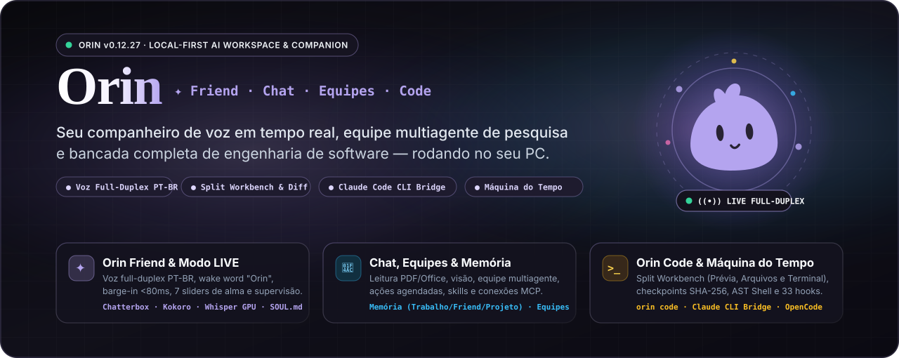
</picture>

<br/>


# Orin `v0.12.5`

**Companheiro de voz, equipe de agentes especialistas e bancada de engenharia de software — rodando no seu computador, com as assinaturas que você já tem.**

[](https://github.com/carlos-edu2367/orin/releases/latest)
[](#arquitetura)
[](#assinaturas-claude-codex-e-antigravity)
[](#agentes-especialistas)
[](LICENSE)

[**Download**](#download-e-instalação) ·
[**Novidades da v0.12**](#novidades-da-v012) ·
[**Agentes especialistas**](#agentes-especialistas) ·
[**Tour visual**](#tour-visual) ·
[**Orin Code & CLI**](#orin-code-web-desktop-e-terminal) ·
[**Provedores**](#modelos-e-provedores) ·
[**Arquitetura**](#arquitetura)

<br/>

<table>
  <tr>
    <td align="center" width="33%">
      <a href="https://github.com/carlos-edu2367/orin/releases/latest/download/OrinSetup.exe">
        <picture>
          <source media="(prefers-color-scheme: dark)" srcset="docs/images/readme/download-windows-dark.svg">
          <source media="(prefers-color-scheme: light)" srcset="docs/images/readme/download-windows-light.svg">
          
        </picture>
      </a>
    </td>
    <td align="center" width="33%">
      <a href="#linux-debian--ubuntu-x64">
        <picture>
          <source media="(prefers-color-scheme: dark)" srcset="docs/images/readme/download-linux-dark.svg">
          <source media="(prefers-color-scheme: light)" srcset="docs/images/readme/download-linux-light.svg">
          
        </picture>
      </a>
    </td>
    <td align="center" width="33%">
      <a href="#no-terminal-orin-code">
        <picture>
          <source media="(prefers-color-scheme: dark)" srcset="docs/images/readme/download-cli-dark.svg">
          <source media="(prefers-color-scheme: light)" srcset="docs/images/readme/download-cli-light.svg">
          
        </picture>
      </a>
    </td>
  </tr>
</table>

</div>

---

## O que é o Orin?

**Orin** é um workspace de agentes de IA *local-first* para **Windows** e **Linux**: interface web, aplicativo **Desktop (Electron)** e terminal **`orin code`**, todos sobre o mesmo motor durável. Em vez de alternar entre um chat genérico, um editor isolado e um assistente de voz separado, você tem três experiências no mesmo lugar:

| | Experiência | Em uma frase |
| :---: | :--- | :--- |
| ✦ | **Orin Friend & Modo LIVE** | Um companheiro com identidade própria (`SOUL.md`), memória afetiva e conversa por voz em tempo real em português, com *wake word* `"Orin"` e interrupção instantânea. |
| 💬 | **Orin Chat & Agentes** | Lê documentos, pesquisa na web, gera mídia e monta uma **equipe de agentes especialistas** — cada um no provedor e modelo que você escolher. |
| `>_` | **Orin Code** | Bancada de engenharia ao lado do chat: prévia ao vivo, arquivos e diffs, terminal, **Máquina do Tempo** e paridade com o `claude-agent-sdk`. |

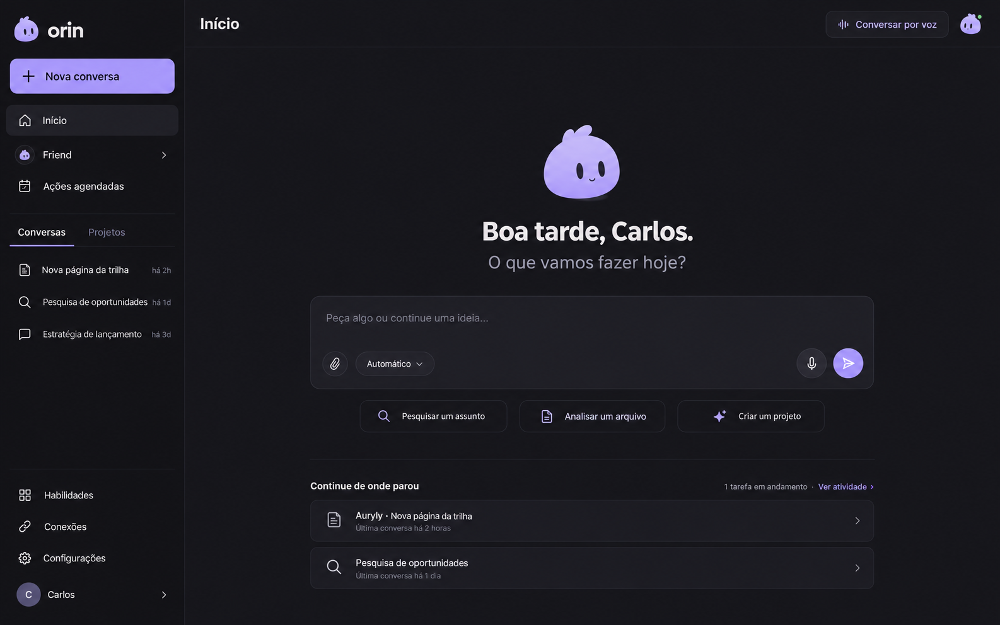
*Home do Orin: saudação contextual, composer unificado com permissão e voz, atalhos rápidos e "Continue de onde parou".*

---

## Novidades da `v0.12`

> [!TIP]
> A série `0.12` transforma o Orin num **orquestrador de assinaturas**: Claude, Codex e Antigravity trabalham juntos na mesma tarefa, cada agente no modelo certo, sem pagar API por token.

| Área | O que mudou |
| :--- | :--- |
| 🧠 **Agentes especialistas** | Subagentes agora chamam outros subagentes (**árvore de até 3 níveis**, configurável), com o pai real registrado, permissões que nunca crescem descendo a árvore e cancelamento em cascata. |
| 🎯 **Provedor e modelos por agente** | Cada agente declara `provider` e uma lista de `models`. Ele **só roda neles** — nunca cai no modelo de quem chamou — e tenta o próximo da lista se um falhar. |
| 📚 **Biblioteca › Agentes** | Nova tela para criar agentes por usuário do Orin (vale no chat, sem pasta e em modo servidor), com catálogo de modelos do provedor, padrão e opções avançadas. |
| `@` **Menção de agente** | Digite `@nome-do-agente` no composer: o `@` sugere seus agentes antes dos arquivos e o Orin delega a ele. |
| 🔌 **Codex e Antigravity por assinatura** | Novos adaptadores para **OpenAI Codex CLI** e **Google Antigravity (`agy`)**, ao lado do Claude Code CLI, todos com as ferramentas do Orin via MCP e isolamento completo. |
| 🚦 **Fila justa de CLIs** | Processos de CLI compartilham uma fila por conversa com proteção de memória; a interface mostra *"aguardando vaga"* e um agente que espera outro libera a própria vaga. |
| 🛠️ **Orin Code** | Conjunto central de ferramentas com carregamento sob demanda (`ToolSearch`), `Read` de 2000 linhas com orçamento de tokens, lint só das linhas alteradas e aviso **"não verificado"** quando um turno termina sem checagens. |
| ⬆️ **Atualização em um reinício** | A atualização roda fora do launcher, reconcilia tentativas interrompidas e sempre reabre o Orin; no Linux, o atalho do menu é criado automaticamente. |

---

## Agentes especialistas

Peça uma tarefa grande e o agente principal distribui as partes para especialistas — que podem, por sua vez, chamar os próprios especialistas. Cada nó da árvore roda no provedor e no modelo definidos para ele.

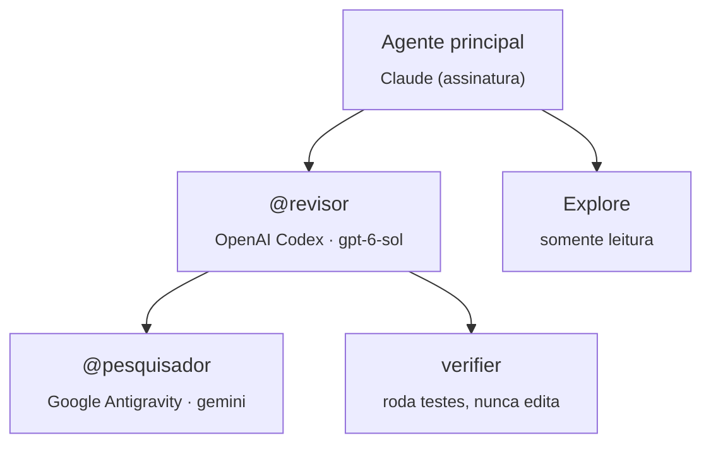

**Como criar um agente**

- **Pela interface:** clique em **Biblioteca** na barra lateral e abra a aba **Agentes**. Comece do zero ou de um modelo pronto (revisor, pesquisador, testador), escolha o provedor e marque os modelos permitidos. Com um modelo só, o agente roda direto nele; com vários, quem chama escolhe um, e a ordem da lista vale para o fallback.
- **Por arquivo** (formato do Claude Code, em `.orin/agents/` ou `.claude/agents/`):

```markdown
---
name: revisor
description: Revisa o diff antes do commit e aponta bugs
provider: openai-codex
models: [gpt-6-sol, gpt-6-luna]
tools: Read, Grep, Glob
maxTurns: 12
---
Revise o diff, aponte bugs com caminho:linha e não altere arquivos.
```

<details>
<summary><b>Regras que o Orin garante</b></summary>

- **Escolha do modelo:** com vários modelos e nenhum escolhido, a chamada é recusada com a lista (`CHILD_MODEL_REQUIRED`); um modelo fora da lista também é recusado.
- **Autorização:** o provedor precisa estar ligado para você (Antigravity só após o aceite de risco) e o modelo precisa estar no catálogo dele. Não precisa ser favorito.
- **Fallback:** só dentro da lista do agente. Se nenhum modelo subir, o erro é claro (`CHILD_MODELS_UNAVAILABLE`).
- **Árvore:** profundidade padrão 3 (`subagentMaxDepth`; um repositório só pode diminuir). Explore e Plan nunca delegam, e o filho de um agente somente leitura também é somente leitura.
- **Posse:** um subagente só inspeciona, retoma ou para os próprios descendentes; o principal enxerga todos. Times (*teammates*) ficam no agente principal.
- **Precedência:** agentes da política gerenciada e do repositório mantêm o nome; os da Biblioteca valem acima dos seus arquivos e dos plugins.

</details>

---

## Tour Visual

<details open>
<summary><b>1. Início & Boas-Vindas</b></summary>

| Tela Inicial | Boas-Vindas em 4 passos |
| :---: | :---: |
|  | 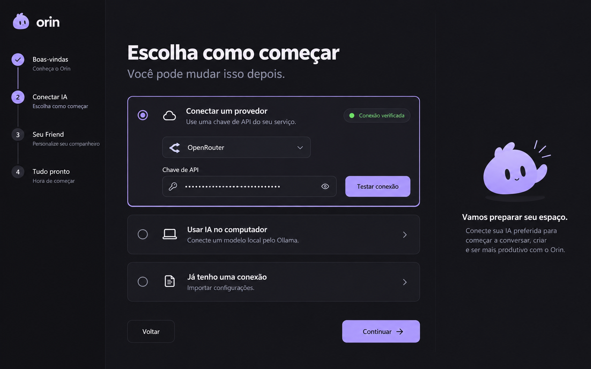 |
| *Saudação contextual, mascote interativo, sugestões rápidas e retomada de sessões.* | *Escolha seu nome, conecte seu modelo preferido e comece em segundos.* |

</details>

<details open>
<summary><b>2. Orin Friend & Voz LIVE Full-Duplex</b></summary>

O **Orin Friend** mantém uma linha contínua de convivência, evolui o vínculo com o tempo (*Conhecido → Parceiro → Amigo Próximo → Confidente*) e conversa com você por voz em tempo real.

| Palco de Voz (`Friend · Ao vivo`) | Personalização "Caixa de Vidro" |
| :---: | :---: |
| 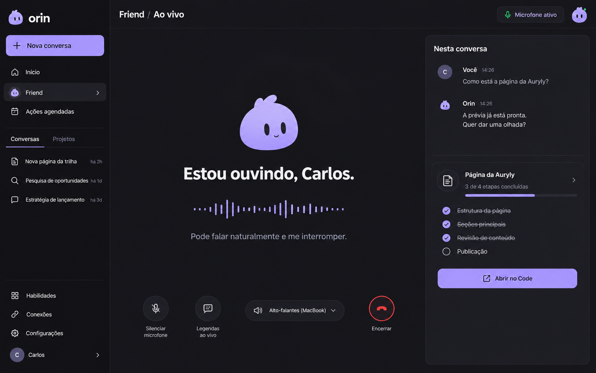 | 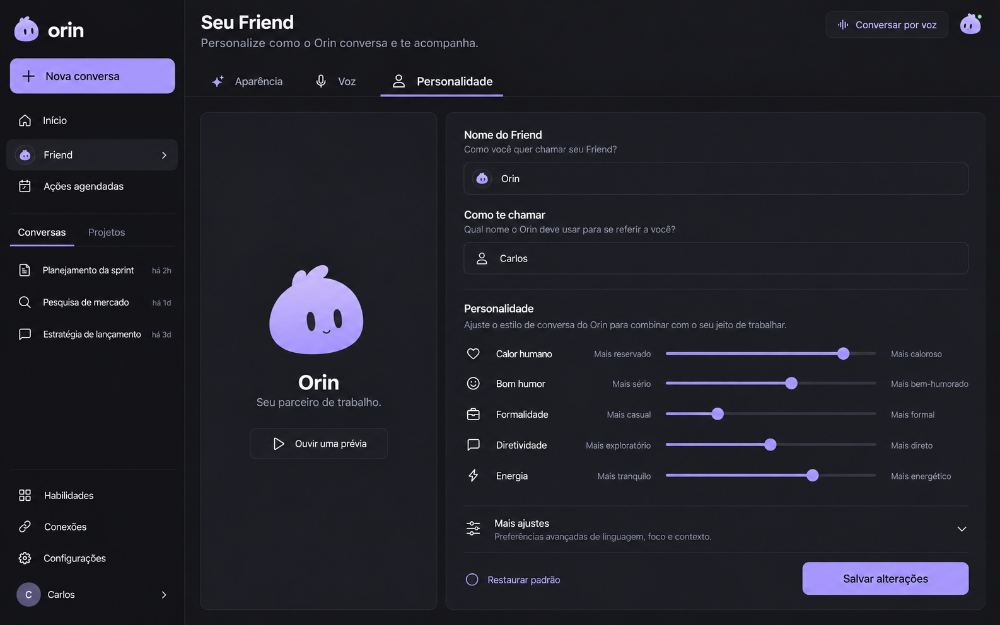 |
| *Voz em PT-BR com legenda ao vivo, wake word e acompanhamento do Orin Code em segundo plano.* | *Aparência, voz e 7 dimensões de personalidade com prévia instantânea.* |

- **Wake word `"Orin"` em 3 camadas:** Silero VAD (32 ms), OpenWakeWord com filtro fonético multi-sotaque e confirmação por Whisper local, com *cooldown* para nunca disparar com a própria voz.
- **Vozes neurais locais em 1 clique:** Chatterbox Multilingual (GPU) e Kokoro 82M ONNX (CPU/GPU, vozes PT-BR), ou OpenRouter Audio e OpenAI TTS.
- **Barge-in `<80ms`:** comece a falar e o Orin para na hora; o histórico guarda só o que você de fato ouviu.
- **Supervisão do Orin Code por voz:** o Orin avisa quando um teste passa ou quando precisa da sua aprovação.

</details>

<details open>
<summary><b>3. Chat Multimodal & Atividade em Equipe</b></summary>

| Chat, Memória Inline & Fila | Atividade em Equipe |
| :---: | :---: |
| 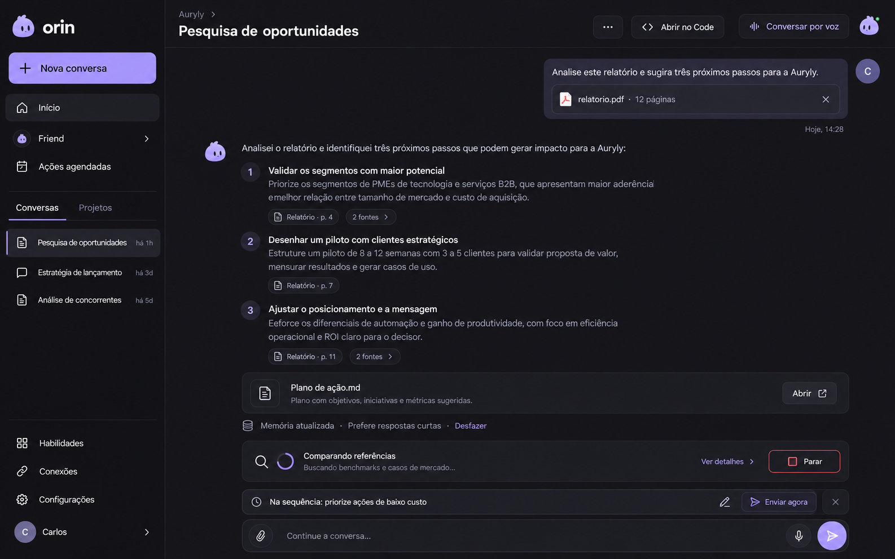 | 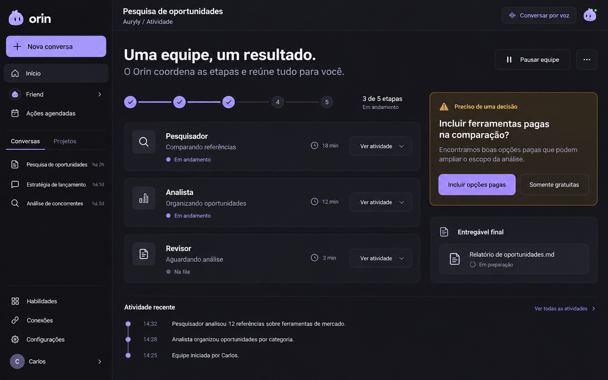 |
| *PDFs e planilhas, card "Memória atualizada · Desfazer" e fila de mensagens com envio imediato.* | *Cada especialista com seu progresso; subagentes chamados por outro aparecem recuados sob ele.* |

</details>

<details open>
<summary><b>4. Orin Code Split Workbench & Máquina do Tempo</b></summary>

| Bancada Dividida | Máquina do Tempo |
| :---: | :---: |
| 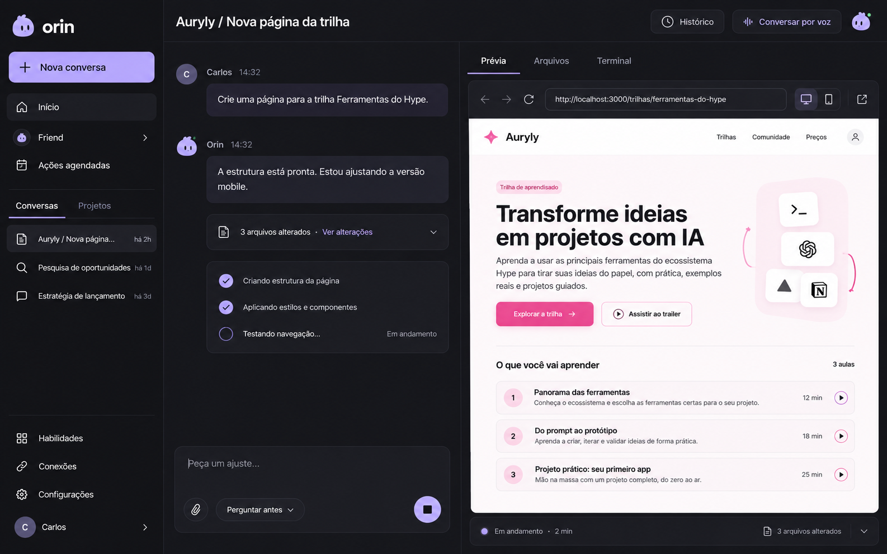 | 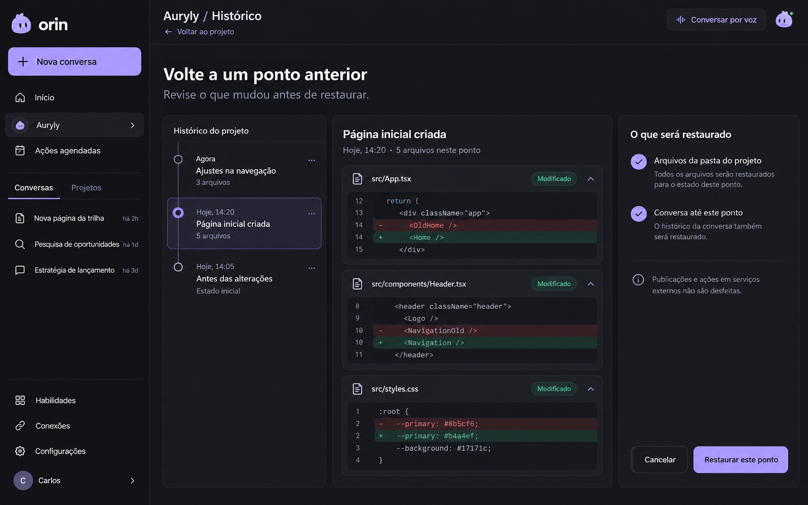 |
| *Conversa à esquerda; **Prévia**, **Arquivos/Diffs** e **Terminal** à direita.* | *Checkpoints SHA-256 com `+adicionadas / -removidas` e restauração em 1 clique.* |

</details>

<details>
<summary><b>5. Projetos, Rotinas, Memória, Skills & Conexões</b></summary>

| Galeria de Projetos | Dashboard do Projeto |
| :---: | :---: |
| 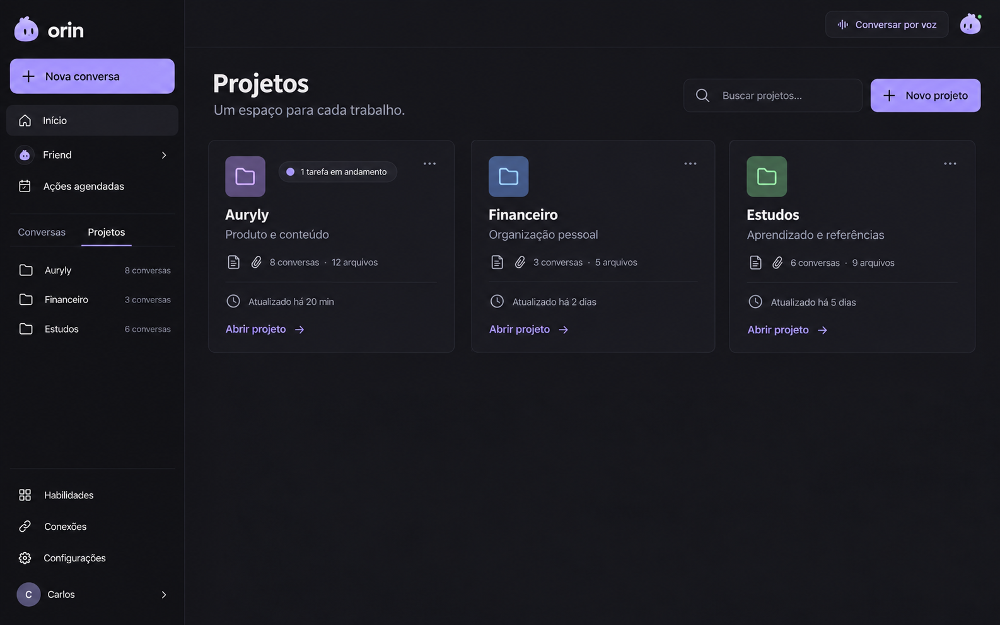 | 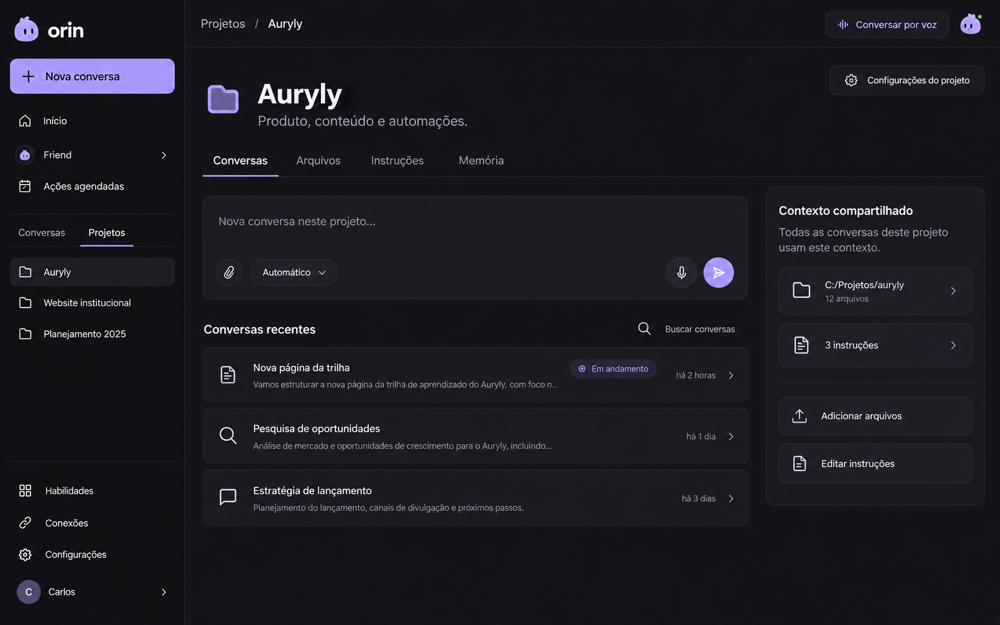 |

| Ações Agendadas | Memória (`Trabalho · Friend · Projeto`) |
| :---: | :---: |
| 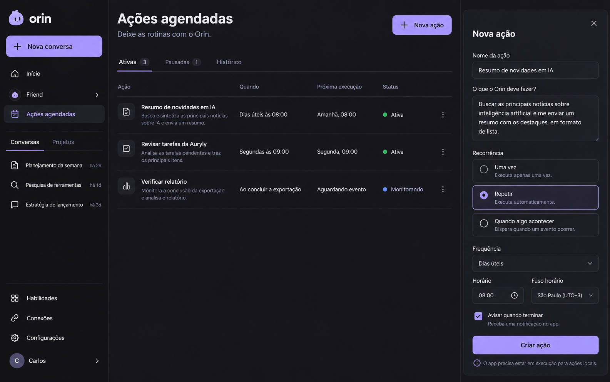 | 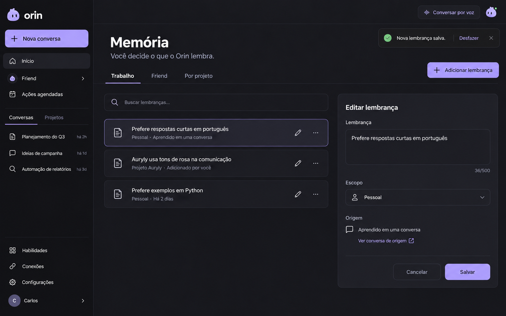 |

| Habilidades (`Skills`) | Conexões (`MCP, Navegador & Arquivos`) |
| :---: | :---: |
| 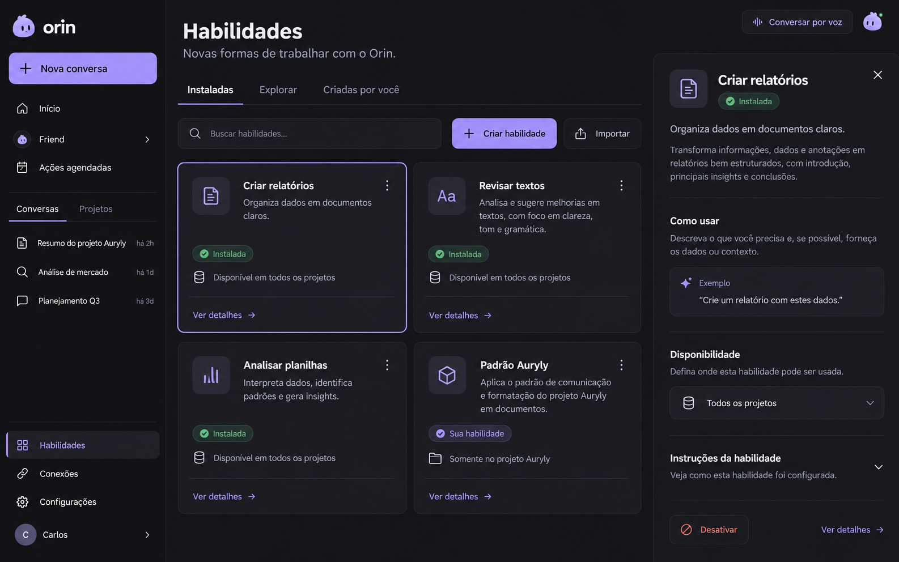 | 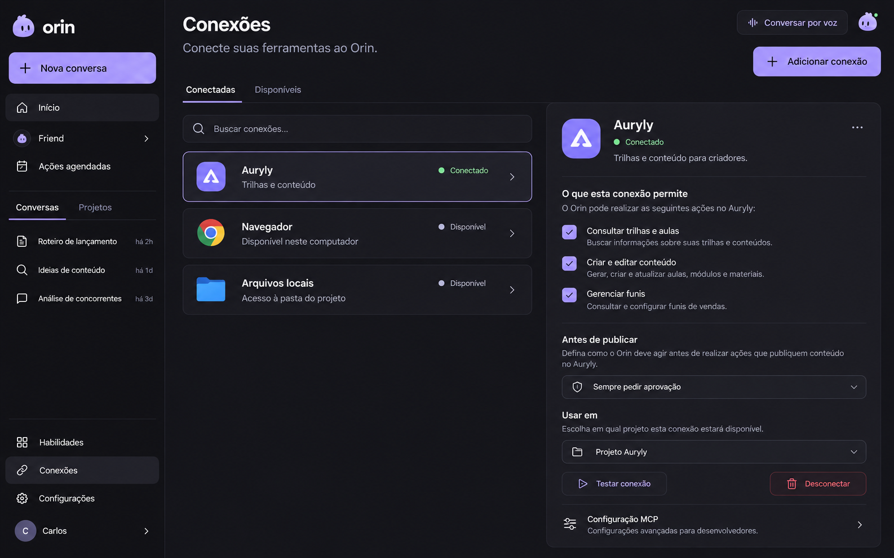 |
| *Ative habilidades prontas ou crie novas em linguagem simples.* | *GitHub, Google Drive, Slack, Postgres e navegador via **Playwright MCP** (`@playwright/mcp`), com aprovação antes de publicar.* |

</details>

<details>
<summary><b>6. Modelos, Provedores & Segurança</b></summary>

| Modelos, Provedores & Custos | Segurança & Permissões |
| :---: | :---: |
| 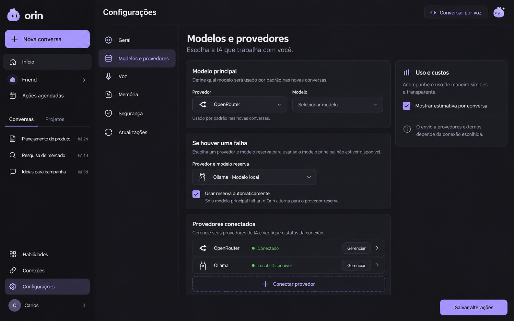 | 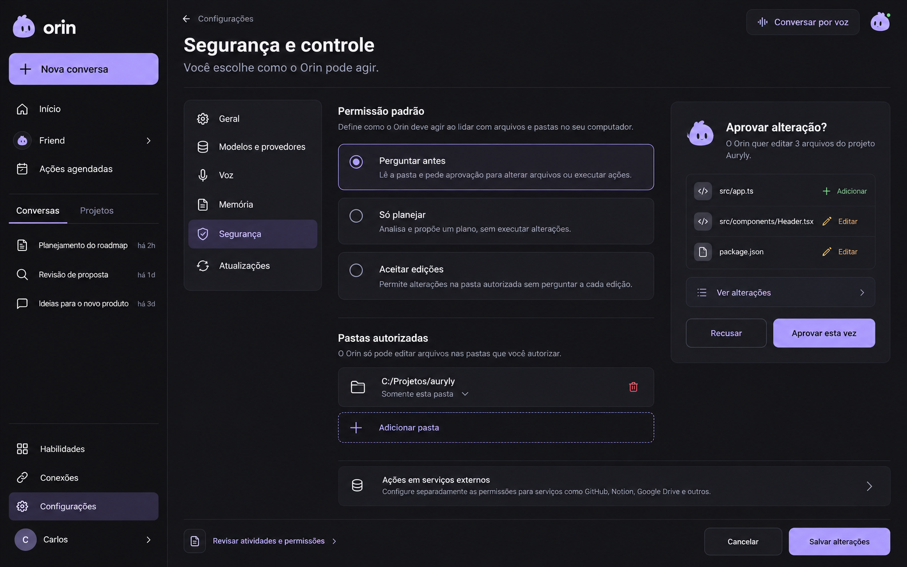 |
| *Modelo principal, reserva automática e gastos do mês com alerta de limite.* | *Comportamento padrão, pastas autorizadas e regras por serviço externo.* |

</details>

---

## Modelos e Provedores

O Orin é agnóstico de provedor: combine modelos locais gratuitos com modelos de ponta, use as assinaturas que você já paga e configure *fallback* automático.

### Assinaturas: Claude, Codex e Antigravity

| Provedor | Como funciona | Observação |
| :--- | :--- | :--- |
| **Anthropic · Claude Code CLI** | Usa o `claude` já logado (Pro/Max), com catálogo de modelos dinâmico. | Também aceita chave `sk-ant-…`. |
| **OpenAI Codex (assinatura)** | Usa o `codex exec` logado com ChatGPT. Delegação nativa do Codex desligada; ele delega só pelo Orin. | Sem ler `auth.json`. |
| **Google Antigravity (assinatura)** | Usa o `agy` logado. Ferramentas e subagentes nativos bloqueados. | Exige aceite de risco explícito. |

Nos três, as ferramentas do Orin chegam ao modelo por um servidor MCP local com token próprio; as ferramentas nativas de cada CLI ficam desligadas, e qualquer tentativa de usá-las encerra o turno.

### APIs e modelos locais

| Provedor | Destaque |
| :--- | :--- |
| **OpenAI** | GPT, modelos de raciocínio, imagem, áudio e TTS. |
| **OpenRouter** | Centenas de modelos de texto, visão, imagem, áudio e vídeo com uma chave. |
| **Ollama** (local e cloud) | 100% offline na sua GPU/CPU, inclusive embeddings para busca semântica. |
| **NVIDIA NIM** | Inferência acelerada em nuvem ou auto-hospedada. |
| **OpenCode** | Bridge local gratuita (`opencode serve`) e OpenCode Zen. |
| **OmniRoute** | Roteador local com *failover* entre contas, chaves e modelos gratuitos. |

---

## Download e Instalação

Cada release publica pacotes para **Windows (x64)** e **Linux (x64)** com runtime Python, interface, aplicativo Desktop e SQLite — **sem exigir Python, Node.js, Docker, PostgreSQL ou Redis**.

### Windows

Baixe e abra o **[OrinSetup.exe](https://github.com/carlos-edu2367/orin/releases/latest/download/OrinSetup.exe)**. A janela mostra versão, local e progresso (download, verificação SHA-256 e auto-teste) e termina com **Abrir o Orin**. Não pede administrador: instala no seu usuário, cria atalhos e adiciona `orin` e `orin-code` ao `PATH`.

> [!NOTE]
> Sem certificado EV, o Windows SmartScreen pode avisar na primeira execução: **Mais informações → Executar assim mesmo**. O instalador confere o SHA-256 de cada pacote contra o manifesto da release.

```powershell
# Em uma linha
irm https://github.com/carlos-edu2367/orin/releases/latest/download/install.ps1 | iex

# Silencioso / automação
OrinSetup.exe --silent [--dir C:\Orin] [--to 0.12.5] [--no-shortcut] [--no-path]
```

### Linux (Debian / Ubuntu x64)

```bash
curl -fsSL https://github.com/carlos-edu2367/orin/releases/latest/download/install.sh | bash
```

Sem `sudo`: instala em `~/.local/share/Orin/versions` e `~/.local/bin/orin`, confere o SHA-256, testa a versão nova antes de promovê-la e cria o atalho no menu de aplicativos.

<details>
<summary><b>Comandos do launcher (<code>orin</code>)</b></summary>

```bash
orin                         # Inicia os serviços locais e abre a interface
orin --desktop               # Abre o Orin na janela nativa Electron
orin --desktop --background  # Inicia minimizado na bandeja
orin status                  # Saúde da API, workers, scheduler e banco
orin logs [--follow]         # Logs unificados
orin restart | stop          # Reinicia ou encerra os serviços locais
orin autostart on|off|status # Início automático ao fazer login
orin update                  # Atualiza (--check, --to, --rollback)
orin code [prompt]           # Sessão Orin Code no repositório atual
orin serve                   # Modo servidor multiperfil (requer ORIN_PUBLIC_URL)
orin --uninstall             # Remove a instalação do usuário
```

</details>

---

## Orin Code (Web, Desktop e Terminal)

O **Orin Code** trabalha direto no seu repositório Git, no **Split Workbench** da interface ou no terminal.

### No terminal (`orin code`)

```bash
orin code "Refatore o módulo de autenticação e adicione testes"

# Headless (-p) em text, json ou stream-json
orin code -p "Rode a suíte de testes e resuma as falhas" --output-format text

# Continuar (-c), retomar (-r) ou rodar em segundo plano (--bg)
orin code -c -p "Agora corrija o caso de borda encontrado"
orin code -p "Execute a migração completa" --bg
```

<details>
<summary><b>Mais subcomandos</b></summary>

```bash
orin code mcp list | get | add | add-json | remove | reset-project-choices | serve
orin code plugin list | install | uninstall | enable | disable | validate | details | configure
orin code plugin marketplace add | list | remove | update
orin code agents [--json]
orin code logs <id> [-f] | attach <id> | stop <id> | rm <id>
orin code auto-mode config | defaults | reset | critique
orin code doctor
```

</details>

### Compatibilidade com `claude-agent-sdk`, `.orin` e `.claude`

- **Protocolo SDK:** `stream-json` bidirecional com `control_request`/`control_response` (`initialize`, `can_use_tool`, `hook_callback`, `mcp_message`, `interrupt`, `rewind_files`, `set_model`, `set_permission_mode`) — use o **`claude-agent-sdk`** com `cli_path="orin-code"`.
- **Ferramentas nativas:** `Bash`, `PowerShell`, `Read`, `Edit`, `Write`, `Glob`, `Grep`, `SearchCode`, `ProjectMap`, `WebSearch`, `WebFetch`, `Agent`, `SendMessage`, `TodoWrite`, `EnterPlanMode`, `EnterWorktree`, `ToolSearch`, `Skill` e outras, com carregamento sob demanda.
- **33 eventos de Hooks** (`PreToolUse`, `PostToolUse`, `SubagentStart`, `SubagentStop`, `PreCompact`, `TeammateIdle`…) com handlers `command`, `http`, `prompt` e `agent`.
- **Memória em arquivo:** `ORIN.md`, `CLAUDE.md`, `.orin/rules/*.md`, `.claude/rules/*.md` e `ORIN.local.md`, com imports `@caminho`.

---

## Arquitetura

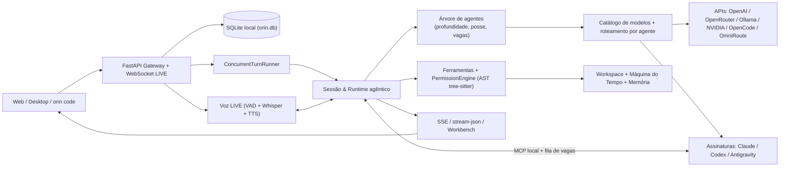

<details>
<summary><b>Estrutura do repositório</b></summary>

```text
src/agentos/
├── api/                 # Gateway FastAPI, REST, SSE, WebSocket de voz e /v1/custom-agents
├── agentic/             # Sessão, runtime, ferramentas, árvore de subagentes e definições de agentes
├── providers/           # Adaptadores de CLI (Claude, Codex, Antigravity), fila de vagas e servidor MCP de ferramentas
├── provider_catalog/    # Catálogo de modelos, preços e bridges
├── live/                # Pipeline de voz: VAD, wake word, Whisper, Chatterbox, Kokoro e barge-in
├── friend/              # Orin Friend: SOUL.md, vínculo e memória afetiva
├── cli_code/            # `orin code` / `orin-code` e protocolo `claude-agent-sdk`
├── permissions/         # Modos de permissão, parser AST de shell e Workspace Trust
├── hooks/  settings/    # 33 eventos de hooks e settings em 5 camadas (.orin e .claude)
├── mcp/  plugins/       # Cliente MCP, OAuth 2.1 PKCE, plugins e marketplaces
├── skills/  lsp/        # Skills em disco e diagnósticos de Language Server
├── persistence/         # SQLAlchemy + Alembic (Postgres e SQLite), incluindo user_agents
├── retrieval/           # Busca semântica local + BM25
├── workers/             # Workers de conversa e agendador de rotinas
└── launcher/            # CLI `orin`, processos, auto-update e instaladores
frontend/                # SPA React 19 + TypeScript + Vite
desktop/                 # Aplicativo Electron (bandeja e autostart)
docs/                    # Guias, ADRs e runbooks
```

</details>

---

## Segurança e Privacidade

- **Seus dados ficam com você:** conversas, memórias, checkpoints e índices ficam no SQLite local. Só saem as chamadas aos modelos e integrações que você acionar.
- **Segredos cifrados:** chaves de API e tokens OAuth cifrados com Fernet, *write-only* na API e redigidos dos logs.
- **Seis modos de permissão:** `default` (pergunta antes), `acceptEdits`, `plan` (só planeja), `auto`, `dontAsk` e `bypassPermissions`, escolhidos no composer; um subagente nunca recebe mais permissão que quem o chamou.
- **CLIs isolados:** cada CLI roda sem as ferramentas nativas, com ambiente limpo e token próprio para o servidor de ferramentas do Orin.
- **Shell analisado por AST (*fail-closed*):** comandos `Bash` e `PowerShell` passam por `tree-sitter`; construções ambíguas ou toques em `.git/`, `.orin/`, `.claude/` e `.env*` pedem confirmação.
- **Workspace Trust:** configurações de repositórios clonados (`.mcp.json`, hooks, agentes do projeto) só valem depois que você confia na pasta.

---

## Desenvolvimento

Requisitos: **Python 3.12+**, **[uv](https://docs.astral.sh/uv/)** e **Node.js 22+**.

```bash
uv sync --frozen --all-groups                               # ambiente Python
npm --prefix frontend ci && npm --prefix frontend run build # frontend
uv run orin                                                 # Orin completo a partir do código

uv tool install --editable .                     # `orin` e `orin-code` apontando para o checkout
npm --prefix frontend run dev -- --host 127.0.0.1  # frontend com hot reload
```

### Testes

```bash
uv run pytest -q tests/unit                  # backend
uv run pytest -q tests/integration/cli_code  # conformidade do Orin Code e do protocolo SDK
npm --prefix frontend test                   # unitários do frontend
npm --prefix frontend run lint
npm --prefix frontend run build
npm --prefix frontend run test:e2e           # Playwright
```

> [!TIP]
> No **Node 26**, o `localStorage` nativo do Node quebra os testes do frontend. Rode com `NODE_OPTIONS=--no-experimental-webstorage`.

---

## Documentação

| Guia | Conteúdo |
| :--- | :--- |
| [`VISAO_GERAL.md`](VISAO_GERAL.md) | Visão completa do produto |
| [`DESIGN.md`](DESIGN.md) | Sistema de design e direção visual |
| [`docs/ORIN_CODE.md`](docs/ORIN_CODE.md) | Orin Code, CLI, permissões, hooks, agentes e settings |
| [`docs/LAUNCHER.md`](docs/LAUNCHER.md) | Launcher, Desktop, bandeja e auto-update |
| [`docs/MCP.md`](docs/MCP.md) | Conectores MCP, lazy loading, OAuth e `mcp serve` |
| [`docs/PLUGINS.md`](docs/PLUGINS.md) | Plugins, hooks, LSP e marketplaces |
| [`docs/CREATING_SKILLS.md`](docs/CREATING_SKILLS.md) | Criação de Skills |
| [`docs/RETRIEVAL.md`](docs/RETRIEVAL.md) | Busca semântica e embeddings locais |
| [`docs/OMNIROUTE.md`](docs/OMNIROUTE.md) | Roteamento com OmniRoute |
| [`docs/SERVER.md`](docs/SERVER.md) | Modo servidor multiperfil |

---

<div align="center">

Distribuído sob a [Licença MIT](LICENSE).

</div>
