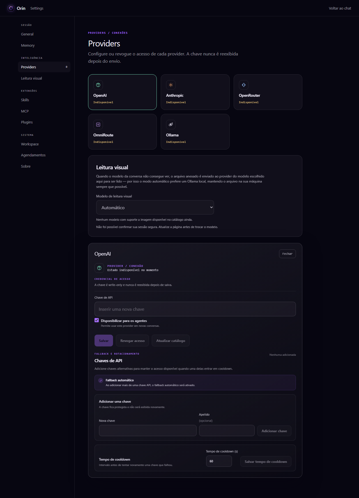
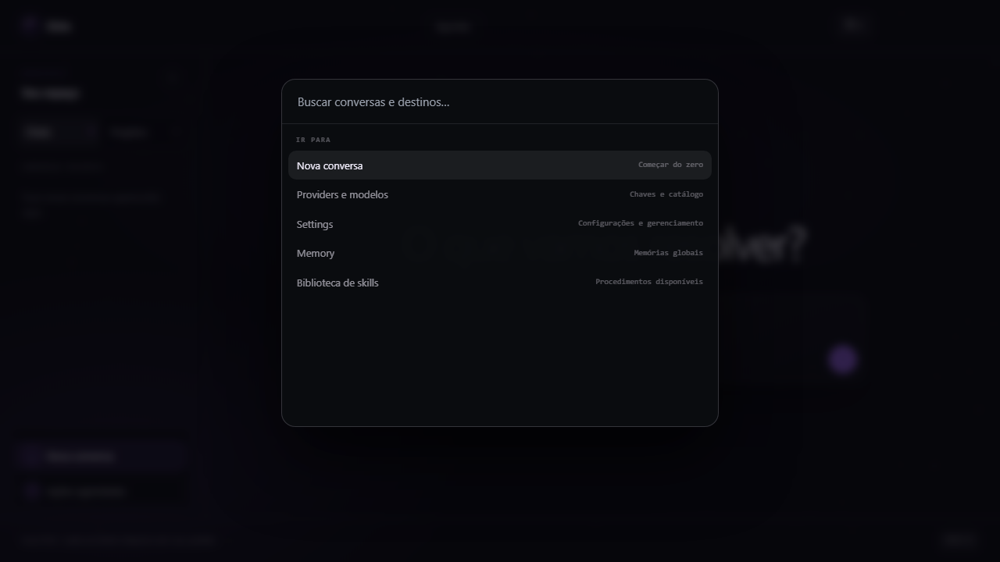
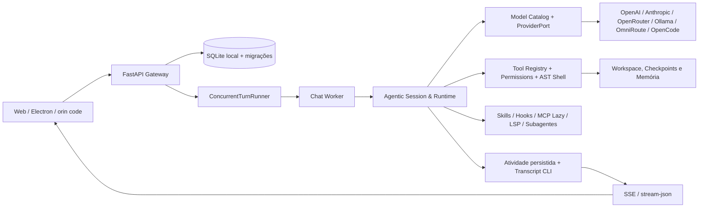

# Orin

## Seu workspace local-first para transformar pedidos em execução visível

Orin é um workspace de agentes de IA orientado a conversas, projetos, engenharia de software (**Orin Code**) e execução rastreável. Você descreve o que precisa — pela interface web, pelo aplicativo Desktop (Electron) ou pelo terminal (`orin code`) —, acompanha decisões, ferramentas, diffs e subagentes em tempo real e mantém o contexto organizado no seu próprio computador.

Ele combina **Orin Chat** e **Orin Code** no mesmo motor durável: ferramentas tipadas para arquivos e shell com análise sintática (`tree-sitter`), busca semântica no código, checkpoints por edição com *rewind*, memória que aprende com o uso, multiagentes e *teams*, Skills em disco e no banco, Hooks (33 eventos), MCP com carregamento *lazy*, LSP, geração de mídia e múltiplos provedores de modelos.

[Instalar (Windows e Linux)](#download-e-instalação) · [Orin Code e CLI](#orin-code-web-desktop-e-cli-headless) · [Ver releases](https://github.com/carlos-edu2367/orin/releases) · [Arquitetura](#arquitetura)

> Status: projeto ativo em desenvolvimento (`v0.9.x`). O perfil local é adequado para uso local; não é uma declaração de prontidão para produção irrestrita ou de auditoria de segurança completa.


*A conversa é o ponto de partida: projeto, modo (Chat ou Code), contexto e ações ficam próximos do pedido.*

## Por que usar o Orin?

- **Execução visível e concorrente:** rode múltiplas sessões (Chat e Code) em paralelo, acompanhe ferramentas, subagentes, diffs inline, tempo trabalhado e custo estimado em USD. A ação de parar ou enfileirar mensagens fica disponível durante toda a execução.
- **Dois modos especializados no mesmo motor:** use **Orin Chat** para pesquisa, documentos, mídia e orquestração geral — com sugestão interativa para abrir sessões no **Orin Code** (`ProposeCodeSession`) — ou entre direto no **Orin Code** (na interface ou via `orin code` no terminal/SDK) para engenharia de software sem tetos artificiais de iteração.
- **Local-first:** conversas, turnos, checkpoints de arquivos, memória e índices semânticos ficam no ambiente local (SQLite). Somente chamadas aos provedores ou servidores remotos que você configurar saem da máquina.
- **Liberdade de provedor e modelo:** suporte nativo a **OpenAI**, **Anthropic**, **OpenRouter**, **Ollama (Local e Cloud)**, **OmniRoute** e **OpenCode** (incluindo *Bridge Local* gratuita via `opencode serve` compartilhando o harness e as ferramentas do Orin, além do OpenCode Zen Cloud).
- **Segurança em camadas e permissões granulares:** 6 modos de permissão (`default`, `acceptEdits`, `plan`, `auto`, `dontAsk`, `bypassPermissions`), avaliação de comandos shell por AST (`tree-sitter-bash` e `tree-sitter-powershell`, *fail-closed*), proteção de dotfiles/caminhos críticos e **Workspace Trust** antes de ativar configurações de repositórios locais.
- **Aprende com o uso:** correções suas e falhas de comando resolvidas viram memória durável, tipada e rastreável — somadas à hierarquia de memória em arquivo (`ORIN.md` / `CLAUDE.md`, `.orin/rules/*.md` e imports `@caminho`).
- **Instalação simples:** as releases para Windows e Linux já incluem runtime e SQLite; não exigem Python, Node.js, Docker, PostgreSQL ou Redis.
- **Extensível e interoperável:** compatível com convenções `.orin` e `.claude` (settings em 5 camadas, Skills, subagentes em arquivo, plugins `.orin-plugin`/`.claude-plugin`, `.mcp.json`, `.lsp.json` e `claude-agent-sdk`).

## Veja o Orin em ação

### Configure seus provedores

O Orin organiza os provedores em um catálogo visual, separa conexões locais e em nuvem e mostra o estado de cada integração.


As credenciais são armazenadas criptografadas (Fernet) e os campos de chave são *write-only*. Ao cadastrar mais de uma chave de API, o fallback automático entre chaves e a cadeia de `fallbackModel` mantêm o fluxo resiliente.



### Acesse ações rapidamente

O command palette concentra navegação, conversas, projetos e ações frequentes sem tirar o foco do trabalho.



## Download e instalação

Cada release publica pacotes independentes para **Windows** e **Linux (x64)**. Os dois incluem runtime e SQLite, sem exigir Python, Node.js nem Docker instalados.

### Windows

Baixe e abra o **[OrinSetup.exe](https://github.com/carlos-edu2367/orin/releases/latest/download/OrinSetup.exe)**. Uma janela mostra a versão, o local de instalação e o progresso (download, verificação, testes), e termina com **Abrir o Orin**. Não pede senha de administrador: instala só para o seu usuário, cria os atalhos, adiciona o comando `orin` ao terminal e registra o Orin em *Aplicativos instalados*. Rodar de novo atualiza ou repara a instalação.

> Enquanto o instalador não for assinado digitalmente, o Windows SmartScreen pode avisar na primeira execução: clique em **Mais informações → Executar assim mesmo**. O instalador confere o SHA-256 de tudo o que baixa.

Para automação, sem janela: `OrinSetup.exe --silent [--dir C:\Orin] [--to 0.9.6] [--no-shortcut] [--no-path]`.

Prefere o terminal?

```powershell
irm https://github.com/carlos-edu2367/orin/releases/latest/download/install.ps1 | iex
```

### Linux (Debian/Ubuntu)

```bash
curl -fsSL https://github.com/carlos-edu2367/orin/releases/latest/download/install.sh | bash
```

Os comandos de uma linha baixam o instalador da release (`OrinSetup.exe` / `OrinSetup-linux-x64`) e o executam em modo texto. Ele:

1. baixa a release estável mais recente;
2. valida o hash SHA-256 dos artefatos;
3. testa o programa novo antes de ativá-lo (e volta atrás se algo falhar);
4. instala o runtime local;
5. cria os atalhos (Área de Trabalho e menu Iniciar no Windows; entrada no menu de aplicativos no Linux);
6. disponibiliza os comandos `orin` e `orin-code`.

O instalador nunca executa comandos privilegiados: no Linux ele não chama `apt` nem pede `sudo`, e instala tudo no seu usuário — runtime em `~/.local/share/Orin/versions`, comando em `~/.local/bin/orin`. Se `~/.local/bin` não estiver no seu `PATH`, ele imprime a linha exata para adicionar, em vez de editar seus dotfiles sozinho.

Abra um novo terminal e inicie o workspace:

```bash
orin
```

O launcher prepara o SQLite local, executa as migrações, inicia a API, os workers, o scheduler e a interface web. Em seguida, aguarda as verificações de prontidão e abre o navegador.

Comandos úteis do launcher (idênticos nas duas plataformas):

```bash
orin status                  # mostra o estado dos serviços
orin logs [--follow]         # acompanha os logs (launcher, backend, worker, scheduler)
orin restart                 # reinicia o perfil local
orin stop                    # encerra os serviços
orin --desktop               # abre a aplicação na janela Electron
orin --desktop --background  # inicia minimizado na bandeja do sistema (tray)
orin autostart on|off|status # configura início automático em segundo plano ao logar
orin update                  # instala a release verificada mais recente (--check, --to, --rollback)
orin --uninstall             # remove a instalação (pede confirmação; --yes para automação)
orin code [prompt]           # abre ou executa uma sessão Orin Code (veja seção abaixo)
orin serve                   # sobe no modo servidor multiperfil (requer ORIN_PUBLIC_URL)
```

`orin update` baixa a versão nova ao lado da atual, confere o SHA-256, testa o programa novo e só então troca; se a versão nova não iniciar, volta sozinho para a anterior (`orin update --rollback` desfaz uma atualização manualmente). No app, a atualização baixa em segundo plano e pede só um clique em **Reiniciar para atualizar**.

As versões e os artefatos verificados por hash ficam na página de [releases do Orin](https://github.com/carlos-edu2367/orin/releases).

> **Automação de navegador via Playwright MCP (opcional).** O Orin utiliza o servidor oficial **Playwright MCP** (`@playwright/mcp`) para navegação e testes visuais pelo agente. Para habilitá-lo com um clique, abra **Configurações → Navegador → Instalar Playwright MCP** (requer Node.js / `npx` no ambiente) ou peça ao agente para configurá-lo.

## Orin Code (Web, Desktop e CLI Headless)

O **Orin Code** é o ambiente de engenharia de software do Orin. Uma sessão Code opera diretamente sobre a pasta do seu repositório, sem limites rígidos de iterações por turno, com suporte a *worktrees* Git, checkpoints por edição de arquivo, diagnósticos LSP e paridade de protocolo com o ecossistema Claude Code.

### Na interface (Web / Electron)
- Crie uma sessão **Code** diretamente na tela inicial, dentro de um **Projeto**, ou aceite um card de transferência (**Iniciar no Orin Code**) proposto pelo agente durante uma conversa no Orin Chat.
- Alterne modos de permissão com `Shift+Tab` (`default`, `acceptEdits`, `plan`, `auto`, `dontAsk`, `bypassPermissions`), acompanhe a barra de tarefas (`TodoBar`), revise planos no `PlanApprovalCard` e faça *rewind* de código, conversa ou ambos em qualquer mensagem (`Esc Esc` ou `/rewind`).
- Use **slash commands embutidos** (`/context`, `/compact`, `/rewind`, `/permissions`, `/hooks`, `/agents`, `/mcp`, `/plugin`, `/keybindings`, `/tasks`, `/usage`, `/diff`, `/fork`, `/doctor`, etc.), execute comandos diretos no composer com `!comando` (modo shell sem modelo), referencie arquivos e resources MCP com `@arquivo` / `@servidor:uri`, gerencie a **fila de mensagens** em andamento (com **Enviar agora**) e configure atalhos em `keybindings.json`.
- Edite visualmente em **Configurações** as regras de permissão por camada (com indicação da camada de origem), hooks, subagentes, estilos de saída (`outputStyle`), atalhos de teclado, servidores MCP por escopo e pastas confiáveis (**Workspace Trust**).

### No terminal (`orin code` / `orin-code`)
```bash
# Abre uma sessão Code na interface apontando para a pasta atual
orin code "Refatore o módulo de autenticação e adicione testes"

# Execução headless (-p / --print) nos formatos text, json ou stream-json
orin code -p "Rode a suíte de testes unitários e resuma falhas" --output-format text
orin code -p "Liste endpoints públicos" --output-format json --json-schema '{"type":"object","properties":{"endpoints":{"type":"array"}}}'

# Continuar ou retomar sessões e rodar em background
orin code -c -p "Agora corrija o caso de borda encontrado"
orin code -r <session_id> -p "Continue"
orin code -p "Execute a migração completa" --bg

# Gerenciamento de extensões, agentes, diagnóstico e execução em segundo plano
orin code mcp list | get | add | add-json | remove | reset-project-choices | serve
orin code plugin list | install | uninstall | enable | disable | validate | details | configure
orin code plugin marketplace add | list | remove | update
orin code agents [--json]
orin code logs <id> [-f] | attach <id> | stop <id> | rm <id>
orin code auto-mode config | defaults | reset | critique
orin code doctor
orin code purge [--yes]
```

O binário `orin-code` implementa o protocolo `stream-json` e `control_request`/`control_response` (`initialize`, `can_use_tool`, `hook_callback`, `mcp_message`, `interrupt`, `rewind_files`, `set_model`, `set_permission_mode`), permitindo que o pacote oficial **`claude-agent-sdk`** dirija o Orin apontando `cli_path` para `orin-code`. Consulte [docs/ORIN_CODE.md](docs/ORIN_CODE.md) para todos os detalhes.

## Primeiro fluxo

1. Instale e execute `orin`.
2. Abra **Configurações → Provedores**, configure um provedor (ou ative a Bridge Local do OpenCode / Ollama local) e marque seus modelos favoritos.
3. Crie ou selecione um **Projeto** (ou associe uma pasta local diretamente à conversa) quando quiser operar sobre código ou arquivos.
4. Inicie uma conversa em **Chat** ou **Code** explicando o objetivo, restrições e resultado esperado.
5. Observe o agente analisar contexto, chamar ferramentas em paralelo, consultar memória ou delegar partes do trabalho a subagentes.
6. Revise a atividade, os diffs, o tempo de trabalho (`Trabalhou por...`), o custo estimado em USD (no painel *Visão geral*) e a resposta final.

## Fluxos do Orin

### Conversa e execução concorrente



A API recebe e persiste o pedido. O `ConcurrentTurnRunner` despacha até 8 sessões distintas em paralelo (mantendo serialização FIFO estrita dentro da mesma conversa). O runtime monta o contexto em camadas, aplica o pipeline de permissões e hooks, executa lotes de ferramentas `concurrency_safe` em paralelo e transmite eventos em tempo real por SSE.

### Projetos, sessões e continuidade

Qualquer conversa avulsa (Chat ou Code) pode ser enviada para um **Projeto** existente ou transformada em um novo projeto com um clique no cabeçalho da conversa (ou pelas tools `create_project_from_session` e `move_session_to_project`). Sessões dentro do mesmo projeto compartilham a pasta de trabalho vinculada, as memórias aprendidas e podem consultar o histórico de sessões irmãs com `read_project_conversation`.

### Permissões, análise de shell por AST e Workspace Trust

Cada chamada de ferramenta passa por um pipeline determinístico:
1. Validação de schema Pydantic (`ToolSpec.validate_input`);
2. Hooks `PreToolUse` (`allow`, `deny`, `ask`, `updatedInput`);
3. Regras multi-camada na ordem estrita **`deny → ask → allow`** (um `deny` vence qualquer modo, inclusive `bypassPermissions`);
4. Verificação de fronteira da ferramenta: comandos `Bash` e `PowerShell` são analisados sintaticamente via **`tree-sitter`** (avaliando cada subcomando, pipe, redirecionamento e substituição de comando em modo *fail-closed*), além de checagem de diretórios de trabalho e caminhos protegidos (`.git/`, `.orin/`, `.claude/`, `.env*`, `.bashrc`, `.mcp.json`, etc.);
5. Avaliação do modo da sessão: `default` (pede confirmação para mutações/execuções), `acceptEdits` (aprova edições de arquivos e comandos de teste/build seguros dentro do workspace), `plan` (somente leitura + edição do arquivo de plano), `auto` (classificador local com *circuit breaker*), `dontAsk` (nega tudo que exigiria prompt) e `bypassPermissions`.

Ao abrir pela primeira vez uma pasta que contém hooks de projeto, servidores `.mcp.json`, skills com execução inline ou configurações sensíveis, o **Workspace Trust** exige aprovação explícita do usuário antes de ativar qualquer item do repositório.

### Multiagentes e Teams

O agente principal pode delegar tarefas usando `Agent` (`run_subagent`), `create_agent`, `ask_agent` e `ask_agents`:
- **Subagentes isolados e paralelos:** chamadas a subagentes (`Explore`, `Plan`, `general-purpose`, `verifier` ou agentes customizados em `.orin/agents/*.md` e `.claude/agents/*.md`) rodam em paralelo no foreground ou em background (`run_in_background=True`), com opção de isolamento em Git worktree (`isolation="worktree"`).
- **Teams e Mailbox:** subagentes criados com `team_name` compartilham um *mailbox* persistido, trocam mensagens via `SendMessage` e disparam o hook `TeammateIdle`.

### Anexos, visão e geração de mídia

- **Leitura multimodal (`Read`):** lê código, imagens, PDFs (por faixa de páginas), notebooks `.ipynb` e documentos Office (`.docx`, `.xlsx`, `.pptx`).
- **Geração de mídia (`GenerateImage`, `GenerateAudio`, `GenerateVideo`):** quando o provedor ativo da conversa possui modelos favoritos de imagem, áudio ou vídeo, o Orin habilita dinamicamente as ferramentas correspondentes e exibe o preview inline (``, `<audio>`, `<video>`) no chat.

### Memória em camadas e aprendizado contínuo

O Orin combina duas frentes de memória:
1. **Memória em arquivo (`ORIN.md` / `CLAUDE.md`):** carregada em 5 camadas (`managed`, `user`, `project` do `cwd` até a raiz do repositório, regras condicionais por glob em `.orin/rules/*.md` e `.claude/rules/*.md`, e `ORIN.local.md`), com suporte a imports `@caminho` (até 5 níveis) e carregamento sob demanda de subdiretórios.
2. **Memória estruturada no banco (`Remember` / `Recall`):** fatos, preferências e notas operacionais aprendidas automaticamente (como falhas de comando resolvidas no turno) com tipo, confiança, encadeamento `superseded_by`, recuperação por relevância, card interativo no turno para corrigir/desfazer e consolidação em background opcional (`autoDreamEnabled`).

### Skills, Hooks, MCP Lazy, Plugins e LSP

- **Skills:** carregadas de disco (`managed`, `user`, `project`, `plugin`, além de `commands/*.md`) e do banco versionado, com suporte a argumentos (`$ARGUMENTS`), `allowed-tools`, `context: fork` e `model`.
- **Hooks:** 33 eventos de ciclo de vida (`PreToolUse`, `PostToolUse`, `UserPromptSubmit`, `SessionStart`, `Stop`, `PreCompact`, `PermissionRequest`, `Setup`, etc.) com 4 tipos de handler (`command`, `http`, `prompt`, `agent`) e isolamento de árvore de processos via Windows Job Object / process groups POSIX.
- **MCP com Lazy Loading e 4 escopos:** suporte a `stdio`, `http`, `sse` e `ws` nos escopos `managed`, `user`, `project` (`.mcp.json` / `.orin/mcp.json`) e `local`, OAuth 2.1 com PKCE, resources (`ListMcpResources`, `ReadMcpResource`), prompts e carregamento *lazy* via `ToolSearch` (`search_mcp_tools`, `inspect_mcp_server`, `call_mcp_tool`) para não desperdiçar janela de contexto com centenas de schemas inativos. Além disso, `orin code mcp serve` expõe as ferramentas de arquivo e shell do Orin como um servidor MCP stdio.
- **Plugins e LSP:** pacotes `.orin-plugin/plugin.json` e `.claude-plugin/plugin.json` podem fornecer skills, agentes, comandos, hooks, servidores MCP, estilos de saída, `userConfig` (com segredos cifrados) e servidores **LSP** (`.lsp.json`) que injetam diagnósticos pós-edição automaticamente.

## Diferenciais técnicos

| Capacidade | O que existe no Orin |
| --- | --- |
| Modos Chat & Code | Conversas Chat (com proposta de handoff `ProposeCodeSession`) e sessões Code completas (UI web/Desktop + CLI headless `orin code` compatível com `claude-agent-sdk`). |
| Busca semântica e léxica | `SearchCode` (`search_code`), `ProjectMap` (`project_map`), `Glob` e `Grep` (com `ripgrep` integrado e fallback Python). |
| Embeddings e vetores | Modo padrão via Ollama local (`nomic-embed-text`) em SQLite separado por projeto, com fallback automático para BM25 lexical e modo remoto explícito. |
| Provedores e Bridges | OpenAI, Anthropic, OpenRouter, Ollama Local/Cloud, OmniRoute e OpenCode (Bridge Local gratuita via `opencode serve` no harness do Orin + Cloud Zen). |
| Geração de mídia e métricas | `GenerateImage`, `GenerateAudio` e `GenerateVideo` habilitados por favoritos do provedor, tempo trabalhado por turno e estimativa de custo em USD no painel de visão geral. |
| Permissões e AST Shell | 6 modos (`default`, `acceptEdits`, `plan`, `auto`, `dontAsk`, `bypassPermissions`), parser AST `tree-sitter` (Bash e PowerShell), caminhos protegidos e Workspace Trust. |
| Checkpoints e Rewind | Snapshots content-addressed (`sha256`) em `file-history/` antes de cada `Edit`/`Write`/`NotebookEdit`, com restauração protegida contra TOCTOU. |
| Hooks e Settings | 33 eventos de hook (`command`, `http`, `prompt`, `agent`) e 5 camadas de settings compatíveis com `.orin` e `.claude`. |
| MCP completo e Lazy | Transportes `stdio`, `http`, `sse` e `ws`, OAuth, resources, prompts, elicitation, busca *lazy* (`ToolSearch`) sem teto de 256 tools e servidor `orin code mcp serve`. |
| Automação de navegador | Integração em 1 clique com o **Playwright MCP** (`@playwright/mcp`) em *Configurações → Navegador*. |

### Embeddings locais, com transparência

Para habilitar a busca semântica no perfil local, instale o Ollama e baixe o modelo de embedding:

```bash
ollama pull nomic-embed-text
```

O padrão é `ORIN_RETRIEVAL_EMBEDDER=ollama`, com chamadas para o Ollama local. O indexador ignora arquivos `.env*`, chaves privadas, `.git`, `node_modules`, ambientes virtuais, builds e lockfiles. Se o Ollama não estiver rodando, a busca cai automaticamente para BM25 lexical e informa o modo utilizado. Consulte [docs/RETRIEVAL.md](docs/RETRIEVAL.md) para todos os parâmetros.

## Arquitetura

```text
Browser web / Electron / CLI (`orin code` / `claude-agent-sdk`)
          │ HTTP + SSE + stream-json control protocol
          ▼
FastAPI gateway ────────► SQLite local (`orin.db`) + migrações
          │                         ▲
          │                         │ conversas, turnos, atividade,
          │                         │ memória, agentes, fila e leases
          ▼                         │
ConcurrentTurnRunner ───► Chat worker ┘
                             │
                             ▼
                      Agentic Session / Runtime
                         ├── EffectiveSettings (5 camadas: .orin + .claude)
                         ├── Lifecycle Bus & Hook Engine (33 eventos)
                         ├── Model Catalog → ProviderPort → provedor / bridge
                         ├── Tool Registry → PermissionEngine (AST Shell + Trust)
                         ├── File Checkpoints (content-addressed rewind)
                         ├── Subagentes paralelos & Teams (mailbox + worktrees)
                         └── MCP (stdio/http/sse/ws) / Plugins / Skills / LSP
                             │
                             ▼
                      atividade persistida + CLI transcript → SSE → UI / CLI
```

### Estrutura do código

```text
src/agentos/api/             gateway HTTP, SSE e rotas REST
src/agentos/cli_code/        CLI `orin code` / `orin-code`, headless e protocolo SDK
src/agentos/conversations/   conversas, turnos duráveis e resumo de custo/uso
src/agentos/agentic/         sessão, runtime, tool registry (`tools/`), lifecycle e mídia
src/agentos/permissions/     motor de 6 modos, regras, parser AST shell e Workspace Trust
src/agentos/hooks/           motor de 33 eventos (`command`, `http`, `prompt`, `agent`, SDK)
src/agentos/settings/        settings em 5 camadas (`.orin` e `.claude`) com proveniência
src/agentos/memory_files/    carregador hierárquico `ORIN.md` / `CLAUDE.md`, rules e imports
src/agentos/mcp/             cliente MCP (`stdio`/`http`/`sse`/`ws`/`sdk`), busca lazy e OAuth
src/agentos/plugins/         inspeção, instalação, marketplaces e `userConfig` cifrado
src/agentos/skills/          skills em disco (4 camadas), builtins e skills versionadas no DB
src/agentos/lsp/             cliente LSP e diagnósticos pós-edição
src/agentos/provider_catalog/ catálogo de modelos, precificação USD e bridge OpenCode
src/agentos/workers/         `ConcurrentTurnRunner`, chat worker e scheduler
src/agentos/retrieval/       indexação semântica e lexical por projeto
frontend/                    SPA React/Vite (Orin Chat, Orin Code, Projetos e Settings)
desktop/                     shell Electron opcional (janela única, bandeja e autostart)
docs/                        guias operacionais, arquitetura, ADRs e runbooks
```

## Segurança e limites importantes

- O perfil local escuta em `127.0.0.1` por padrão. Para uso multiusuário em rede, utilize o [modo servidor](docs/SERVER.md) (`orin serve` com `ORIN_PUBLIC_URL`), que isola perfis e desabilita superfícies de execução irrestrita no host até que o sandbox por perfil esteja ativo.
- Chaves de provedores, tokens OAuth de MCP e `userConfig` sensíveis de plugins são criptografados em repouso com `AGENTOS_PROVIDER_ENCRYPTION_KEY`, *write-only* na API e redigidos antes de qualquer log ou evento público.
- O token de execução local usado por `orin code` é gerado por instância em `ORIN_RUN_DIR` com ACL restrita exclusivamente ao usuário proprietário (SID no Windows via `icacls`, `0600` no POSIX).
- Comandos `Bash` e `PowerShell` passam pelo parser sintático `tree-sitter` antes de qualquer regra `allow`; construções não reconhecidas ou substituições de comando caem em `ask` (*fail-closed*).
- Configurações vindas de repositórios (`.orin/`, `.claude/`, `.mcp.json`) só têm efeito sobre hooks, servidores MCP ou execução em skills depois que você concede **Workspace Trust** para a pasta.
- Os instaladores verificam o SHA-256 de cada artefato contra o manifesto da release antes de promover a instalação e instalam apenas no escopo do usuário, sem `sudo` ou privilégios de administrador.

## Desenvolvimento a partir do código-fonte

Para desenvolvimento, use Python 3.13+, [uv](https://docs.astral.sh/uv/) e Node.js 22+ (o Docker só é necessário para os serviços opcionais de integração). O mesmo caminho serve para Windows, Linux e macOS:

```bash
uv sync --frozen --all-groups                                 # ambiente Python + dependências de dev
npm --prefix frontend ci && npm --prefix frontend run build   # build do frontend servido pelo backend
uv run orin                                                   # sobe o runtime a partir do código-fonte
```

Para ter os comandos `orin` e `orin-code` no `PATH` apontando para este checkout (um `git pull` reflete na hora), instale como ferramenta editável: `uv tool install --editable .`.

Os arquivos de configuração são opcionais: o launcher gera a chave de criptografia e a configuração padrão sozinho na primeira execução. Para personalizar, copie os exemplos:

```bash
cp .env.local.example .env.local
cp frontend/.env.local.example frontend/.env.local
```

Para trabalhar no frontend com *hot reload*:

```bash
npm --prefix frontend ci
npm --prefix frontend run dev -- --host 127.0.0.1
```

## Validação

```bash
# Backend unitário
uv run pytest -q tests/unit

# Conformidade CLI / SDK e integração local
uv run pytest -q tests/integration/cli_code

# Frontend
npm --prefix frontend test
npm --prefix frontend run lint
npm --prefix frontend run build
npm --prefix frontend run test:e2e

# Cenários adicionais de integração
uv run pytest -q tests/integration
```

A CI executa a suíte de backend em **Windows e Ubuntu** a cada PR; o build de release monta os pacotes das duas plataformas na mesma tag, com manifesto SHA-256 único. Consulte o [runbook de E2E](docs/agentic/E2E_RUNBOOK.md) para detalhes sobre os testes de contrato e infraestrutura opcional.

## Documentação útil

- [Guia do Orin Code, CLI, Permissões, Hooks e Settings](docs/ORIN_CODE.md)
- [Launcher, Orin Desktop, bandeja e atualizações (`orin`)](docs/LAUNCHER.md)
- [Busca semântica, embeddings e vetores](docs/RETRIEVAL.md)
- [Conectores MCP, Lazy Loading, OAuth e `mcp serve`](docs/MCP.md)
- [Plugins, Hooks, LSP e Marketplaces](docs/PLUGINS.md)
- [Criação e estrutura de Skills (disco e banco)](docs/CREATING_SKILLS.md)
- [OmniRoute](docs/OMNIROUTE.md)
- [Modo servidor multiperfil](docs/SERVER.md)
- [Provider ports e catálogo de modelos](docs/adr/010-provider-ports-and-model-catalog.md)
- [Contratos de API e SSE](docs/architecture/700-api-security/701-api-sse.md)
- [Runtime](docs/architecture/100-kernel/101-runtime.md)
- [Issues e releases](https://github.com/carlos-edu2367/orin)

## Licença

Orin é distribuído sob a [licença MIT](LICENSE).
