<div align="center">

<picture>
  <source media="(prefers-color-scheme: dark)" srcset="docs/images/readme/banner-dark.svg">
  <source media="(prefers-color-scheme: light)" srcset="docs/images/readme/banner-light.svg">
  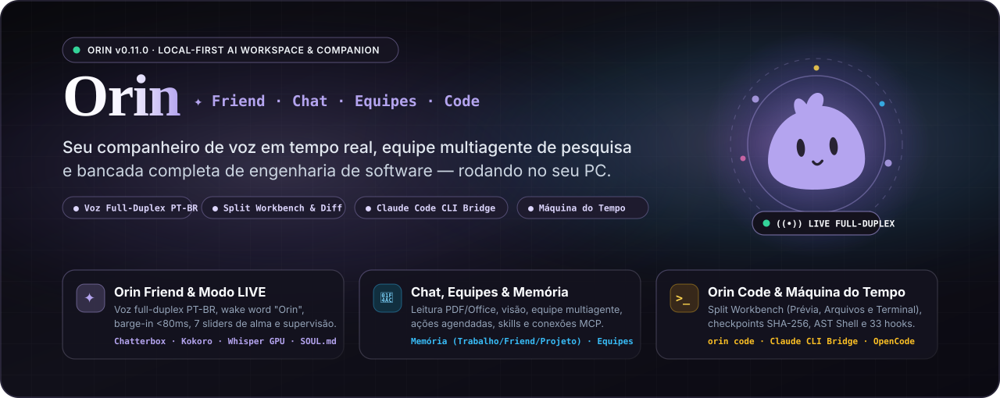
</picture>

<br/>


# Orin `v0.11.0`

**Seu companheiro de voz full-duplex, equipe multiagente de pesquisa e bancada completa de engenharia de software — rodando localmente no seu computador.**

[](https://github.com/carlos-edu2367/orin/releases)
[](#arquitetura)
[-06b6d4?style=for-the-badge)](#2-orin-friend--palco-de-voz-live-full-duplex)
[](#4-orin-code-split-workbench--máquina-do-tempo)
[](LICENSE)

[**Download (Windows & Linux)**](#download-e-instalação) ·
[**Novidades da v0.11.0**](#o-que-há-de-novo-na-v0110) ·
[**Tour Visual (16 Telas)**](#tour-visual-da-interface-v0110) ·
[**Orin Friend & Voz LIVE**](#2-orin-friend--palco-de-voz-live-full-duplex) ·
[**Orin Code & CLI**](#orin-code-web-desktop-e-cli-headless) ·
[**Provedores & Bridges**](#7-modelos-provedores-bridges-de-assinatura--segurança) ·
[**Arquitetura**](#arquitetura)

<br/>

<table>
  <tr>
    <td align="center" width="33%">
      <a href="https://github.com/carlos-edu2367/orin/releases/latest/download/OrinSetup.exe">
        <picture>
          <source media="(prefers-color-scheme: dark)" srcset="docs/images/readme/download-windows-dark.svg">
          <source media="(prefers-color-scheme: light)" srcset="docs/images/readme/download-windows-light.svg">
          
        </picture>
      </a>
    </td>
    <td align="center" width="33%">
      <a href="#linux-debianubuntu">
        <picture>
          <source media="(prefers-color-scheme: dark)" srcset="docs/images/readme/download-linux-dark.svg">
          <source media="(prefers-color-scheme: light)" srcset="docs/images/readme/download-linux-light.svg">
          
        </picture>
      </a>
    </td>
    <td align="center" width="33%">
      <a href="#no-terminal-orin-code--orin-code">
        <picture>
          <source media="(prefers-color-scheme: dark)" srcset="docs/images/readme/download-cli-dark.svg">
          <source media="(prefers-color-scheme: light)" srcset="docs/images/readme/download-cli-light.svg">
          
        </picture>
      </a>
    </td>
  </tr>
</table>

</div>

---

## O que é o Orin?

**Orin** é um workspace de agentes de IA *local-first* para **Windows** e **Linux** (Web, aplicativo **Desktop Electron** e terminal **`orin code`**). Em vez de dividir seu fluxo entre um chat genérico, um editor de código isolado e um assistente de voz separado, o Orin une três experiências completas no mesmo motor durável:

1. **✦ Orin Friend & Modo LIVE Full-Duplex:** um companheiro contínuo com identidade evolutiva (`SOUL.md`), memória afetiva, personalização em **"Caixa de Vidro"** (aparência, voz e 7 sliders de personalidade) e conversação por voz em tempo real em português — com *wake word* `"Orin"`, transcrição local em GPU (**Whisper + Silero VAD**), vozes neurais locais instaláveis em 1 clique (**Chatterbox** e **Kokoro**), corte de fala instantâneo (*barge-in* `<80ms`) e supervisão por voz de tarefas rodando no **Orin Code**.
2. **💬 Orin Chat, Equipes Multiagentes & Automação:** leitura nativa de documentos (PDF por faixa de páginas, Word, Excel, PowerPoint, imagens e código), pesquisa web, geração de imagem/áudio/vídeo, **Atividade em Equipe** (subagentes especialistas trabalhando em paralelo com linha do tempo ao vivo), **Ações Agendadas** (*cron* e eventos), **Habilidades (Skills)**, **Conexões MCP** e memória transparente em 3 escopos (*Trabalho*, *Friend* e *Por projeto*).
3. **`>_` Orin Code Split Workbench & Máquina do Tempo:** bancada de engenharia de software lado a lado com o chat — trazendo **Prévia ao vivo** (navegador embutido), **Arquivos & Diffs**, **Terminal integrado**, **Máquina do Tempo** (checkpoints SHA-256 com restauração de arquivos e conversa), isolamento em *Git worktrees*, análise sintática de shell via AST (`tree-sitter`), 33 eventos de *Hooks*, diagnóstico **LSP** e paridade de protocolo com o **`claude-agent-sdk`**.

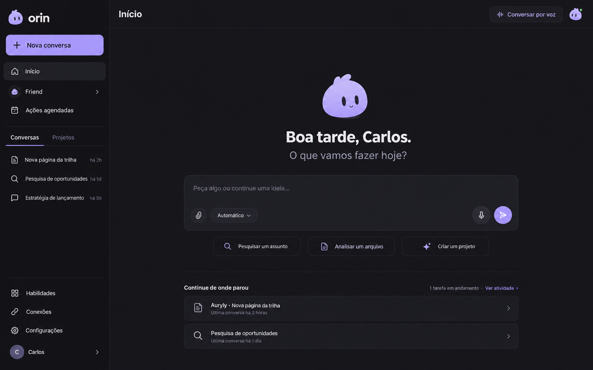
*Nova Home do Orin `v0.11.0`: saudação contextual com o mascote `OrinMascot`, composer unificado com seletor de permissão e voz, atalhos rápidos e retomada instantânea ("Continue de onde parou").*

---

## O que há de novo na `v0.11.0`

A versão **`v0.11.0`** entrega a reconstrução visual e estrutural completa do Orin em 7 fases, além de novas bridges de provedores e melhorias profundas de voz e engenharia:

| Área | Novidades da `v0.11.0` |
| :--- | :--- |
| **Identidade & Design System** | Novo mascote interativo **`OrinMascot`** (`#B4A4EF`) com animações de estado e partículas radiais de celebração; tipografia editorial (`Instrument Serif` / `Newsreader` + `Plus Jakarta Sans` + `JetBrains Mono`); temas **Escuro**, **Claro** e **Automático**; suporte nativo à barra de janela do Electron. |
| **Home & Onboarding** | Nova tela de **Início** com saudação dinâmica, composer unificado, pílulas de ação rápida e cards *"Continue de onde parou"* com status ao vivo; **Onboarding Wizard** em 4 passos (nome, apresentação dos modos, conexão de modelo em 1 clique e primeiro pedido). |
| **Orin Friend & Voz LIVE** | Palco de voz full-duplex redesenhado com orbe reativo, *wake word* `"Orin"` multi-sotaque, **supervisão em segundo plano do Orin Code por voz**, transcrição sincronizada ao que foi efetivamente falado (`SpokenTranscriptLedger`) e painel **Seu Friend** com 5 cores, seletor de voz e 7 sliders de personalidade. |
| **Chat & Equipes Multiagentes** | Nova visualização **Atividade em Equipe** (*"Uma equipe, um resultado"*) com progresso por etapas, cards por agente em paralelo, decisões em destaque e linha do tempo; card inline de **Memória atualizada** com botão *Desfazer*; **Fila de mensagens** visível com *Enviar agora*. |
| **Orin Code & Máquina do Tempo** | **Split Workbench** com abas de **Prévia** (app rodando ao vivo), **Arquivos** (árvore e diffs) e **Terminal** ao lado da conversa; **Máquina do Tempo** visual com histórico de checkpoints SHA-256, contagem de linhas `+adicionadas / -removidas` e restauração em 1 clique. |
| **Projetos, Rotinas, Memória, Skills & MCP** | Galeria e dashboard de **Projetos** (com instruções, arquivos e memória própria); **Ações Agendadas** (diárias, semanais ou sob condição); **Memória** dividida em *Trabalho*, *Friend* e *Por projeto*; catálogo de **Habilidades**; e página de **Conexões** com aprovação explícita para ações externas. |
| **Claude Code CLI Bridge & Provedores** | Nova **Bridge de Assinatura do Claude Code CLI (`claude -p`)** para usar sua conta Claude Pro/Max sem chave de API separada, com catálogo dinâmico da Anthropic (`downloads.claude.ai`); seletor de **Modelo Principal + Modelo Reserva Automático**; painel de uso e custos em R$/USD; e suporte a **NVIDIA NIM**, **OpenCode Bridge**, **OpenAI**, **OpenRouter**, **Ollama** e **OmniRoute**. |

---

## Tour Visual da Interface (`v0.11.0`)

### 1. Início & Boas-Vindas Guiadas

A tela inicial coloca tudo a um clique de distância: escolha se quer pesquisar, criar documentos, conversar por voz ou programar, ajuste o modo de permissão diretamente no composer e retome qualquer tarefa recente exatamente do ponto em que parou.

| Tela Inicial (`Home`) | Boas-Vindas (`Onboarding em 4 passos`) |
| :---: | :---: |
|  | 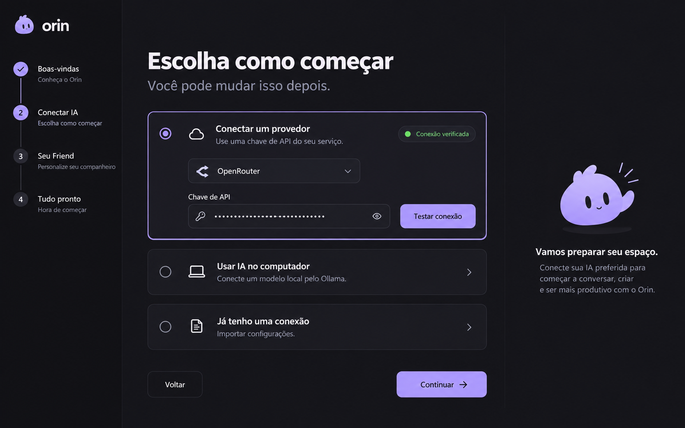 |
| *Saudação contextual, mascote interativo, sugestões rápidas e retomada de sessões ativas.* | *Configuração inicial sem fricção: escolha seu nome, conecte seu modelo preferido e comece em segundos.* |

---

### 2. Orin Friend & Palco de Voz LIVE Full-Duplex

O **Orin Friend** não é um chat efêmero que esquece quem você é a cada janela: ele mantém uma linha contínua de convivência, evolui o nível de vínculo com o tempo (*Conhecido → Parceiro → Amigo Próximo → Confidente*) e conversa com você por voz em tempo real.

| Palco de Voz Full-Duplex (`Friend · Ao vivo`) | Personalização "Caixa de Vidro" (`Seu Friend`) |
| :---: | :---: |
| 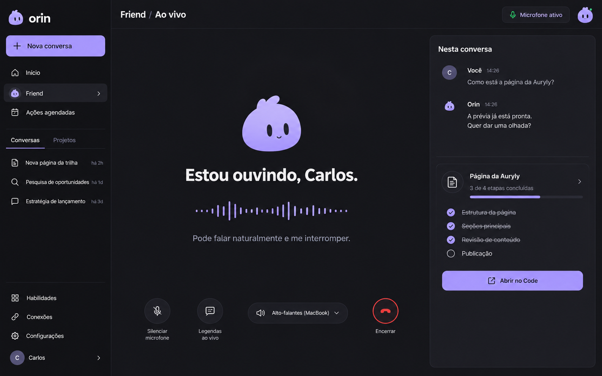 | 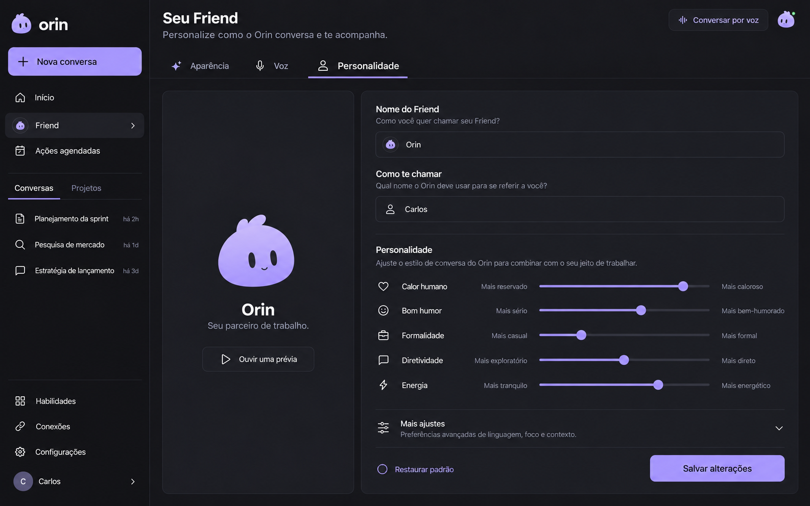 |
| *Conversa fluida por voz em PT-BR com legenda ao vivo, controles de microfone/wake word e card flutuante acompanhando o Orin Code em segundo plano.* | *Personalize a aparência do mascote, a voz e 7 dimensões de personalidade com prévia instantânea de como o Friend fala com você.* |

#### Destaques técnicos do Orin Friend & Modo LIVE:
- **Wake Word `"Orin"` em 3 camadas (Baixo consumo de CPU):**
  1. *Camada 1:* **Silero VAD** em janela deslizante de 32ms (descarta silêncio com custo próximo de zero);
  2. *Camada 2:* **OpenWakeWord** + filtro fonético multi-sotaque para variações do português brasileiro (*"ôrin"*, *"órin"*, *"orím"*, *"ei orin"*, *"oi orin"*);
  3. *Camada 3:* Confirmação rápida via **Whisper GPU** local + *cooldown anti-loop* para nunca ativar com a própria voz do TTS.
- **Vozes Neurais Locais em 1 Clique + Cloud:** instale modelos de voz direto pela interface sem tocar no terminal — **Chatterbox Multilingual** (clonagem zero-shot e alta expressividade em GPU) e **Kokoro 82M ONNX** (ultra-leve em CPU/GPU com vozes PT-BR `pf_dora`, `pm_alex`, `pm_santa`) — ou use provedores em nuvem (**OpenRouter Audio** e **OpenAI TTS**).
- **Barge-In Real (`<80ms`) & `SpokenTranscriptLedger`:** interrompa o Orin no meio de qualquer frase apenas começando a falar. O controlador cancela o áudio imediatamente por `epoch_id` e grava no histórico exatamente até a palavra que você realmente ouviu (`[interrompido pelo usuário]`), evitando que o modelo ache que terminou de falar o que foi cortado.
- **Supervisão do Orin Code por Voz:** enquanto você conversa no modo LIVE, o Orin pode despachar ou acompanhar uma sessão do **Orin Code** trabalhando no seu repositório e avisar você por voz quando um teste passar ou precisar de aprovação.

---

### 3. Orin Chat Multimodal & Atividade em Equipe (Subagentes)

No **Orin Chat**, o agente lê documentos complexos, gera mídia, aprende com suas correções em tempo real e, quando a tarefa exige múltiplas frentes, monta uma **equipe de especialistas** trabalhando em paralelo.

| Chat Multimodal, Memória Inline & Fila | Atividade em Equipe (`Uma equipe, um resultado`) |
| :---: | :---: |
| 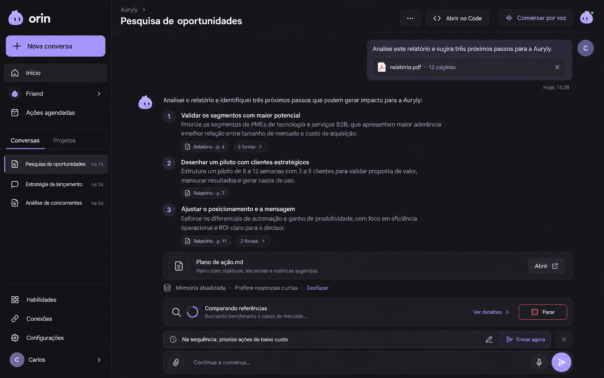 | 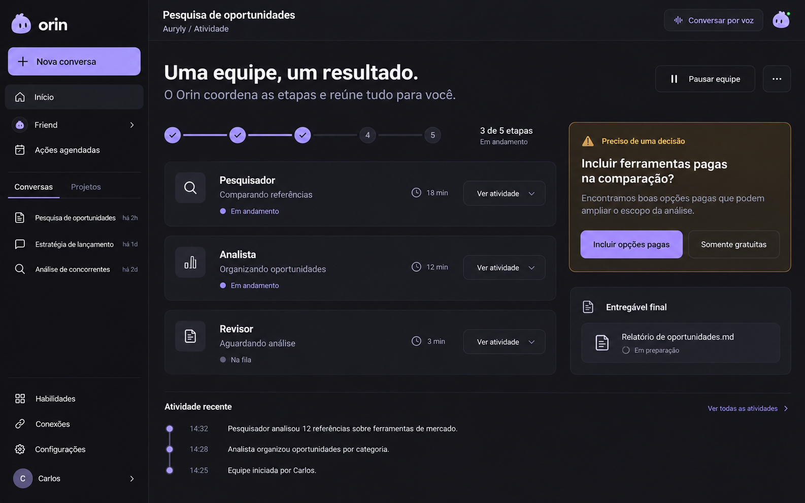 |
| *Análise de PDFs e planilhas, card inline "Memória atualizada · Desfazer" e fila visível de próximas mensagens com envio imediato.* | *Visão dedicada da equipe de subagentes: progresso por etapas, status de cada especialista em paralelo, decisões pendentes e linha do tempo.* |

---

### 4. Orin Code Split Workbench & Máquina do Tempo

Quando a tarefa envolve criar aplicações, refatorar repositórios ou rodar comandos e testes, o **Orin Code** abre uma bancada dividida (*Split Workbench*) com tudo visível ao vivo — e salva automaticamente um ponto na **Máquina do Tempo** antes de cada edição.

| Bancada Dividida (`Orin Code Workbench`) | Máquina do Tempo (`Checkpoints & Rewind SHA-256`) |
| :---: | :---: |
| 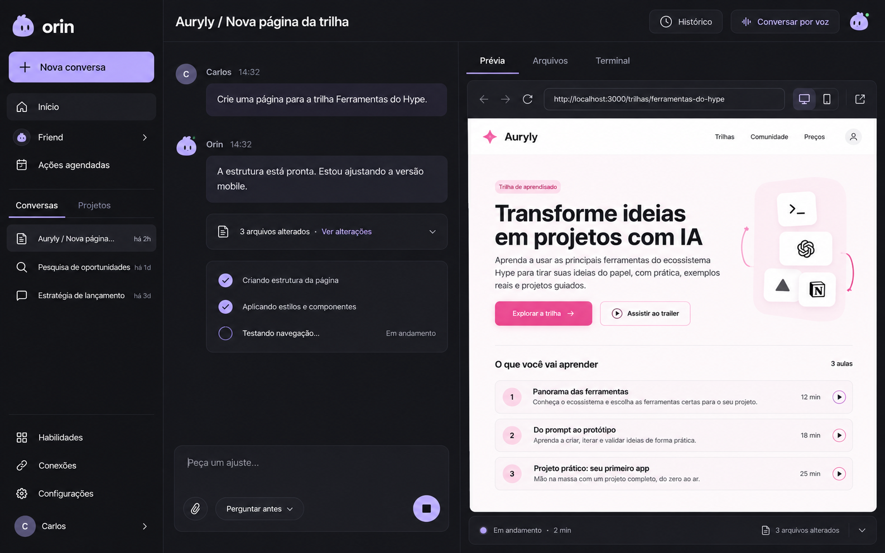 | 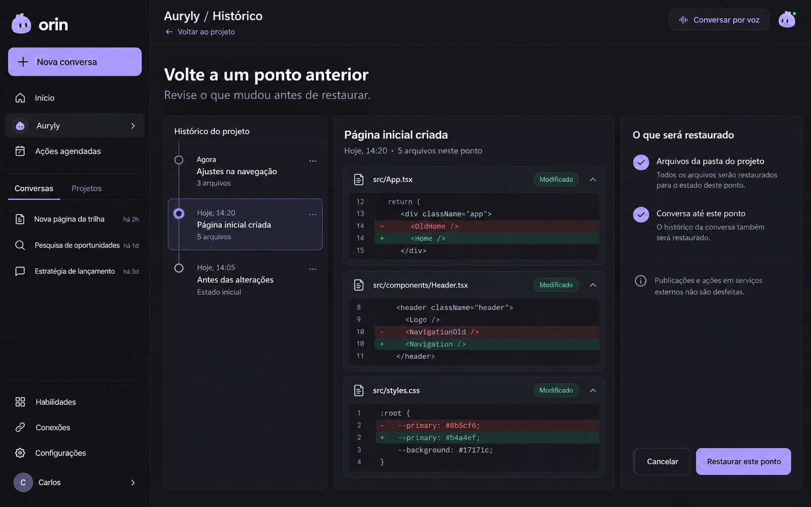 |
| *Conversa técnica à esquerda e bancada à direita com **Prévia ao vivo** (navegador), **Arquivos/Diffs**, **Terminal** e barra de etapas concluídas.* | *Inspecione qualquer ponto anterior da sessão, veja exatamente quais arquivos e linhas mudaram (`+adicionadas / -removidas`) e restaure com 1 clique.* |

---

### 5. Projetos Dedicados

Organize frentes de trabalho contínuas em **Projetos**: cada projeto reúne sua pasta de código ou documentos vinculada, instruções permanentes, arquivos de referência, conversas e memória própria.

| Galeria de Projetos | Dashboard do Projeto |
| :---: | :---: |
| 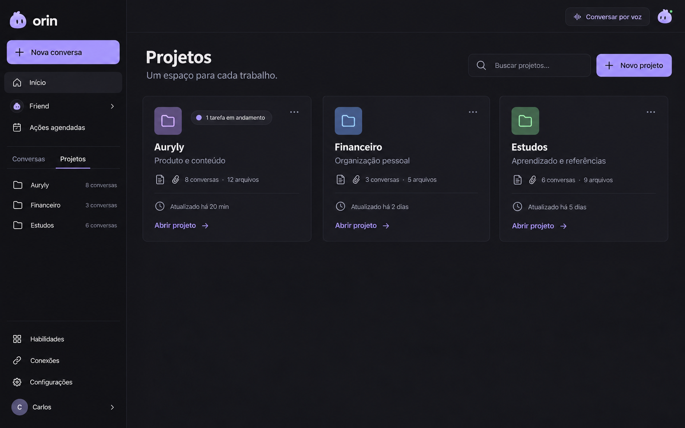 | 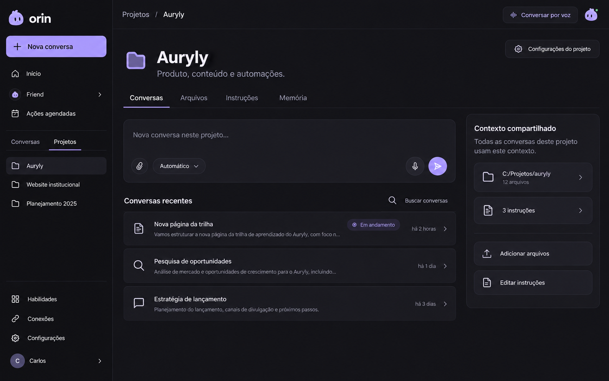 |
| *Visão geral dos seus projetos com status de atividade, contagem de conversas, arquivos e ações agendadas.* | *Dentro do projeto: instruções fixas, arquivos compartilhados, memória isolada do projeto e histórico de conversas.* |

---

### 6. Ações Agendadas, Memória em 3 Escopos, Habilidades & Conexões

Você tem visibilidade e controle total sobre o que o Orin faz sozinho, o que ele lembra sobre você, quais habilidades ele domina e a quais serviços externos ele está conectado.

| Ações Agendadas (`Rotinas & Cron`) | Memória Transparente (`Trabalho · Friend · Projeto`) |
| :---: | :---: |
| 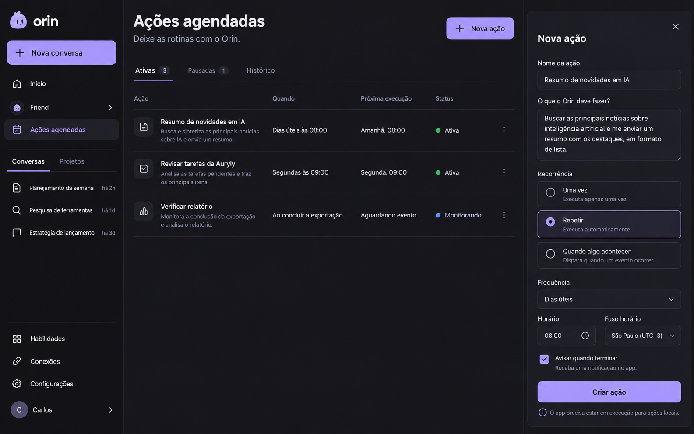 | 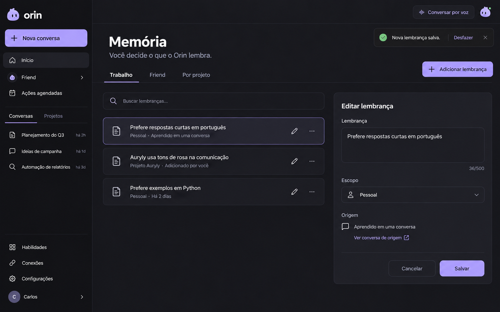 |
| *Crie rotinas automáticas em linguagem natural (diárias, semanais ou sob condição) com opção de pedir confirmação antes de agir.* | *Veja, filtre, edite ou apague qualquer lembrança salva pelo Orin nos escopos de Trabalho, Friend ou por Projeto.* |

| Habilidades (`Skills`) | Conexões (`MCP, Navegador & Arquivos`) |
| :---: | :---: |
| 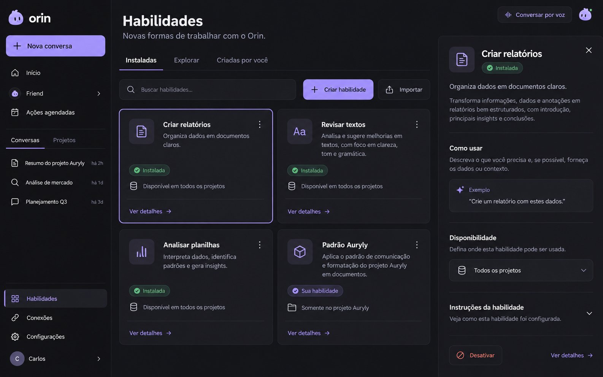 | 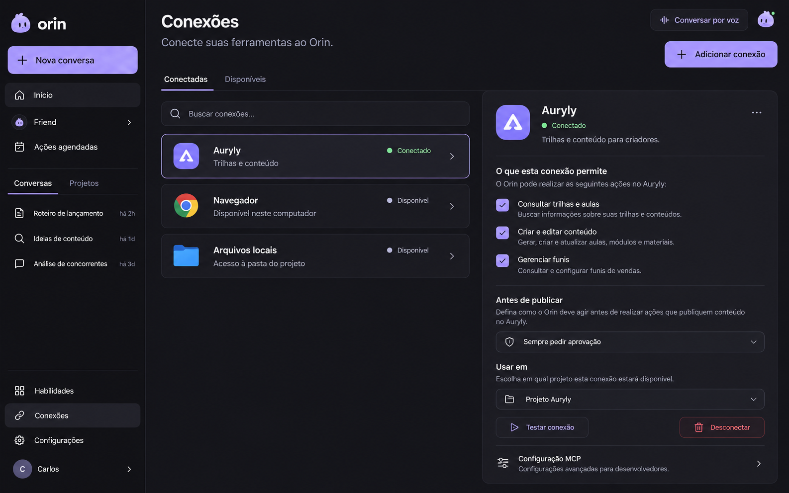 |
| *Ative habilidades prontas, explore o catálogo ou crie novas capacidades reutilizáveis em linguagem simples.* | *Gerencie integrações (GitHub, Google Drive, Slack, Postgres, Navegador Playwright) com aprovação explícita antes de publicar qualquer coisa.* |

---

### 7. Modelos, Provedores, Bridges de Assinatura & Segurança

O Orin é 100% agnóstico de provedor: combine modelos locais gratuitos com modelos de ponta na nuvem, use sua assinatura existente do **Claude Code CLI** ou do **OpenCode** sem pagar API duplicada, configure *fallback* automático e defina exatamente onde o agente pode tocar.

| Modelos, Provedores & Custos | Segurança, Permissões & Pastas Autorizadas |
| :---: | :---: |
| 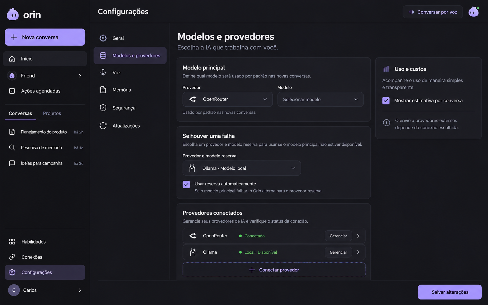 | 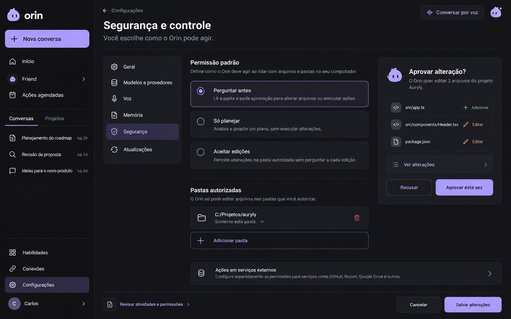 |
| *Escolha o modelo principal e o modelo reserva automático, acompanhe gastos do mês com alerta de limite e conecte 7 provedores.* | *Defina o comportamento padrão (Perguntar antes, Só planejar, Aceitar edições), pastas autorizadas e regras por serviço externo.* |

#### Provedores e Bridges suportados nativamente:
1. **Anthropic — API Key & Bridge de Assinatura Claude Code CLI (`claude -p`):**
   - Usa sua assinatura **Claude Pro / Max** já autenticada no CLI oficial `claude` (zero custo extra de API por token) ou chave `sk-ant-...`, buscando o catálogo atualizado de modelos (`Claude Sonnet 4.6`, `Claude Opus 4.6`, `Claude Haiku 4.5`) diretamente do endpoint público da Anthropic.
2. **OpenCode — Bridge Local Gratuita (`opencode serve`) & OpenCode Zen Cloud:**
   - Usa os modelos gratuitos do OpenCode diretamente dentro do *harness* e das ferramentas nativas do Orin.
3. **Ollama (Local & Cloud):**
   - Execução 100% offline na sua GPU/CPU (`qwen3`, `llama3.3`, `deepseek-r1`, embeddings `nomic-embed-text`) ou via Ollama Cloud.
4. **OpenRouter:**
   - Acesso unificado a centenas de modelos de texto, visão, imagem, áudio e vídeo com uma única chave.
5. **OpenAI:**
   - Família GPT, modelos de raciocínio (`o3`, `o4-mini`), geração de imagem, áudio e TTS.
6. **NVIDIA NIM:**
   - Inferência acelerada em nuvem ou microsserviços NIM auto-hospedados.
7. **OmniRoute:**
   - Roteador multi-provedor local com *failover* automático entre contas OAuth, chaves de API e modelos gratuitos.

---

## Download e Instalação

Cada release publica pacotes independentes para **Windows (x64)** e **Linux (x64)**. Ambos já incluem runtime Python, interface web, aplicativo Desktop e SQLite — **sem exigir Python, Node.js, Docker, PostgreSQL ou Redis instalados previamente**.

### Windows

Baixe e abra o **[OrinSetup.exe](https://github.com/carlos-edu2367/orin/releases/latest/download/OrinSetup.exe)**. Uma janela mostra a versão, o local de instalação e o progresso (download, verificação SHA-256 e auto-teste), terminando com **Abrir o Orin**.
- Não pede senha de administrador: instala no escopo do seu usuário, cria atalhos na Área de Trabalho e Menu Iniciar, adiciona `orin` e `orin-code` ao `PATH` e registra em *Aplicativos instalados*.

> **Nota sobre o Windows SmartScreen:** enquanto o instalador não possuir certificado EV pago, o Windows pode exibir um aviso na primeira execução. Clique em **Mais informações → Executar assim mesmo**. O instalador valida o hash SHA-256 de todos os pacotes baixados contra o manifesto oficial da release.

Prefere instalar em 1 linha pelo PowerShell?

```powershell
irm https://github.com/carlos-edu2367/orin/releases/latest/download/install.ps1 | iex
```

Para instalação silenciosa / automação:

```powershell
OrinSetup.exe --silent [--dir C:\Orin] [--to 0.11.0] [--no-shortcut] [--no-path]
```

### Linux (Debian / Ubuntu x64)

```bash
curl -fsSL https://github.com/carlos-edu2367/orin/releases/latest/download/install.sh | bash
```

O instalador nunca executa comandos privilegiados (`sudo` / `apt`): instala tudo no seu usuário (`~/.local/share/Orin/versions` e `~/.local/bin/orin`), confere o SHA-256, testa a versão nova antes de promovê-la e cria o atalho no menu de aplicativos.

### Comandos do Launcher (`orin`)

Abra um terminal e execute:

```bash
orin                         # Inicia os serviços locais e abre a interface
orin --desktop               # Abre o Orin na janela nativa Electron
orin --desktop --background  # Inicia minimizado na bandeja do sistema (tray)
orin status                  # Mostra a saúde da API, workers, scheduler e banco
orin logs [--follow]         # Exibe os logs unificados em tempo real
orin restart                 # Reinicia todos os serviços do perfil local
orin stop                    # Encerra os serviços locais com segurança
orin autostart on|off|status # Configura início automático ao fazer login no sistema
orin update                  # Atualiza para a release mais recente (--check, --to, --rollback)
orin code [prompt]           # Abre ou executa uma sessão Orin Code no repositório atual
orin serve                   # Sobe em modo servidor multiperfil (requer ORIN_PUBLIC_URL)
orin --uninstall             # Remove a instalação do usuário
```

---

## Orin Code (Web, Desktop e CLI Headless)

O **Orin Code** opera diretamente sobre o seu repositório Git, combinando o **Split Workbench** na interface gráfica com o binário de terminal **`orin code`** (`orin-code`).

### No Terminal (`orin code` / `orin-code`)

```bash
# Abre uma sessão Code apontando para a pasta atual
orin code "Refatore o módulo de autenticação e adicione testes"

# Execução headless (-p / --print) nos formatos text, json ou stream-json
orin code -p "Rode a suíte de testes unitários e resuma falhas" --output-format text
orin code -p "Liste endpoints públicos" --output-format json \
  --json-schema '{"type":"object","properties":{"endpoints":{"type":"array"}}}'

# Continuar a última sessão (-c), retomar por ID (-r) ou rodar em background (--bg)
orin code -c -p "Agora corrija o caso de borda encontrado"
orin code -r <session_id> -p "Continue a implementação"
orin code -p "Execute a migração completa" --bg

# Gerenciar servidores MCP, plugins, agentes e diagnósticos
orin code mcp list | get | add | add-json | remove | reset-project-choices | serve
orin code plugin list | install | uninstall | enable | disable | validate | details | configure
orin code plugin marketplace add | list | remove | update
orin code agents [--json]
orin code logs <id> [-f] | attach <id> | stop <id> | rm <id>
orin code auto-mode config | defaults | reset | critique
orin code doctor
```

### Compatibilidade com `claude-agent-sdk` e Convenções `.orin` / `.claude`
- **Protocolo SDK:** `orin-code` implementa `stream-json` bidirecional com `control_request` / `control_response` (`initialize`, `can_use_tool`, `hook_callback`, `mcp_message`, `interrupt`, `rewind_files`, `set_model`, `set_permission_mode`), permitindo usar o pacote oficial **`claude-agent-sdk`** apontando `cli_path="orin-code"`.
- **23 Ferramentas Nativas:** `Bash`, `PowerShell`, `Read`, `Edit`, `Write`, `NotebookEdit`, `Glob`, `Grep`, `SearchCode`, `ProjectMap`, `WebSearch`, `WebFetch`, `Agent`, `SendMessage`, `TodoWrite`, `EnterPlanMode`, `ExitPlanMode`, `EnterWorktree`, `ExitWorktree`, `ToolSearch`, `ListMcpResources`, `ReadMcpResource`, `Skill`, entre outras.
- **33 Eventos de Hooks:** `PreToolUse`, `PostToolUse`, `UserPromptSubmit`, `SessionStart`, `Stop`, `SubagentStop`, `PreCompact`, `PermissionRequest`, `Setup`, `TeammateIdle`, etc., com handlers `command`, `http`, `prompt` e `agent`.
- **Memória em Arquivo em 5 Camadas:** carrega automaticamente `ORIN.md` e `CLAUDE.md`, `.orin/rules/*.md`, `.claude/rules/*.md` e `ORIN.local.md`, com suporte a imports `@caminho`.

---

## Arquitetura

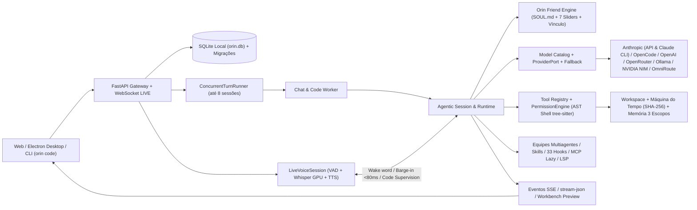

### Estrutura do Repositório

```text
src/agentos/
├── api/                 # Gateway FastAPI, rotas REST, SSE e WebSocket de voz LIVE
├── friend/              # Orin Friend: SOUL.md, evolução de vínculo, memória afetiva e sliders
├── live/                # Pipeline Full-Duplex: Silero VAD, Wake Word "Orin", Whisper GPU, Chatterbox, Kokoro e Barge-in
├── cli_code/            # CLI `orin code` / `orin-code`, modo headless e protocolo `claude-agent-sdk`
├── agentic/             # Sessão, runtime, 23+ tools (`tools/`), subagentes, equipes e geração de mídia
├── permissions/         # 6 modos de permissão, parser AST (`tree-sitter-bash`/`powershell`) e Workspace Trust
├── hooks/               # Motor de 33 eventos de ciclo de vida (`command`, `http`, `prompt`, `agent`)
├── settings/            # Settings hierárquicos em 5 camadas (`.orin` e `.claude`) com proveniência
├── memory_files/        # Carregador `ORIN.md` / `CLAUDE.md`, rules condicionais por glob e imports `@`
├── mcp/                 # Cliente MCP (`stdio`/`http`/`sse`/`ws`), OAuth 2.1 PKCE, ToolSearch lazy e `mcp serve`
├── plugins/             # Gerenciador de plugins `.orin-plugin`/`.claude-plugin`, marketplaces e `userConfig` cifrado
├── skills/              # Skills em disco (4 camadas), builtins e catálogo de habilidades no banco
├── lsp/                 # Cliente Language Server Protocol (`.lsp.json`) e diagnósticos pós-edição
├── provider_catalog/    # Catálogo de modelos, precificação, bridge Claude Code CLI (`claude -p`) e bridge OpenCode
├── retrieval/           # Busca semântica (embeddings Ollama locais) + fallback lexical BM25 por projeto
├── workers/             # `ConcurrentTurnRunner`, workers de conversação e agendador de rotinas (`scheduler`)
└── launcher/            # CLI `orin`, gerenciamento de processos, auto-update atômico e instaladores
frontend/                # SPA React 19 + TypeScript + Vite (Home, Friend/Live, Chat, Equipes, Code Workbench, Projetos, etc.)
desktop/                 # Aplicativo Electron (janela única com controles customizados, bandeja do sistema e autostart)
docs/                    # Documentação técnica, ADRs, guias do Orin Code, MCP, Plugins e runbooks
```

---

## Segurança e Privacidade Local-First

- **Dados no seu computador:** conversas, memórias (*Trabalho*, *Friend* e *Projeto*), checkpoints da Máquina do Tempo e índices semânticos ficam em SQLite local (`orin.db`). Apenas chamadas aos modelos ou integrações externas que você acionar saem da máquina.
- **Segredos criptografados em repouso:** chaves de API, tokens OAuth de MCP e configurações sensíveis são cifrados com Fernet (`AGENTOS_PROVIDER_ENCRYPTION_KEY`), nunca retornam em texto puro na API (*write-only*) e são redigidos dos logs.
- **Análise sintática de Shell por AST (*Fail-Closed*):** antes de executar qualquer comando `Bash` ou `PowerShell`, o Orin analisa a árvore sintática via **`tree-sitter`**, inspecionando subcomandos, pipes, redirecionamentos e substituições. Qualquer construção ambígua ou toque em caminhos sensíveis (`.git/`, `.orin/`, `.claude/`, `.env*`) exige confirmação explícita.
- **Workspace Trust & Aprovação de Publicação:** configurações vindas de repositórios clonados (`.mcp.json`, hooks de projeto) só entram em vigor após você autorizar a pasta, e conexões externas pedem confirmação antes de enviar e-mails, criar PRs ou publicar mensagens.

---

## Desenvolvimento a partir do Código-Fonte

Para contribuir ou rodar diretamente do código-fonte, utilize **Python 3.12+**, **[uv](https://docs.astral.sh/uv/)** e **Node.js 22+**:

```bash
# 1. Sincronize o ambiente Python e dependências de desenvolvimento
uv sync --frozen --all-groups

# 2. Instale as dependências e gere o build do frontend
npm --prefix frontend ci && npm --prefix frontend run build

# 3. Inicie o Orin completo a partir do código-fonte
uv run orin
```

Para instalar os comandos `orin` e `orin-code` apontando em modo editável para o seu checkout:

```bash
uv tool install --editable .
```

Para desenvolver o frontend com *hot reload* (Vite):

```bash
npm --prefix frontend run dev -- --host 127.0.0.1
```

### Executando a Suíte de Testes

```bash
# Testes unitários do backend
uv run pytest -q tests/unit

# Testes de conformidade do Orin Code CLI e protocolo SDK
uv run pytest -q tests/integration/cli_code

# Testes unitários, lint, tipagem e build do frontend
npm --prefix frontend test
npm --prefix frontend run lint
npm --prefix frontend run build

# Testes End-to-End (Playwright) das 7 fases da interface
npm --prefix frontend run test:e2e
```

---

## Documentação Adicional

- [Visão Geral Completa do Produto e Funcionalidades (`VISAO_GERAL.md`)](VISAO_GERAL.md)
- [Sistema de Design e Direção Visual (`DESIGN.md`)](DESIGN.md)
- [Guia Completo do Orin Code, CLI, Permissões, Hooks e Settings (`docs/ORIN_CODE.md`)](docs/ORIN_CODE.md)
- [Launcher, Orin Desktop, Bandeja e Auto-Update (`docs/LAUNCHER.md`)](docs/LAUNCHER.md)
- [Busca Semântica, Embeddings Locais e Vetores (`docs/RETRIEVAL.md`)](docs/RETRIEVAL.md)
- [Conectores MCP, Lazy Loading, OAuth e `mcp serve` (`docs/MCP.md`)](docs/MCP.md)
- [Plugins, Hooks, LSP e Marketplaces (`docs/PLUGINS.md`)](docs/PLUGINS.md)
- [Criação e Estrutura de Skills (`docs/CREATING_SKILLS.md`)](docs/CREATING_SKILLS.md)
- [Roteamento com OmniRoute (`docs/OMNIROUTE.md`)](docs/OMNIROUTE.md)
- [Modo Servidor Multiperfil (`docs/SERVER.md`)](docs/SERVER.md)

---

## Licença

Distribuído sob a [Licença MIT](LICENSE).
