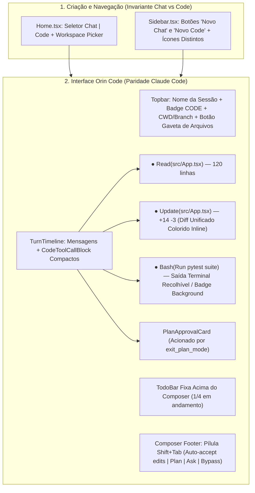

# Design Spec: Orin Code (100% Paridade com Claude Code v2.1.300) + Redesign UX/UI

**Data:** 2026-10-15  
**Status:** Draft (Aguardando Aprovação do Usuário)  
**Base de Engenharia Reversa (REA):** `@anthropic-ai/claude-code` v2.1.300 (`claude.exe` SHA-256 `56810a111c01dcd218b42727c23fd8763be42720038b1adcac93cf599fac2de2`, 2.397 chunks JS extraídos de `.bun` + `sdk-tools.d.ts`)

---

## 1. Visão Geral & Objetivos

O objetivo deste projeto é transformar o modo de engenharia de software do Orin (**Orin Code**) para funcionar **100% igual ao Claude Code (v2.1.300)** em termos de invariante de sessão, loop de execução, ferramentas nativas, modos de permissão (`Shift+Tab`), fluxo de Plan Mode (`EnterPlanMode` / `ExitPlanMode`), gerenciamento de tarefas (`TodoWrite` + `Task*`), subagentes (`Agent`) e experiência visual (timeline densa de blocos de ferramentas, diffs inline coloridos e barra de progresso de tarefas), **preservando todas as ferramentas exclusivas do Orin** (Playwright Browser, Vision/PDF, Memória durável `remember`/`recall`, Skills, Plugins e MCP).

Além disso, o projeto corrige todos os problemas de UX/UI identificados nas capturas de tela da interface atual do Orin.

### Decisões de Produto Alinhadas no Brainstorming
1. **Invariante Estrita de Modo (`Chat` vs `Code`):**
   - Uma conversa nasce como **`mode = "chat"`** ou **`mode = "code"`** e **nunca muda de modo** ao longo de sua vida útil.
   - O modo `"auto"` e a heurística por mensagem (`detect_code_request`) são eliminados.
   - Na **Home**, o usuário conta com um seletor explícito **`Chat | Code`** (exibindo seletor de pasta/repositório quando `Code` está ativo). Na **Sidebar**, há botões dedicados **"Novo Chat"** e **"Novo Code"**, além de ícones distintos na listagem de conversas.
2. **Estética e Layout da Sessão Orin Code:**
   - **Idêntico ao Claude Code Desktop/CLI:** Timeline técnica limpa e densa com blocos compactos de ferramentas (`Read`, `Update` com diff unificado inline colorido `+N -M`, `Bash` com descrição curta e saída recolhível, `Search`, `Agent`), barra fixa de `Todo/Tasks` acima do input, card interativo de aprovação de plano (`ExitPlanMode`), e gaveta lateral sob demanda (árvore de arquivos / preview).
3. **Modo de Permissão Padrão & Atalho `Shift+Tab`:**
   - Sessões Orin Code iniciam por padrão em **`accept_edits` (Auto-accept Edits)**: leituras e edições de arquivos no workspace ocorrem diretamente exibindo o diff inline na timeline, pedindo confirmação apenas para comandos `Bash` destrutivos/não-triviais ou ações externas.
   - O atalho **`Shift+Tab`** (e a pílula clicável no rodapé do Composer) alterna ciclicamente entre:
     1. `accept_edits` (*Auto-accept edits*)
     2. `plan_mode` (*Plan Mode* — somente leitura + escrita do arquivo de plano até `exit_plan_mode`)
     3. `ask_permissions` (*Ask permissions* — confirma edições e comandos shell)
     4. `full_autonomy` (*Bypass permissions / Auto* — execução autônoma total dentro do workspace)

---

## 2. Diagnóstico Causa-Raiz (UX/UI Atual vs. Evidência REA do Claude Code)

| Problema Observado no Orin | Causa-Raiz no Código do Orin | Como o Claude Code v2.1.300 Faz (Evidência REA) | Solução no Orin |
| :--- | :--- | :--- | :--- |
| **Conversas misturam Chat e Code a cada turno** | `conversations` (`schema.py:550`) não possui coluna `mode`; `conversation_turns` usa `code_mode="auto"` e chama `detect_code_request(message)` em `PostgresChatStore.create` (`conversations/chat.py:553`). | Cada sessão do Claude Code é inicializada em um CWD/workspace fixo com estado de sessão imutável. | Adicionar `mode` (`'chat' \| 'code'`), `permission_mode` e `workspace_root_path` na tabela `conversations`. Remover `auto` e `detect_code_request`. |
| **Card roxo gigante de 5 etapas (`CodeModeCard`) repetido em todo turno** | `ChatWorker._hydrate_code_mode` (`workers/chat.py:1002`), `TurnSession.build_runtime` (`session.py:1471`) e `_ensure_code_mode_plan` criam um `.orin/plans/{turn_id}-plan.md` fictício em **todo** turno e emitem `CODE_MODE_ACTIVATED` / `STAGE_CHANGED` / `PLAN_READY`. | No Claude Code (`chunk_0589.js`), **não existe card de 5 fases em todo turno**. Planos só existem quando a sessão está em `plan` mode (ou o agente chama `EnterPlanMode`) e finaliza com `ExitPlanMode`, que pausa o turno e mostra o card de aprovação do plano real. | Remover `_ensure_code_mode_plan` automático e aposentar o stepper `CodeModeCard.tsx`. Substituir pelo `PlanApprovalCard.tsx` acionado exclusivamente por `exit_plan_mode`. |
| **Links de arquivos quebram listas numeradas e parágrafos (Screenshot 3)** | `MarkdownMessage.tsx` intercepta `<a href="workspace://...">` dentro de `
`/`<li>` e renderiza `<WorkspaceFileCard />` (`div` em bloco com botões `Prévia \| Baixar \| Abrir`), quebrando a frase antes de `: Contém toda a estrutura...`. | Referências a arquivos no texto são pílulas inline (`file_path:line_number`) que mantêm o fluxo tipográfico da frase e abrem o arquivo ao clicar. | Renderizar links `workspace://` dentro de parágrafos/listas como `<InlineWorkspaceFilePill />` (`inline-flex`), movendo cards de entregáveis para uma barra discreta no rodapé da resposta. |
| **Indicador `\|\|\|\| Executando comandos` preso após cancelar/concluir e `npm run dev` travando o turno (Screenshots 2 e 3)** | 1) `run_command` (`agent_tools.py:2177`) roda `npm run dev`/`vite` em foreground até estourar 120s se o modelo esquecer `background=true`. 2) `ChatPage.tsx:806` exibe `<AgentPulse />` mesmo após o turno sair de estado ativo se `activeActivity` não for limpo. | `BashTool` (`sdk-tools.d.ts` / `chunk_1224.js`) detecta servidores dev / processos contínuos e faz **auto-backgrounding** assim que a porta/URL fica pronta, retornando imediatamente o PID/log. | 1) Auto-background em `run_command` ao detectar comandos de dev server ou padrão `Local: http://localhost:...` no stdout. 2) Limpar `activeActivity` imediatamente no cancelamento/término e condicionar `<AgentPulse />` a `isActiveState(conversation.state)`. |
| **Botão `Reverter alterações` poluindo todos os turnos passados (Screenshot 2)** | `TurnTimeline.tsx:93-105` renderiza uma caixa dedicada com botão `Reverter alterações` em cada turno com `turn.checkpoint`. | Checkpoints ficam acessíveis de forma discreta no menu do turno ou via comando `/rewind` (`Esc+Esc`). | Mover `Reverter alterações` para uma ação discreta no cabeçalho do turno (visível no hover) + suporte ao slash command `/rewind`. |

---

## 3. Arquitetura de Abordagens Consideradas

Durante o brainstorming, avaliamos duas abordagens para unificar o Orin Code com o motor do Claude Code:

- **Abordagem A (Escolhida) — Motor Nativo Unificado "Claude Code Parity" no `TurnSession` + Contratos Tipados de Ferramentas e Eventos:**
  - `conversations.mode` define permanentemente se a conversa usa o motor **Chat** ou **Code**.
  - Em `mode == "code"`, o `TurnSession` executa **sempre o loop direto em estilo Claude Code** (sem `PhaseController`, sem obrigatoriedade burocrática de `write_contract` / `report_verification` para liberar ferramentas), guiado pelo System Prompt real extraído do Claude Code v2.1.300 adaptado com as ferramentas extras do Orin.
  - As ferramentas nativas em `agent_tools.py` emitem metadados ricos (`structured_patch`, `num_lines`, `description`, `auto_backgrounded`, `plan_approval`, `todo_list`) consumidos diretamente pelos novos componentes visuais (`CodeToolCallBlock`, `PlanApprovalCard`, `TodoBar`).
- **Abordagem B (Descartada) — Wrapper sobre o CLI externo `claude.exe`:**
  - Impossibilitaria usar os provedores/modelos configurados no Orin (OpenRouter, Gemini, OpenAI, Ollama), quebraria a integração nativa com o banco Postgres/checkpoints do Orin e exigiria licença/autenticação separada do CLI externo.

---

## 4. Especificação Técnica Detalhada

### 4.1. Banco de Dados, Modelos e API (`mode`, `permission_mode`, `workspace_root_path`)

1. **Migração em `src/agentos/persistence/postgres/schema.py`:**
   - Na tabela `conversations`:
     - `mode TEXT NOT NULL DEFAULT 'chat'` (`'chat'` | `'code'`)
     - `permission_mode TEXT NOT NULL DEFAULT 'ask_permissions'` (`'accept_edits'` | `'plan_mode'` | `'ask_permissions'` | `'full_autonomy'`)
     - `workspace_root_path TEXT` (caminho absoluto opcional de diretório local vinculado à sessão Code, ou workspace gerenciado em `data/workspaces/{conversation_id}`)
     - `pre_plan_permission_mode TEXT` (armazena o modo anterior quando a sessão entra em `plan_mode`, permitindo restaurá-lo ao aprovar `exit_plan_mode`, exatamente como em `chunk_0589.js`).
   - Backfill automático na migração: conversas existentes que possuam qualquer turno com `code_mode = 'code'` recebem `mode = 'code'` e `permission_mode = 'accept_edits'`; as demais recebem `mode = 'chat'`.

2. **Invariante no Store e Rotas (`src/agentos/conversations/chat.py`, `src/agentos/api/routers/conversations.py`):**
   - `POST /api/conversations`: aceita `mode: Literal["chat", "code"] = "chat"`, `permission_mode: Optional[str] = None` (default `'accept_edits'` quando `mode == "code"`, `'ask_permissions'` quando `mode == "chat"`), `workspace_root_path: Optional[str] = None`, `project_id: Optional[str] = None`.
   - `PATCH /api/conversations/{conversation_id}/permission-mode`: endpoint leve para alternar `permission_mode` via `Shift+Tab` ou clique no rodapé (mesmo com conversa ociosa ou ativa) e atualizar `workspace_root_path` se necessário. **O campo `mode` (`chat` vs `code`) é imutável após a criação** (tentativas de alterá-lo retornam `400 Bad Request`).
   - `POST /api/conversations/{conversation_id}/turns`: ignora qualquer tentativa de trocar `mode` no turno; o turno herda `conversation.mode` e `conversation.permission_mode`. Remove-se a chamada a `detect_code_request(message)` do fluxo de criação de turnos.

---

### 4.2. Paridade 100% de Ferramentas (Claude Code v2.1.300 + Exclusivas do Orin)

Baseado na extração REA de `sdk-tools.d.ts`, `chunk_0380.js`, `chunk_0589.js`, `chunk_2177.js`, `chunk_2178.js` e `chunk_0296.js`, o catálogo de ferramentas do Orin Code (`src/agentos/agentic/agent_tools.py`) terá paridade completa:

#### A. Ferramentas Core do Claude Code (Alinhadas / Adicionadas)
1. **`read_file` (`Read` — `FileReadTool`):**
   - **Parâmetros:** `path` (alias `file_path`), `offset` (1-indexed), `limit`, `pages` (ex: `"1-5"` para leitura seletiva de PDFs grandes).
   - **Deduplicação de leitura inalterada (`file_unchanged_stub`):** Se o mesmo `path` + `offset` + `limit` já foi lido no turno/sessão e o `sha256` em `_read_file_state` não mudou, retorna um stub curto informando que o arquivo não mudou desde a última leitura (economizando janela de contexto, idêntico ao Claude Code).
   - **Retorno estruturado:** `path`, `content` (com numeração `cat -n`), `total_lines`, `start_line`, `end_line`, `unchanged`.

2. **`edit_file` (`Edit` / `Update` — `FileEditTool`):**
   - **Parâmetros:** `path` (alias `file_path`), `old_text` (alias `old_string`), `new_text` (alias `new_string`), `replace_all: bool = False`, `edits: Optional[ list[dict] ]`.
   - **Invariante Read-Before-Edit (`chunk_2177.js`):** Mantém verificação em `_read_file_state` (com mensagem clara pedindo `read_file` caso o arquivo existente nunca tenha sido lido ou tenha sido modificado externamente).
   - **Diff Estruturado (`structured_patch` — `chunk_0296.js`):** Calcula e retorna hunks estruturados (`oldStart`, `oldLines`, `newStart`, `newLines`, `lines: list[str]`), `additions`, `deletions`, permitindo ao frontend renderizar o bloco `● Update(path)` com o diff colorido idêntico ao Claude Code sem precisar de chamadas extras.

3. **`write_file` (`Write` — `FileWriteTool`):**
   - **Parâmetros:** `path` (alias `file_path`), `content`.
   - **Invariante Read-Before-Overwrite (`chunk_2178.js`):** Se o arquivo já existir no disco, exige que tenha sido lido antes via `read_file`.
   - **Retorno estruturado:** `type: "create" | "update"`, `path`, `structured_patch`, `additions`, `deletions`, `line_count`.

4. **`glob_files` (`Glob` — `GlobTool`) & `list_files`:**
   - **Nova tool dedicada `glob_files`:** `pattern` (ex: `"**/*.tsx"`, `"src/**/*.py"`), `path` (diretório base opcional), `max_results` (default 200), ordenando por data de modificação (`mtime` decrescente) e ignorando `.git`, `node_modules`, `.venv`, `dist`, `build`, `__pycache__`.

5. **`search_files` (`Grep` — `GrepTool`):**
   - **Parâmetros expandidos para paridade total com `GrepInput` (`sdk-tools.d.ts`):**
     - `pattern` (regex), `path` (arquivo ou diretório), `glob` (filtro de arquivos), `type` (ex: `"py"`, `"ts"`, `"rust"`).
     - `output_mode`: `"content"` (default, mostra linhas), `"files_with_matches"` (apenas caminhos), `"count"` (contagem de ocorrências por arquivo).
     - `before_context` (alias `-B`), `after_context` (alias `-A`), `context_lines` (alias `-C`).
     - `case_sensitive` (ou `-i`), `multiline: bool = False`, `head_limit: int = 100`, `offset: int = 0`.

6. **`notebook_edit` (`NotebookEdit` — `NotebookEditTool`):**
   - **Nova tool nativa para `.ipynb`:**
     - **Parâmetros:** `notebook_path`, `new_source`, `cell_id: Optional[str] = None`, `cell_type: Optional[Literal["code", "markdown"]] = None`, `edit_mode: Literal["replace", "insert", "delete"] = "replace"`.
     - Preserva metadados do notebook e limpa `outputs`/`execution_count` ao editar células de código.

7. **`run_command` (`Bash` — `BashTool`):**
   - **Parâmetros:** `command`, `description: Optional[str] = None` (descrição curta de 5-10 palavras exibida no cabeçalho do bloco `Bash` na UI), `cwd`, `timeout` (ms ou s), `background` (alias `run_in_background: bool = False`).
   - **Auto-Backgrounding Inteligente de Dev Servers:**
     - Se `background=False`, mas o comando corresponde a um servidor contínuo (`npm run dev`, `pnpm dev`, `yarn dev`, `npx vite`, `next dev`, `uvicorn --reload`, `python -m http.server`, `flask run`) **ou** emite no stdout/stderr um marcador de prontidão (`Local: http://`, `ready in`, `Listening on`, `Uvicorn running on`) e permanece vivo por mais de 2 segundos após o marcador, o executor promove automaticamente o processo para background (`backgrounded_by_readiness: True`), registra-o no `BackgroundProcessManager`, e retorna imediatamente `status="running"`, `process_id`, `detected_url` e `output` inicial. Isso impede que o turno trave por 120s!
   - **Invalidation de `_read_file_state`:** Após comandos shell que modificam arquivos no disco, atualiza/invalida hashes obsoletos para evitar edições cegas.

8. **`enter_plan_mode` (`EnterPlanMode`) & `exit_plan_mode` (`ExitPlanMode` — `chunk_0589.js`):**
   - **`enter_plan_mode`:** Salva `pre_plan_permission_mode = session.permission_mode`, muda `session.permission_mode = "plan_mode"` e instrui o agente a explorar o código (apenas ferramentas read-only) e escrever o plano detalhado em `.orin/plans/{slug}.md`.
   - **`exit_plan_mode`:**
     - Parâmetros: `plan_path: Optional[str] = None`, `allowed_prompts: Optional[list[dict]] = None`.
     - Lê o conteúdo do arquivo de plano (`.orin/plans/...`). Se o modelo passou o plano ou escreveu no arquivo, emite o payload `plan_approval: True`, `plan_path`, `plan_content`, `allowed_prompts` e define `wait_for_user = True` no turno (`waiting_user`).
     - A UI renderiza o **`PlanApprovalCard`** com o Markdown do plano e botões:
       1. **"Aprovar e aceitar edições automaticamente"** (`accept_edits`)
       2. **"Aprovar e pedir permissão a cada edição"** (`ask_permissions`)
       3. **"Pedir ajustes no plano"** (abre caixa de feedback ou permite digitar no Composer mantendo em `plan_mode`).

9. **`todo_write` (`TodoWrite`) + Ferramentas `task_create`, `task_get`, `task_update`, `task_list` (`chunk_0380.js`):**
   - `todo_write` aceita `todos: list[{id?, content, status: "pending"|"in_progress"|"completed", activeForm?}]` (gerando `id` sequencial automaticamente caso omitido, compatível com `TodoWriteInput` do Claude Code).
   - Adição de `task_create` (`subject`, `description`, `activeForm`), `task_update` (`taskId`, `status`, `subject`, `description`, `activeForm`, `addBlocks`, `addBlockedBy`), `task_get` (`taskId`) e `task_list` (), operando sobre a mesma store durável de tarefas da conversa e atualizando em tempo real a barra de progresso `TodoBar` acima do Composer.

10. **`ask_user` (`AskUserQuestion` — `sdk-tools.d.ts`):**
    - Suporta `question` (ou lista `questions`), `header` (chip curto de até 12 caracteres), `options: list[{label, description?, preview?}]`, e `multi_select: bool = False`. Quando `preview` está presente, o card de pergunta exibe o preview de código/diagrama ao lado das opções.

11. **`spawn_subagent` / `Agent` (`chunk_0386.js`):**
    - Tipos alinhados ao Claude Code: `explore` (rápido, read-only para mapear arquivos/símbolos), `plan` (arquitetura/investigação read-only), `general` (execução completa em sub-tarefa isolada), `verifier` (executa testes/build/browser e valida resultado), e `fork` (herda contexto).

#### B. Ferramentas Exclusivas do Orin Mantidas no Orin Code
- **Browser & Verificação Visual (Playwright):** `browse_page`, `browser_click`, `browser_type`, `browser_fill_form`, `browser_snapshot`, `browser_take_screenshot`, `browser_console_messages`, `browser_network_requests`, `verify_frontend`.
- **Visão & Documentos:** `view_file` (imagens/PDFs multimodais), `transcribe_pdf`.
- **Inteligência de Repositório & Preview:** `search_code` (busca por símbolos AST/ctags), `project_map`, `verify_project`, `preview_start`, `preview_stop`, `preview_logs`, `enter_worktree`, `exit_worktree`.
- **Memória Durável, Skills, Plugins e MCP:** `remember`, `recall`, `skill_invoke`, `mcp_*`.

---

### 4.3. Modos de Permissão (`PermissionMode`) e Matriz de Autorização

No Orin Code (`src/agentos/agentic/session.py` e `src/agentos/tools/permissions.py`), o comportamento de autorização segue exatamente a matriz do Claude Code:

| Ferramenta / Ação | `plan_mode` (Plan Mode) | `accept_edits` (Default no Code) | `ask_permissions` (Confirmar) | `full_autonomy` (Bypass) |
| :--- | :--- | :--- | :--- | :--- |
| **Leitura / Busca** (`read_file`, `glob_files`, `search_files`, `list_files`, `git_status`, `git_diff`, `search_code`, `project_map`) | Permitido automaticamente | Permitido automaticamente | Permitido automaticamente | Permitido automaticamente |
| **Escrita do Plano** (`write_file` / `edit_file` dentro de `.orin/plans/`) | Permitido automaticamente | Permitido automaticamente | Permitido automaticamente | Permitido automaticamente |
| **Edição de Código no Workspace** (`edit_file`, `write_file`, `notebook_edit`) | **Bloqueado** (instrui a usar `exit_plan_mode` primeiro) | **Permitido automaticamente** (mostra diff inline na UI) | **Pede confirmação** na UI (mostra diff proposto) | Permitido automaticamente |
| **`Bash` (`run_command`) Seguro / Read-only / Build / Test local** (`pytest`, `npm test`, `npm run build`, `tsc`, `ruff`, `git status/log/diff`) | Permitido apenas se read-only (`git status/diff/log`, `ls`, `pwd`) | **Permitido automaticamente** | **Pede confirmação** na UI | Permitido automaticamente |
| **`Bash` (`run_command`) Destrutivo / Externo / Instalação ou Git Push** (`rm -rf`, `git push`, `git reset --hard`, `curl \| sh`, escrita fora do workspace) | **Bloqueado** | **Pede confirmação** na UI (`ApprovalBanner`) | **Pede confirmação** na UI (`ApprovalBanner`) | Permitido dentro do workspace (bloqueia apenas `CRITICAL` de sistema) |

---

### 4.4. System Prompt do Orin Code (`src/agentos/code_mode/prompt.py`)

O System Prompt do Orin Code será reescrito com base nos prompts extraídos via REA de `chunk_0386.js`, `chunk_0589.js` e `claude_code_re.json`:
- **Tom e Postura:** Direto, conciso, técnico, sem preâmbulos desnecessários ("Aqui está...", "Vou fazer..."). Comunica-se no idioma do usuário (Português por padrão).
- **Regras de Ferramentas:**
  - Preferir sempre ferramentas dedicadas (`read_file`, `edit_file`, `write_file`, `glob_files`, `search_files`) em vez de `Bash` (`cat`, `sed`, `awk`, `find`, `grep`).
  - Ler o arquivo com `read_file` antes de usar `edit_file` ou sobrescrever com `write_file`.
  - Sempre fornecer `description` curta (5-10 palavras) ao chamar `run_command`.
  - Ao referenciar arquivos no texto, usar formato inline conciso (`[caminho/arquivo.ts](workspace://caminho/arquivo.ts)`), nunca quebrando listas ou parágrafos.
- **Fluxo de Tarefas e Plan Mode:**
  - Para tarefas de múltiplos passos (3+ etapas), usar `todo_write` / `task_create` mantendo exatamente **uma** tarefa `in_progress` por vez e atualizando em tempo real.
  - Se `permission_mode == "plan_mode"`, explorar o repositório sem modificar código de produção, salvar o plano estruturado em `.orin/plans/` e chamar `exit_plan_mode` para aprovação do usuário.
  - Quando o usuário pede uma tarefa direta em `accept_edits`, executar diretamente sem burocracia de criar planos não solicitados.

---

### 4.5. Redesign UX/UI Completo (Frontend React)

#### 1. `Home.tsx` & `Sidebar.tsx` (Separação Absoluta Chat vs. Code)
- **`Home.tsx`:**
  - Acima do Composer na Home, adicionar um **Segmented Toggle `Chat | Code`** elegante.
  - Quando **`Chat`** está selecionado: visual limpo de assistente geral, placeholders de conversa/pesquisa/documentos, cria conversa com `mode: "chat"`.
  - Quando **`Code`** está selecionado: o card do Composer ganha borda de acento técnica (`accent`/âmbar sutil), exibe na barra inferior do Composer o **Seletor de Pasta/Workspace** (permitindo escolher um projeto existente, informar um diretório local como `C:\Users\...` ou criar um workspace limpo) e a pílula inicial de Permissão (`Auto-accept edits` por padrão, alternável com `Shift+Tab`), criando a conversa com `mode: "code"`.
- **`Sidebar.tsx`:**
  - No topo da Sidebar: botão primário **"Novo Chat"** (`MessageSquarePlus`) ao lado do botão **"Novo Code"** (`Terminal` / `Code2`).
  - Na lista de conversas: conversas `mode === "code"` exibem ícone `Terminal` e badge sutil `CODE`; conversas `mode === "chat"` exibem ícone de chat.

#### 2. Novos Blocos Compactos de Ferramentas (`frontend/src/features/conversations/CodeToolCallBlock.tsx`)
Substitui os cards genéricos pesados quando `conversation.mode === "code"` (e melhora a visualização de ferramentas em geral):
- **Layout estilo Claude Code:** Linha única compacta com indicador de status (`●` verde = sucesso, âmbar pulsante = executando, vermelho = erro), **Verbo em negrito** (`Read`, `Update`, `Write`, `Bash`, `Search`, `Glob`, `Agent`, `Browser`) e **Alvo em fonte monoespaçada** (`src/App.tsx`, descrição do comando ou query), seguido de estatísticas à direita (`+18 -4`, `42 lines`, `120ms`).
- **Para `edit_file` (`Update`) e `write_file` (`Write`):**
  - Exibe por padrão (ou expansível com 1 clique) a caixa de **Diff Unificado Inline** com numeração de linhas antiga/nova, linhas adicionadas em fundo verde escuro suave (`bg-emerald-500/12 text-emerald-300`) e linhas removidas em fundo vermelho escuro suave (`bg-rose-500/12 text-rose-300`), renderizando os hunks de `structured_patch` (`chunk_2177.js`).
- **Para `run_command` (`Bash`):**
  - Cabeçalho mostra `● Bash(Descrição ou comando)` + badge `background · porta 5173` quando auto-backgrounded.
  - Mostra as últimas 5 linhas do terminal em fonte mono compacta com botão `"Expandir saída completa (N linhas)"`.

#### 3. Aposentadoria do `CodeModeCard.tsx` e Criação do `PlanApprovalCard.tsx`
- Remover a renderização do `CodeModeCard` (stepper roxo de 5 etapas) de `TurnTimeline.tsx`.
- Criar `PlanApprovalCard.tsx`:
  - Renderizado apenas quando um turno emite um pedido de aprovação de plano (`exit_plan_mode` / `plan_approval`).
  - Exibe cabeçalho `"Plano pronto para revisão"` com o caminho `.orin/plans/...`, corpo renderizado em Markdown (com suporte a diagramas Mermaid e syntax highlighting), e barra de ações:
    - Botão Primário: **"Aprovar e aceitar edições (`Shift+Tab`)"** -> aprova o plano, muda `permission_mode` para `accept_edits` e retoma o turno.
    - Botão Secundário: **"Aprovar e revisar cada edição"** -> aprova o plano, muda `permission_mode` para `ask_permissions` e retoma o turno.
    - Campo/Botão: **"Solicitar alterações no plano"** -> envia feedback ao agente mantendo em `plan_mode`.

#### 4. Barra de Tarefas Fixa Acima do Composer (`TodoBar.tsx`) e Rodapé `Shift+Tab`
- **TodoBar:** Fica acoplada logo acima do `Composer` quando há tarefas ativas na sessão Code. Mostra em uma linha a tarefa `in_progress` atual (`activeForm`, ex: `"Implementando componente CodeToolCallBlock... (2/5)"`) e, ao clicar, expande a lista completa com checkboxes (`completed`, `in_progress`, `pending`).
- **Pílula de Modo de Permissão (`Shift+Tab`) no `Composer.tsx`:**
  - Nas conversas `mode === "code"`, o seletor de modo Chat/Code **não aparece** (pois o modo da conversa é imutável).
  - Em seu lugar, o rodapé do Composer exibe a **Pílula de Permissão do Claude Code**:
    - `⏵⏵ accept edits on (shift+tab to cycle)` (quando em `accept_edits`)
    - `⏸ plan mode on (shift+tab to cycle)` (quando em `plan_mode`)
    - `? ask permissions (shift+tab to cycle)` (quando em `ask_permissions`)
    - `⚡ bypass permissions (shift+tab to cycle)` (quando em `full_autonomy`)
  - Listener global de teclado na `ChatPage.tsx` captura `Shift+Tab` e alterna instantaneamente o `permission_mode` via `PATCH /api/conversations/{id}/permission-mode`.

#### 5. Correção dos 3 Bugs Visuais das Screenshots
1. **Pílulas Inline de Arquivos em `MarkdownMessage.tsx` (Screenshot 3):**
   - Modificar o componente `a` customizado em `MarkdownMessage.tsx`: links `workspace://` nunca mais renderizam `<WorkspaceFileCard />` (`div` de bloco) dentro do texto. Eles renderizam `<InlineWorkspaceFilePill />` (`<button type="button" className="inline-flex items-center gap-1 rounded bg-white/[0.07] px-1.5 py-0.5 font-mono text-[0.85em] text-accent hover:bg-white/[0.12] align-baseline">`), preservando 100% da formatação de listas numeradas e frases como `1. App.tsx: Contém toda a estrutura...`. Ao clicar na pílula, abre o arquivo na gaveta lateral de código/preview.
2. **Ciclo de Vida do `<AgentPulse />` em `ChatPage.tsx` (Screenshots 2 e 3):**
   - Garantir que `<AgentPulse />` só seja renderizado quando `isActiveState(conversation?.state)` for verdadeiro (`queued`, `starting`, `running`, `waiting_tool`) **e** limpar `activeActivity` imediatamente no handler `handleCancel`, em eventos `TURN_COMPLETED` / `TURN_FAILED` / `TURN_CANCELLED` / `WAITING_USER`, e quando `isActiveState` mudar para `false`.
3. **Ação Discreta de Checkpoint (`Reverter alterações`) em `TurnTimeline.tsx` (Screenshot 2):**
   - Remover o card avulso `Reverter alterações` que aparecia abaixo de todo turno concluído. Mover a ação para um botão compacto no cabeçalho/hover do turno (`RotateCcw` `"Restaurar checkpoint"`) e habilitar o comando `/rewind` no Composer.

---

## 5. Plano de Testes e Verificação

1. **Testes Unitários e de Integração Backend (`pytest`):**
   - `tests/test_conversation_mode_invariant.py`: Verifica criação de conversa `mode="chat"` vs `mode="code"`, imutabilidade de `mode`, persistência e troca de `permission_mode` (`accept_edits`, `plan_mode`, `ask_permissions`, `full_autonomy`), e ausência de `detect_code_request` trocando modo de conversa.
   - `tests/test_claude_code_tools_parity.py`: Testa `read_file` (com deduplicação de arquivo inalterado), `edit_file` e `write_file` (geração de `structured_patch` e invariante read-before-edit), `glob_files`, `search_files` (modos `content`, `files_with_matches`, `count` e contexto `-A/-B/-C`), `notebook_edit` (`.ipynb`), `todo_write` + `task_create`/`task_update`/`task_list`, e `enter_plan_mode` / `exit_plan_mode` (pausa `waiting_user` com `plan_approval`).
   - `tests/test_bash_auto_background.py`: Verifica que `run_command` promove servidores dev para background automaticamente assim que emitem linha de prontidão no stdout, sem travar o turno por 120s.
2. **Testes e Build Frontend (`npm run build` & `vitest` / Playwright):**
   - Compilação TypeScript limpa (`tsc -b && vite build`).
   - Verificação visual e funcional:
     - Home com toggle `Chat | Code` + seletor de diretório.
     - Sidebar com botões `Novo Chat` e `Novo Code`.
     - Sessão Orin Code com blocos `CodeToolCallBlock` (diffs inline coloridos), `TodoBar`, `PlanApprovalCard` e ciclo `Shift+Tab`.
     - Renderização de listas numeradas com links `workspace://` inline sem quebra de linha.
     - Ausência de indicador `|||| Executando comandos` preso após término/cancelamento.
