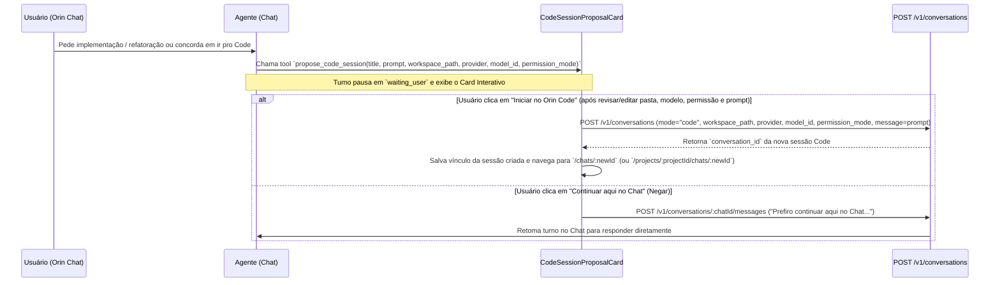

# Spec: Extensões (Plugins/MCPs/Skills), Handoff Chat → Orin Code e Gestão de Projetos/Workspaces

**Data:** 2026-10-16  
**Escopo:** Arquitetural (Backend `agentos` + Frontend React/TypeScript)  
**Referência de Engenharia Reversa:** Claude Desktop (`@ant/desktop` v2.37337.1) & Claude Code (`@anthropic-ai/claude-code` v2.1.295 / v2.1.300)

---

## 1. Visão Geral e Diagnóstico

O objetivo deste design é entregar três capacidades integradas no Orin, alinhadas aos padrões de UX e arquitetura identificados na engenharia reversa do Claude Desktop e Claude Code:

1. **Instalação e configuração de Plugins, MCPs e Skills pelo agente (no Orin Chat e no Orin Code)** quando solicitado pelo usuário.
2. **Sugestão interativa no Orin Chat para iniciar uma sessão no Orin Code** (`propose_code_session` + `CodeSessionProposalCard`), definindo pasta, modelo/provider, modo de permissão e prompt/spec, permitindo ao usuário aceitar (navegando para a nova sessão Code), editar qualquer parâmetro ou negar (continuando no próprio Chat).
3. **Envio da sessão atual (Chat ou Code) para dentro de um Projeto ou criação de Projeto a partir da sessão/workspace atual** (via UI e via Agent Tools), compartilhando pasta, arquivos, memória e histórico entre múltiplos chats e sessões Code do mesmo projeto.

### Diagnóstico da Base Atual do Orin
A investigação do repositório revelou que parte da infraestrutura da Funcionalidade 1 já existe no backend, mas **não funciona em produção** devido a quatro lacunas arquiteturais:
1. **`mcp_service` desconectado do `TurnSession`:** Em `ChatWorker._runtime_for` (`src/agentos/workers/chat.py:1090-1142`), `McpServerService` é instanciado, mas nunca é passado para `TurnSession.__init__` nem para `AgentToolset` em `TurnSession._toolset` (`src/agentos/agentic/session.py:1567-1612`). Como resultado, `list_mcp_catalog`, `list_mcp_servers`, `configure_mcp` e `test_mcp_server` nunca são registradas.
2. **Filtro de fases no Orin Chat (`PhaseController`):** Em `src/agentos/agentic/phases.py`, `create_skill`, `edit_skill` e `read_skill_resource` não constam em nenhuma tupla de `PHASE_TOOLS` ou `TOOLKIT_TOOLS` (ficando inacessíveis no Chat). Além disso, as tools de `mcp` e `plugin` ficam ocultas em `Phase.ORIENT`, exigindo que o agente crie um contrato formal antes de poder atender a um pedido simples como *"instale o MCP do GitHub"*.
3. **Filtro de tools no Orin Code (`CODE_MODE_CORE_TOOLS`):** Em `src/agentos/agentic/runtime.py:44-53`, `CODE_MODE_CORE_TOOLS` inclui apenas `use_skill`, excluindo todas as tools de criação/busca de skills, todas as tools de catálogo/configuração de MCP e todas as tools de busca/instalação de plugins.
4. **Renderização de Cards de Aprovação no Orin Code (`TurnTimeline.tsx`):** Em `frontend/src/features/conversations/TurnTimeline.tsx:704-732`, o bloco `code-mode:` renderiza apenas `PlanApprovalCard`, `toolPermission` e `renderCodeToolSequence`, ignorando eventos com `mcpApproval` e `pluginApproval`.

---

## 2. Funcionalidade 1: Instalação de Plugins, MCPs e Skills no Chat e no Code

### 2.1 Backend: Wiring e Exposição de Tools
1. **Conectar `mcp_service` no `TurnSession` (`src/agentos/agentic/session.py` e `src/agentos/workers/chat.py`):**
   - Adicionar `mcp_service: object | None = None` em `TurnSession.__init__`.
   - Passar `mcp_service=mcp_service` em `ChatWorker._runtime_for` (`src/agentos/workers/chat.py:1139`).
   - Em `TurnSession._toolset` (`src/agentos/agentic/session.py:1594`), passar `mcp_service=self.mcp_service` e `mcp_user_id=str(self.turn.get("user_id") or "") or None` para `AgentToolset`.
2. **Expor Tools de Extensão no Orin Chat (`src/agentos/agentic/phases.py`):**
   - Definir tuplas explícitas:
     - `_SKILL_TOOLS = ("search_skills", "list_skills", "read_skill_resource", "use_skill", "create_skill", "edit_skill")`
     - `_EXTENSION_TOOLS = ("list_mcp_catalog", "list_mcp_servers", "configure_mcp", "test_mcp_server", "search_plugin", "inspect_plugin", "install_plugin", "list_plugins", "uninstall_plugin")`
   - Incluir `_SKILL_TOOLS` e `_EXTENSION_TOOLS` em `PHASE_TOOLS[Phase.ORIENT]` e `PHASE_TOOLS[Phase.EXECUTE]`, além de adicionar a família `"skills": _SKILL_TOOLS` em `TOOLKIT_TOOLS`.
   - Isso garante que no Chat o agente consiga instalar/configurar um MCP, plugin ou criar/editar uma skill imediatamente quando o usuário pedir, sem precisar esgotar o orçamento de `ORIENT`.
3. **Expor Tools de Extensão no Orin Code (`src/agentos/agentic/runtime.py`):**
   - Adicionar em `CODE_MODE_CORE_TOOLS`:
     - Skills: `"search_skills"`, `"list_skills"`, `"read_skill_resource"`, `"use_skill"`, `"create_skill"`, `"edit_skill"`
     - MCPs: `"list_mcp_catalog"`, `"list_mcp_servers"`, `"configure_mcp"`, `"test_mcp_server"`
     - Plugins: `"search_plugin"`, `"inspect_plugin"`, `"install_plugin"`, `"list_plugins"`, `"uninstall_plugin"`
4. **Orientação no System Prompt (`src/agentos/agentic/prompts.py` e `src/agentos/code_mode/prompt.py`):**
   - Documentar claramente para o agente (tanto em Chat quanto em Code) que:
     - Para instalar/conectar um MCP pedido pelo usuário: chamar `list_mcp_catalog` (se necessário) e `configure_mcp(...)`, que exibe o `McpApprovalCard` para o usuário inserir credenciais com segurança e aprovar.
     - Para instalar um plugin: chamar `search_plugin` / `install_plugin(reference)`, que exibe o `PluginApprovalCard` com as contribuições (skills, MCPs, agentes, comandos, hooks) para aprovação do usuário.
     - Para criar ou atualizar uma skill: chamar `create_skill` / `edit_skill` com seções `Workflow` e `Validation`.

### 2.2 Frontend: Renderização Unificada dos Cards na Timeline do Code
1. **`TurnTimeline.tsx` (`frontend/src/features/conversations/TurnTimeline.tsx`):**
   - Em `isCodeToolEvent`: retornar `false` quando o evento possuir `event.mcpApproval`, `event.pluginApproval`, `event.questions` ou `event.codeSessionProposal`, evitando que aprovações interativas sejam engolidas como linhas compactas de tool call.
   - No ramo `if (group.id.startsWith('code-mode:') || first.type.startsWith('code_mode.'))`: adicionar tratamento para eventos interativos (`event.mcpApproval`, `event.pluginApproval`, `event.questions`, `event.codeSessionProposal`), fazendo `flushCodeToolBatch()` e delegando para `renderActivityGroup(...)`.
2. **`ChatPage.tsx` (`frontend/src/features/conversations/ChatPage.tsx`):**
   - Em `openQuestionTurnIds`: garantir que um turno que emitiu `event.mcpApproval`, `event.pluginApproval`, `event.questions` ou `event.codeSessionProposal` (sem evento terminal posterior) seja incluído em `openQuestionTurnIds`, mantendo os botões de Aprovar/Recusar ativos tanto no modo Chat quanto no modo Code.

---

## 3. Funcionalidade 2: Orin Chat Sugerindo Iniciar Sessão no Orin Code

Inspirado no `mcp__cowork__launch_code_session` e no card interativo de proposta de sessão do Claude Desktop (`code-mode-session-workspace-ui.js`).

### 3.1 Fluxo de Usuário e Arquitetura


### 3.2 Backend: Tool `propose_code_session`
- **Onde fica:** `AgentToolset` (`src/agentos/agentic/agent_tools.py`), registrada quando `not self._code_mode_active` (apenas em conversas do modo `chat`), e incluída em `PHASE_TOOLS[Phase.ORIENT]`, `PHASE_TOOLS[Phase.PLAN]` e `PHASE_TOOLS[Phase.EXECUTE]`.
- **Schema de Entrada:**
  - `title` (`string`, obrigatório): título curto da tarefa para a nova sessão Code (ex.: `"Refatorar autenticação JWT"`).
  - `prompt` (`string`, obrigatório): especificação completa e autocontida para iniciar a sessão no Orin Code (objetivo, contexto já discutido no chat, arquivos relevantes e critérios de aceite).
  - `workspace_path` (`string`, opcional): caminho sugerido da pasta local. Se omitido e a conversa atual já possuir uma pasta local vinculada, o backend preenche automaticamente com a pasta local atual da conversa/projeto.
  - `provider` (`string`, opcional): provider sugerido (default: provider atual da conversa).
  - `model_id` (`string`, opcional): modelo sugerido (default: `model_id` atual da conversa).
  - `permission_mode` (`"accept_edits" | "plan_mode" | "ask_permissions"`, opcional, default `"accept_edits"`).
- **Retorno (`ToolOutcome`):**
  - Retorna `ToolOutcome("succeeded", f"Sugestão para iniciar no Orin Code: {title}", "Presented the 'Start in Orin Code' card to the user. Stop here and wait for the user's decision.", payload)`:
    ```json
    {
      "code_session_proposal": {
        "proposal_id": "codeprop_<hex>",
        "title": "...",
        "prompt": "...",
        "workspace_path": "...",
        "provider": "...",
        "model_id": "...",
        "permission_mode": "accept_edits",
        "project_id": "..."
      },
      "wait_for_user": true,
      "tool_kind": "code_handoff"
    }
    ```

### 3.3 Frontend: `CodeSessionProposalCard.tsx`
- **Parsing e Tipagem (`activityTypes.ts`, `conversations.ts`, `activitySummary.ts`):**
  - Novo tipo `CodeSessionProposalRequest` em `activityTypes.ts` e campo `codeSessionProposal?: CodeSessionProposalRequest` em `ConversationActivityEvent`.
  - Em `groupingKey` (`activitySummary.ts`): `if (event.codeSessionProposal) return 'approval:code-session:...'` para nunca colapsar o card dentro de um lote genérico de ferramentas.
- **Interface do Componente (`frontend/src/features/conversations/CodeSessionProposalCard.tsx`):**
  - **Cabeçalho:** Badge `>_ Orin Code` + título da proposta (`title`) + subtítulo explicativo.
  - **Campo de Pasta (`workspace_path`):**
    - Exibe a pasta sugerida (ou `"Workspace gerenciado"` se vazio) + input/botão para digitar ou selecionar outra pasta local, validando via `inspectNewWorkspaceFolder` (`POST /v1/workspaces/inspect`) e exibindo aviso de confirmação caso seja um repositório com risco/git sujo.
  - **Seletor de Modelo / Provider e Modo de Permissão:**
    - Reutiliza `ModelPicker` (permitindo trocar `provider` e `model_id` dentre os providers configurados) e seletor de `permission_mode` (`Aceitar edições`, `Modo Plano`, `Pedir permissão`).
  - **Campo de Prompt / Spec (`prompt`):**
    - `textarea` editável com o prompt completo proposto pelo agente, permitindo ao usuário ajustar instruções antes de iniciar.
  - **Botões de Ação:**
    - **Primário (`"Iniciar no Orin Code"`):**
      - Chama `createConversation(client, { message: prompt, provider, model_id: modelId, project_id: currentProjectId, workspace_path: workspacePath || null, workspace_acknowledged_risk: true, mode: 'code', permission_mode: permissionMode })`.
      - Persiste em `localStorage` (`orin.launched-code-sessions.<proposal_id> = { conversation_id, title, workspace_path }`) para que, se o usuário voltar ao Chat, o card exiba o estado resolvido **"Sessão iniciada no Orin Code"** com botão **"Abrir sessão →"**.
      - Navega imediatamente para `/chats/${receipt.conversation_id}` (ou `/projects/${currentProjectId}/chats/${receipt.conversation_id}`).
    - **Secundário (`"Continuar no Chat"` / `"Negar"`):**
      - Envia mensagem na conversa de Chat atual informando que o usuário recusou abrir o Orin Code e deseja continuar no Chat.

---

## 4. Funcionalidade 3: Enviar Sessão para Projeto ou Criar Projeto no Workspace Atual

Inspirado nos servidores `ccd_directory`, `ccd_sidebar`, `ccd_session_mgmt` e no vínculo de `Space`/`Project` do Claude Desktop.

### 4.1 Modelo de Dados e Comportamento de Workspace
No Orin, conversas avulsas (standalone) usam `workspace_id = conversation_id`, enquanto conversas dentro de um projeto usam `workspace_id = f"workspace:{project_id}"`.

Quando uma sessão (Chat ou Code) é **movida para um projeto** ou **transformada em um novo projeto**:
1. **Atualização do vínculo:** `conversations.project_id` passa a apontar para `project_id` (e `projects.updated_at` é atualizado).
2. **Herança / Sincronização da Pasta Local (`workspace_roots`):**
   - Se a sessão possuía uma pasta local vinculada (`local_workspaces.get_root(user_id, conversation_id)`) e o projeto de destino ainda **não** possui pasta local vinculada (`local_workspaces.get_root(user_id, project.workspace_id) is None`), o backend vincula automaticamente essa mesma pasta local ao `project.workspace_id`.
3. **Migração Segura de Arquivos do Workspace Gerenciado (Scratch Migration):**
   - Se a sessão estava usando um workspace gerenciado (`orin_paths().user_workspaces(user_id) / safe_name(conversation_id)`) e criou arquivos nele, ao mover para o projeto, os arquivos criados no workspace gerenciado da sessão são copiados de forma segura para o diretório raiz efetivo do projeto (sem sobrescrever arquivos existentes e ignorando `.git`, `.orin`, `node_modules`, `.venv` e symlinks), exatamente como o `change_directory` do Claude Desktop faz.
4. **Reassociação de Memórias:**
   - Memórias aprendidas naquela conversa (`agent_memories.conversation_id == conversation_id`) que estavam sem `project_id` podem opcionalmente ser consultadas no escopo do projeto.

### 4.2 Backend: Novos Métodos de Store e Endpoints HTTP
1. **`PostgresChatStore.set_project(conversation_id, user_id, project_id: str | None)` (`src/agentos/conversations/chat.py`):**
   - Verifica propriedade da conversa e (se `project_id` não for `None`) existência do projeto ativo.
   - Atualiza `conversations.project_id = project_id` e `updated_at = now`.
   - Sincroniza `workspace_roots` e migra arquivos do scratch/managed workspace conforme a seção 4.1.
   - Retorna o resumo atualizado da conversa + `project_id` + `workspace` efetivo.
2. **Incluir `project_id` e `project_name` no Snapshot da Conversa (`GET /v1/conversations/{conversation_id}`):**
   - Hoje `PostgresChatStore.get()` não retorna `project_id` no payload de `Conversation`. Passará a retornar `project_id: str | None` e `project_name: str | None`.
3. **Endpoint `PATCH /v1/conversations/{conversation_id}/project` (`src/agentos/api/gateway.py`):**
   - Body: `{"project_id": "project_..." | null}`.
   - Move a conversa para o projeto (ou remove do projeto se `null`) e retorna `{ conversation_id, project_id, project_name, workspace }`.
4. **Estender `POST /v1/projects` (`src/agentos/api/gateway.py`):**
   - `CreateProjectRequest` passa a aceitar:
     - `name: str`
     - `description: str | None = None`
     - `workspace_path: str | None = None`
     - `workspace_acknowledged_risk: bool = False`
     - `source_conversation_id: str | None = None`
   - Se `workspace_path` for enviado, valida via `inspect_directory` e grava em `local_workspaces.set_root(user_id, project.workspace_id, root_path)`.
   - Se `source_conversation_id` for enviado, chama `chat_store.set_project(source_conversation_id, user_id, project.project_id)` (que também herda a pasta local da conversa caso `workspace_path` não tenha sido especificado).
5. **Endpoints de Workspace do Projeto (`PUT /v1/projects/{project_id}/workspace` e `DELETE /v1/projects/{project_id}/workspace`) + `workspace` em `GET /v1/projects/sidebar`:**
   - Permite visualizar e alterar a pasta local vinculada ao projeto diretamente na página do projeto (`ProjectPage.tsx`), e retorna `workspace` em cada item de `GET /v1/projects/sidebar`.

### 4.3 Backend: Agent Tools para Gestão de Projetos e Continuidade entre Sessões
Registradas em `AgentToolset` (`src/agentos/agentic/agent_tools.py`) e expostas tanto no **Orin Chat** (`ORIENT` / `EXECUTE`) quanto no **Orin Code** (`CODE_MODE_CORE_TOOLS`):
1. **`list_projects()`** (`kind="project"`, `read_only=True`):
   - Lista todos os projetos ativos do usuário com `project_id`, `name`, `description`, `workspace_path` e lista compacta de sessões (`conversation_id`, `title`, `mode`).
2. **`create_project_from_session(name: str, description: str = "", workspace_path: str | None = None)`** (`kind="project"`, `mutates=True`):
   - Cria um novo projeto, vincula a pasta atual da sessão (ou `workspace_path` se informado), move a sessão atual (`self._conversation_id`) para dentro do projeto recém-criado e retorna os dados do projeto (`project_id`, `name`, `workspace_path`).
3. **`move_session_to_project(project_id: str)`** (`kind="project"`, `mutates=True`):
   - Move a sessão atual (`self._conversation_id`) para o projeto `project_id`, sincronizando o workspace e retornando o resumo do projeto e o `workspace` efetivo.
4. **`read_project_conversation(conversation_id: str, max_messages: int = 20)`** (`kind="project"`, `read_only=True`):
   - Permite que uma sessão dentro de um projeto leia o histórico/resumo de outra sessão irmã (Chat ou Code) pertencente ao mesmo projeto (ou do próprio usuário), viabilizando continuar o contexto em outros chats/codes sem copiar e colar.
5. **Injeção Automática de Contexto do Projeto (`TurnSession.build_runtime`):**
   - Quando a conversa pertence a um `project_id`, além das memórias do projeto, o prompt inclui a lista compacta das outras sessões recentes do mesmo projeto (`id`, `título`, `modo`), informando ao agente que ele pode usar `read_project_conversation(conversation_id)` se o usuário pedir para continuar ou consultar algo feito em outra sessão do projeto.

### 4.4 Frontend: UI de Projetos na Sessão, Sidebar e ProjectPage
1. **Controle de Projeto no Header da Conversa (`ChatPage.tsx`):**
   - Ao lado do seletor de pasta / indicadores do topo da conversa (tanto em Chat quanto em Code):
     - Se a conversa **não** está em um projeto (`project_id == null`): botão **"Enviar para projeto"** (`data-testid="conversation-project-trigger"`) que abre um popover com:
       - Lista de projetos existentes para mover com 1 clique (`"Mover para <Nome do Projeto>"`).
       - Ação **"Criar projeto a partir desta sessão…"** (pré-preenche o nome sugerido pelo título da conversa e mostra a pasta atual que será compartilhada no projeto).
     - Se a conversa **já está** em um projeto: pill clicável com o nome do projeto (link para `/projects/:projectId`) e menu dropdown para `"Trocar de projeto…"` ou `"Remover do projeto"`.
   - Quando o agente executa `create_project_from_session` ou `move_session_to_project` via tool call, o `loadSnapshot` detecta o novo `project_id` da conversa e atualiza automaticamente o badge do projeto e a sidebar.
2. **Menu de Ação Rápida na Sidebar (`WorkspaceNavigation.tsx`):**
   - No modal `"Novo projeto"` da sidebar, adicionar campo opcional de pasta local (`WorkspaceFolderButton` / input de caminho) para já criar projetos vinculados a uma pasta.
   - Nos itens de conversa da aba `"Chats"`, adicionar botão de ação rápida para enviar a conversa para um projeto.
3. **Evolução da Página do Projeto (`ProjectPage.tsx`):**
   - Exibir e permitir configurar a **pasta local compartilhada** do projeto (`PUT /v1/projects/:projectId/workspace`).
   - Adicionar dois botões de ação direta no cabeçalho do projeto:
     - **"+ Novo Chat neste projeto"** (`/projects/:projectId/new?mode=chat`)
     - **`>_ Novo Code neste projeto`** (`/projects/:projectId/new?mode=code`)
   - Exibir o ícone de modo (`Chat` vs `>_ Code`) ao lado de cada sessão listada dentro do projeto.

---

## 5. Segurança e Mentalidade Adversária (Red-Team)

1. **Isolamento de Credenciais MCP:** `configure_mcp` continua rejeitando qualquer tentativa do modelo de enviar valores de segredos (`**rejected` levanta `AgentToolError`); apenas `secret_names` são aceitos e os valores reais só entram pelo formulário do usuário no `McpApprovalCard`.
2. **Inspeção de Pasta Local e Travessia de Diretório (Path Traversal):**
   - Tanto no `CodeSessionProposalCard`, quanto em `create_project_from_session` e na migração de arquivos de scratch workspace para projeto:
     - Validar todos os caminhos via `inspect_directory` (`src/agentos/local_workspace/inspector.py`).
     - Na cópia de arquivos do workspace gerenciado para a pasta do projeto, ignorar estritamente symlinks (`path.is_symlink()`), caminhos com `..` fora da raiz, diretórios sensíveis (`.git`, `.orin`, `.env`, `node_modules`, `.venv`) e **nunca sobrescrever** arquivos já existentes na pasta de destino (`if dest.exists(): continue`).
3. **Autorização por `user_id`:**
   - `set_project`, `move_session_to_project` e `read_project_conversation` validam estritamente `conversations.c.user_id == user_id` e `projects.c.user_id == user_id`, impedindo leitura ou movimentação cruzada entre usuários.
4. **Invariante de Modo (`chat` vs `code`):**
   - `propose_code_session` nunca muta a conversa de Chat atual para Code; ela sempre cria uma nova conversa com `mode = "code"`, preservando a invariante arquitetural do Orin (*"a conversation is either chat or code forever"*).
