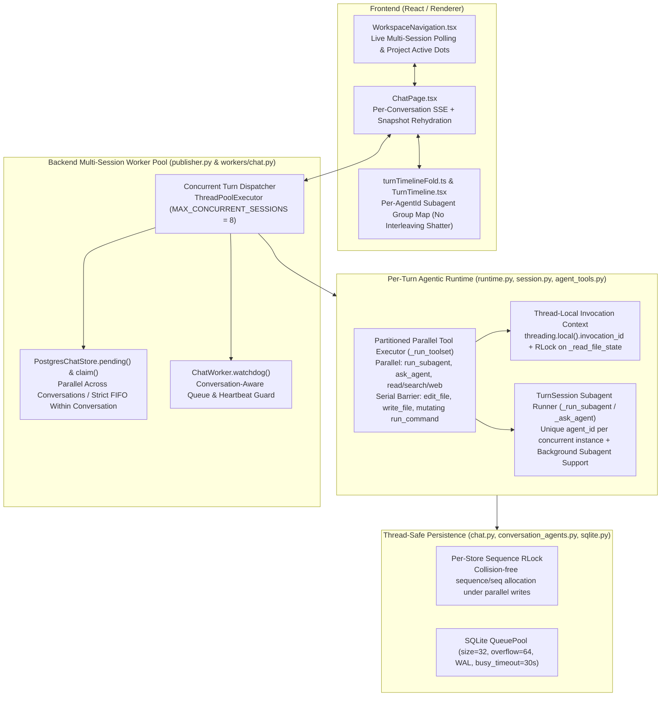

# Spec: Multi-Session & Multi-Agent Concurrency in Orin (Based on Claude Desktop & Claude Code via REA)

**Date:** 2026-10-16  
**Status:** Draft — Awaiting User Approval  
**Evidence Base:** REA Reverse Engineering of Claude Desktop (`v2.37337.1`, `LocalSessionManager`) and Claude Code CLI (`v2.1.295`, `StreamingToolExecutor` / `Zo` / `yX` / `mC` / `Eir`)

---

## 1. Objective

Enable Orin to run:
1. **Multiple concurrent sessions (Orin Chat and Orin Code) simultaneously**, allowing the user to start a task in Session A, switch to Session B (in the same or another project/workspace), start another task in parallel, see live status indicators in the sidebar for all running/waiting sessions, and switch back and forth without blocking, losing streamed tokens, or falsely failing queued turns.
2. **Multiple concurrent agents / subagents simultaneously** within a single turn (both foreground parallel batches and optional background execution), matching Claude Code's concurrency model (`isConcurrencySafe` batching, isolated per-subagent `agent_id` & `readFileState`, thread-local `invocation_id`, and cohesive parallel UI cards in `TurnTimeline`).

---

## 2. Insights from Claude Desktop & Claude Code (via REA)

### 2.1 How Claude Desktop Runs Multiple Sessions (`LocalSessionManager`)
- **Independent Session Execution (`this.sessions = new Map<sessionId, SessionRecord>()`)**:
  - In `local-sessions-ccd-engine.js`, each active session has its own independent execution context (`query`, `abortController`, `messageBuffer`, `pendingCycle`), while enforcing **strict 1-turn-at-a-time FIFO serialization within the same `sessionId`** (`inputStream` / `heldInput`).
  - Two sessions in **different** conversations run 100% in parallel. Two sessions targeting the same Git repo can either share the working directory or use isolated Git worktrees (`startedWithWorktree: true`).
- **Sidebar Attention State Machine (`Xt` / `YB` / `s1`)**:
  - Every session computes a live status: `"running"` (`isRunning || hasBackgroundWork`), `"awaiting_permission"` / `"needs_input"`, `"failed"`, or `"idle"`.
  - Project folders in the sidebar bubble up `hasActive = true` when any child session is `"running"` or `"requires_action"`.
- **Seamless Session Switching (`VO.buckets[sessionId]` + `fetchTranscript` + `messageBuffer`)**:
  - Switching from Running Session A to Running Session B never cancels Session A. When switching back to Session A, the UI merges persisted transcript rows with the live `messageBuffer` and resumes streaming immediately.

### 2.2 How Claude Code Runs Multiple Subagents & Parallel Tools (`Zo`, `Ka`, `Va`, `Ga`, `yX`, `Eir`)
- **Partitioned Concurrency-Safe Batches (`Ka` / `Va` / `Ga`)**:
  - When an assistant turn emits multiple `tool_use` blocks, Claude Code partitions them into contiguous batches by `isConcurrencySafe(input)`:
    - Read-only / subagent tools (`Agent`/`Task`, `Read`, `Grep`, `Glob`, `WebFetch`, `WebSearch`) have `isConcurrencySafe = true` and execute concurrently up to `CLAUDE_CODE_MAX_TOOL_USE_CONCURRENCY` (10).
    - Mutating tools (`Edit`, `Write`, mutating `Bash`) have `isConcurrencySafe = false` and act as **strict serial barriers** — no tool before or after a mutating tool crosses the barrier.
- **Unique Subagent Identity & Concurrency Caps (`$o` / `yX` / `mC`)**:
  - Every new `Agent` (`Task`) tool invocation allocates a **fresh unique `agentId`** (unless explicitly resuming an existing agent via `resume` / `SendMessage`), capped by `CLAUDE_CODE_MAX_CONCURRENT_SUBAGENTS` (20) and `CLAUDE_CODE_MAX_SUBAGENT_SPAWN_DEPTH` (3).
  - Supports both **foreground parallel execution** (multiple `Agent` calls in one assistant message awaited via `Promise.all` / `Okn`) and **background execution** (`run_in_background: true`, returning `status: "async_launched"` with `agentId` immediately while the subagent runs in the background).
- **Per-Subagent Context Isolation (`AsyncLocalStorage` `fA`/`Nn` & `Eir`)**:
  - Each concurrent subagent gets its own isolated `toolUseContext` (`Eir`), its own `AbortController` linked to the parent turn, and its own isolated `readFileState` cache (deep-cloned via `gre` for `fork` subagents, empty `aS` for standard subagents) so parallel subagents never corrupt each other's file state or tool invocation IDs.

---

## 3. Architectural Design for Orin

---

### 3.1 Layer 1: Multi-Session Worker Concurrency (`publisher.py`, `workers/chat.py`, `conversations/chat.py`, `persistence/sqlite.py`)

1. **Multi-Session `ThreadPoolExecutor` in [`src/agentos/workers/publisher.py`](file:///c:/Users/User/Documents/GitHub/Carlos/orin/src/agentos/workers/publisher.py)**:
   - Replace the single-threaded `worker.run(str(pending[0]))` loop with a bounded `ConcurrentTurnRunner` backed by `ThreadPoolExecutor(max_workers=MAX_CONCURRENT_SESSIONS)` (default `8`, configurable via `ORIN_MAX_CONCURRENT_SESSIONS`).
   - Keep `poll_once(worker)` synchronous for existing unit tests, while updating it to claim and run up to `max_workers` eligible pending turns across distinct conversations in parallel (or submit them to the pool in `run_forever` without blocking the polling loop).
   - Periodically refresh `worker.store.heartbeat("chat-worker")` on the main dispatcher loop every poll cycle so the worker heartbeat never expires even while 8 long turns are running.

2. **Per-Conversation Turn Serialization in [`src/agentos/conversations/chat.py`](file:///c:/Users/User/Documents/GitHub/Carlos/orin/src/agentos/conversations/chat.py)**:
   - Update `PostgresChatStore.pending()` (`line 1429`) so it returns pending `conversation_turn_dispatches` **excluding** any `conversation_id` that already has another turn in `state IN ('starting', 'running')` (or another `'claimed'` dispatch), and returns at most **one** earliest pending `turn_id` per `conversation_id` (FIFO).
   - Update `PostgresChatStore.claim(turn_id)` (`line 1439`) to also verify within the transaction that no other turn for the same `conversation_id` is currently in `state == 'running'`, returning `False` if the conversation is busy.
   - Update `ChatWorker.watchdog()` in [`src/agentos/workers/chat.py`](file:///c:/Users/User/Documents/GitHub/Carlos/orin/src/agentos/workers/chat.py#L699-L714) so a turn in `starting` state is **never** failed with `worker_unavailable` while:
     - the worker heartbeat (`"chat-worker"`) is fresh, OR
     - another turn in the same `conversation_id` is currently `running` / `waiting_user`.

3. **Thread-Safe `ChatWorker` Instance State in [`src/agentos/workers/chat.py`](file:///c:/Users/User/Documents/GitHub/Carlos/orin/src/agentos/workers/chat.py)**:
   - Add `self._state_lock = threading.RLock()` on `ChatWorker` to guard `self._reconciliation_turns`, `self._kernel_turns`, and `self._last_heartbeat_mono`.
   - Fix the missing `self._reconciliation_turns.discard(turn_id)` in the `finally` block of `ChatWorker.run` (`line 482`).
   - In `ChatWorker._runtime_for` (`line 1118`), instantiate a **per-turn `HookEngine`** (copying base registered hooks before calling `rehydrate_hooks(engine, self.store, conversation_id)`) instead of mutating the shared `self._hook_engine` across concurrent conversations.

4. **SQLite Pool & Sequence Allocation Thread-Safety (`sqlite.py`, `conversations/chat.py`, `conversation_agents.py`)**:
   - In [`src/agentos/persistence/sqlite.py`](file:///c:/Users/User/Documents/GitHub/Carlos/orin/src/agentos/persistence/sqlite.py#L23-L28), increase `QueuePool` to `pool_size=32, max_overflow=64, pool_timeout=60` and set `PRAGMA busy_timeout=30000` so 8 concurrent sessions × 4 concurrent subagents never exhaust connections or hit `database is locked`.
   - In [`src/agentos/conversations/chat.py`](file:///c:/Users/User/Documents/GitHub/Carlos/orin/src/agentos/conversations/chat.py#L402-L539), add `self._seq_lock = threading.RLock()` on `PostgresChatStore` around sequence allocation + insert in `_activity`, `record_tool_call`, and `record_step` so concurrent subagents in the same turn never collide on `(turn_id, sequence)` or `(turn_id, agent_id, seq)` and never silently drop activity events.

---

### 3.2 Layer 2: Multi-Agent / Subagent Concurrency & Isolation (`runtime.py`, `session.py`, `agent_tools.py`, `conversation_agents.py`)

1. **Claude Code Partitioned Parallel Tool Execution in [`src/agentos/agentic/runtime.py`](file:///c:/Users/User/Documents/GitHub/Carlos/orin/src/agentos/agentic/runtime.py#L1519-L1579)**:
   - Update `_is_parallel_safe_call(call)` (`line 1519`) to include both `"run_subagent"` and `"ask_agent"` alongside read-only tools (`read_file`, `view_file`, `list_files`, `glob_files`, `search_files`, `search_code`, `web_search`, `fetch_url`, `list_skills`, `search_skills`, `read_skill_resource`, `list_projects`, `read_project_conversation`, `check_subagent`).
   - Upgrade `_run_toolset` (`line 1528`) to match Claude Code's `Ka` / `Zo` **partitioned batching**:
     - Instead of requiring *every* tool in the turn to be parallel-safe (which currently falls back to 100% sequential if the model emits `[read_file, read_file, edit_file]`), partition `ordered` into contiguous batches:
       - Contiguous `is_parallel_safe` batches of length `> 1` execute concurrently via `ThreadPoolExecutor(max_workers=min(len(batch), MAX_PARALLEL_TOOLS))` (`MAX_PARALLEL_TOOLS = 8`), preserving deterministic result order.
       - Any non-parallel-safe tool (`edit_file`, `write_file`, `run_command`, etc.) acts as a strict serial barrier and executes alone in order.

2. **Thread-Local `invocation_id` & Isolated `_read_file_state` in [`src/agentos/agentic/agent_tools.py`](file:///c:/Users/User/Documents/GitHub/Carlos/orin/src/agentos/agentic/agent_tools.py) & [`runtime.py`](file:///c:/Users/User/Documents/GitHub/Carlos/orin/src/agentos/agentic/runtime.py)**:
   - Replace the plain attribute `self._active_invocation_id` on `AgentToolset` with a property backed by `self._tls = threading.local()` (`_active_invocation_id` getter/setter reading/writing `getattr(self._tls, "active_invocation_id", None)`), so parallel threads in `_run_toolset` never overwrite each other's `invocation_id`.
   - Guard `self._read_file_state` and `self._tool_calls_count` in `AgentToolset` with `self._state_lock = threading.RLock()`.
   - In `TurnSession._toolset` (`src/agentos/agentic/session.py`), when creating a child `AgentToolset` for a subagent:
     - Pass a deep copy of the parent's `_read_file_state` when `subagent_type == "fork"`, and a fresh isolated `{}` dict for standard subagents (`explore`, `plan`, `general`, `verification`), matching Claude Code's `Eir` / `gre`.

3. **Unique Subagent Instance Identity & Thread-Safe `ConversationAgentStore` (`session.py`, `conversation_agents.py`)**:
   - **Problem Fixed**: Previously, `ConversationAgentStore.agent_id_for(name)` hashed `f"{conversation_id}|{name.lower()}"`. Calling `run_subagent(subagent_type="explore")` twice in parallel produced the **exact same `agent_id` (`agent_...`) and `name="explore"`**, causing DB `IntegrityError`s, step sequence collisions, and merged UI timelines!
   - **Solution (Claude Code `Agent` Identity Model)**:
     - Add explicit optional parameters to `run_subagent`:
       - `agent_id: str | None = None` (or `resume: str | None = None`): when provided, resumes that specific existing subagent instance (loading its prior message history).
       - `run_in_background: bool = False`: when `True`, launches the subagent asynchronously in a background thread scoped to the conversation/session and returns immediately with `{"status": "async_launched", "agent_id": agent_id, "subagent_type": subagent_type, "description": description}`.
     - When `run_subagent` is called **without** `agent_id`/`resume`:
       - Allocate a **unique instance identity** for each spawned subagent (`instance_name = f"{clean_type}:{uuid4().hex[:8]}"`, producing a unique `agent_id = self.agents_store.agent_id_for(instance_name)` while storing `role=clean_type` and `title=description or clean_type`).
       - For `ask_agent(name=..., ...)` (named specialist peer agents), if an agent with `name` is not currently active in another thread, allow reusing/continuing that named agent; if another thread is already actively executing that exact `agent_id` (`self._active_subagent_ids`), automatically suffix a unique instance key so two parallel calls never collide on the same running `agent_id`.
     - Add `check_subagent(agent_id: str, wait_seconds: float = 0.0)` tool so the parent agent can inspect or await a background subagent launched with `run_in_background=True`, and automatically inject completed background subagent outputs into the parent session on the next turn / step (matching Claude Code's `<task-notification>`).
     - Make `ConversationAgentStore.create` and `ConversationAgentStore.record_usage` in [`src/agentos/persistence/postgres/conversation_agents.py`](file:///c:/Users/User/Documents/GitHub/Carlos/orin/src/agentos/persistence/postgres/conversation_agents.py) thread-safe with `self._lock = threading.RLock()` and atomic SQL `SET input_tokens = input_tokens + :inc`.

---

### 3.3 Layer 3: Frontend Parallel Subagent Timeline & Multi-Session Sidebar (`turnTimelineFold.ts`, `TurnTimeline.tsx`, `WorkspaceNavigation.tsx`, `ChatPage.tsx`)

1. **Cohesive Parallel Subagent Cards in [`frontend/src/features/conversations/turnTimelineFold.ts`](file:///c:/Users/User/Documents/GitHub/Carlos/orin/frontend/src/features/conversations/turnTimelineFold.ts)**:
   - **Problem Fixed**: `buildTurnTimeline` previously kept a single `group: ActivityGroup | null` and a single `thoughtBuffer`. When Subagent A (`agent_1`) and Subagent B (`agent_2`) ran in parallel and emitted interleaved SSE events (`A -> B -> A -> B`), `group.id === key` missed on every event, fracturing 2 parallel subagents into 20+ fragmented 1-action `SubagentTaskContainer` blocks and mixing their `thought_delta` streams.
   - **Solution**:
     - Track open subagent groups in a `Map<string, ActivityGroup>` keyed by `event.agentId` (`openSubagentGroups = new Map<string, ActivityGroup>()`), anchored in `items` at the exact index where that subagent first appeared in the turn.
     - Track `thoughtBuffers` in a `Map<string, { id: string; agentId: string; agentName: string; content: string }>()` keyed by `event.agentId || 'main'`.
     - All events emitted by `agent_1` (`agent.spawned`, `tool.requested`, `tool.completed`, `agent.completed`, `thought_delta`) fold cleanly into `agent_1`'s single `SubagentTaskContainer` while `agent_2`'s interleaved events fold cleanly into `agent_2`'s single `SubagentTaskContainer` right below it!
   - In [`frontend/src/features/conversations/TurnTimeline.tsx`](file:///c:/Users/User/Documents/GitHub/Carlos/orin/frontend/src/features/conversations/TurnTimeline.tsx):
     - Display a live `"Em execução"` badge / pulsing indicator on each active `SubagentTaskContainer`, and when 2+ subagents are running or ran in parallel, keep each container clearly labeled with its `subagentType` and `taskDescription` (`Task (explore) · Analisar arquitetura · 4 ações`).

2. **Live Multi-Session Sidebar Status & Switching in [`frontend/src/features/projects/WorkspaceNavigation.tsx`](file:///c:/Users/User/Documents/GitHub/Carlos/orin/frontend/src/features/projects/WorkspaceNavigation.tsx) & [`frontend/src/features/conversations/ChatPage.tsx`](file:///c:/Users/User/Documents/GitHub/Carlos/orin/frontend/src/features/conversations/ChatPage.tsx)**:
   - In `ChatPage.tsx`:
     - Dispatch `window.dispatchEvent(new CustomEvent('orin:projects-updated'))` whenever the active conversation's `state` transitions (e.g., `idle -> running`, `running -> waiting_user`, `running -> completed/failed`) so the sidebar updates immediately.
   - In `WorkspaceNavigation.tsx`:
     - Add a lightweight background refresh interval (`4000ms` while any conversation in `conversations` or `projects` has `state === 'running' || state === 'starting' || state === 'waiting_user'`, or `10000ms` otherwise) so background sessions started in other tabs/conversations update their sidebar status indicators (`state-dot--running`, `state-dot--waiting_user`, `state-dot--failed`) in real time.
     - Add a project-level active dot (`data-testid="project-active-indicator"`) on project folders in `WorkspaceNavigation.tsx` whenever any chat/code session inside that project is `running` or `waiting_user` (matching Claude Desktop's `s1` `hasActive` indicator).

---

## 4. Adversarial & Security Considerations (Red-Team Checklist)

1. **Same-Conversation Race Prevention**:
   - What if a user sends two rapid messages to the *same* conversation while 8 worker threads are polling?
   - Both `pending()` and transactional `claim(turn_id)` enforce at most 1 active `running` turn per `conversation_id`, guaranteeing two worker threads never execute the same conversation simultaneously.
2. **Subagent Spawn Bomb / Recursion**:
   - Subagents already have `run_subagent` and `ask_agent` stripped from their toolset (`is_subagent=True` in `TurnSession._toolset`), enforcing nesting depth `= 1`, and we cap concurrent subagents per turn (`MAX_PARALLEL_TOOLS = 8`, `MAX_BACKGROUND_SUBAGENTS_PER_TURN = 6`).
3. **File Mutation Race Across Parallel Tools**:
   - Only read-only tools and subagent tools (`explore`, `plan`, `verification`, or isolated `run_subagent`) are marked parallel-safe in `_run_toolset`; `write_file`, `edit_file`, `delete_file`, and `run_command` act as strict serial barriers (`!_is_parallel_safe_call`), preventing two tools in the same turn from editing the same file simultaneously.
4. **SQLite Lock / Sequence Exhaustion Under High Concurrency**:
   - Protected by `PostgresChatStore._seq_lock` (`threading.RLock()`) and expanded `QueuePool(pool_size=32, max_overflow=64)` + `busy_timeout=30000`.
5. **Cancellation Cascade**:
   - Cancelling a turn (`POST /v1/conversations/{id}/cancel`) cancels both the parent turn and all active foreground/background subagents spawned by that turn via `self.cancelled(str(turn_id))`.
