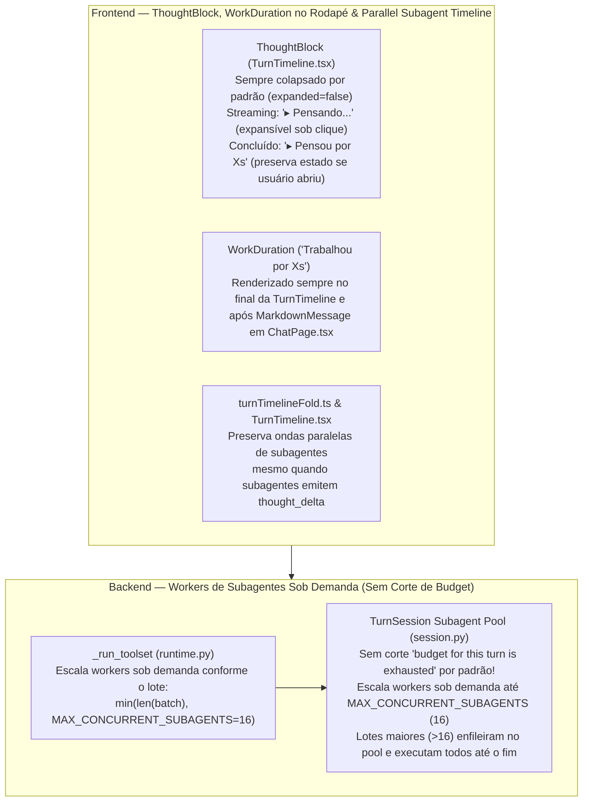

# Spec: Pensamento Expansível durante Streaming, Duração no Rodapé & Escalonamento Sob Demanda de Subagentes em Paralelo

**Data:** 2026-10-17  
**Status:** Aprovado pelo Carlos  
**Escopo:** Frontend (`TurnTimeline.tsx`, `ChatPage.tsx`, `turnTimelineFold.ts`, `agentos.css`) + Runtime/Agentes (`session.py`, `runtime.py`, `conversation_worker.py`, `chat.py`)

---

## 1. Contexto e Diagnóstico Causa-Raiz

### 1.1 Problema 1 — Poluição Visual do Pensamento (`Pensando...`) durante o Streaming & Posição de `"Trabalhou por Xs"`
- **Comportamento Atual (`ThoughtBlock`):**
  - Em [`frontend/src/features/conversations/TurnTimeline.tsx`](file:///c:/Users/carlos/Documents/projetos/orin/frontend/src/features/conversations/TurnTimeline.tsx#L211-L269), o componente `ThoughtBlock` possui duas árvores de renderização distintas:
    1. Quando `isStreaming === true` (`thought.status === 'streaming' && !turnCompleted`), renderiza um cabeçalho estático `<div className="thought-block__header">` (`Pensando...`) e **sempre renderiza `<div className="thought-block__body">{thought.content}</div>` aberto**.
    2. Somente quando `isStreaming === false` (após concluir o pensamento), passa a renderizar o `<button className="thought-block__toggle">` recolhido por padrão (`expanded = false`, `▸ Pensou por Xs`).
  - Como resultado, raciocínios longos (ex.: 1m40s) despejam dezenas de linhas de monólogo interno em tempo real na timeline antes da resposta, poluindo a UI e duplicando visualmente o indicador do `AgentPulse` no rodapé.
- **Comportamento Atual (`"Trabalhou por Xs"` no Topo):**
  - Em [`TurnTimeline.tsx#L1085-L1092`](file:///c:/Users/carlos/Documents/projetos/orin/frontend/src/features/conversations/TurnTimeline.tsx#L1085-L1092) e [`ChatPage.tsx#L1703-L1712`](file:///c:/Users/carlos/Documents/projetos/orin/frontend/src/features/conversations/ChatPage.tsx#L1703-L1712), o rótulo `workDurationLabel` (`data-testid="turn-work-duration"`, ex.: `"Trabalhou por 7s"`) é renderizado no **início** da timeline / acima da resposta (`<MarkdownMessage>`), quando deveria aparecer sempre no **final da resposta**.
- **Risco Colateral Identificado (Análise Adversarial):**
  - Em [`src/agentos/agentic/session.py`](file:///c:/Users/carlos/Documents/projetos/orin/src/agentos/agentic/session.py#L892-L909), quando um **subagente** emite `thinking_delta`, `self._record(...)` não estava propagando `parent_agent_id=self.main_agent_id if is_subagent else None`.
  - Além disso, em [`frontend/src/features/conversations/TurnTimeline.tsx`](file:///c:/Users/carlos/Documents/projetos/orin/frontend/src/features/conversations/TurnTimeline.tsx#L1155-L1220), um item `thought` emitido por um subagente durante uma onda paralela podia interromper o agrupamento `ParallelSubagentsGroup`.

---

### 1.2 Problema 2 — Falha ao Rodar Muitos Subagentes em Paralelo (`"budget for this turn is exhausted"`) Mesmo com Limites Desativados
- **Diagnóstico Causa-Raiz no Código:**
  1. **Trava Hardcoded `MAX_SUBAGENTS_PER_TURN = 4` Ignorando Limites Desativados ([`src/agentos/agentic/session.py#L107`](file:///c:/Users/carlos/Documents/projetos/orin/src/agentos/agentic/session.py#L107) e [`L1401-L1404`](file:///c:/Users/carlos/Documents/projetos/orin/src/agentos/agentic/session.py#L1401-L1404)):**
     - Mesmo com `max_iterations = None` e `max_actions = None` (desativados nas configurações), [`session.py`](file:///c:/Users/carlos/Documents/projetos/orin/src/agentos/agentic/session.py#L1401-L1404) possui uma trava fixa e independente:
       ```python
       MAX_SUBAGENTS_PER_TURN = 4
       ...
       with self._subagent_lock:
           if self._subagent_runs >= MAX_SUBAGENTS_PER_TURN:
               return ToolOutcome("failed", "Limite de subagentes atingido", "The subagent budget for this turn is exhausted; finish the work yourself.", {"tool_kind": "agent"}, "SUBAGENT_LIMIT")
           self._subagent_runs += 1
       ```
     - Como `self._subagent_runs` é cumulativo no turno e fixado em `4`, qualquer tentativa de rodar 8+ subagentes em paralelo (ex.: traduzir 9 aulas simultaneamente) — ou mesmo rodar 2 lotes de 3 no mesmo turno — corta a partir do 5º subagente retornando `"The subagent budget for this turn is exhausted; finish the work yourself."` (`SUBAGENT_LIMIT`).
  2. **Pool de Workers de Ferramentas Paralelas Fixado em 4 (`MAX_PARALLEL_TOOLS = 4` em [`src/agentos/agentic/runtime.py#L25`](file:///c:/Users/carlos/Documents/projetos/orin/src/agentos/agentic/runtime.py#L25) e [`L1646`](file:///c:/Users/carlos/Documents/projetos/orin/src/agentos/agentic/runtime.py#L1646)):**
     - Quando o modelo emite 8, 10 ou 15 chamadas `run_subagent` na mesma resposta, `_run_toolset` ([`runtime.py#L1646`](file:///c:/Users/carlos/Documents/projetos/orin/src/agentos/agentic/runtime.py#L1646)) cria um `ThreadPoolExecutor(max_workers=min(len(run_indexes), MAX_PARALLEL_TOOLS))` limitado a apenas `4` threads.
     - O mesmo ocorre em `_bg_subagent_executor` ([`session.py#L1420`](file:///c:/Users/carlos/Documents/projetos/orin/src/agentos/agentic/session.py#L1420)) e `_ask_agents` ([`session.py#L1814`](file:///c:/Users/carlos/Documents/projetos/orin/src/agentos/agentic/session.py#L1814)), que usavam `max_workers=MAX_SUBAGENTS_PER_TURN` (`4`).
  3. **Limite de Abas Isoladas do Browser (`MAX_AGENT_PAGES = 6` em [`src/agentos/browser/conversation_worker.py#L44`](file:///c:/Users/carlos/Documents/projetos/orin/src/agentos/browser/conversation_worker.py#L44)):**
     - Dimensionado originalmente para `1 + 4 + 1 = 6`. Se mais de 5 subagentes usarem o browser em paralelo, falta slot de página.

---

## 2. Arquitetura Proposta



### 2.1 Parte 1: `ThoughtBlock` Expansível Durante o Pensamento & `"Trabalhou por Xs"` no Final da Resposta
1. **Unificação do Toggle em [`TurnTimeline.tsx`](file:///c:/Users/carlos/Documents/projetos/orin/frontend/src/features/conversations/TurnTimeline.tsx#L211-L269):**
   - `ThoughtBlock` inicia sempre com `expanded = false` (recolhido por padrão, tanto em `streaming` quanto em `completed`).
   - Enquanto `isStreaming === true`:
     - Renderiza o container `thought-block thought-block--streaming` (`data-testid="thought-block-streaming"`).
     - O cabeçalho é um `<button type="button" onClick={() => setExpanded((prev) => !prev)} aria-expanded={expanded} data-testid="thought-block-toggle" className="thought-block__toggle">`:
       - Ícone de expansão: `<span aria-hidden="true">{expanded ? '▾' : '▸'}</span>`
       - Dot pulsante + label com shimmer: `<span className="agent-pulse__dot" aria-hidden="true" /> <span className="agent-pulse__label--shimmer">Pensando...</span>`
     - O corpo `<div className="thought-block__body">{thought.content}</div>` **só é renderizado se `expanded && thought.content`**.
   - Quando `isStreaming` transita para `false` (`completed`):
     - Renderiza `thought-block thought-block--completed` (`data-testid="thought-block-completed"`).
     - Preserva o estado `expanded` (se o usuário clicou para abrir enquanto pensava, continua aberto; se não clicou, permanece recolhido em `▸ Pensou por Xs`).
2. **Posicionamento de `"Trabalhou por Xs"` sempre no Final da Resposta ([`TurnTimeline.tsx`](file:///c:/Users/carlos/Documents/projetos/orin/frontend/src/features/conversations/TurnTimeline.tsx#L1085-L1258) e [`ChatPage.tsx`](file:///c:/Users/carlos/Documents/projetos/orin/frontend/src/features/conversations/ChatPage.tsx#L1702-L1713)):**
   - Em [`TurnTimeline.tsx`](file:///c:/Users/carlos/Documents/projetos/orin/frontend/src/features/conversations/TurnTimeline.tsx), mover o bloco `{workDurationLabel && (<div data-testid="turn-work-duration" ...>{workDurationLabel}</div>)}` do topo de `<div className="turn-timeline">` para o **final**, logo após `</AnimatePresence>` (usando `pt-1` em vez de `pb-1`).
   - Em [`ChatPage.tsx`](file:///c:/Users/carlos/Documents/projetos/orin/frontend/src/features/conversations/ChatPage.tsx#L1702-L1713), no fallback sem `timeline`, mover `{turnWorkDurationLabel && ...}` para **depois** de `<MarkdownMessage ... />`.
3. **Isolamento de `thinking_delta` de Subagentes ([`session.py`](file:///c:/Users/carlos/Documents/projetos/orin/src/agentos/agentic/session.py) e [`TurnTimeline.tsx`](file:///c:/Users/carlos/Documents/projetos/orin/frontend/src/features/conversations/TurnTimeline.tsx)):**
   - Em `TurnSession.emit_lifecycle` (`state == "thinking_delta"`), incluir `parent_agent_id=self.main_agent_id if is_subagent else None`.
   - Em `TurnTimeline.tsx`, garantir que itens `thought` pertencentes a um subagente não quebrem o agrupamento `ParallelSubagentsGroup` quando múltiplos subagentes rodam em paralelo.

### 2.2 Parte 2: Workers Sob Demanda e Fim do Corte `"budget for this turn is exhausted"`
1. **Remoção do Corte de Orçamento de Subagentes por Turno + Workers Sob Demanda ([`session.py`](file:///c:/Users/carlos/Documents/projetos/orin/src/agentos/agentic/session.py)):**
   - Definir `MAX_CONCURRENT_SUBAGENTS = max(1, int(os.environ.get("ORIN_MAX_CONCURRENT_SUBAGENTS", "16") or "16"))` (teto de workers rodando simultaneamente em paralelo, criados sob demanda).
   - **Sem corte artificial por turno (`max_subagents_per_turn: int | None = None` por padrão):**
     - Por padrão (ou sempre que `ORIN_MAX_SUBAGENTS_PER_TURN` não for definido explicitamente), **não há limite de quantidade de subagentes por turno** — nenhum subagente será rejeitado com `"The subagent budget for this turn is exhausted"`.
     - Se o agente disparar 3 subagentes, o pool sobe 3 workers sob demanda. Se disparar 12 subagentes em paralelo, o pool sobe 12 workers sob demanda. Se disparar 24 subagentes de uma só vez, o pool sobe 16 workers simultâneos (controlados por `BoundedSemaphore(MAX_CONCURRENT_SUBAGENTS)`) e os outros 8 aguardam na fila e executam assim que os primeiros terminam, entregando todos os 24 resultados com sucesso!
     - Manter suporte opcional a `max_subagents_per_turn` no `TurnSession` (ou via env `ORIN_MAX_SUBAGENTS_PER_TURN`) apenas caso algum teste ou configuração explícita deseje impor um teto manual.
2. **Escalonamento Sob Demanda no Executor de Ferramentas `_run_toolset` ([`runtime.py`](file:///c:/Users/carlos/Documents/projetos/orin/src/agentos/agentic/runtime.py)):**
   - Elevar `MAX_PARALLEL_TOOLS` de `4` para `8` para ferramentas de leitura comuns.
   - Para ondas que contenham subagentes (`run_subagent`, `ask_agent`, `check_subagent`), escalar `ThreadPoolExecutor(max_workers=min(len(run_indexes), MAX_CONCURRENT_SUBAGENTS))` (até `16` workers criados sob demanda conforme o tamanho do lote pedido pelo modelo).
   - Para `_bg_subagent_executor` (`run_in_background=True`) e `_ask_agents`, também escalar `max_workers` sob demanda até `MAX_CONCURRENT_SUBAGENTS` (`16`).
3. **Ajuste de Capacidade de Recursos Compartilhados ([`conversation_worker.py`](file:///c:/Users/carlos/Documents/projetos/orin/src/agentos/browser/conversation_worker.py)):**
   - Em [`src/agentos/browser/conversation_worker.py`](file:///c:/Users/carlos/Documents/projetos/orin/src/agentos/browser/conversation_worker.py#L44), elevar `MAX_AGENT_PAGES` de `6` para `20` (`1` agente principal + até `16` subagentes simultâneos + folga).

---

## 3. Análise Adversarial, Segurança e Tratamento de Erros

1. **Controle de Concorrência Simultânea vs. Fila Elástica:**
   - E se o modelo disparar 20 ou 30 subagentes de uma vez (ex.: 12 via `run_subagent` + 8 via `run_in_background=True`)?
   - Um `BoundedSemaphore(MAX_CONCURRENT_SUBAGENTS)` compartilhado na `TurnSession` garante que no máximo `16` subagentes executem chamadas simultâneas ao provedor/disco ao mesmo tempo, enquanto os demais aguardam vaga na fila sem falhar.
2. **Cancelamento Imediato de Subagentes na Fila:**
   - Se o usuário clicar em "Parar" enquanto 16 subagentes estão rodando e outros 4 estão aguardando vaga no semáforo:
     - Assim que um subagente na fila adquire o semáforo em `_execute_subagent_run`, verificamos `if self.cancelled(self.turn):` **antes** de instanciar o provedor ou iniciar o `AgenticTurnRuntime`, encerrando-o imediatamente como `cancelled` sem gastar tokens nem fazer requisições extras.
3. **Contenção de Sequência no SQLite com 16 Subagentes Simultâneos:**
   - Em [`src/agentos/conversations/chat.py`](file:///c:/Users/carlos/Documents/projetos/orin/src/agentos/conversations/chat.py#L431-L571), `_activity`, `record_tool_call` e `record_step` já usam `self._sequence_lock`, mas tinham `range(16)` tentativas caso outra conexão colidisse. Aumentaremos a janela de retry para `64` para garantir zero perda de eventos sob alta concorrência.

---

## 4. Plano de Testes (TDD + Verificação Visual)

1. **Frontend Unit Tests (`frontend/tests/unit/TurnTimeline.test.tsx`, `frontend/src/features/conversations/mediaAndMetricsUx.test.tsx`):**
   - `ThoughtBlock` em `streaming` inicia **recolhido** (`aria-expanded="false"`, exibe `▸` e `Pensando...` com shimmer, oculta `thought.content`).
   - Clicar no botão durante `streaming` expande (`▾ Pensando...`) e mostra `thought.content` ao vivo; ao transitar para `completed`, mantém aberto com `▾ Pensou por Xs`.
   - Quando não clicado durante `streaming`, transita recolhido para `▸ Pensou por Xs` e abre ao clicar.
   - `"Trabalhou por Xs"` (`data-testid="turn-work-duration"`) é renderizado **após** o texto da resposta (no final do `TurnTimeline` e após `MarkdownMessage` no `ChatPage`), nunca acima.
   - Múltiplos subagentes paralelos emitindo `thought_delta` mantêm o `ParallelSubagentsGroup` coeso.
2. **Backend Unit & Adversarial Tests (`tests/unit/agentic/test_turn_session.py`, `test_agentic_runtime_loop.py`):**
   - Disparar **12 subagentes em paralelo** na mesma rodada (`_run_toolset` e `_ask_agents`) e múltiplos lotes sequenciais no mesmo turno (ex.: 3 ondas de 6 = 18 subagentes), provando que **todos concluem com sucesso** sem `SUBAGENT_LIMIT`.
   - Disparar uma onda maior que `max_concurrent_subagents` (ex.: `max_concurrent_subagents=4`, disparando 10 subagentes simultâneos): provar que o pico de workers ativos nunca ultrapassa 4 (controle sob demanda + semáforo) e que todos os 10 terminam com `succeeded`.
   - Testar cancelamento de turno com subagentes aguardando vaga no semáforo (garantindo que não chamam o provedor).
3. **Verificação Visual no Navegador Real (Playwright):**
   - Validar visualmente no navegador (desktop e mobile) o estado recolhido/expansível de `Pensando...` durante o streaming, após concluir (`Pensou por Xs`), e `"Trabalhou por Xs"` no final da resposta.
