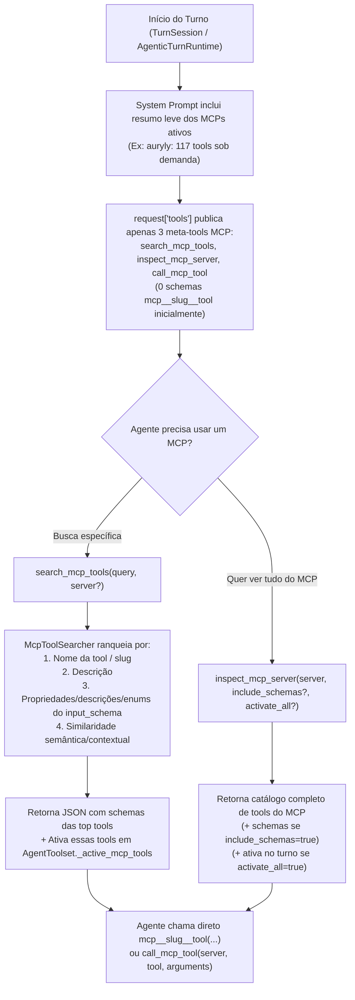

# Especificação de Design: Lazy Loading, Busca Semântica/Contextual de Tools MCP e Remoção de Limite de Tools

- **Data:** 2026-10-17
- **Status:** Aprovado pelo Carlos
- **Escopo:** `src/agentos/mcp/`, `src/agentos/agentic/`, `tests/unit/mcp/`, `tests/unit/agentic/`

---

## 1. Contexto e Problema

1. **Explosão de tokens de entrada com MCPs grandes:**
   - Hoje, qualquer servidor MCP ativo tem **todas** as suas ferramentas (`mcp__<slug>__<tool>`) injetadas de forma *eager* em `request["tools"]` em **todas** as chamadas ao provedor (tanto nas fases `ORIENT`/`EXECUTE` via `TOOLKIT_KINDS["mcp"]` quanto no Modo Code).
   - Exemplo real: o MCP `Auryly` possui 117 ferramentas (~147 KB de JSON schemas + descrições), consumindo **40.536 tokens estimados (~47k tokens reais no tokenizador Qwen)** em cada iteração, mesmo em conversas que não têm relação alguma com o MCP. Num turno de 4 iterações, apenas o schema inativo do MCP consome ~162.000 tokens de entrada.
2. **Limite artificial de tools por servidor MCP (`MAX_TOOLS_PER_SERVER = 256`):**
   - Em `src/agentos/mcp/sanitize.py`, `sanitize_tool_descriptors` rejeita inteiramente qualquer servidor MCP que publique mais de 256 ferramentas (`UntrustedDescriptorRejected`), além de `McpClient.list_tools` cortar a paginação em `MAX_TOOL_PAGES = 8`. Com lazy loading, esse limite não faz sentido e impede conectar servidores MCP extensos.
3. **Erro opaco em `MediaGenerationClient` no OpenRouter (`Provider returned error`):**
   - Quando um modelo de imagem no OpenRouter (como `google/gemini-nano-banana-2.1`) sofre rate-limit (`HTTP 429 Too Many Requests`) ou erro no provedor upstream antes de gerar tokens, o OpenRouter não registra a chamada no histórico de cobrança (Activity Log) e retorna `{"error": {"message": "Provider returned error", "code": 429, "metadata": {"provider_name": "...", "raw": "..."}}}`.
   - Hoje, `MediaGenerationClient._extract_error` lê apenas `error.message` (`"Provider returned error"`), descartando o status HTTP (`429`) e o `metadata` com a causa real, levando o modelo a tentar chamar `generate_image` repetidamente às cegas.

---

## 2. Objetivos e Requisitos

1. **Remover o limite de quantidade de tools por servidor MCP:**
   - Remover a trava `MAX_TOOLS_PER_SERVER` de `sanitize_tool_descriptors` para que servidores MCP possam publicar qualquer número de ferramentas.
   - Em `McpClient.list_tools`, substituir o limite fixo de 8 páginas por paginação com detecção de ciclo de cursor (`seen_cursors`) e teto de segurança alto (`MAX_TOOL_PAGES = 1000`).
2. **Lazy Load Puro por padrão:**
   - Nenhum schema individual `mcp__<slug>__<tool>` é enviado em `request["tools"]` no início do turno.
   - O `system_prompt` informa de maneira ultracompacta quais servidores MCP ativos estão conectados (nome, `slug` e quantidade de ferramentas disponíveis sob demanda).
3. **Três capacidades nativas para o agente operar MCPs sob demanda:**
   - **`search_mcp_tools`**: busca ferramentas nos MCPs ativos por **nome**, **descrição** ou **schema** (nomes/descrições de propriedades, tipos, `enum`), combinando ranking contextual/léxico (BM25/term-overlap ponderado por campo, tokenização camelCase/snake_case e correspondência parcial/prefixo) e scorer semântico opcional. Retorna os schemas completos das ferramentas encontradas **e as ativa automaticamente** na janela de tools do turno atual.
   - **`inspect_mcp_server`**: permite ao agente **puxar todas as informações de um MCP específico** (`server` por slug ou nome), listando todas as suas ferramentas e descrições, com flag opcional `include_schemas=True` (para receber todos os `input_schema` completos) e `activate_all=True` (para publicar as tools do servidor diretamente em `request["tools"]` no turno atual).
   - **`call_mcp_tool`**: permite ao agente invocar qualquer ferramenta de um MCP ativo passando `server`, `tool` e `arguments` diretamente (sem precisar aguardar uma nova iteração para que o schema `mcp__<slug>__<tool>` apareça na lista de tools do provedor), mantendo a mesma política de permissões, auditoria e tratamento de erros.
4. **Diagnóstico claro de erros HTTP/OpenRouter no `MediaGenerationClient`:**
   - Incluir `HTTP <status>` e detalhes de `error.metadata` (`provider_name` e `raw`) em `MediaGenerationClient._extract_error` para que erros `429 Too Many Requests` ou recusas de upstream no OpenRouter sejam informados com clareza ao agente e ao usuário.

---

## 3. Arquitetura e Componentes



### 3.1. Remoção do Limite de Tools (`src/agentos/mcp/sanitize.py` e `src/agentos/mcp/client.py`)
- Em [`sanitize.py`](file:///c:/Users/carlos/Documents/projetos/orin/src/agentos/mcp/sanitize.py):
  - `sanitize_tool_descriptors(payload)` deixa de lançar `UntrustedDescriptorRejected` quando `len(items) > MAX_TOOLS_PER_SERVER`.
  - Mantemos a validação individual de cada ferramenta (nome válido `_TOOL_NAME`, `schema.get("type") == "object"`, profundidade máxima `MAX_SCHEMA_DEPTH` e tamanho individual do schema `MAX_SCHEMA_BYTES`) para que uma ferramenta malformada seja ignorada sem derrubar o servidor inteiro.
- Em [`client.py`](file:///c:/Users/carlos/Documents/projetos/orin/src/agentos/mcp/client.py):
  - `list_tools()` rastreia `seen_cursors: set[str]` para interromper imediatamente se o servidor repetir um `nextCursor`, com limite de segurança `MAX_TOOL_PAGES = 1000`.

### 3.2. Motor de Busca Contextual e Semântica de Tools MCP (`src/agentos/mcp/search.py`)
Novo módulo dedicado e livre de dependências externas pesadas, capaz de indexar e pesquisar todas as ferramentas dos servidores MCP ativos:
- **Indexação de `McpToolDescriptor` por campo:**
  - **Identificadores (peso 8x):** tokens do nome da tool (`snake_case`, `camelCase`, `kebab-case` separados), nome completo e `slug` / `display_name` do servidor.
  - **Descrição da tool (peso 4x):** tokens normalizados (sem acentos, lowercase, radicais/prefixos PT/EN de 4+ caracteres para capturar variações como `metrica`/`metricas`, `funil`/`funnel`, `pagina`/`page`).
  - **Schema (`input_schema`) (peso 5x para nomes de parâmetros, 3x para descrições/enums):** extrai recursivamente de `properties`, `required`, `items`, `anyOf`/`oneOf`:
    - nomes dos campos (`funnel`, `step_id`, `slug`, `date_from`, etc.),
    - descrições dos parâmetros,
    - valores de `enum` e `title`.
  - **Scorer Semântico Opcional:** aceita um `semantic_scorer: Callable[[str, McpToolSearchDocument], float] | None` (mesmo padrão arquitetural de [`SkillRetriever`](file:///c:/Users/carlos/Documents/projetos/orin/src/agentos/skills/retrieval.py)) para enriquecimento vetorial quando disponível, sem jamais bloquear ou falhar se offline.
- **Modos de consulta:**
  - Se `query` for vazio/omitido e `server` for informado, retorna as ferramentas daquele servidor em ordem alfabética.
  - Se `query` for informado, pontua todas as ferramentas habilitadas (filtradas por `server` se especificado), suportando correspondência exata de substring, interseção de termos, prefixos/radicais e expansão de termos equivalentes comuns (PT ↔ EN, ex.: `metrica`/`metrics`, `criar`/`create`, `listar`/`list`, `atualizar`/`update`, `excluir`/`delete`/`remove`, `pagina`/`page`, `usuario`/`user`).

### 3.3. Ferramentas Nativas de Lazy Loading no `AgentToolset` (`src/agentos/agentic/agent_tools.py`)
Quando `self._mcp_provider` estiver presente com servidores ativos:
1. **Estado de ativação por turno (`self._active_mcp_tool_names: set[str]`):**
   - Inicia vazio (`set()`) em cada turno.
   - `AgentToolset.schemas(allowed, kinds)`:
     - As meta-tools de gerenciamento/descoberta (`list_mcp_catalog`, `list_mcp_servers`, `configure_mcp`, `test_mcp_server`, `search_mcp_tools`, `inspect_mcp_server`, `call_mcp_tool`) têm `kind="mcp_meta"` (ou são incluídas explicitamente em `_EXTENSION_TOOLS` / `CODE_MODE_CORE_TOOLS`), sendo sempre publicadas quando apropriado.
     - As ferramentas remotas `mcp__<slug>__<tool>` (que têm `kind="mcp"`) **só** têm seus schemas incluídos em `AgentToolset.schemas()` se `item.name in self._active_mcp_tool_names`!
     - `AgentToolset.resolve(name)` continua enxergando **todas** as definições em `self._by_name`, permitindo que tanto `call_mcp_tool` quanto uma chamada direta a `mcp__<slug>__<tool>` funcionem a qualquer momento.
2. **Definição das 3 novas tools:**
   - **`search_mcp_tools(query: str = "", server: str | None = None, limit: int = 10, activate: bool = True)`**:
     - Busca ferramentas por nome, descrição ou campos do schema JSON.
     - Quando `activate=True` (padrão), adiciona as ferramentas encontradas em `self._active_mcp_tool_names`, disponibilizando seus schemas nativos `mcp__<slug>__<tool>` para chamada direta a partir da próxima iteração.
     - Retorna para o agente: `qualified_name` (`mcp__<slug>__<tool>`), `server`, `tool`, `description`, `input_schema` completo e `score`.
   - **`inspect_mcp_server(server: str, include_schemas: bool = False, activate_all: bool = False, offset: int = 0, limit: int = 200)`**:
     - Puxa todas as informações de um servidor MCP ativo (`slug` ou `display_name`): metadados do servidor, contagem total de tools e a lista de tools (`name`, `qualified_name`, `description` e, se `include_schemas=True`, o `input_schema` completo de cada uma).
     - Se `activate_all=True`, ativa todas as tools retornadas em `self._active_mcp_tool_names` para o turno atual.
   - **`call_mcp_tool(server: str, tool: str, arguments: dict[str, object] | None = None)`**:
     - Executa diretamente a ferramenta `tool` do servidor `server` (aceita tanto o nome curto `get_funnel_metrics` quanto o qualificado `mcp__auryly__get_funnel_metrics`), repassando `arguments` ao handler do `McpToolProvider`.
     - Respeita `read_only_mode`, `ToolPolicy` e `ToolPermissionBroker` exatamente como uma chamada direta `mcp__<slug>__<tool>`.

### 3.4. Resumo de MCPs no System Prompt (`src/agentos/agentic/session.py` e `prompts.py`)
- Em `TurnSession.build_runtime()` e `_subagent_prompt()`:
  - O bloco `volatile` passa a listar um resumo enxuto dos MCPs conectados naquela sessão, por exemplo:
    ```markdown
    ## Connected MCP servers (lazy-loaded)
    Tool schemas from connected MCP servers are lazy-loaded to save context window.
    - `auryly` (Auryly): 117 tools available.
    Use `search_mcp_tools(query="...", server="...")` to find tools by name, description, or schema (this also activates them), `inspect_mcp_server(server="...", include_schemas=...)` to pull all tools/info from a server, or `call_mcp_tool(server="...", tool="...", arguments={...})` to invoke a tool directly.
    ```
- Em `src/agentos/agentic/phases.py`:
  - Adicionar `search_mcp_tools`, `inspect_mcp_server` e `call_mcp_tool` em `_EXTENSION_TOOLS` e em `CODE_MODE_CORE_TOOLS` (`runtime.py`), garantindo disponibilidade tanto no Chat normal quanto no Modo Code e em subagentes.
  - Atualizar a instrução de `Phase.ORIENT` para informar que ferramentas de servidores MCP ativos são carregadas sob demanda com `search_mcp_tools` / `inspect_mcp_server` / `call_mcp_tool`.

### 3.5. Melhoria no Erro de Mídia (`src/agentos/agentic/media_client.py`)
- Em `MediaGenerationClient._extract_error(response)`:
  - Extrair o código HTTP (`HTTP 429`, etc.), `error.message`, `error.metadata.provider_name` e a mensagem interna de `error.metadata.raw` (quando for JSON ou string legível), formatando:
    `HTTP 429: Provider returned error (Google: ...)` em vez de apenas `Provider returned error`.

---

## 4. Tratamento de Erros, Segurança e Casos de Borda (Postura Adversarial)

1. **Prevenção de Explosão de Contexto por `activate_all=True` ou buscas repetidas:**
   - `inspect_mcp_server` tem `include_schemas=False` e `activate_all=False` por padrão, paginando com `limit=200` (máx. 500 por chamada) e truncando o payload em `MAX_MCP_RESULT_CHARS` se um servidor tiver milhares de schemas gigantescos.
2. **Prevenção de Bypass de Permissões via `call_mcp_tool`:**
   - Como `call_mcp_tool` é declarada com `policy_tags=("mcp", "mutates")`, qualquer chamada em `ask_permissions` ou `plan_mode` passa pelo `ToolPermissionBroker` e bloqueia em `read_only_mode` (`explore` / `plan` subagents têm acesso apenas a `search_mcp_tools` e `inspect_mcp_server` em modo leitura, nunca a `call_mcp_tool`!).
3. **Servidores MCP com centenas/milhares de tools ou cursores maliciosos:**
   - `McpClient.list_tools` detecta cursores repetidos (`seen_cursors`) evitando loop infinito caso um servidor MCP mal-implementado retorne sempre o mesmo `nextCursor`.
   - Ferramentas individuais com JSON inválido ou profundidade > `MAX_SCHEMA_DEPTH` continuam sendo descartadas individualmente sem derrubar as demais ferramentas válidas do servidor.
4. **Compatibilidade com `_context_usage` (`mcps_tokens`):**
   - As tools ativadas dinamicamente no turno continuam marcadas com `kind="mcp"`, de modo que o indicador de contexto (`ContextIndicator`) mostrará `MCPs: ~300 tokens` no início da conversa e aumentará apenas para os schemas que o agente realmente carregar no turno.

---

## 5. Estratégia de Testes

1. **Testes Unitários de Sanitização e Paginação MCP (`tests/unit/mcp/test_sanitize.py`, `tests/unit/mcp/test_client.py`):**
   - Verificar que lotes com > 256 tools (ex.: 500 tools) são aceitos integralmente sem `UntrustedDescriptorRejected`.
   - Verificar que `list_tools` pagina além de 8 páginas e para imediatamente se `nextCursor` repetir.
2. **Testes Unitários de Busca Semântica/Contextual (`tests/unit/mcp/test_search.py`):**
   - Busca por nome exato e parcial (`get_funnel_metrics`, `funnel`).
   - Busca por termos na descrição.
   - Busca por propriedades/campos dentro do `input_schema` (ex.: buscar por nome de argumento `step_id`, `redirect` ou valor de `enum`).
   - Busca bilíngue PT/EN e tolerância a acentos (`métricas de funil` encontrando `get_funnel_metrics`).
   - Filtro por `server` e fallback seguro quando scorer semântico lança exceção.
3. **Testes Unitários e Adversariais no `AgentToolset` e `AgenticTurnRuntime` (`tests/unit/agentic/`):**
   - Confirmar que no início do turno `toolset.schemas()` **não** publica as 117 tools `mcp__auryly__*` (`mcps_tokens` próximo de zero).
   - Confirmar que `search_mcp_tools` retorna os schemas relevantes e **ativa** essas tools em `toolset.schemas()` na iteração seguinte.
   - Confirmar que `inspect_mcp_server` lista todas as tools do servidor (com e sem `include_schemas` / `activate_all`).
   - Confirmar que `call_mcp_tool` executa a tool no `McpToolProvider` e que é bloqueada em `read_only_mode` (subagentes `explore`/`plan`).
4. **Testes Unitários do `MediaGenerationClient` (`tests/unit/agentic/test_media_client.py`):**
   - Verificar que erros `429` do OpenRouter com `metadata.provider_name` e `metadata.raw` produzem mensagem clara contendo `HTTP 429` e o detalhe do provedor upstream.
