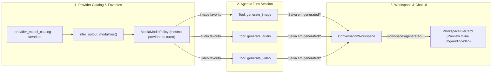

# Spec: Ferramentas de Geração de Mídia (Imagem, Áudio e Vídeo) & Métricas de UX (Tempo de Trabalho e Custo em USD)

**Data:** 2026-10-17  
**Escopo:** Arquitetural / Multi-componente — Catálogo de Providers (`src/agentos/provider_catalog/`), Ferramentas do Agente (`src/agentos/agentic/`), Worker & Chat Store (`src/agentos/workers/`, `src/agentos/conversations/`) e Frontend React (`frontend/src/features/`)  
**Skills Utilizadas:** `superpowers:brainstorming`  

---

## 1. Visão Geral e Objetivos

Esta especificação define três entregas minimalistas e coesas para o Orin:

1. **Ferramentas de Geração de Mídia (`generate_image`, `generate_audio`, `generate_video`):**
   - Disponibilizadas dinamicamente ao agente **somente** quando o usuário possuir pelo menos um modelo favoritado (`is_favorite = True`) da respectiva modalidade (`image`, `audio` ou `video`) **no mesmo provider** da conversa ativa.
   - Segue a mesma filosofia de segurança e isolamento de `ParentProviderChildModelPolicy`: o agente nunca utiliza credenciais de outro provider nem modelos não favoritados pelo usuário.
2. **UX — Tempo de Trabalho do Agente por Turno (`"Trabalhou por X..."`):**
   - Exibe de forma sutil na timeline da conversa quanto tempo o agente levou desde o início do turno até entregar a resposta final (ex: `Trabalhou por 18s`, `Trabalhou por 2m 14s`, `Trabalhou por 1h 05m`).
3. **UX — Gasto Estimado em Dólar (`USD`) na Visão Geral (`OverviewPanel`):**
   - Exibe o custo estimado em dólar (`$`) ao lado dos tokens de Entrada, Saída e Total no painel `Visão geral`, combinando preços do catálogo do provider (ex: OpenRouter) com uma tabela de referência embutida para modelos conhecidos (OpenAI, Anthropic, Gemini, etc.).

---

## 2. Abordagens Avaliadas

Durante o brainstorming, avaliamos três arquiteturas para a disponibilização e execução das ferramentas de mídia:

| Critério | **Abordagem A (Recomendada): Tools Dinâmicas por Modalidade + Roteador Multi-Protocolo** | Abordagem B: Tool Única Genérica (`generate_media`) | Abordagem C: Subagente Especialista de Mídia |
| :--- | :--- | :--- | :--- |
| **Descrição** | Publica `generate_image`, `generate_audio` e `generate_video` individualmente apenas para as modalidades que têm favoritos no provider ativo. Um adaptador enxuto (`MediaGenerator`) resolve o endpoint correto (`/images/generations`, `/audio/speech`, `/videos/generations` ou `/chat/completions` multimodal). | Publica uma única tool `generate_media(kind, prompt, ...)` sempre que qualquer modelo de mídia for favoritado. | Usa `spawn_subagent` para delegar geração de mídia a um subagente com modelo de mídia. |
| **Vantagens** | Schemas claros e específicos por mídia (ex: `voice` só em áudio, `size` só em imagem, `duration_seconds` só em vídeo); zero confusão para o LLM; não gasta tokens de schema com mídias não favoritadas. | Menos descritores de tool no código. | Reaproveita infraestrutura de subagentes. |
| **Desvantagens** | Requer 3 métodos de tool (porém compartilhando o mesmo cliente HTTP e validação de workspace). | Schema poluído com parâmetros mutuamente exclusivos; o LLM pode tentar gerar vídeo quando só há modelo de imagem favoritado. | Modelos de imagem/TTS/vídeo não são LLMs conversacionais e não rodam action loop de subagente. |

**Decisão:** Seguiremos com a **Abordagem A**.

---

## 3. Arquitetura Detalhada

### 3.1 Identificação de Modelos de Mídia e Política do Mesmo Provider

1. **Inferência Híbrida de Modalidades (`src/agentos/provider_catalog/modalities.py` & `service.py`):**
   - Hoje apenas o OpenRouter (e parcialmente o OmniRoute) preenche `output_modalities` via API, enquanto `_normalize_openai`, `_normalize_ollama` e `add_custom` fixam `output_modalities=("text",)`.
   - Criaremos a função pura `infer_output_modalities(model_id: str, explicit_modalities: Sequence[str] = ()) -> tuple[str, ...]`:
     - Se `explicit_modalities` já contiver `"image"`, `"audio"` ou `"video"`, preserva-os.
     - Caso contrário, analisa padrões conhecidos no `model_id` (case-insensitive):
       - **Imagem (`"image"`):** `gpt-image*`, `dall-e*`, `flux*`, `sdxl*`, `stable-diffusion*`, `imagen*`, `recraft*`, `ideogram*`, `midjourney*`, `playground-v*`, `*-image-preview*`, `*-image-generation*`.
       - **Áudio (`"audio"`):** `tts-*`, `*-tts*`, `gpt-4o-audio*`, `gpt-4o-mini-audio*`, `elevenlabs*`, `kokoro*`, `bark*`, `musicgen*`, `stable-audio*`.
       - **Vídeo (`"video"`):** `sora*`, `veo*`, `runway*`, `gen-3*`, `kling*`, `luma*`, `ray-*`, `minimax-video*`, `wan-*`, `cogvideo*`, `hunyuan-video*`, `mochi*`.
     - É aplicada automaticamente na normalização de todos os catálogos (`_normalize_openai`, `_normalize_openrouter`, `_normalize_omniroute`, `_normalize_ollama`) e também em `read_catalog()` / consulta do worker (garantindo que catálogos já salvos no banco funcionem imediatamente sem exigir refresh manual).
2. **Seletor Minimalista para Modelos Customizados (`ProviderDetail.tsx` & `service.py`):**
   - `ProviderCatalogService.add_custom()` passa a aceitar `output_modalities: Sequence[str] | None = None` (validado contra `{"text", "image", "audio", "video"}`).
   - No formulário de adicionar modelo manual em `frontend/src/features/providers/ProviderDetail.tsx`, adicionamos um `<select>` enxuto de modalidade (`Texto`, `Imagem`, `Áudio`, `Vídeo`), e exibimos uma badge discreta nos cards de modelos de mídia (`Imagem`, `Áudio`, `Vídeo`).
3. **Política de Autorização no Mesmo Provider (`src/agentos/provider_catalog/media_policy.py`):**
   - `SameProviderMediaModelPolicy`:
     - Recebe `turn_provider: str` e os modelos favoritos do usuário naquele `turn_provider` agrupados por modalidade: `favorites_by_modality: Mapping[str, tuple[str, ...]]`.
     - `available_modalities() -> frozenset[str]`: retorna o subconjunto de `{"image", "audio", "video"}` que possui pelo menos 1 modelo favorito no `turn_provider`.
     - `resolve_model(modality: str, requested_model: str | None) -> str`:
       - Se `requested_model` for omitido ou vazio, retorna o primeiro favorito daquela modalidade no `turn_provider`.
       - Se `requested_model` for informado (exato ou sufixo após `/`), valida se pertence aos favoritos daquela modalidade no `turn_provider`; caso contrário, lança erro claro informando quais modelos favoritos estão disponíveis.

### 3.2 Ferramentas `generate_image`, `generate_audio` e `generate_video`

1. **Publicação Condicional (`src/agentos/agentic/agent_tools.py` & `phases.py`):**
   - As 3 ferramentas pertencem ao toolkit `"media"` e só são registradas em `AgentToolset` quando `media_policy` possui favoritos para a respectiva modalidade:
     - `generate_image`:
       - **Parâmetros:** `prompt` (obrigatório, string), `model` (opcional, enum/string com os favoritos de imagem do provider), `size` (opcional, default `"1024x1024"`), `output_path` (opcional, caminho relativo no workspace, default `"generated/image-<ts>.png"`).
     - `generate_audio`:
       - **Parâmetros:** `text` (obrigatório, string a ser sintetizada/gerada), `model` (opcional, favoritos de áudio do provider), `voice` (opcional, default `"alloy"`), `format` (opcional, `"mp3" | "wav" | "opus"`, default `"mp3"`), `output_path` (opcional, default `"generated/audio-<ts>.mp3"`).
     - `generate_video`:
       - **Parâmetros:** `prompt` (obrigatório, string), `model` (opcional, favoritos de vídeo do provider), `duration_seconds` (opcional, int), `output_path` (opcional, default `"generated/video-<ts>.mp4"`).
   - Liberadas nas fases de trabalho (`Phase.ACT`, `Phase.ORIENT` e conversas normais) para o agente principal e subagentes que compartilham o mesmo provider.

2. **Cliente de Execução Multi-Protocolo (`src/agentos/agentic/media_client.py`):**
   - Usa as credenciais e `base_url` do `turn["provider"]` (via rotação de chaves existente do provider) e `httpx.Client` com timeouts seguros (`120s` para imagem/áudio, `300s` para vídeo):
     - **Imagem:**
       - Para `openrouter` (ou modelos que operam via chat multimodal): chama `POST {base_url}/chat/completions` com `modalities: ["image", "text"]` e extrai a imagem de `choices[0].message.images` ou data URL base64.
       - Para `openai` e `omniroute`: chama `POST {base_url}/images/generations` (`model`, `prompt`, `size`, `response_format="b64_json"` ou fallback sem `response_format` para `gpt-image-1`), com fallback automático para `/chat/completions` caso o endpoint retorne 404/405.
     - **Áudio:**
       - Chama `POST {base_url}/audio/speech` (`model`, `input=text`, `voice`, `response_format`), gravando os bytes de áudio retornados (ou decodificando `audio.data` base64 em modelos `*-audio*` via `/chat/completions`).
     - **Vídeo:**
       - Chama `POST {base_url}/videos/generations` (ou endpoint compatível do provider). Se a resposta contiver bytes/`b64_json`/`url` direta, baixa e salva imediatamente; se retornar um job assíncrono (`id` + `status`), faz polling com backoff até concluir dentro do limite da tool e baixa o arquivo `.mp4`.
   - **Segurança & Validação Adversarial:**
     - O `output_path` passa obrigatoriamente por `workspace.resolve(output_path)` (impedindo path traversal `../` ou escrita fora do workspace).
     - Downloads de URLs externas de mídia retornadas pelo provider recusam IPs privados/loopback (SSRF protection) e possuem limite máximo de bytes (`100 MB`).
     - Valida assinatura básica/conteúdo não-vazio antes de persistir no disco (escrita atômica via arquivo temporário ou escrita completa verificada).

3. **Renderização Inline no Chat (`frontend/src/features/conversations/WorkspaceFileCard.tsx`):**
   - As ferramentas retornam no resultado textual o link `workspace://<caminho>` (ex: `workspace://generated/image-1729200.png`), que o `MarkdownMessage` e a timeline já transformam automaticamente em `WorkspaceFileCard`.
   - Em `WorkspaceFileCard.tsx`:
     - Estendemos `PreviewKind` para incluir `'audio'` (`mp3`, `wav`, `ogg`, `m4a`, `aac`, `flac`) e `'video'` (`mp4`, `webm`, `mov`).
     - Cards de arquivo de áudio renderizam um `<audio controls preload="metadata" className="w-full" />` limpo; cards de vídeo renderizam `<video controls preload="metadata" className="max-h-80 w-full rounded-lg bg-black/40" />`; imagens continuam com preview visual imediato e lightbox.

---

### 3.3 UX Melhoria 1: Tempo de Trabalho do Agente (`"Trabalhou por X..."`)

1. **Cálculo e Persistência:**
   - A tabela `conversation_turns` já grava `started_at` e `finished_at` em cada turno.
   - Na timeline (`frontend/src/features/conversations/TurnTimeline.tsx` e `activityReducer.ts`), cada turno já possui os eventos `turn.started` e `turn.completed` (com `occurredAt` ISO-8601), além dos timestamps do turno.
   - Criaremos o formatador puro `formatTurnWorkDuration(durationMs: number): string`:
     - Arredonda para no mínimo `1s` quando `durationMs > 0`.
     - `< 60s`: `"Trabalhou por Xs"` (ex: `"Trabalhou por 12s"`).
     - `1m a 59m`: `"Trabalhou por Xm Ys"` (ou `"Trabalhou por Xm"` se `Ys == 0`).
     - `>= 1h`: `"Trabalhou por Xh Ym"`.
2. **Posicionamento Minimalista na UI (`TurnTimeline.tsx`):**
   - Exibido de forma discreta logo acima da resposta final do agente (ao lado do botão de recolher/expandir passos do turno, ou como pílula sutil quando não houve passos intermediários), usando tipografia monoespaçada tabular (`tabular-nums`) e cor secundária (`var(--orin-text-muted)`).

---

### 3.4 UX Melhoria 2: Gasto em Dólar (`USD`) na Visão Geral (`OverviewPanel`)

1. **Motor de Precificação (`src/agentos/provider_catalog/pricing.py`):**
   - Função `estimate_cost_usd(*, provider: str, model_id: str, input_tokens: int, output_tokens: int, input_per_million: str | float | None = None, output_per_million: str | float | None = None) -> float | None`:
     1. **Preço do Catálogo:** Se `input_per_million` e `output_per_million` estiverem presentes em `provider_model_catalog`, converte com `Decimal`/`float` seguro e calcula `(input_tokens / 1_000_000) * in_price + (output_tokens / 1_000_000) * out_price`.
     2. **Tabela de Referência Embutida (`KNOWN_MODEL_PRICING_PER_MILLION`):** Fallback para quando a API do provider não envia preços (OpenAI, Anthropic, OmniRoute). Cobre famílias `gpt-4o`, `gpt-4o-mini`, `gpt-4.1`, `gpt-4.1-mini`, `gpt-4.1-nano`, `o1`, `o3`, `o3-mini`, `o4-mini`, `gpt-5*`, `claude-3-5-sonnet`, `claude-3-7-sonnet`, `claude-sonnet-4`, `claude-opus-4`, `claude-3-5-haiku`, `claude-haiku-4`, `gemini-2.5-pro`, `gemini-2.5-flash`, `deepseek-chat`, `deepseek-reasoner`, ignorando prefixos de provider (`openai/`, `anthropic/`) e sufixos de data (`-20250514`).
     3. **Modelos Locais (`ollama`):** Retorna `0.0`.
     4. **Desconhecidos:** Retorna `None` (nunca inventa número falso).
2. **Contrato do Endpoint `/v1/conversations/{id}/overview` (`src/agentos/conversations/chat.py`):**
   - Cada item em `agents` recebe `estimated_cost_usd: float | None`.
   - O objeto `token_usage` da execução recebe `estimated_cost_usd: float | None` (soma dos custos de todos os agentes da execução quando ao menos um agente possui custo conhecido; `None` se todos forem desconhecidos).
3. **Exibição no Frontend (`frontend/src/features/overview/OverviewPanel.tsx`):**
   - No bloco `Tokens da execução`, o grid passa a exibir 4 métricas alinhadas: **Entrada**, **Saída**, **Total** e **Custo (USD)**.
   - Formatação inteligente:
     - `null` / `undefined`: `—`
     - `0`: `$0.00`
     - `< 0.01`: até 4 casas decimais (ex: `$0.0042`) para que turnos curtos não apareçam como `$0.00` quando houve gasto real.
     - `>= 0.01`: 2 a 4 casas decimais limpas (ex: `$0.14`).
   - Na lista `Agentes na execução`, exibe também o custo de cada agente ao lado da contagem de tokens (ex: `12,400 tokens · $0.031`).

---

## 4. Tratamento de Erros, Segurança e Casos de Borda (Postura Adversarial)

1. **Troca de Provider no meio da conversa:**
   - A verificação de favoritos de mídia ocorre a cada turno com base em `turn["provider"]`. Se o usuário mudar a conversa da OpenAI para a Anthropic (onde não há modelo de imagem favoritado), `generate_image` deixa imediatamente de ser publicada naquele turno.
2. **Isolamento de Credenciais:**
   - `MediaGenerator` utiliza exclusivamente a credencial do `turn["provider"]` da conversa atual. Nunca vaza chaves entre providers diferentes.
3. **Path Traversal e Limite de Disco:**
   - Qualquer `output_path` fornecido pelo LLM é resolvido via `ConversationWorkspace.resolve()`, bloqueando caminhos absolutos, `..` ou escrita em `.orin/`. Respostas binárias acima de `100 MB` são abortadas durante o stream.
4. **Preços Malformados no Catálogo:**
   - Valores não numéricos, negativos ou `NaN`/`Infinity` em `input_per_million` / `output_per_million` são ignorados com fallback seguro para a tabela de referência ou `None`.
