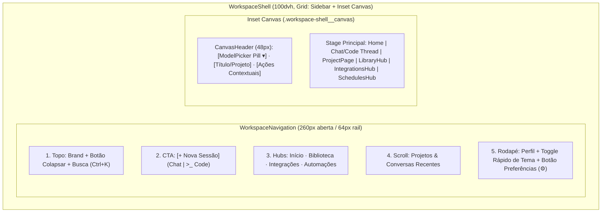
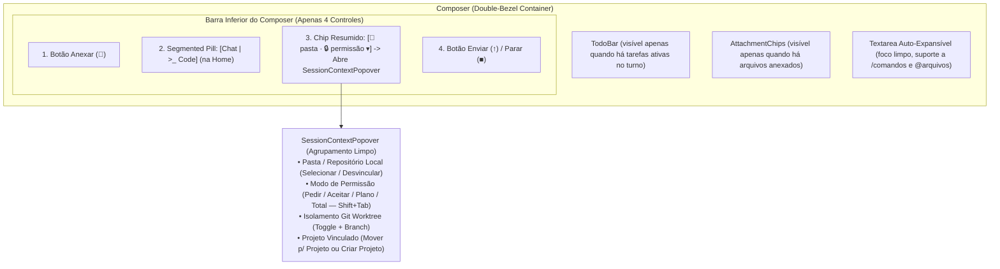

# Spec: Refatoração Visual Clean/Premium do Orin (Inset Studio Shell, Progressive Disclosure, Hubs & Sistema de Temas)

**Data:** 2026-10-17  
**Escopo:** Arquitetural — Frontend React/TypeScript (`frontend/src/`) & Design System CSS (`theme.css`, `index.css`, `agentos.css`)  
**Skills Utilizadas:** `superpowers:brainstorming`, `taste-skill:design-taste-frontend`, `taste-skill:redesign-existing-projects`, `taste-skill:minimalist-ui`, `taste-skill:high-end-visual-design`  
**Referências Visuais:** *Zyricon* (Dark Atmospheric Inset Frame), *Askk AI* (Sidebar Hubs & Clean Stage), *BeeBot* (Warm Daylight Canvas & Top-Left Model Pill)

---

## 1. Visão Geral e Diagnóstico Anti-Slop

O Orin evoluiu rapidamente em capacidades (Orin Chat, Orin Code, Projetos, Worktrees, Permissões granulares, Subagentes paralelos, Skills, Plugins, MCPs, Memória, Leitura Visual, OmniRoute, Ollama e Agendamentos). Porém, o crescimento orgânico levou a três problemas críticos na interface atual:

1. **Sobrecarga de Informações na Home, Chat e Code:** Controles de configuração da sessão (Modelo, Provider, Modo Chat/Code, Pasta do Workspace, Modo de Permissão, Git Worktree e Projeto) estão espalhados e duplicados entre a barra superior, o centro da tela e a barra interna do Composer.
2. **Tela de Configurações (`Settings`) Fragmentada e Bugada:** 12 rotas separadas misturam recursos cotidianos do agente (Skills, Plugins, MCP, Memória, Agendamentos, Providers) com ajustes técnicos de sistema (Autostart, Chromium, Limites de Iteração, Versões). Além disso, há conflito de CSS entre duas implementações de shell (`SettingsShell.tsx` vs `SettingsPage.tsx`), saltos de layout no drawer de Providers (`.settings-content__drawer`) e uma rajada de 7 requisições paralelas em `useSettingsBadges.ts`.
3. **Ausência de Personalização Visual (Temas):** Apesar de `frontend/src/styles/theme.css` conter tokens preliminares para `[data-theme="dark"]` e `[data-theme="light"]`, nenhum componente aplica ou persiste temas, não há opções de cor de acento ou controle de efeitos visuais, e dezenas de classes Tailwind hardcoded (`text-white/55`, `bg-black/35`, `border-white/10`, `#14171b`) quebram qualquer tentativa de tema claro ou alternativo.

### 1.1 Auditoria Técnica do Estado Atual (`redesign-existing-projects`)

| Área / Arquivo | Problema Identificado | Impacto na UX |
| :--- | :--- | :--- |
| `frontend/src/app/Home.tsx` | Exibe simultaneamente: topbar global (`Brand`, `Agendar`, `CommandPalette`), sidebar completa, seletor gigante de 2 colunas (`home__mode-switch`), barra amarela `.home__code-workspace-bar`, `Composer` com os mesmos botões repetidos, lista `.home__recent` (duplicando a sidebar) e `.home__foot` (duplicando `Ctrl+K`). | Poluição visual severa; o usuário vê até 3 botões de busca/atalho e 2 seletores de pasta/modo na mesma tela. |
| `frontend/src/features/conversations/ChatPage.tsx` | `.chat__bar` empilha 11 itens na horizontal e inclui um formulário inline de criação/mudança de projeto com `style={{...}}` hardcoded. | Cabeçalho claustrofóbico, truncamento precoce do título da conversa e quebra em janelas médias (`1024px`). |
| `frontend/src/features/conversations/Composer.tsx` | Carrega na barra inferior: Anexo, toggle `</> Code`, pílula de Permissão, toggle de `Worktree`, `ModelPicker` (2 selects: Provider + Modelo) e `WorkspaceFolderButton`. | Falta de hierarquia; controles raros competem com o ato de digitar e enviar. |
| `frontend/src/features/settings/*` | 12 seções em `sections.ts`; código morto em `SettingsPage.tsx`; `RuntimeSettingsPage.tsx` e `AboutSection.tsx` duplicam informações de versão/instalação; `ProviderDetail` abre empilhado abaixo do grid em vez de lateralmente. | Navegação confusa, saltos de scroll ao configurar providers e lentidão ao abrir Settings. |
| `frontend/src/styles/index.css` & `agentos.css` | Uso da fonte `Inter` como padrão; regras duplicadas para `.settings-shell`, `.brand` e botões; cores escuras fixas em múltiplos seletores. | Estética genérica ("AI slop") nas áreas de gestão e impossibilidade de alternar temas com consistência. |

---

## 2. Pilar 1: Design System Anti-Slop & Motor de Temas (`ThemeProvider`)

### 2.1 Diretrizes Visuais Anti-Slop (`taste-skill`)
1. **Tipografia com Personalidade e Precisão:**
   - **UI & Corpo (`--orin-font-sans`):** `'Plus Jakarta Sans', 'Geist', -apple-system, BlinkMacSystemFont, sans-serif` (substituindo `Inter`).
   - **Código, Terminais & Métricas (`--orin-font-mono`):** `'JetBrains Mono', 'Geist Mono', monospace` com `font-variant-numeric: tabular-nums`.
   - **Escala Tipográfica Restrita (5 níveis):**
     - `Display / Greeting` (Home): `clamp(28px, 3.2vw, 40px)`, `font-weight: 600`, `letter-spacing: -0.03em`, `line-height: 1.12` (máximo de 2 linhas, `text-wrap: balance`).
     - `Title / View Header`: `20px`, `font-weight: 600`, `letter-spacing: -0.02em`.
     - `Section Heading`: `15px`, `font-weight: 600`, `letter-spacing: -0.01em` (sempre em *Sentence case*, eliminando o excesso de eyebrows em `UPPERCASE`).
     - `Body / Chat Thread`: `14.5px`, `line-height: 1.6`, largura máxima de leitura de `68ch`.
     - `Caption / Meta / Pills`: `12px` (`11px` para badges monoespaçados).
2. **Superfícies em Camada Dupla ("Double-Bezel" / Inset Architecture):**
   - A janela base (`--orin-page-bg`) funciona como a moldura externa (bandeja onde repousa a Sidebar).
   - O palco principal (`.workspace-shell__canvas`) e o `Composer` utilizam bordas concêntricas sutis (`1px solid var(--orin-border-subtle)`) e elevação por degrau de tom (`--orin-surface-1` → `--orin-surface-2` → `--orin-surface-3`), evitando sombras pesadas em elementos estáticos.

### 2.2 Arquitetura Tridimensional de Temas

O sistema de aparência será controlado por um `ThemeProvider` (`frontend/src/app/ThemeContext.tsx`) que sincroniza três atributos no elemento `<html>` (`document.documentElement`) e persiste as escolhas em `localStorage`:

1. **Modo Base (`data-theme="dark" | "carbon" | "light"` + preferência `"system"`):**
   - **`dark` (Orin Space Dark — Padrão):** Grafite espacial profundo com leve matiz noturno.
     - `--orin-page-bg`: `#07060e` (Fundo da janela e Sidebar)
     - `--orin-surface-1`: `#0d0b16` (Fundo do Inset Canvas)
     - `--orin-surface-2`: `#141122` (Cards, Popovers, Barra lateral interna)
     - `--orin-surface-3`: `#1b172d` (Composer, Inputs ativos, Hover forte)
     - `--orin-text-primary`: `#f5f2ff` | `--orin-text-secondary`: `rgba(245, 242, 255, 0.72)` | `--orin-text-muted`: `rgba(245, 242, 255, 0.50)`
   - **`carbon` (Carbon OLED Minimal):** Neutro técnico puro sem matiz colorido nas superfícies, ideal para longas sessões de código.
     - `--orin-page-bg`: `#050506`
     - `--orin-surface-1`: `#0b0b0d`
     - `--orin-surface-2`: `#121215`
     - `--orin-surface-3`: `#18181c`
     - `--orin-text-primary`: `#f4f4f6` | `--orin-text-secondary`: `rgba(244, 244, 246, 0.70)` | `--orin-text-muted`: `rgba(244, 244, 246, 0.48)`
   - **`light` (Warm Daylight Paper — inspirado na ref. *BeeBot*):** Papel quente editorial de alto conforto ocular, sem branco estéril na moldura.
     - `--orin-page-bg`: `#f2f0ec` (Fundo da janela e Sidebar)
     - `--orin-surface-1`: `#faf9f6` (Fundo do Inset Canvas)
     - `--orin-surface-2`: `#ffffff` (Cards e painéis elevados)
     - `--orin-surface-3`: `#ffffff` (Composer com `box-shadow: 0 4px 20px rgba(20, 18, 28, 0.05)`)
     - `--orin-text-primary`: `#14121c` | `--orin-text-secondary`: `#4a4656` | `--orin-text-muted`: `#6e6a7c`
   - **`system`:** Resolve dinamicamente para `dark` ou `light` escutando `window.matchMedia('(prefers-color-scheme: dark)')`.

2. **Cor de Acento / Signal (`data-accent="violet" | "sapphire" | "emerald" | "amber" | "mono"`):**

| Acento (`data-accent`) | Token `--orin-accent` (Dark / Carbon) | Token `--orin-accent` (Light) | Uso Principal |
| :--- | :--- | :--- | :--- |
| **`violet`** *(Padrão)* | `#a66cff` | `#6d28d9` | Identidade original do Orin |
| **`sapphire`** | `#637dff` | `#3b4cca` | Azul/Índigo técnico (estilo *BeeBot*) |
| **`emerald`** | `#34d399` | `#047857` | Verde engenharia / terminal |
| **`amber`** | `#fbbf24` | `#b45309` | Âmbar quente / foco em Orin Code |
| **`mono`** | `#e4e4e7` | `#18181b` | Utilitarismo monocromático puro |

3. **Atmosfera & Efeitos (`data-ambient="on" | "off"`):**
   - **`on` (Padrão):** Exibe o `OrinOrb` central na Home e um glow radial sutil atrás do Composer (usando `rgb(var(--orin-accent-rgb) / 0.08)` no escuro e `rgb(var(--orin-accent-rgb) / 0.05)` no claro).
   - **`off`:** Oculta o canvas WebGL (`AmbientField`) e os gradientes radiais decorativos, zerando o uso de GPU em background e deixando o palco 100% sólido.

### 2.3 Contrato de Persistência e Zero-FOUC
- Chaves no `localStorage`:
  - `orin.theme.mode`: `'dark' | 'carbon' | 'light' | 'system'` (default: `'dark'`)
  - `orin.theme.accent`: `'violet' | 'sapphire' | 'emerald' | 'amber' | 'mono'` (default: `'violet'`)
  - `orin.theme.ambient`: `'on' | 'off'` (default: `'on'`)
- Inicialização síncrona na entrada de `main.tsx` (antes de `createRoot`) para aplicar `data-theme`, `data-accent` e `data-ambient` no `<html>` sem flash de tema incorreto (FOUC).
- **Regra de Ouro Anti-Hardcode:** Nenhuma classe utilitária como `text-white`, `bg-black`, `border-white/*` pode ser usada em superfícies temáticas. Todos os componentes devem usar variáveis semânticas (`var(--orin-text-primary)`, `var(--orin-surface-2)`, `var(--orin-border-subtle)`).

---

## 3. Pilar 2: App Shell "Inset Studio Canvas" & Sidebar Unificada

Em vez de cada página (`Home.tsx`, `ChatPage.tsx`, `ProjectPage.tsx`, `SettingsShell.tsx`) reconstruir seu próprio topo e sidebar, todas as rotas principais passam a ser filhas de um **`<WorkspaceShell>`** persistente (`frontend/src/app/WorkspaceShell.tsx`).

### 3.1 Sidebar Unificada de Altura Total (`WorkspaceNavigation.tsx`)
1. **Topo da Sidebar:**
   - Exibe `<Brand to="/" />` à esquerda e o botão de **Recolher/Expandir Sidebar** (`aria-expanded`, alternando entre `260px` e `64px` Icon Rail no desktop, ou Drawer Off-Canvas abaixo de `768px`).
   - Logo abaixo, o botão compacto de busca e comandos (`Buscar… Ctrl+K` / `⌘K`).
2. **Ação Primária (`+ Nova Sessão`):**
   - Um botão principal de destaque sutil (`+ Nova conversa`) acompanhado do atalho rápido `>_ Code` para iniciar diretamente em modo de engenharia.
3. **Navegação de Hubs do Workspace (1º Nível):**
   - **Início** (`/`) — Palco principal de criação e conversa.
   - **Biblioteca** (`/library`) — Hub unificado de **Skills**, **Plugins** e **Memória** (com badge discreto se houver plugin aguardando aprovação).
   - **Integrações** (`/integrations`) — Hub unificado de **Providers**, **Leitura Visual** e **Servidores MCP** (com badge discreto se houver MCP aguardando aprovação).
   - **Automações** (`/schedules`) — Hub de **Agendamentos** recorrentes.
4. **Lista Unificada de Projetos e Conversas (Scrollável):**
   - Mantém a alternância rápida ou seções colapsáveis entre **Projetos** (pastas com suas sessões internas) e **Conversas Recentes** (com ícone de modo `Chat` / `>_ Code` e indicador pulsante verde apenas quando uma sessão estiver rodando em segundo plano).
5. **Rodapé da Sidebar (Estilo *BeeBot* / *Zyricon*):**
   - Esquerda: `<ProfileMenu />` (avatar + nome do perfil ativo).
   - Direita:
     - Botão rápido de alternar tema (`ThemeQuickToggle`: alterna `Dark` → `Light` → `Carbon` com 1 clique).
     - Botão **Preferências (`⚙`)** (`data-testid="open-preferences-modal"`), que abre o `PreferencesModal` sem sair da tela atual.

### 3.2 Cabeçalho do Palco Principal (`CanvasHeader`, 48px)
O palco enquadrado (`.workspace-shell__canvas`) possui um cabeçalho limpo e silencioso com apenas **3 zonas**:
1. **Zona Esquerda (Sempre visível em Home, Chat e Code):**
   - **`ModelPicker` em formato Pill Dropdown** (`[Ícone do Provider] Nome do Modelo ▾`, inspirado em *Zyricon* `ChatGPT v4.0 ▾` e *BeeBot* `iBeeBot 4o ▾`).
   - Clicar na pílula abre um popover estruturado com: abas/filtro de **Provider** (`OpenRouter`, `OpenAI`, `Anthropic`, `Ollama`, `OmniRoute`), busca textual de modelo, seção de **Favoritos** e lista de modelos disponíveis.
   - Isso remove os dois `<select>` que antes ficavam espremidos dentro do `Composer`.
2. **Zona Central (Visível em Conversa ativa ou Projeto):**
   - Em uma conversa (`ChatPage`): exibe o badge `>_ Code` (se estiver em modo Code), o título da conversa truncado com elegância e, se a conversa pertencer a um projeto, o chip clicável do projeto (`/projects/:projectId`).
   - O antigo botão `"Enviar para projeto / Trocar projeto"` com formulário inline sai do cabeçalho e passa para o **Popover de Contexto da Sessão** (e menu de ações da conversa), acabando com a poluição do topo.
3. **Zona Direita (Ações estritamente contextuais):**
   - Na `Home`: vazia ou apenas um indicador discreto do status local.
   - Na `ChatPage`:
     - `<ContextIndicator usage={contextUsage} />` (medidor compacto de janela de contexto).
     - Botão `Arquivos` (`workspace-files-drawer-toggle`, exibido no modo Code).
     - Botão `Visão geral` (exibido quando a conversa possui atividades/subagentes).

---

## 4. Pilar 3: Home, Chat e Orin Code com Progressive Disclosure

### 4.1 Nova Tela Inicial (`Home.tsx`)
Seguindo as referências *Zyricon* e *BeeBot*, a Home passa a respirar com generoso espaço negativo (`macro-whitespace`):

1. **O que é removido da `Home.tsx` para eliminar redundância:**
   - Removido o bloco gigante de 2 cards `.home__mode-switch` acima do título.
   - Removida a barra amarela duplicada `.home__code-workspace-bar` acima do Composer.
   - Removida a lista `.home__recent` abaixo do Composer (as conversas recentes já estão visíveis na Sidebar ao lado).
   - Removido o rodapé `.home__foot` repetindo `Ctrl K`.
2. **O que permanece no centro do palco (`.home__stage`):**
   - **Elemento Focal (`OrinOrb`):** Esfera sutil centralizada acima da saudação (desativada automaticamente se `data-ambient="off"`).
   - **Saudação Concisa (`h1`):** Máximo de 1 a 2 linhas (ex.: *"O que vamos resolver hoje?"* no modo Chat, ou *"Orin Code · Construa no seu repositório"* no modo Code).
   - **Composer em Camada Dupla ("Double-Bezel"):** Centralizado (`max-width: 740px`), funcionando como o único ponto de entrada.
   - **Pílulas / Cards Contextuais de Partida Rápida (abaixo do Composer):**
     - 3 ações rápidas discretas que se adaptam ao modo selecionado:
       - Em **Chat**: *Pesquisar e sintetizar*, *Analisar arquivos ou imagens*, *Usar uma Skill da Biblioteca*.
       - Em **Orin Code**: *Selecionar repositório local*, *Planejar arquitetura / spec*, *Revisar testes e corrigir bugs*.

### 4.2 Novo `Composer.tsx` + `SessionContextPopover.tsx` (Progressive Disclosure)

1. **Redução de 7+ controles para 4 controles na barra do Composer:**
   - **Controle 1 — Anexar (`composer__attach`):** Ícone de clipe limpo com tooltip `"Anexar arquivos"`.
   - **Controle 2 — Seletor de Modo Compacto (`Chat | >_ Code`):** Na Home, um segmented control compacto em pílula permite alternar entre `Chat` e `Orin Code` com 1 clique (mantendo `data-testid="home-mode-chat"` e `data-testid="home-mode-code"` para compatibilidade com testes). Em uma conversa já iniciada, exibe apenas o badge estático da modalidade se necessário.
   - **Controle 3 — Chip Unificado de Contexto da Sessão (`SessionContextPopover`):**
     - Exibe um resumo imediato do estado atual:
       - No modo **Chat**: `📁 NomeDaPasta` (se vinculada) ou `📁 Workspace padrão` (+ nome do Projeto, se houver).
       - No modo **Code**: `📁 NomeDoRepo · 🔒 Pedir permissão` (+ ícone `⑂` se Worktree estiver ativo).
     - Ao clicar no chip, abre o **`SessionContextPopover`** dividido em seções claras:
       1. **Repositório / Pasta Local:** Mostra o caminho atual e botão para selecionar/alterar ou desvincular pasta local (reutilizando a lógica segura de `inspectWorkspaceFolder` / `inspectNewWorkspaceFolder` com confirmação de risco Git).
       2. **Permissões de Execução (Modo Code):** Seletor visual dos 4 modos (`ask_permissions`, `accept_edits`, `plan_mode`, `full_autonomy`) com indicação do atalho `Shift+Tab`. (O atalho de teclado `Shift+Tab` no textarea continua alternando o modo instantaneamente e atualizando o texto do chip sem precisar abrir o popover).
       3. **Isolamento Git Worktree (Modo Code):** Toggle para ativar/desativar worktree isolado (`.orin/worktrees/`) e exibição da branch ativa.
       4. **Projeto:** Seletor para mover a conversa para um Projeto existente ou criar um novo Projeto a partir da sessão atual.
   - **Controle 4 — Ação Principal (`Enviar ↑` / `Parar ■`):** Botão squircle/circular com destaque em `--orin-accent`.

---

## 5. Pilar 4: Desacoplamento de Configurações (Modal Rápido vs. Hubs na Sidebar)

Para eliminar a complexidade das 12 telas de Settings, dividimos a gestão em **dois níveis semânticos** (inspirados em *Zyricon*, *Askk AI* e *Claude Desktop*):

### 5.1 Nível 1: `PreferencesModal.tsx` (Preferências do App & Aparência)
Acionado pelo botão **Preferências (`⚙`)** no rodapé da Sidebar (ou pelo atalho `Ctrl+,` / rota `/settings/general`), abre como um **Modal amplo sobreposto** (`max-width: 820px`, `height: min(640px, 88dvh)`, `backdrop-filter: blur(16px)`), dividido em **4 abas verticais**:

1. **Aba 1: Aparência (`appearance`)**
   - **Modo Base:** 4 cards visuais em miniatura (`Space Dark`, `Carbon OLED`, `Warm Paper`, `Automático (Sistema)`).
   - **Cor de Destaque (Accent):** 5 swatches circulares com label (`Violeta Orin`, `Safira`, `Esmeralda`, `Âmbar`, `Monocromático`).
   - **Atmosfera:** Toggle `"Exibir esfera orbital e brilho atmosférico no palco inicial"` (`data-ambient="on" | "off"`).
   - Todas as alterações de aparência têm efeito imediato em tempo real, sem botão "Salvar".
2. **Aba 2: Geral & Modo Code (`general`)**
   - **Autonomia padrão do Modo Code:** Select (`Sempre pedir aprovação`, `Autonomia de código`, `Autonomia total`).
   - **Monitoramento e Notificações:** Checkboxes/switches modernos para *"Acompanhar tarefas longas em segundo plano"* e *"Receber notificações do sistema"*.
   - **Limites de Iteração (Runtime):** Controles de limite de rodadas do agente principal e de subagentes (`RuntimeSettingsPage`).
3. **Aba 3: Sistema & Ambiente (`system`)**
   - Unifica em blocos limpos e padronizados:
     - **Workspace Padrão** (`WorkspaceSection`): onde as pastas gerenciadas são salvas.
     - **Segundo Plano** (`BackgroundSection`): iniciar com o Windows/SO e comportamento ao fechar janela.
     - **Motor do Navegador** (`BrowserSection`): status e download opcional do Chromium para automação web.
4. **Aba 4: Conta & Sobre (`about`)**
   - **Estado da Instalação e Versões:** Consolida `AboutSection` e o bloco de versões instaladas de `RuntimeSettingsPage` em um único componente sem duplicação.
   - **Perfis e Segurança:** Se o usuário for admin com `capabilities.user_admin`, exibe a gestão de perfis (`UsersSection`); inclui também atalho para troca de senha.

### 5.2 Nível 2: Hubs de Recursos na Sidebar (`/library`, `/integrations`, `/schedules`)
Recursos que fazem parte do trabalho diário com o agente saem do antigo menu de Settings e ganham **Hubs dedicados dentro do `<WorkspaceShell>`** (mantendo a Sidebar principal sempre visível à esquerda!):

1. **Hub de Biblioteca (`/library` → `LibraryHubPage.tsx`):**
   - Cabeçalho com título `"Biblioteca"`, descrição curta e **3 abas horizontais**:
     - **Skills** (`/library/skills` — renderiza `SkillsSection`)
     - **Plugins** (`/library/plugins` — renderiza `PluginsSection`)
     - **Memória** (`/library/memory` — renderiza `MemoryPage embedded`)
2. **Hub de Integrações (`/integrations` → `IntegrationsHubPage.tsx`):**
   - Cabeçalho com título `"Integrações"`, descrição curta e **2 abas horizontais**:
     - **Providers & Modelos** (`/integrations/providers` — renderiza `ProvidersSection` + `VisionModelSetting` logo abaixo).
       - **Correção do Bug do Drawer de Provider:** Ao clicar em um card de Provider (`OpenRouter`, `OpenAI`, `Anthropic`, `Ollama`, `OmniRoute`), o `ProviderDetail` abre em um **Slide-Over Panel fixo à direita do palco** (`position: fixed/absolute; right: 0; top: 0; bottom: 0; width: min(460px, 100%)`, com backdrop sutil e botão `Fechar`), nunca mais empurrando o conteúdo da página para baixo!
     - **Servidores MCP** (`/integrations/mcp` — renderiza `McpSection`).
3. **Hub de Automações (`/schedules` → `SchedulesPage` dentro do `WorkspaceShell`):**
   - Renderiza os agendamentos diretamente no palco principal, mantendo a navegação lateral ativa.

### 5.3 Retrocompatibilidade de Rotas e Limpeza de Código Morto
- Para garantir que nenhum link existente, comando da `CommandPalette` ou teste automatizado quebre:
  - `/settings`, `/settings/general`, `/settings/appearance`, `/settings/workspace`, `/settings/background`, `/settings/browser`, `/settings/about`, `/settings/users` renderizam o `<WorkspaceShell>` com o `<PreferencesModal>` aberto na aba correspondente (ou permitem navegação direta entre as abas).
  - `/settings/skills/*`, `/settings/plugins`, `/settings/memory` redirecionam ou mapeiam para as abas do **Hub de Biblioteca** (`/library/*`).
  - `/settings/providers/*`, `/settings/vision`, `/settings/mcp` redirecionam ou mapeiam para as abas do **Hub de Integrações** (`/integrations/*`).
  - `/settings/schedules` mapeia para `/schedules`.
- O arquivo legado duplicado `frontend/src/features/settings/SettingsPage.tsx` será removido após migrar qualquer referência restante em `RuntimeSettingsPage.tsx`.
- `useSettingsBadges.ts` será otimizado: em vez de disparar 7 chamadas de API simultâneas no mount global, carregará apenas badges leves de pendência (`pending_approval` de MCP/Plugin) com debounce/cache em memória, consultando contagens detalhadas apenas quando o respectivo Hub for aberto.

---

## 6. Postura Adversarial, Segurança, Acessibilidade e Testes

### 6.1 Análise Adversarial (Como isso pode falhar e como prevenimos)
1. **Risco de Quebra de Testes Existentes (`data-testid` e Seletores de Acessibilidade):**
   - *Como pode falhar:* A suíte Vitest da `Home`, `ChatPage`, `Composer` e `Settings` busca elementos como `data-testid="home-mode-chat"`, `data-testid="home-mode-code"`, `data-testid="code-permission-mode-pill"`, `data-testid="code-worktree-toggle"` e `aria-label="Anexar arquivos"`.
   - *Mitigação:* Todos os `data-testid` existentes serão preservados nos novos controles compactos. No `Composer`, o `code-permission-mode-pill` continuará visível no chip de resumo quando em modo Code (ou acessível diretamente) e o `<select data-testid="code-permission-mode-select">` oculto para testes continuará presente no DOM.
2. **Contraste Insuficiente em Combinações de Tema × Acento:**
   - *Como pode falhar:* Uma cor de acento clara (como `#fbbf24` Amber) usada sobre fundo branco (`#ffffff` no tema Light) perde leitura (contraste < 3:1).
   - *Mitigação:* Cada `data-accent` define pares específicos de valores para temas escuros (`dark` / `carbon`) e para o tema claro (`light`), garantindo razão mínima de contraste de `4.5:1` para texto normal e `3:1` para elementos gráficos/bordas ativas (WCAG AA).
3. **Vazamento de Contexto WebGL ou Queda de FPS em Máquinas Modestas:**
   - *Como pode falhar:* Manter `AmbientField` rodando com `backdrop-filter: blur()` pesado em containers de scroll degrada a performance no modo Code com dezenas de diffs.
   - *Mitigação:* `AmbientField` só monta na `Home` quando `data-ambient="on"` e `prefers-reduced-motion` não está ativo. Nenhum container com `overflow-y: auto` (`chat__scroll`, `project-navigation__scroll`) usará `backdrop-filter` em itens internos repetidos.
4. **Trap de Foco e Teclado nos Novos Popovers e Modal:**
   - *Como pode falhar:* Abrir o `SessionContextPopover`, o `ModelPicker` ou o `PreferencesModal` e pressionar `Escape` pode cancelar um turno em andamento no `Composer` se a propagação do evento não for contida.
   - *Mitigação:* Qualquer popover/modal aberto captura `Escape` com `event.stopPropagation()`, fechando apenas o popover/modal sem disparar o `onStop` do `Composer`.

### 6.2 Estratégia de Verificação (TDD + Visual Browser Verification)
1. **Testes Unitários e de Integração (Vitest + Testing Library):**
   - `ThemeContext.test.tsx`: valida persistência em `localStorage`, atributos `data-theme`, `data-accent`, `data-ambient` no `document.documentElement` e resposta a `prefers-color-scheme`.
   - `WorkspaceShell.test.tsx`: valida colapso da sidebar (expandida vs rail), abertura do `PreferencesModal` e navegação entre `Início`, `Biblioteca`, `Integrações` e `Automações`.
   - `SessionContextPopover.test.tsx`: valida agrupamento de pasta, permissão (`Shift+Tab`), worktree e projeto tanto na `Home` quanto na `ChatPage`.
   - `IntegrationsAndLibraryHubs.test.tsx`: valida que `ProviderDetail` abre no Slide-Over lateral sem deslocar o grid e que todas as rotas legadas `/settings/*` continuam acessíveis.
2. **Verificação Visual Obrigatória no Navegador Real (Playwright):**
   - Subir o servidor de desenvolvimento e inspecionar visualmente em `1440x900` (Desktop) e `390x844` (Mobile):
     - `Home` nos temas `Space Dark`, `Carbon OLED` e `Warm Paper (Light)` com diferentes cores de acento.
     - `ChatPage` (modo Chat e modo Orin Code) verificando o `ModelPicker` no topo esquerdo e o `SessionContextPopover` no Composer.
     - `PreferencesModal` aberto sobre o Chat e os novos Hubs (`Biblioteca` e `Integrações` com Slide-Over de Provider aberto).
