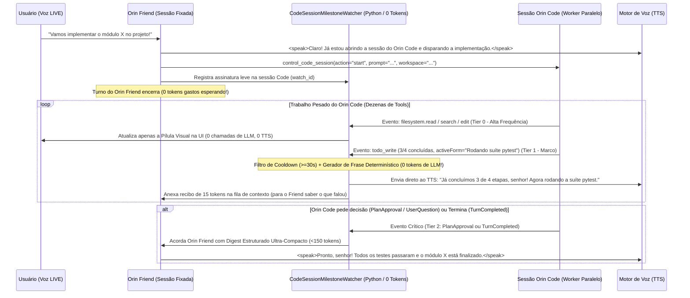

# Especificação de Design (Spec): Orin Friend & Modo LIVE (Full-Duplex + Orquestração Orin Code)

**Data:** 2026-10-27  
**Status:** Aguardando Aprovação Final da Spec  
**Escopo:** Arquitetura completa do companheiro contínuo **Orin Friend**, **Modo LIVE** (voz em tempo real full-duplex com `<speak>` paralelo, chunking prosódico PT-BR e *Audio Sprites* de pensamento), **Memória Dual-Layer & Personalidade Evolutiva ("Caixa de Vidro")**, **Sidecar de Voz Local Desacoplado** e **Ponte de Controle/Narração de Sessões `Orin Code` com Desperdício Zero de Tokens**.

---

## 1. Decisões de Produto e Arquitetura Consolidadas

| # | Eixo | Decisão Aprovada |
| :-: | :--- | :--- |
| **1** | **Modelo de Sessão (`1B`)** | **Companheiro Único Fixado + Toggle LIVE Global:** O `Orin Friend` é uma entidade contínua única fixada no topo da Sidebar (relação vitalícia por usuário, com compacção automática de episódios). Além disso, o botão `((•)) LIVE` pode ser ativado tanto no `Orin Friend` quanto em qualquer sessão `Chat` ou `Code`. |
| **2** | **Hardware & Multiproviders** | **Desacoplado, Adaptável por Hardware e Selecionável por Provider:** O usuário seleciona independentemente o provider/modelo de **STT (Ouvido)** e **TTS (Voz)** (Cloud ou Local). O `VoiceHardwareGovernor` detecta VRAM/CPU (ex.: numa **RTX 4060 8GB**, habilita o preset local de alta naturalidade `Chatterbox-Multilingual-pt-br` 500M / `F5-TTS-pt-br` 335M + `faster-whisper large-v3-turbo` INT8 consumindo ~3.8 GB de VRAM; em máquinas sem GPU, sugere `Kokoro-82M ONNX` em CPU ou Cloud). |
| **3** | **Personalidade Evolutiva (`3A`)** | **"Caixa de Vidro" Editável + `~/.orin/friend/SOUL.md`:** A evolução de personalidade é 100% visível e auditável na UI (painel mostrando Estágio do Vínculo, Humor Atual, barras ajustáveis dos 7 traços e lista de Memórias Afetivas / Piadas Internas com `Editar`/`Desfazer`), sincronizada bidirecionalmente com `~/.orin/friend/SOUL.md`. |
| **4** | **Memória Automática & Controle do `Orin Code`** | **Injeção Automática de Memórias + Orquestração `Orin Code` em Tempo Real (Zero-Token-Waste):** As memórias existentes (Camada 1 Global + Camada 2 Friend) são injetadas automaticamente por contexto relevante em cada turno. O `Orin Friend` pode iniciar, enviar mensagens, aprovar planos/perguntas e monitorar sessões `Orin Code` em tempo real, narrando o progresso ao usuário (*"Já estamos na reta final do projeto, senhor!"*) através de um **Filtro Determinístico de Marcos em 3 Níveis** que evita chamadas desnecessárias ao LLM. |
| **5** | **Isolamento de Modelos Locais** | **Sidecar Supervisionado (`orin-voice-sidecar`):** Modelos locais pesados (PyTorch/CUDA: `Chatterbox`, `F5-TTS`, `Faster-Whisper`) rodam em um processo/sidecar isolado gerenciado pelo Supervisor do Orin (`src/agentos/launcher/internal.py`), mantendo o `backend` FastAPI leve e sem poluir o ambiente base para quem não usa voz local pesada. |

---

## 2. Arquitetura do Companheiro Único Fixado (`Orin Friend`) e Memória Dual-Layer

### 2.1. Entidade Contínua `Orin Friend` no Banco e na UI
- **Persistência (`conversations` em [`schema.py`](file:///c:/Users/User/Documents/GitHub/Carlos/orin/src/agentos/persistence/postgres/schema.py#L551-L560)):**
  - A coluna `mode` passa a aceitar `"friend"` (`_VALID_MODES = {"chat", "code", "friend"}`).
  - Cada `user_id` possui **uma conversa canônica fixada** com `mode = "friend"` (criada automaticamente no bootstrap do usuário ou no primeiro clique em `◈ Orin Friend` no topo da Sidebar, via endpoint `POST /v1/conversations/friend/ensure`).
  - **Continuidade Infinita:** Diferente de chats comuns que ficam gigantes e lentos, a thread do `Orin Friend` utiliza a compacção episódica automática já existente no `AgenticTurnRuntime` combinada com a extração contínua para a **Camada 2 de Memória (`scope_type='friend'`)**, permitindo conversar na mesma sessão por meses sem estourar a janela de contexto.

### 2.2. Injeção Automática de Memórias Existentes (Camada 1 + Camada 2)
O `Orin Friend` **já nasce conhecendo o usuário** porque lê automaticamente todas as memórias existentes em `agent_memories`:
- **Camada 1 (Memória Global Compartilhada — `scope_type IN ('user', 'project')`):**
  - Todas as memórias que o Orin já aprendeu ou aprenderá em sessões `Chat` e `Code` (`fact`, `preference`, `operational`, `correction`).
- **Camada 2 (Memória Afetiva e Episódica Própria — `scope_type = 'friend'`):**
  - Novos tipos em `agent_memories`: `episodic` (momentos vividos juntos), `inside_joke` (piadas internas/apelidos), `milestone` (conquistas e marcos), `emotional` (padrões de humor e preferências de conversa).
  - Novas colunas em `agent_memories`: `emotional_valence` (`FLOAT DEFAULT 0.0`) e `salience` (`FLOAT DEFAULT 0.5`).
- **Seleção Automática por Contexto (`relevant_for_friend(task, limit=18)` em [`agent_memory.py`](file:///c:/Users/User/Documents/GitHub/Carlos/orin/src/agentos/persistence/postgres/agent_memory.py#L133-L166)):**
  - A cada turno, sem o usuário precisar pedir, [`TurnSession.build_system_prompt()`](file:///c:/Users/User/Documents/GitHub/Carlos/orin/src/agentos/agentic/session.py#L598-L600) injeta automaticamente no `volatile_prompt`:
    1. **10 memórias da Camada 1** (4 preferências fixas + 6 fatos relevantes para o assunto e projeto atual).
    2. **8 memórias da Camada 2** (2 marcos/piadas com rotação anti-repetição + 6 memórias episódicas/emocionais ranqueadas por sobreposição léxica + saliência afetiva + recência).

### 2.3. Motor de Personalidade "Caixa de Vidro" (`user_friend_personas` + `~/.orin/friend/SOUL.md`)
- **Tabela `user_friend_personas`:**
  - Guarda `bond_stage` (`acquaintance`, `buddy`, `close_friend`, `confidant`), `affinity_score` (`0..100`), `current_mood`, `style_notes_json`, `compiled_rubric` e o vetor `traits_json`:
    - `warmth` (`0.65`), `humor` (`0.50`), `sarcasm` (`0.25`, máx `0.75`), `formality` (`0.35`), `verbosity` (`0.40`), `candor` (`0.70`, mín `0.50` anti-bajulação), `energy` (`0.55`).
- **Sincronização Bidirecional com `~/.orin/friend/SOUL.md`:**
  - Qualquer evolução pós-sessão (`FriendReflectionConsolidator`, limitado a $|\Delta T_i| \le 0.03$ por sessão) ou edição feita pelo usuário nos sliders da UI ("Caixa de Vidro") atualiza o banco e reescreve `~/.orin/friend/SOUL.md`.
  - Se o usuário editar `~/.orin/friend/SOUL.md` em um editor externo, o hash SHA-256 diferente é detectado e sincronizado de volta para o banco.

---

## 3. Orin Friend Controlando e Narrando Sessões `Orin Code` (Arquitetura Zero-Token-Waste)

Este é um dos diferenciais mais fortes do projeto: você está conversando por voz com o **Orin Friend** e diz:
> *"Orin, vamos criar o sistema de autenticação JWT naquele nosso projeto backend."*

O Orin Friend inicia a sessão `Orin Code`, envia o prompt detalhado, acompanha o trabalho em segundo plano e vai falando com você em tempo real (*"Já estruturei o middleware, agora estamos rodando os testes, senhor!"*), **sem desperdiçar tokens**.



### 3.1. Por que Abordagens Comuns Desperdiçam Tokens (e Como Evitamos Isso)
Se o `Orin Friend` fizesse *polling* na sessão `Orin Code` ou acordasse o seu próprio LLM a cada tool executada pelo `Orin Code`:
- Uma tarefa de código com 25 steps dispararia 25 turnos no `Orin Friend` $\times$ ~15.000 tokens de prompt = **~375.000 tokens desperdiçados** só para narrar progresso!
- Se o `Orin Friend` lesse o histórico bruto da sessão `Orin Code` (com diffs e saídas de terminal), estouraria sua própria janela de contexto.

### 3.2. Nossa Solução: `CodeSessionMilestoneWatcher` em 3 Tiers de Custo

1. **Tool Unificada `control_code_session` no Orin Friend:**
   - `action="start"`: Cria a conversa `mode="code"` diretamente no `PostgresChatStore`, despacha o turno inicial no `ConcurrentTurnRunner` (que roda em outra thread do `worker`) e registra o `CodeSessionMilestoneWatcher` vinculando `friend_conversation_id <-> code_conversation_id`.
   - `action="send_message"`: Envia nova instrução para a sessão `Orin Code` (ou usa `enqueue()` se o turno do Code estiver em andamento, injetando a orientação imediatamente antes da próxima tool!).
   - `action="approve_or_answer"`: Aprova ou rejeita um `PlanApprovalCard` / `ToolPermissionCard` ou responde um `UserQuestionCard` pendente na sessão `Orin Code` quando o usuário responde por voz (*"Pode aprovar o plano!"*).
   - `action="stop"`: Cancela imediatamente a execução ativa na sessão `Orin Code`.

2. **Classificador de Eventos em 3 Tiers (em Python puro, Custo = `0 Tokens`):**
   O `CodeSessionMilestoneWatcher` escuta os eventos de `conversation_activity_events` da sessão `Orin Code` e aplica:

   - **Tier 0 — Silencioso / UI-Only (`0 tokens` de LLM, `0 chamadas` de TTS):**
     - Eventos: `filesystem.read`, `filesystem.write`, `search`, `assistant.delta`, `agent.thought_delta`, `tool.progressed`.
     - Efeito: Atualiza apenas o widget visual **`CodeSessionLiveCard`** dentro da tela do `Orin Friend` (mostrando o arquivo atual, o cronômetro e a barra de `TodoWrite`).

   - **Tier 1 — Narração de Marcos em Tempo Real via *Direct-to-TTS* (`0 tokens` de LLM!):**
     - Eventos que disparam um marco (respeitando *cooldown* mínimo de `30 segundos` entre falas para não metralhar o usuário):
       1. **Criação do Plano/Checklist (`todo_write` inicial):** Ex.: *"Plano montado com 5 etapas, começando por `{first_todo}`."*
       2. **Avanço de Metade do Projeto (`completed_todos >= total_todos // 2` pela 1ª vez):** Ex.: *"Já passamos da metade, senhor: `{completed}` de `{total}` etapas prontas. Agora `{active_form}`."*
       3. **Entrada na Reta Final / Verificação (`completed_todos == total_todos - 1` ou tool `VerifyProject` / `pytest` iniciada):** Ex.: *"Já estamos na reta final do projeto, senhor! Executando a validação e os testes agora."*
       4. **Heartbeat de Tarefa Longa (`> 90s` sem mudança de todo, mas trabalhando ativamente):** Ex.: *"Seguimos firme aqui na implementação de `{active_form}`, já mexemos em `{files_touched}` arquivos."*
     - **O Segredo da Economia de Tokens:** Para falar esses marcos do Tier 1, **NÃO acordamos o LLM de 15k tokens do Orin Friend!** O próprio `CodeSessionMilestoneWatcher` monta a frase de 1 linha usando um conjunto de *Templates de Personalidade* (calibrados pelos traços atuais de `formality`/`humor` do `FriendPersonaState`) + os metadados estruturados do `todo_write` (`completed`, `total`, `active_form`), e envia **direto para a fila `<speak>` do TTS**!
     - Para manter o LLM do Orin Friend ciente do que foi dito sem gastar chamadas, o watcher apenas adiciona uma linha de 15 tokens no buffer silencioso da sessão (`[Code Session Update Spoken]: "Já estamos na reta final..." (3/4 todos done)`), que só será enviada ao LLM na próxima vez que o usuário falar ou quando o Tier 2 disparar!

   - **Tier 2 — Wakeup Inteligente com `CompactCodeDigest` (`< 150 tokens`) nos Momentos Decisivos:**
     - Eventos:
       1. `PlanApprovalCard` / `UserQuestionCard` / `ToolPermissionCard` aguardando o usuário (`waiting_user`).
       2. Falha crítica do turno (`turn.failed`).
       3. Conclusão da sessão (`turn.completed`).
     - Nesses momentos, o watcher dispara um turno real no `Orin Friend` injetando apenas um **`CompactCodeDigest` JSON de no máximo 150 tokens**:
       ```json
       {
         "event": "code_session_completed",
         "code_conversation_id": "conv_abc123",
         "title": "Autenticação JWT",
         "todos_completed": "4/4",
         "files_changed": ["src/auth/jwt.py", "tests/test_jwt.py"],
         "verification": "passed (12 tests)",
         "summary": "Implementado middleware JWT e testes unitários."
       }
       ```
     - O LLM do `Orin Friend` recebe esse resumo enxuto e comenta com toda a sua personalidade em `<speak>...</speak>`.

---

## 4. Pipeline `<speak>`, Chunking Prosódico PT-BR e Vocalizações de Pensamento

### 4.1. `SpeakStreamParser` + `PTBRProsodicChunker` (Duas Marchas)
- Acoplado ao [`AgenticTurnRuntime._run()`](file:///c:/Users/User/Documents/GitHub/Carlos/orin/src/agentos/agentic/runtime.py#L899-L914) sobre `StreamKind.TEXT` (compatível com todos os 7 providers).
- **Prompt de Abertura Imediata (`< 20 tokens`):** No Modo LIVE, o LLM é instruído a abrir imediatamente qualquer resposta com `<speak>...</speak>`, falando uma reação curta antes de disparar tools/MCPs, e deixando códigos/tabelas/links fora de `<speak>`.
- **Fatiamento Prosódico em Duas Marchas:**
  - **Marcha 1 (`chunk_index == 0` — Ignição Rápida / TTFA Mínimo):** Libera saudações e interjeições autônomas (`"Olá"`, `"Claro"`, `"Deixa eu ver"`) na primeira vírgula/ponto (`min_chars = 2`).
  - **Marcha 2 (`chunk_index >= 1` — Cruzeiro Prosódico):** Agrupa sintagmas entoacionais completos (`min_chars = 12` ou $\ge 3$ palavras em vírgulas mediais), protegendo abreviações (`Sr.`, `Dra.`, `etc.`), moedas/decimais/horas (`R\$ 1.250,50`, `14h30`) e proibindo corte em palavras átonas proclíticas (`FORBIDDEN_CHUNK_ENDINGS`: `o`, `de`, `para`, `que`, `mas`, `é`, `vou`).
  - Exemplo exato garantido por teste unitário:
    `"Olá, meu nome é X, posso te auxiliar com várias coisas!"` $\rightarrow$ **`"Olá"`** | **`"meu nome é X"`** | **`"posso te auxiliar com várias coisas"`** (preservando a pontuação de fronteira `,` e `!` no `tts_text` para manter a curva melódica contínua).

### 4.2. Vocalizações de Pensamento (`AudioSpriteBank` `<10ms` + `AudioArbitrator`)
- Pacote de ~18 *Audio Sprites* gerados com a mesma voz do personagem (`[inalação suave]`, `"Hmm..."`, `"Ahn..."`, `"Deixa eu ver aqui..."`, `"Só um instante..."`) em `.orin/voice_sprites/<provider>_<voice>/`.
- Dispara em `<10ms` se o modelo entrar em `AGENT_THOUGHT_DELTA` / TTFT `>320ms` sem abrir `<speak>`, ou se uma tool/MCP demorar `>2.2s` / `>5.5s`.
- **Arbitragem Anti-Colisão (`AudioArbitrator`):**
  1. Cancela fillers pendentes assim que a tag `<speak>` abre (`SPEAK_OPENED`).
  2. Se um `"Hmm..."` curto tiver `<=200ms` restantes quando o áudio da Chunk 0 ficar pronto, aguarda terminar naturalmente (+ `40ms` de pausa).
  3. Se for um filler longo (`>200ms` restantes), aplica *Cosine Fade-Out* de `90ms` + `45ms` de respiro antes de tocar a Chunk 0.

---

## 5. Motor de Áudio Full-Duplex, Multiproviders e Sidecar Local (RTX 4060 Ready)

### 5.1. WebSocket Full-Duplex (`/v1/conversations/{id}/live`) e Barge-in (`<80ms`)
- **Entrada (Ouvido):**
  - Captura via `AudioWorklet` (16kHz PCM Int16, janelas de `32ms`) com WebRTC AEC3 (`echoCancellation: true`), *Audio Ducking* + threshold dinâmico do VAD durante a fala do Orin e *Text-Similarity Echo Gate* ($\ge 65\%$ match descartado como eco).
  - **Silero VAD v5 (ONNX CPU `<1ms`)** + **Detector Semântico de Fim de Turno PT-BR** (estende a tolerância de pausa de `400ms` para `1400ms` se a frase terminar em conectivos suspensos como `"mas..."`, `"porque..."`, `"então..."`).
- **Saída (Voz) & Continuidade entre Chunks (`ProsodyContinuityEngine`):**
  - **Local (`Chatterbox-Multilingual-pt-br` 500M / `F5-TTS-pt-br` 335M):** mantém latentes da voz de referência em VRAM + *Rolling Audio Tail* (`600ms` finais da chunk anterior como condicionamento acústico da próxima chunk).
  - **Local Leve (`Kokoro-82M ONNX`):** usa vírgula de continuação fonêmica para manter o *continuation rise*.
  - **Cloud (`ElevenLabs Flash v2.5` / `Cartesia Sonic-2` / `OpenAI`):** streaming WebSocket contínuo no mesmo `context_id` / sessão.
  - **Crossfade DSP (`20ms` Hann Window):** costura as fronteiras em `numpy` sem cliques de fase.
- **Barge-in e `SpokenTranscriptLedger`:**
  - Corta o `RingBuffer` do `AudioWorklet` em `<15ms` ao confirmar voz humana, cancela o turno via `turn_epoch` e grava no histórico exatamente até a palavra efetivamente reproduzida (`"Olá, meu nome é Orin, posso te— [interrompido pelo usuário]"`).

### 5.2. Sidecar Local Supervisionado (`orin-voice-sidecar`) e Governador de Hardware
- Gerenciado pelo Supervisor do Orin ([`src/agentos/launcher/internal.py`](file:///c:/Users/User/Documents/GitHub/Carlos/orin/src/agentos/launcher/internal.py#L19-L67)) em porta local dedicada (ex.: `127.0.0.1:20129`), iniciado sob demanda quando o usuário seleciona um provider de STT ou TTS local.
- **Perfis Adaptáveis pelo `VoiceHardwareGovernor`:**
  - **GPU >= 6GB VRAM (ex.: sua RTX 4060 8GB):** Habilita `faster-whisper large-v3-turbo` (INT8, ~1.5GB VRAM) + `Chatterbox-Multilingual-pt-br` (500M FP16, ~2.3GB VRAM) ou `F5-TTS-pt-br` (335M, ~2.0GB VRAM). Se o usuário também estiver rodando um LLM pesado no Ollama local na mesma GPU e restar `<2.2GB` livres, o governador avisa na UI e oferece alternar o TTS para `Kokoro-82M ONNX` (~250MB) ou CPU.
  - **GPU <= 4GB ou CPU-Only:** Usa `Silero VAD` (CPU) + `Kokoro-82M ONNX` (CPU/GPU leve) + `faster-whisper small/distil-ptbr` (INT8) ou STT Cloud (Groq/Deepgram/OpenAI).
- **UI Desacoplada em `/settings/media` ([`MediaModelsSetting.tsx`](file:///c:/Users/User/Documents/GitHub/Carlos/orin/frontend/src/features/providers/MediaModelsSetting.tsx)):**
  - Separa claramente **1) Modelo de Voz / TTS (Saída)**, **2) Modelo de Transcrição / STT (Entrada)** e **3) Diagnóstico de Hardware / Voz de Referência (5–10s WAV para clonagem local)**.

---

## 6. Componentes de Interface (Frontend & Desktop)

1. **Item Fixado `◈ Orin Friend` no Topo da Sidebar ([`WorkspaceNavigation.tsx`](file:///c:/Users/User/Documents/GitHub/Carlos/orin/frontend/src/features/conversations/WorkspaceNavigation.tsx)):**
   - Sempre acessível no topo da navegação, com indicador de humor/presença ao vivo e badge caso haja uma sessão `Orin Code` sendo supervisionada por ele.
2. **Botão Global `((•)) LIVE` no [`Composer.tsx`](file:///c:/Users/User/Documents/GitHub/Carlos/orin/frontend/src/features/conversations/Composer.tsx) + Bandeja do Electron ([`main.cjs`](file:///c:/Users/User/Documents/GitHub/Carlos/orin/desktop/electron/main.cjs)):**
   - Disponível no `Orin Friend` e em qualquer conversa `Chat` ou `Code` (atalho `Alt+L` para alternar Modo LIVE e `Ctrl+Space` para Push-to-Talk).
3. **`LiveVoiceStage.tsx` + `CodeSessionLiveCard.tsx`:**
   - Orbe reativo com os 5 estados (*Ouvindo*, *Pensando/Vocalizando*, *Trabalhando em Paralelo*, *Falando com Legenda Viva*, *Interrompido*).
   - Quando o `Orin Friend` está controlando uma sessão `Orin Code`, exibe um card compacto ao vivo com a barra de progresso `TodoWrite` (`3/4 tarefas`), o arquivo atual sendo editado e um botão `[Abrir Sessão Orin Code ↗]`.
4. **Drawer "Alma & Memórias do Orin Friend" (Caixa de Vidro `3A`):**
   - Acessível pelo cabeçalho do `Orin Friend`: mostra o `bond_stage`, `affinity_score`, `current_mood`, sliders editáveis dos 7 traços de personalidade, botão para abrir `~/.orin/friend/SOUL.md` e a lista de memórias afetivas/piadas internas com ações de editar/excluir.
