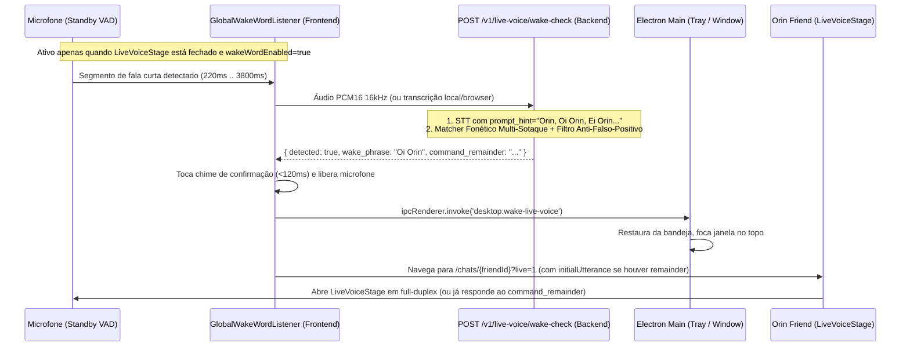

# Especificação de Design (Spec): Wake Word "Orin" em Segundo Plano para o Orin Friend Live

**Data:** 2026-10-28  
**Status:** Aguardando Aprovação da Spec  
**Escopo:** Detecção contínua e leve da wake word **"Orin"** (com alta tolerância a sotaques regionais do PT-BR e pronúncias internacionais) quando o Orin está em segundo plano (bandeja do sistema, janela minimizada/oculta ou fora do modo Live), abrindo automaticamente a janela do app direto no **Modo Live do Orin Friend** e encaminhando comandos falados na mesma frase.

---

## 1. Visão Geral e Fluxo de Experiência

Quando o usuário deixa o Orin rodando em segundo plano (ou aberto em outra tela sem o Modo Live ativo) e diz:
- **"Orin"** / **"Oi Orin"** / **"Ei Orin"** / **"Fala Orin"** / **"Hey Orin"**:
  1. O detector reconhece a wake word (mesmo com variações de sotaque).
  2. Toca imediatamente um *earcon* sonoro curto e suave (`< 120ms`) confirmando que o Orin acordou.
  3. Se o app estiver oculto na bandeja do sistema (Tray) ou minimizado no Electron, a janela é restaurada e trazida para o primeiro plano (`desktop:wake-live-voice`).
  4. O app garante/abre a conversa canônica do **Orin Friend** (`POST /v1/conversations/friend/ensure`) e ativa automaticamente o **`LiveVoiceStage`** (`?live=1`).
- **Frase completa ("Orin, que horas são?" / "Ei Orin, como está o nosso projeto?"):**
  - Se o usuário já emendou uma pergunta ou comando logo após a wake word na mesma fala, o texto restante (`command_remainder`) é enviado automaticamente como o primeiro turno de voz no Modo Live do Orin Friend, sem exigir que o usuário repita a frase.



---

## 2. Arquitetura de Detecção Multi-Sotaque em 4 Camadas

A palavra **"Orin"** não é um vocábulo comum do dicionário português. Sem condicionamento léxico e normalização fonética, motores de STT sob diferentes sotaques (paulista/caipira com R retroflexo, carioca/nordestino com R aspirado, sulista com R vibrante, mineiro com redução vocálica, ou pronúncia inglesa `/ˈɔːɹɪn/`) frequentemente transcrevem `"Orin"` como `"orim"`, `"órem"`, `"orem"`, `"ori"`, `"ourin"`, `"aurin"`, `"horin"`, `"olin"`, `"olhin"`, `"urin"`, `"orion"` ou `"all in"`.

Para resolver isso com alta precisão e baixíssimo índice de falsos positivos, usamos 4 camadas complementares:

### Camada 1 — Gate Acústico de Baixo Consumo (`AudioWorklet` + `EnergyVad` de Curta Duração)
- Roda em standby usando `MicCapture` (16 kHz mono Int16) apenas quando o `LiveVoiceStage` e o painel de teste de microfone (`LiveVoiceQuickSettings`) estão **fechados**.
- Configuração de VAD otimizada para chamadas curtas:
  - `startSpeechMs`: `64 ms`
  - `preRollMs`: `280 ms` (preserva a vogal inicial `/o/` ou `/ɔ/` de `"Orin"`)
  - `endSilenceMs`: `450 ms`
  - `maxUtteranceMs`: `3800 ms`
- **Descarte Acústico Imediato (0 chamadas de rede/CPU durante silêncio ou ruído):**
  - Segmentos `< 220 ms` (cliques de teclado, tosse, batidas) são descartados localmente sem acionar o STT.
  - Cooldown entre verificações e suspensão imediata assim que o `LiveVoiceStage` assume o microfone.

### Camada 2 — Viés de Decodificação no STT (`prompt_hint` / `initial_prompt`)
- Tanto o `LocalWhisperEngine` (`faster-whisper` in-process e `whisper_worker.py` isolado) quanto o adaptador compatível com OpenAI/Groq recebem o `prompt_hint`:
  `"Orin. Oi Orin, ei Orin, fala Orin, olá Orin, hey Orin, ok Orin."` (incluindo também o `display_name` customizado do `FriendPersona`, se o usuário tiver dado um apelido adicional, mantendo `"Orin"` sempre ativo).
- No Whisper, o `initial_prompt` eleva diretamente a probabilidade dos tokens de `"Orin"` durante o *beam/greedy decoding*, fazendo com que sotaques regionais convergiam para `"Orin"` em vez de palavras aleatórias do dicionário.

### Camada 3 — Matcher Fonético Multi-Sotaque (`src/agentos/live_voice/wake_word.py` e `frontend/src/features/conversations/live/wakeWord.ts`)
- Normaliza a transcrição retornada por qualquer motor STT (Whisper local, OpenAI, OpenRouter, Groq ou `BrowserRecognition`):
  1. **Remoção de prefixos vocativos opcionais no início da fala:**
     `oi`, `olá`, `ola`, `ei`, `hey`, `e aí`, `e ai`, `fala`, `ô`, `o`, `ok`, `okay`, `aí`, `ai`, `escuta`, `ouve`, `acorda`, `bom dia`, `boa tarde`, `boa noite`.
  2. **Tabela de Variantes Multi-Sotaque de "Orin":**
     Reconhece grafias diretas e aproximações de STT para diferentes sotaques:
     - *Padrão / Vogal aberta ou fechada:* `orin`, `órin`, `orim`, `órim`, `oryn`, `orinn`, `orinzinho`, `orinho`
     - *Ditongação / Labialização inicial:* `ourin`, `ourim`, `aurin`, `aurim`, `horin`, `horim`
     - *Substituições léxicas do Whisper PT-BR:* `orem`, `órem`, `oren`, `oran`, `oring`, `ori`, `orion`, `órion`
     - *Redução vocálica inicial (`o -> u`):* `urin`, `urim`, `uri`
     - *Troca líquida / tepe alveolar (`r -> l/lh/d`):* `olin`, `olim`, `olhin`, `odin`
     - *R retroflexo / inglês ou segmentação dupla:* `o rin`, `oh rin`, `ô rin`, `ó rin`, `all in`, `hall in`, `ronin`, `arin`
  3. **Esqueleto Fonético PT-BR/EN (`phonetic_skeleton`):**
     Converte o candidato para uma representação canônica invariante a sotaque:
     - Remove acentos e `h` mudo;
     - Unifica início vocálico labial (`ou`, `au`, `o`, `u` inicial antes de vibrante $\rightarrow$ `O`);
     - Unifica consoante vibrante/líquida intervocálica (`rr`, `r`, `l`, `lh` $\rightarrow$ `R`);
     - Unifica coda nasal (`in`, `im`, `en`, `em`, `yn`, `ing`, `inh`, `nh`, `an`, `on`, `m`, `n` final $\rightarrow$ `N`);
     - Calcula similaridade fonética + distância de edição ponderada ($\ge 0.82$).

### Camada 4 — Guarda Adversária Anti-Falso-Positivo
- **Bloqueio Explícito de Colisões Comuns do Português:**
  Palavras comuns do dia a dia que começam com `or-` ou `ol-` são **estritamente bloqueadas** na lista de rejeição (`STOPWORDS_COLLISION`), tais como:
  `hora`, `horas`, `horario`, `horário`, `agora`, `olho`, `olha`, `olhar`, `olhei`, `ouro`, `outro`, `outra`, `outros`, `outras`, `onde`, `ontem`, `ordem`, `origem`, `original`, `orientar`, `orientação`, `orçamento`, `orelha`, `orgulho`, `orquestra`, `orla`, `ornamento`.
- **Restrição Posicional:**
  A wake word deve estar **no início da frase** (logo após eventual saudação como `"Oi"` / `"Ei"`) ou ser uma chamada curta isolada ($\le 3$ palavras). Se a palavra aparecer perdida no meio de uma conversa longa entre duas pessoas na sala, ela é ignorada.
- **Extração de Comando (`command_remainder`):**
  Se houver texto após a wake word (ex.: `"Oi Orin, me ajuda a revisar esse código"`), o matcher separa `wake_phrase = "Oi Orin"` e `command_remainder = "me ajuda a revisar esse código"`.

---

## 3. Integração Desktop (Electron), Frontend e Backend

### 3.1. Electron Desktop (`desktop/electron/main.cjs` & `preload.cjs`)
1. **`backgroundThrottling: false` em `mainWindow.webPreferences`:**
   - Garante que o Chromium não congele o `AudioContext` / `AudioWorklet` nem os timers do renderer quando a janela for enviada para a bandeja do sistema (`hideToBackground()`) ou minimizada.
2. **Novo canal IPC `desktop:wake-live-voice` (e conexão completa de `desktop:toggle-live-voice`):**
   - `window.orinDesktop.wakeToLiveFriend()` no `preload.cjs` invoca `desktop:wake-live-voice` no processo principal.
   - No `main.cjs`, `wakeWindowToForeground()` restaura a janela se minimizada, exibe se oculta na bandeja (`destroyTray()`), aplica `setAlwaysOnTop(true)` + `focus()` + `setAlwaysOnTop(false)` (contornando a restrição de foco do Windows ao acordar da bandeja) e garante visibilidade imediata.
   - O atalho global `CommandOrControl+Shift+L` e o item da bandeja `"Conversa Live (Orin Friend)"` passam a ser ouvidos no frontend via `window.orinDesktop.onToggleLiveVoice(callback)`.

### 3.2. Backend (`src/agentos/live_voice/wake_word.py`, `session.py`, `engines.py`, `whisper_worker.py`)
1. **Suporte a `prompt_hint` ponta a ponta no Whisper Local:**
   - `whisper_worker.py` e `LocalWhisperEngine.transcribe()` passam `prompt_hint` para `model.transcribe(..., initial_prompt=...)`.
2. **Endpoint `POST /v1/live-voice/wake-check`:**
   - Recebe `{ pcm_base64?, sample_rate?, transcript_hint?, stt_provider?, stt_model?, custom_wake_words? }`.
   - Se `transcript_hint` já vier preenchido (ex.: quando o motor for `browser`), avalia diretamente com o `WakeWordMatcher`.
   - Caso contrário, transcreve o áudio curto usando o motor STT resolvido pelo usuário (`local_sidecar`, `openai`, `openrouter`, `groq`) com `prompt_hint` da wake word e retorna:
     ```json
     {
       "detected": true,
       "transcript": "Oi Orin, tudo bem?",
       "wake_phrase": "Oi Orin",
       "command_remainder": "tudo bem?",
       "confidence": 0.96,
       "matched_variant": "orin"
     }
     ```

### 3.3. Frontend (`GlobalWakeWordListener`, `ChatPage.tsx`, `LiveVoiceQuickSettings.tsx`, `BackgroundSection.tsx`)
1. **Preferências (`liveVoicePrefs.ts`):**
   - Adiciona `wakeWordEnabled: boolean` (padrão `true`) em `LiveVoicePrefs`.
2. **Serviço Global `GlobalWakeWordListener.tsx` (montado em `App.tsx` dentro do `SessionGate`):**
   - Escuta quando:
     - `prefs.wakeWordEnabled === true`
     - `LiveVoiceStage` **não** está aberto (`!liveVoiceStageOpen`)
     - `LiveVoiceQuickSettings` **não** está aberto (`!liveVoiceSettingsOpen`)
   - Quando detecta a wake word:
     - Toca um som curto de confirmação (*wake chime* via Web Audio API);
     - Chama `window.orinDesktop?.wakeToLiveFriend?.()` + `window.focus()`;
     - Chama `ensureFriendConversation(client)` e navega para `/chats/${friendConv.conversation_id}?live=1` (passando `state: { openLiveVoice: true, initialLiveUtterance: commandRemainder }` ou disparando evento customizado se já estiver na página do Orin Friend).
3. **`ChatPage.tsx`:**
   - Ao receber `?live=1` / `state.openLiveVoice` ou o evento `orin:open-friend-live`, abre `setLiveVoiceOpen(true)` imediatamente e, se houver `initialLiveUtterance`, submete a fala como turno `live_mode=true` assim que a conversa carregar.
4. **Configurações na UI (`LiveVoiceQuickSettings.tsx` e `BackgroundSection.tsx`):**
   - Em `LiveVoiceQuickSettings` (seção `"4. Conversa"`): checkbox **"Acordar com a palavra “Orin” (Wake Word)"** com explicação clara.
   - Em `BackgroundSection` (`Configurações → Segundo plano`): checkbox sincronizado para ligar/desligar a escuta da wake word `"Orin"` em segundo plano.

---

## 4. Segurança, Privacidade e Tratamento de Erros (Red-Team)

- **Privacidade:** Nenhum áudio é enviado durante o silêncio; quando `local_sidecar` (Whisper local) está selecionado/instalado, 100% da detecção da wake word roda localmente na máquina do usuário, sem sair para a nuvem.
- **Prevenção de Loop / Eco:** A escuta de wake word fica **100% desligada** enquanto o `LiveVoiceStage` está aberto (evitando que a própria voz do Orin falando `"Aqui é o Orin"` re-acione a wake word) e respeita um *cooldown* de 3 segundos após fechar o Modo Live.
- **Limites de Payload e DoS:** O endpoint `POST /v1/live-voice/wake-check` limita `pcm_base64` a no máximo 5 segundos de áudio 16kHz (~160 KB PCM) e valida autenticação + CSRF.
- **Degradação Graciosa:** Se o usuário negar permissão de microfone ou nenhum STT estiver disponível, o listener entra em espera silenciosa sem travar a UI nem spamar erros em segundo plano, reativando quando as preferências ou permissões mudarem.
