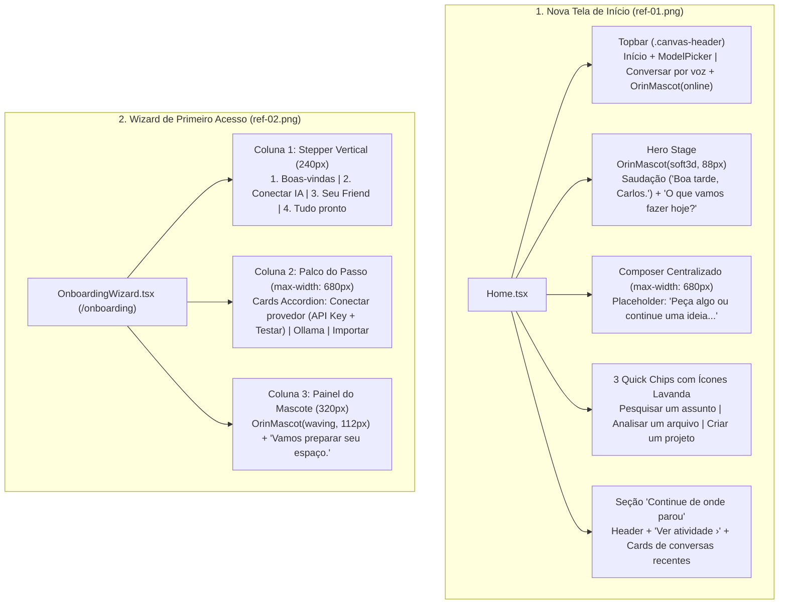

# Spec — Fase 2: Nova Home (`ref-01.png`) & Wizard de Primeiro Acesso (`ref-02.png`)

> [!IMPORTANT]
> **Etapa do Fluxo Obrigatório (`superpowers`):** Brainstorming & Especificação de Design (**Fase 2 de 7** — iniciada após aprovação 100% da revisão da Fase 1).
> Esta especificação aguarda sua **aprovação explícita** antes de gerarmos o Plano de Implementação (`writing-plans`) da Fase 2.

---

## 1. Objetivo e Escopo da Fase 2

Com a fundação de Design System, Mascote SVG (`OrinMascot`) e Shell Global entregues na Fase 1, a **Fase 2** reconstrói as duas primeiras experiências de entrada do usuário conforme [`relatorio-01-design-system-shell-home.md`](file:///C:/Users/User/.gemini/antigravity/brain/f9309199-920e-4114-94d6-10ab7d5212cf/relatorio-01-design-system-shell-home.md):

1. **Nova Tela de Início (`Home.tsx` — `ref-01.png`):**
   - Topbar com título `"Início"` (além do `ModelPicker` compacto), botão pill **`"Conversar por voz"`** (`data-testid="home-voice-cta"`, que abre o palco do Orin Friend / Live Voice) e `<OrinMascot size={28} variant="flat" statusDot="online" />` à direita.
   - Hero centralizado com `<OrinMascot size={88} variant="soft3d" />`.
   - Saudação dinâmica por horário e nome do usuário (`"Bom dia, Carlos."` / `"Boa tarde, Carlos."` / `"Boa noite, Carlos."`) + subtítulo convidativo **`"O que vamos fazer hoje?"`** (preservando a troca contextual para modo Code quando selecionado).
   - 3 Chips de sugestões rápidas estilizados conforme `ref-01.png` (retângulos arredondados `border-radius: 10px` com ícones em lavanda `#B4A4EF`):
     - Modo Chat: `🔍 Pesquisar um assunto` (`aria-label` compatível com `Pesquisar e sintetizar`), `📄 Analisar um arquivo` (`Analisar arquivos ou imagens`), `✨ Criar um projeto` (abre criação de projeto ou biblioteca).
     - Modo Code: `📁 Selecionar repositório local`, `📐 Planejar arquitetura / spec`, `🧪 Revisar testes e corrigir bugs`.
   - Seção visível **`"Continue de onde parou"`** (`data-testid="home-continue-section"`) abaixo de uma divisória sutil:
     - Cabeçalho com `"Continue de onde parou"` à esquerda e contador de tarefas ativas + link **`"Ver atividade ›"`** à direita.
     - Cards clicáveis das últimas conversas com ícone contextual em box `36px × 36px`, título da conversa, subtítulo de tempo relativo (`"Última conversa recente"`) e chevron `›` à direita.
2. **Wizard de Primeiro Acesso / Onboarding (`OnboardingWizard.tsx` — `ref-02.png`):**
   - Rota dedicada `/onboarding` (e acessível via botão/atalho de configuração rápida quando nenhum provedor está configurado).
   - Layout em **3 colunas full-height** idêntico a `ref-02.png`:
     - **Coluna 1 (Stepper Lateral Esquerdo `240px`):** `<Brand />` no topo + 4 passos conectados por linha vertical (`1. Boas-vindas`, `2. Conectar IA`, `3. Seu Friend`, `4. Tudo pronto`), com check `✓` nos passos concluídos.
     - **Coluna 2 (Palco Central `max-width: 680px`):**
       - **Passo 1 (`Boas-vindas`):** Apresentação do Orin e definição do nome do usuário (`localStorage: orin.user.displayName`, padrão `"Carlos"`).
       - **Passo 2 (`Conectar IA` — `ref-02.png`):** Título `"Escolha como começar"` + subtítulo `"Você pode mudar isso depois."` + 3 Radio Cards expansíveis:
         1. **`Conectar um provedor`** (*Use uma chave de API do seu serviço*): seletor de provedor (`OpenRouter`, `OpenAI`, `Anthropic`, `Gemini`, `NVIDIA`, `Groq`, `DeepSeek`), campo `"Chave de API"` com toggle mostrar/ocultar senha (`👁`), botão **`"Testar conexão"`** (que salva/valida a chave via API de providers) e badge verde **`● Conexão verificada`** (`#4ADE80`) quando validada.
         2. **`Usar IA no computador`** (*Conecte um modelo local pelo Ollama*): configuração rápida de endpoint local (`http://localhost:11434`) e teste de conexão.
         3. **`Já tenho uma conexão`** (*Importar configurações*): atalho para usar credenciais já salvas no ambiente ou importar JSON.
       - **Passo 3 (`Seu Friend`):** Escolha rápida do nome do companheiro (`Orin`) e tom inicial (Amigável, Direto, Criativo, Analítico) sincronizado com `orinFriendProfile`.
       - **Passo 4 (`Tudo pronto`):** Resumo da configuração e botão **`"Começar a usar o Orin →"`** que marca `orin.onboarding.completed = "true"` e navega para `/`.
     - **Coluna 3 (Painel Contextual Direito `320px`):** `<OrinMascot size={112} variant="waving" />` + título **`"Vamos preparar seu espaço."`** + texto explicativo contextual de cada etapa.

---

## 2. Comparativo Visual de Referência (`ref-01.png` e `ref-02.png`)

````carousel

<!-- slide -->

````

---

## 3. Arquitetura de Componentes da Fase 2



### 3.1. Detalhamento da Nova `Home.tsx` (`ref-01.png`)
- **Saudação e Hierarquia Semântica (`<h1>` + subtítulo):**
  - Para manter apenas **um `<h1>` na página** (requisito de acessibilidade e do teste `HomeNetwork.test.tsx` linha 57 `expect(screen.getAllByRole('heading', { level: 1 })).toHaveLength(1)`):
    - No modo Chat padrão:
      - Saudação personalizada em `<p className="home__greeting" data-testid="home-greeting">`: `"Boa tarde, Carlos."` (calculada pelo horário local: `05h–11h59` `"Bom dia"`, `12h–17h59` `"Boa tarde"`, `18h–04h59` `"Boa noite"`, usando o nome salvo em `orin.user.displayName` ou `"Carlos"`).
      - `<h1>` principal (`className="home__subtitle-heading"`): **`"O que vamos fazer hoje?"`** (ou `"O que vamos resolver neste projeto?"` quando em rota de projeto).
    - No modo Code (`codeMode === 'code'`):
      - `<h1>` exibe **`"Qual repositório vamos construir ou evoluir?"`** (ou `"Orin Code · < Nome do Projeto >"`).
- **Topbar da Home (`<header className="home__bar canvas-header">`):**
  - **Esquerda (`.canvas-header__left`):** Label `"Início"` (`className="home__topbar-title"`) + `<ModelPicker variant="unified" ... />`.
  - **Direita (`.canvas-header__right`):**
    - Botão pill **`"Conversar por voz"`** (`data-testid="home-voice-cta"`, ícone de ondas de áudio + texto `"Conversar por voz"`), que dispara a abertura do Orin Friend / Live Voice (`window.dispatchEvent(new CustomEvent('orin:open-friend-voice'))` ou modal de voz).
    - `<CommandPalette conversations={chats} />`.
    - `<OrinMascot size={28} variant="flat" statusDot="online" label="Orin ativo" />`.
- **3 Quick Action Chips (`data-testid="home-quick-actions"`):**
  - No modo Chat:
    1. **Pesquisar um assunto** (`aria-label="Pesquisar um assunto (Pesquisar e sintetizar)"`, preenche `'Pesquise e sintetize sobre: '` no Composer e foca o input).
    2. **Analisar um arquivo** (`aria-label="Analisar um arquivo (Analisar arquivos ou imagens)"`, preenche `'Analise os arquivos ou imagens anexados e destaque os pontos principais.'`).
    3. **Criar um projeto** (`aria-label="Criar um projeto (Usar uma Skill da Biblioteca)"`, navega para `/library/skills` ou aciona criação de projeto).
- **Seção `"Continue de onde parou"` (`data-testid="home-continue-section"`):**
  - Renderizada quando `chats.length > 0` (ou com um card de onboarding `"Configurar primeiro acesso (Conectar IA)"` quando o catálogo está vazio).
  - Mostra até 3 conversas recentes em cards clicáveis (`<button type="button" className="home__continue-card">`) com:
    - Ícone contextual (`36px × 36px`, documento ou lupa).
    - Título da conversa (`chat.title`) + subtítulo (`"Última conversa recente"` ou `"Em andamento"` se `chat.state === 'running'`).
    - Seta `›` à direita.
  - Cabeçalho da seção com `"Continue de onde parou"` à esquerda e `"Ver atividade ›"` à direita.

### 3.2. Detalhamento do `OnboardingWizard.tsx` (`ref-02.png`)
- **Novo arquivo:** [`frontend/src/features/onboarding/OnboardingWizard.tsx`](file:///c:/Users/User/Documents/GitHub/Carlos/orin/frontend/src/features/onboarding/OnboardingWizard.tsx)
- **Rota registrada em [`frontend/src/app/routes.tsx`](file:///c:/Users/User/Documents/GitHub/Carlos/orin/frontend/src/app/routes.tsx):**
  - `{ path: '/onboarding', element: <OnboardingWizard /> }`
- **Link na Home quando não há modelos configurados:**
  - Além do link `"Configurar provider"` (`/providers`) exigido por `HomeNetwork.test.tsx`, adicionaremos um botão secundário `" Assistente de primeiro acesso"` (`/onboarding`).
- **Comportamento Interativo do Passo 2 (`Conectar IA` — `ref-02.png`):**
  - Inicia no **Passo 2 (`step = 2`) por padrão quando aberto via `?step=2` ou permite navegar entre os 4 passos (`1`, `2`, `3`, `4`)** clicando no Stepper ou nos botões `"Voltar"` / `"Continuar →"`.
  - No card **`"Conectar um provedor"`**:
    - Permite selecionar o provedor (`OpenRouter` como padrão, `OpenAI`, `Anthropic`, `Gemini`, `NVIDIA`, `Groq`, `DeepSeek`).
    - Permite digitar a chave de API (`input[type="password"]` com botão `👁` para alternar `type="text"`).
    - Ao clicar em **`"Testar conexão"`** (`data-testid="onboarding-test-connection"`):
      - Valida que a chave não está vazia (mentalidade adversária: trim, rejeição de string vazia/espaços).
      - Chama a API `updateProviderSettings(client, provider, { api_key, enabled: true })` (ou valida localmente se em modo preview/mock) e exibe o badge verde **`● Conexão verificada`** (`data-testid="onboarding-connection-verified"`).

---

## 4. Mentalidade Adversária (Red-Team) & Segurança

1. **Proteção de Chaves de API no `OnboardingWizard`:**
   - O campo de API key usa `type="password"`, `autoComplete="off"` e `spellCheck={false}`.
   - A chave nunca é salva em `localStorage` nem exibida em logs/URLs; é enviada apenas via `PUT` autenticado ao backend ou descartada ao desmontar o componente.
   - Se a chamada de teste falhar (erro 401/403/500/rede), o badge `"Conexão verificada"` é imediatamente limpo e uma mensagem clara de erro (`role="alert"`) é exibida sem vazar a chave digitada.
2. **Sanitização do Nome do Usuário (`orin.user.displayName`):**
   - Limite de 60 caracteres, `trim()`, fallback seguro para `"Carlos"` se `localStorage` contiver string vazia ou lançar `SecurityError`.
3. **Retrocompatibilidade com a Suíte de Testes Existente:**
   - Mantemos apenas 1 `<h1>` na `Home.tsx`.
   - Mantemos os `aria-label` compostos nos quick chips e o link `"Configurar provider"` apontando para `/providers` quando `models.length === 0`.
   - Em `HomeAndChatRefactored.test.tsx`, atualizamos a asserção do `<h1>` no modo Chat para aceitar `"O que vamos fazer hoje?"` e verificamos a nova seção `"Continue de onde parou"`, o mascote 3D e a saudação.

---

## 5. Critérios de Aceitação da Fase 2

1. `Home.tsx` renderiza o `<OrinMascot size={88} variant="soft3d" />`, a saudação `"Bom dia/Boa tarde/Boa noite, Carlos."`, o `<h1>` `"O que vamos fazer hoje?"`, os 3 quick chips com ícones em lavanda e a seção visível `"Continue de onde parou"` com os cards de conversas recentes e `"Ver atividade ›"`.
2. A topbar da `Home.tsx` exibe `"Início"`, o `ModelPicker`, o botão `"Conversar por voz"`, a `CommandPalette` e o `<OrinMascot size={28} variant="flat" statusDot="online" />`.
3. `OnboardingWizard.tsx` (`/onboarding`) renderiza as 3 colunas de `ref-02.png` (Stepper de 4 etapas à esquerda, Palco Central com os 3 cards `"Conectar um provedor"`, `"Usar IA no computador"`, `"Já tenho uma conexão"`, input de chave de API, botão `"Testar conexão"` e badge `"Conexão verificada"`, e Painel Direito com `<OrinMascot size={112} variant="waving" />`).
4. Todos os testes unitários e de integração passam (`100% GREEN`), o build TypeScript/Vite compila sem erros e ambas as telas (`/` e `/onboarding`) são inspecionadas visualmente no **Playwright**.
