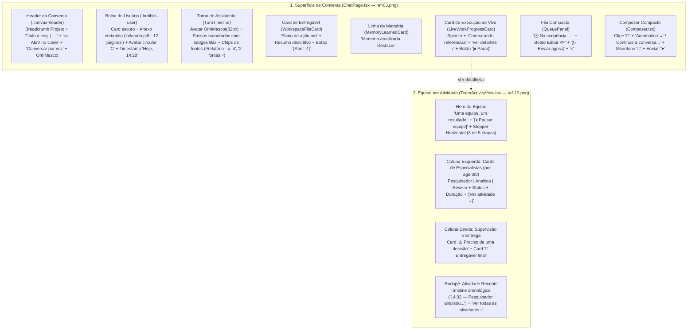

# Spec — Fase 3: Conversa de Chat, Composer Compacto & Equipe Multi-Agente (`ref-03.png` e `ref-10.png`)

> [!IMPORTANT]
> **Etapa do Fluxo Obrigatório (`superpowers` -> `brainstorming`):**
> A **Fase 2** foi concluída, auditada e enviada para `origin/refactor/interface`.
> Esta é a especificação técnica e de design da **Fase 3 de 7** e aguarda sua **aprovação explícita** antes de gerarmos o Plano de Implementação (`writing-plans`).

---

## 1. Objetivo e Escopo da Fase 3

A **Fase 3** reconstrói a experiência central de conversa ativa (**Orin Chat** — `ref-03.png`), o **Composer** unificado (seletor `"Automático ⌄"` / cápsula compacta `"Continue a conversa..."` com microfone e botão de envio lavanda) e a superfície de **Equipe em Atividade Multi-Agente** (`ref-10.png`), seguindo [`relatorio-02-chat-composer-equipe.md`](file:///C:/Users/User/.gemini/antigravity/brain/f9309199-920e-4114-94d6-10ab7d5212cf/relatorio-02-chat-composer-equipe.md) e preservando 100% do [`UX-CONTRACT.md`](file:///c:/Users/User/Documents/GitHub/Carlos/orin/UX-CONTRACT.md).

````carousel

<!-- slide -->

````

---

## 2. Arquitetura de Componentes da Fase 3



### 2.1. Evolução do `Composer.tsx` (`ref-01.png` e `ref-03.png`)
- **Seletor amigável `"Automático ⌄"` (`data-testid="composer-auto-mode-pill"`):**
  - Exibe um pill amigável `"Automático ⌄"` ao lado do botão de anexo (`📎`), permitindo alternar rapidamente entre Automático (Chat), Orin Code e seleção de contexto sem poluir a barra no modo Chat, enquanto preserva os `data-testid` existentes (`home-mode-code`, `session-context-trigger`, `code-permission-mode-pill`) para compatibilidade total com os testes contratuais.
- **Botão circular de Microfone (`🎤`, `data-testid="composer-voice-dictation-button"`) + Botão circular lavanda de Enviar (`➤` paper-plane):**
  - À direita do Composer, o botão de microfone circular (`36px`) fica ao lado do botão circular lavanda (`#B4A4EF` com texto/ícone escuro `#181523`) de enviar mensagem.

### 2.2. Evolução do `ChatPage.tsx`, `WorkspaceFileCard.tsx`, `MemoryLearnedCard.tsx` e `QueuePanel.tsx` (`ref-03.png`)
1. **Header da Conversa (`ChatPage.tsx`):**
   - **Esquerda:** Breadcrumb clicável do projeto (`Auryly ›`, quando a conversa pertence a um projeto) + título da conversa alinhado à esquerda (`Pesquisa de oportunidades`), mantendo `ModelPicker` e `ContextIndicator` acessíveis.
   - **Direita:** Botão **`<> Abrir no Code`** (`data-testid="chat-open-in-code-button"`), botão **`Conversar por voz`** (`data-testid="chat-voice-button"`), botão de mais opções **`...`** e `<OrinMascot size={30} variant="flat" statusDot="online" />`.
2. **Bolha do Usuário e Turno do Assistente:**
   - Bolha `.bubble--user` acompanhada por avatar circular com a inicial do usuário e timestamp discreto (`Hoje, HH:mm`).
   - Abertura do turno do assistente acompanhada pelo `<OrinMascot size={28} variant="flat" />`.
   - Suporte a chips de citação/fontes (`SourceCitationPill`) e cards largos de entregável em `WorkspaceFileCard.tsx` com botão **`Abrir ↗`**.
3. **Notificação de Memória (`MemoryLearnedCard.tsx`):**
   - Linha inline com ícone de banco de dados + prefixo `"Memória atualizada · "` + resumo + botão `"Desfazer"` em lavanda.
4. **Card de Trabalho ao Vivo e Fila Compacta (`QueuePanel.tsx`):**
   - Enquanto o turno está rodando (`running`), exibe o card de progresso ao vivo com título da etapa atual, link **`Ver detalhes ›`** (que abre a visão de Equipe em Atividade) e botão **`Parar`** (`#F87171`).
   - `QueuePanel.tsx` formatado como barra compacta `"Na sequência: ..."` com botões **Editar (`✏️`)**, **`Enviar agora`** e **`Remover (`×`)`**.

### 2.3. Nova Superfície `TeamActivityView.tsx` (`ref-10.png`)
- **Novo componente:** [`frontend/src/features/conversations/TeamActivityView.tsx`](file:///c:/Users/User/Documents/GitHub/Carlos/orin/frontend/src/features/conversations/TeamActivityView.tsx)
- Acessível a partir da conversa ativa ao clicar em **`"Ver detalhes ›"`** / botão **`"Equipe em atividade"`** (ou via rota `/chats/:conversationId/activity` e `/projects/:projectId/chats/:conversationId/activity`).
- **Estrutura fiel a `ref-10.png`:**
  1. **Hero da Equipe:** Título **`"Uma equipe, um resultado."`**, subtítulo `"O Orin coordena as etapas e reúne tudo para você."`, botão **`"Pausar equipe"`** (`data-testid="team-pause-button"`) e **Stepper Horizontal de Etapas** (`data-testid="team-stepper"`, ex.: `3 de 5 etapas · Em andamento`).
  2. **Coluna Esquerda — Cards de Especialistas (`data-testid="team-agents-list"`):**
     - Agrupados estritamente por `agentId` (respeitando `turnTimelineFold.ts`): exibe ícone semântico do papel (Pesquisador / Analista / Revisor), nome do agente, tarefa atual, badge de status (`● Em andamento` ou `● Na fila`), duração e botão expansível **`"Ver atividade ⌄"`** que revela as chamadas de ferramentas daquele agente.
  3. **Coluna Direita — Decisão e Entregável (`data-testid="team-side-rail"`):**
     - Card âmbar **`"⚠️ Preciso de uma decisão"`** (`data-testid="team-decision-card"`) quando há pergunta/aprovação pendente (com botões de resposta rápida).
     - Card **`"📄 Entregável final"`** (`data-testid="team-final-deliverable-card"`) mostrando o artefato principal em preparação ou concluído.
  4. **Rodapé — `Atividade recente` (`data-testid="team-recent-activity"`):**
     - Linha do tempo cronológica com horário (`HH:mm`), frase em linguagem natural e link `"Ver todas as atividades ›"`.

---

## 3. Mentalidade Adversária (Red-Team) & Segurança

1. **Preservação Integral dos Contratos de Teste Existentes (`w7ChatSurfacesD1`, `w7ChatSurfacesD2`, `ChatPage.test.tsx`, `Composer.test.tsx`, `TurnTimeline.test.tsx`):**
   - Todos os `data-testid`, `role` e `aria-label` exigidos pelos testes existentes de `ChatPage`, `Composer`, `QueuePanel`, `WorkspaceFileCard`, `MemoryLearnedCard` e `TurnTimeline` serão 100% preservados.
2. **Isolamento de Estado por `agentId` e Eventos Malformados:**
   - `TeamActivityView` sanitiza listas vazias de eventos/subagentes, timestamps inválidos e nomes de agentes ausentes (fallback seguro para `"Especialista"`), nunca quebrando se o turno ainda não tiver subagentes paralelos.
3. **Fila de Mensagens (`QueuePanel`):**
   - Editar um item da fila remove o item da fila de forma atômica e devolve o texto ao `Composer` sem disparar envio acidental.

---

## 4. Critérios de Aceitação da Fase 3

1. `Composer.tsx` exibe o seletor `"Automático ⌄"`, botão circular de microfone e botão circular lavanda de envio (`➤`), mantendo 100% dos testes de `Composer.test.tsx` e `SessionContextPopover.test.tsx` passando.
2. `ChatPage.tsx`, `WorkspaceFileCard.tsx`, `MemoryLearnedCard.tsx` e `QueuePanel.tsx` refletem o design de `ref-03.png` (header com `"Abrir no Code"` e `"Conversar por voz"`, avatar do usuário e do Orin nas mensagens, linha `"Memória atualizada ·"`, fila compacta `"Na sequência:"` com botão de editar e card de progresso ao vivo com `"Ver detalhes ›"` e `"Parar"`).
3. `TeamActivityView.tsx` renderiza o painel executivo de `ref-10.png` (`"Uma equipe, um resultado."`, stepper de etapas, cards de especialistas por `agentId` com `"Ver atividade ⌄"`, card `"Preciso de uma decisão"`, card `"Entregável final"` e timeline `"Atividade recente"`).
4. Suíte de testes (`100% GREEN`), build TypeScript/Vite (`exit code 0`), verificação visual no **Playwright** e auditoria aprovada por subagente revisor.
