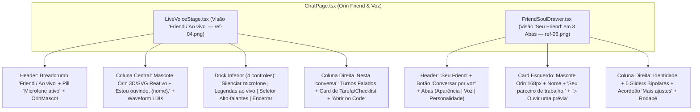

# Especificação de Design — Fase 4: Palco Orin Friend Ao Vivo (`ref-04.png`) & Personalização do Friend (`ref-06.png`)

> [!IMPORTANT]
> **Escopo desta Fase (Fase 4 de 7):** Reconstruir a experiência do **Orin Friend** em duas superfícies irmãs:
> 1. **Orin ao Vivo: Voz, Transcrição e Tarefas (`ref-04.png` — [`LiveVoiceStage.tsx`](file:///c:/Users/User/Documents/GitHub/Carlos/orin/frontend/src/features/conversations/LiveVoiceStage.tsx)):** Transformar o palco de voz em um layout de 2 colunas integrado (`Palco Central de Voz` + coluna direita `"Nesta conversa"` com transcrição recente da chamada e card de tarefa delegada em andamento com checklist e botão `"Abrir no Code"`), mascote reativo, headline personalizado (`"Estou ouvindo, Carlos."`), waveform horizontal lilás e dock inferior de 4 controles (`Silenciar microfone`, `Legendas ao vivo`, seletor de saída de áudio `Alto-falantes` e `Encerrar`).
> 2. **Personalize seu Friend (`ref-06.png` — [`FriendSoulDrawer.tsx`](file:///c:/Users/User/Documents/GitHub/Carlos/orin/frontend/src/features/conversations/FriendSoulDrawer.tsx)):** Transformar a personalização do Friend na visão estruturada `"Seu Friend"` com 3 abas (`✨ Aparência`, `🎙️ Voz`, `👤 Personalidade`), card esquerdo com mascote em destaque e botão `"▷ Ouvir uma prévia"`, campos de identidade com ícones, os **5 sliders bipolares visíveis** (`Calor humano`, `Bom humor`, `Formalidade`, `Diretividade`, `Energia`), acordeão `"Mais ajustes"` e rodapé com `"↺ Restaurar padrão"` + `"Salvar alterações"`.

---

## 1. Referências Visuais Alvo (`ref-04.png` e `ref-06.png`)

````carousel

<!-- slide -->

````

---

## 2. Arquitetura de Componentes da Fase 4



---

## 3. Especificação Detalhada por Superfície

### 3.1. Palco `"Friend / Ao vivo"` (`ref-04.png` — [`LiveVoiceStage.tsx`](file:///c:/Users/User/Documents/GitHub/Carlos/orin/frontend/src/features/conversations/LiveVoiceStage.tsx))

1. **Header Superior (`.live-stage__top`):**
   - **Breadcrumb à esquerda (`data-testid="live-voice-breadcrumb"`):**
     - `Friend` (`color: var(--orin-text-secondary)`) `/` `<strong data-testid="live-voice-companion-name">{companionName}</strong>` + chip `Ao vivo`.
   - **Indicador de Microfone e Ações à direita:**
     - Pill `data-testid="live-voice-mic-status-pill"`: ponto/ícone verde (`#34D399`) + `"Microfone ativo"` (ou `"Microfone silenciado"` quando `muted === true`).
     - Mantém os gatilhos acessíveis de configuração (`data-testid="live-voice-active-profile-pill"`, `data-testid="live-voice-open-settings-button"`, `data-testid="live-voice-close-button"`) para compatibilidade total com testes existentes.
     - `<OrinMascot size={30} variant="flat" statusDot="online" ariaHidden />` no canto direito.

2. **Palco Central de Voz (`.live-stage__center`):**
   - **Mascote Orin Central Reativo (`data-testid="live-voice-orb"`):**
     - Exibe o mascote Orin volumétrico em destaque (`size={164}`) reagindo ao nível de áudio (`orbLevel`) junto ao `LiveOrb` (preservando os seletores de teste do `LiveOrb`).
   - **Headline de Estado Personalizado (`data-testid="live-voice-state-label"`):**
     - Em `phase === 'listening'`, exibe **`Estou ouvindo, {userNickname}.`** quando `userNickname` estiver preenchido (ex.: `"Estou ouvindo, Carlos."`), ou **`Estou ouvindo`** quando vazio (preservando a assinatura pura `stateLabel(phase, name, working, userNickname)` com retrocompatibilidade quando `userNickname` é omitido).
   - **Waveform Horizontal Simétrico em Lilás (`data-testid="live-voice-waveform"`):**
     - Posicionado no centro do palco, logo abaixo do título de estado.
     - Composto por `31` barras verticais arredondadas em lilás (`#B4A4EF` / `var(--orin-accent)`) moduladas por envelope gaussiano a partir do centro.
   - **Subtítulo de Orientação & Legendas ao Vivo (`data-testid="live-voice-captions"`):**
     - Exibe `"Pode falar naturalmente e me interromper."` no estado padrão e renderiza as legendas dinâmicas (`live-voice-assistant-caption` / `live-voice-user-caption`) quando `captionsEnabled === true`.

3. **Dock Inferior de 4 Controles (`.live-stage__controls`):**
   - **Controle 1 — `Silenciar microfone` (`data-testid="live-voice-mute-button"`):**
     - Botão circular (`52px × 52px`) + rótulo abaixo `"Silenciar microfone"` (ou `"Ativar microfone"` quando `muted`).
   - **Controle 2 — `Legendas ao vivo` (`data-testid="live-voice-captions-toggle"`):**
     - Botão circular (`52px × 52px`) com `aria-pressed={captionsEnabled}` + rótulo abaixo `"Legendas ao vivo"`.
   - **Controle 3 — Seletor de Saída de Áudio (`data-testid="live-voice-speaker-picker"`):**
     - Pill horizontal com ícone de alto-falante `🔊`, exibindo o dispositivo de saída selecionado (ex.: `"Alto-falantes (Padrão)"` ou dispositivos `audiooutput` retornados por `navigator.mediaDevices.enumerateDevices()`) + chevron `⌄`.
   - **Controle 4 — `Encerrar` (`data-testid="live-voice-end-call-button"`):**
     - Botão circular vermelho (`#EF4444`) com ícone de telefone desligando + rótulo abaixo `"Encerrar"`, acionando `onClose()`.
   - *Compatibilidade:* Os botões de acessibilidade `live-voice-barge-in-button` (`Interromper`) e `live-voice-ptt-button` (`Modo sem fone`) permanecem acessíveis para usuários sem fone e suítes de teste existentes.

4. **Coluna Lateral Direita `"Nesta conversa"` (`data-testid="live-voice-side-panel"`):**
   - **Zona A — Diálogo Recente da Chamada (`data-testid="live-voice-transcript-list"`):**
     - Cabeçalho **`Nesta conversa`**.
     - Lista os últimos turnos falados/mensagens da conversa com avatar circular do usuário (`Você`) ou mini `<OrinMascot />` (`Orin`), horário `HH:mm` e conteúdo limpo (com fallback demonstrativo contextual quando a lista estiver vazia ou em prévia).
   - **Zona B — Card de Tarefa / Delegação em Andamento (`data-testid="live-voice-task-card"`):**
     - Exibe o progresso da tarefa delegada (`delegatedCodeSession` / `todos`):
       - Título da tarefa (ex.: `delegatedCodeSession?.goal` ou `"Tarefa em andamento"`) + contador `"X de Y etapas concluídas"`.
       - Barra de progresso contínua em lilás (`#B4A4EF`).
       - Checklist de etapas (`todos`) com `✓` para concluídas (texto riscado) e `○` para pendentes.
       - Botão primário largo **`↗ Abrir no Code`** (`data-testid="live-voice-open-in-code"`), que navega para a sessão do Orin Code (`onOpenCodeSession`).

---

### 3.2. Visão `"Seu Friend"` em Abas (`ref-06.png` — [`FriendSoulDrawer.tsx`](file:///c:/Users/User/Documents/GitHub/Carlos/orin/frontend/src/features/conversations/FriendSoulDrawer.tsx))

1. **Cabeçalho & Abas de Navegação:**
   - **Título Principal:** `Seu Friend` + subtítulo `Personalize como o Orin conversa e te acompanha.`
   - **Ações no Topo Direito:**
     - Botão pill **`🎙️ Conversar por voz`** (`data-testid="friend-start-voice-button"`, aciona `onStartVoice` ou fecha a gaveta e abre o `LiveVoiceStage`).
     - `<OrinMascot size={32} variant="flat" statusDot="online" />` + botão `"Fechar"` (`data-testid="close-friend-soul-drawer"`).
   - **Barra de Abas Horizontais (`role="tablist"`, `data-testid="friend-personalize-tabs"`):**
     - Aba 1: `✨ Aparência` (`data-testid="friend-tab-appearance"`)
     - Aba 2: `🎙️ Voz` (`data-testid="friend-tab-voice"`)
     - Aba 3: `👤 Personalidade` (`data-testid="friend-tab-personality"`, **aba ativa por padrão**)

2. **Layout de 2 Colunas da Aba `Personalidade` (`ref-06.png`):**
   - **Coluna Esquerda — Card de Identidade & Prévia (`data-testid="friend-preview-card"`):**
     - Mascote `<OrinMascot size={160} variant="soft3d" />` (com suporte visual ao `draft.theme` e `<LiveOrb>` preservado para testes).
     - Nome em destaque: **`<h2 data-testid="friend-preview-name">{displayName}</h2>`** (`24px`, `font-weight: 700` — único `<h2>` do componente para preservar `getByRole('heading', { level: 2 })`).
     - Subtítulo de parceria: **`Seu parceiro de trabalho.`** (`bondStageLabel` + afinidade no card de vínculo).
     - Botão **`▷ Ouvir uma prévia`** (`data-testid="friend-listen-preview-button"`): sintetiza/reproduz uma frase de exemplo refletindo os traços atuais (com feedback de estado `"Reproduzindo prévia…"` e proteção contra cliques simultâneos).
   - **Coluna Direita — Identidade, 5 Sliders Bipolares e `"Mais ajustes"`:**
     - **Campos de Identidade:**
       - `Nome do Friend` (`Como você quer chamar seu Friend?`) — `data-testid="friend-name-input"` com ícone do mascote.
       - `Como te chamar` (`Qual nome o Orin deve usar para se referir a você?`) — `data-testid="friend-nickname-input"` com ícone de usuário.
     - **Seção `Personalidade` — Os 5 Sliders Bipolares Visíveis (`ref-06.png`):**
       - Exibidos diretamente (sem exigir abrir um `<details>` para os 5 principais), cada um no formato horizontal `[Ícone + Rótulo] | [Pólo Esquerdo] | [Input Range Lilás] | [Pólo Direito]`:
         1. **Calor humano** (`data-testid="friend-trait-slider-warmth"`): `Mais reservado` ↔ `Mais caloroso`
         2. **Bom humor** (`data-testid="friend-trait-slider-humor"`): `Mais sério` ↔ `Mais bem-humorado`
         3. **Formalidade** (`data-testid="friend-trait-slider-formality"`): `Mais casual` ↔ `Mais formal`
         4. **Diretividade** (`data-testid="friend-trait-slider-candor"`): `Mais exploratório` ↔ `Mais direto`
         5. **Energia** (`data-testid="friend-trait-slider-energy"`): `Mais tranquilo` ↔ `Mais energético`
     - **Acordeão `Mais ajustes` (`data-testid="friend-more-settings"`):**
       - Título **`Mais ajustes`** + descrição `"Preferências avançadas de linguagem, foco e contexto."`
       - Contém (mantendo 100% dos `data-testid` existentes montados no DOM):
         - Presets rápidos (`friend-preset-*`)
         - Sliders complementares (`friend-trait-slider-sarcasm`, `friend-trait-slider-verbosity`)
         - Aparência / Temas (`friend-theme-*`)
         - Vínculo e Afinidade (`friend-bond-card`, `friend-bond-stage`, `friend-affinity-score`)
         - Humor e Instruções de estilo (`friend-mood-input`, `friend-style-notes-textarea`)
         - Memórias e piadas internas (`friend-memory-item-*`, `delete-friend-memory-*`)
         - Sincronização `SOUL.md` (`friend-soul-path`, `sync-friend-soul-button`)
     - **Rodapé de Ações:**
       - Botão à esquerda: **`↺ Restaurar padrão`** (`data-testid="friend-restore-defaults-button"`), que restaura os traços e valores padrão e marca `dirty = true`.
       - Status central: `data-testid="friend-save-status"`.
       - Botão primário à direita: **`Salvar alterações`** (`data-testid="save-friend-persona-button"`).

---

## 4. Mentalidade Adversária (Red-Team) & Casos de Borda

1. **Permissão/Enumeração de Dispositivos de Áudio (`enumerateDevices`):**
   - Em navegadores sem `navigator.mediaDevices?.enumerateDevices` (ou quando a permissão é negada / retorna labels vazios), o seletor de saída de áudio deve exibir graciosamente o fallback `"Alto-falantes (Padrão)"` sem lançar erro.
2. **Prevenção de Condição de Corrida em `"▷ Ouvir uma prévia"` e `"Salvar alterações"`:**
   - Clicar repetidamente em `"▷ Ouvir uma prévia"` não deve abrir múltiplas sessões de síntese simultâneas; o botão fica desabilitado/em estado `"Ouvindo prévia…"` até concluir ou cancelar no unmount.
3. **Validação e Sanitização de Inputs de Identidade:**
   - Preservar integralmente a validação de `draft.name` (vazio, `> 40` caracteres ou caracteres proibidos `< > { } \``) e truncamento seguro em `userNickname` no headline `"Estou ouvindo, {userNickname}."`.
4. **Acessibilidade e Movimento Reduzido (`prefers-reduced-motion`):**
   - O `LiveWaveform` congela as barras em alturas estáticas suaves quando `reducedMotion === true` ou `@media (prefers-reduced-motion: reduce)` estiver ativo.
5. **Zero Regressão nos Testes Existentes:**
   - Todos os `data-testid` testados em `LiveVoiceStage.test.tsx` e `FriendSoulDrawer.test.tsx` permanecem presentes e funcionais.
