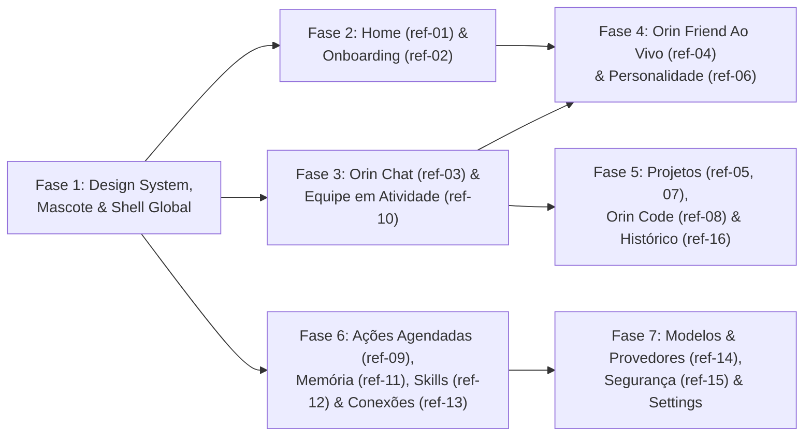

# Roadmap Mestre — Reconstrução da Interface do Orin

> [!IMPORTANT]
> **Rito Obrigatório por Fase (`superpowers` + TDD + Playwright):**
> Cada uma das **7 fases** abaixo será executada de forma independente e incremental seguindo rigorosamente a sequência:
> 1. **Brainstorming** (`brainstorming`) — alinhamento de decisões abertas da fase;
> 2. **Spec** — documento de especificação detalhada da fase + **aprovação explícita**;
> 3. **Plano** (`writing-plans`) — plano de implementação passo a passo + **aprovação explícita**;
> 4. **Implementação** (`executing-plans` ou `subagent-driven-development`) — aplicando **TDD** (teste falhando `[RED]` → código mínimo `[GREEN]` → refatoração) e mentalidade adversária (*Red-Team*);
> 5. **Revisão & Verificação Visual** (`verification-before-completion` + **Playwright**) — validação 100% local no navegador comparando o resultado renderizado com as telas de referência antes de avançar para a próxima fase.

---

## 📚 Índice dos 6 Relatórios Especializados

Todos os diagnósticos visuais e de código foram gerados por subagentes especialistas analisando as 16 telas de referência (`ref-01.png` a `ref-16.png`) e o mascote [`orin.svg`](file:///C:/Users/User/Downloads/orin%20ref/orin.svg):

| # | Relatório Especializado | Telas de Referência Analisadas | Escopo Principal |
| :--- | :--- | :--- | :--- |
| **01** | [Relatório 01 — Design System, Mascote, Shell Global, Home e Onboarding](file:///C:/Users/User/.gemini/antigravity/brain/f9309199-920e-4114-94d6-10ab7d5212cf/relatorio-01-design-system-shell-home.md) | `orin.svg`, `ref-01.png`, `ref-02.png` (+ Shell transversal) | Paleta *Warm Charcoal & Lavender* (`#B4A4EF`), tipografia, componente `OrinMascot`, unificação de `WorkspaceShell` / `WorkspaceNavigation`, nova `Home` e `OnboardingWizard`. |
| **02** | [Relatório 02 — Orin Chat, Composer, Timeline e Equipe em Atividade](file:///C:/Users/User/.gemini/antigravity/brain/f9309199-920e-4114-94d6-10ab7d5212cf/relatorio-02-chat-composer-equipe.md) | `ref-03.png`, `ref-10.png` | Header limpo com breadcrumb, bolhas com avatares, citações clicáveis, Card de Entregável, Card de Progresso Ao Vivo, Composer em cápsula e Visão de Equipe em Atividade (`Auryly / Atividade`). |
| **03** | [Relatório 03 — Orin Friend: Modo Ao Vivo e Personalidade](file:///C:/Users/User/.gemini/antigravity/brain/f9309199-920e-4114-94d6-10ab7d5212cf/relatorio-03-friend-voz-personalidade.md) | `ref-04.png`, `ref-06.png`, `orin.svg` | Palco de voz integrado ao `WorkspaceShell` com Mascote reativo, waveform lilás, painel lateral `"Nesta conversa"` (transcrição + progresso do Code) e tela `"Seu Friend"` com 3 abas e 5 sliders bipolares. |
| **04** | [Relatório 04 — Projetos, Contexto, Orin Code (Preview) e Histórico](file:///C:/Users/User/.gemini/antigravity/brain/f9309199-920e-4114-94d6-10ab7d5212cf/relatorio-04-projetos-code-historico.md) | `ref-05.png`, `ref-07.png`, `ref-08.png`, `ref-16.png` | Galeria `/projects`, Dashboard do Projeto com abas e `Contexto compartilhado`, Orin Code Split-Screen com Workbench (`Prévia | Arquivos | Terminal`) e Máquina do Tempo em 3 colunas com diff visual. |
| **05** | [Relatório 05 — Ações Agendadas, Memória, Habilidades e Conexões](file:///C:/Users/User/.gemini/antigravity/brain/f9309199-920e-4114-94d6-10ab7d5212cf/relatorio-05-agenda-memoria-skills-conexoes.md) | `ref-09.png`, `ref-11.png`, `ref-12.png`, `ref-13.png` | Ações agendadas em linguagem humana + drawer `Nova ação`, Memória com adição manual e inspector lateral, vitrine de Habilidades em grid + inspector com exemplo, e Central unificada de Conexões. |
| **06** | [Relatório 06 — Modelos & Provedores, Segurança & Controle e Settings](file:///C:/Users/User/.gemini/antigravity/brain/f9309199-920e-4114-94d6-10ab7d5212cf/relatorio-06-modelos-seguranca-settings.md) | `ref-14.png`, `ref-15.png` | Submenu de Configurações enxuto (6 seções dentro do `WorkspaceShell`), Modelo Principal + Fallback Reserva + Uso/Custos, e painel unificado de Segurança (Permissão padrão + Pastas autorizadas). |

---

## 🗺️ Visão Geral e Dependências das Fases

---

## 🛠️ Detalhamento das 7 Fases

### Fase 1 — Design System, Mascote `OrinMascot` e Shell Global Unificado
- **Referências:** [`orin.svg`](file:///c:/Users/User/Documents/GitHub/Carlos/orin/.cache/orin-ref/orin.svg) e estrutura global de `ref-01.png` a `ref-16.png`
- **Relatório Base:** [Relatório 01](file:///C:/Users/User/.gemini/antigravity/brain/f9309199-920e-4114-94d6-10ab7d5212cf/relatorio-01-design-system-shell-home.md)
- **Escopo Principal:**
  1. **Tokens e Tipografia ([`theme.css`](file:///c:/Users/User/Documents/GitHub/Carlos/orin/frontend/src/styles/theme.css), [`index.css`](file:///c:/Users/User/Documents/GitHub/Carlos/orin/frontend/src/styles/index.css), [`agentos.css`](file:///c:/Users/User/Documents/GitHub/Carlos/orin/frontend/src/styles/agentos.css)):**
     - Atualizar superfícies escuras para *Warm Charcoal & Plum Dark* (`#101014` sidebar, `#141419` canvas, `#1A1A21` cards, `#1E1E26` inputs) e acento primário para o **Lavanda Orin (`#B4A4EF`)** com texto escuro de alto contraste (`#181523`).
     - Substituir cabeçalhos finos precedidos por eyebrows monospace caixa-alta por títulos `Plus Jakarta Sans` / `Inter` Bold (`700`) acompanhados de subtítulos humanos em `#9A98A6`.
  2. **Componente `OrinMascot.tsx` e [`Brand.tsx`](file:///c:/Users/User/Documents/GitHub/Carlos/orin/frontend/src/components/Brand.tsx):**
     - Criar `frontend/src/components/OrinMascot.tsx` com as variantes `flat`, `soft3d`, `waving` e `statusDot="online"`.
     - Atualizar `Brand.tsx` para exibir o mascote flat (`28px`) + wordmark `"orin"` em letras minúsculas (`20px bold`).
  3. **Unificação do [`WorkspaceShell.tsx`](file:///c:/Users/User/Documents/GitHub/Carlos/orin/frontend/src/app/WorkspaceShell.tsx) e [`WorkspaceNavigation.tsx`](file:///c:/Users/User/Documents/GitHub/Carlos/orin/frontend/src/features/projects/WorkspaceNavigation.tsx):**
     - Remover o card "inset" arredondado (`.workspace-shell__canvas` passa a ser full-bleed separado por hairline `1px`).
     - Padronizar a topbar (`56px`) com breadcrumb/título à esquerda e botão pill `"Conversar por voz"` + avatar `OrinMascot` online à direita.
     - Reestruturar a sidebar: botão único primário **`+ Nova conversa`**, menu superior (**`Início`**, **`Friend ›`**, **`Ações agendadas`**), abas **`Conversas` | `Projetos`** com sublinhado lavanda, lista enxuta com ícones semânticos e tempo relativo (`há 2h`), rodapé com **`Habilidades`**, **`Conexões`**, **`Configurações`** e [`ProfileMenu.tsx`](file:///c:/Users/User/Documents/GitHub/Carlos/orin/frontend/src/features/auth/ProfileMenu.tsx) sempre visível (inclusive em modo local).

---

### Fase 2 — Nova Home (`ref-01`) e Wizard de Primeiro Acesso / Onboarding (`ref-02`)
- **Referências:** `ref-01.png` (*Orin: início com assistente*) e `ref-02.png` (*Primeiro acesso: conecte sua IA*)
- **Relatório Base:** [Relatório 01](file:///C:/Users/User/.gemini/antigravity/brain/f9309199-920e-4114-94d6-10ab7d5212cf/relatorio-01-design-system-shell-home.md)
- **Escopo Principal:**
  1. **Tela de Início ([`Home.tsx`](file:///c:/Users/User/Documents/GitHub/Carlos/orin/frontend/src/app/Home.tsx) — `ref-01.png`):**
     - Hero centralizado com `<OrinMascot variant="soft3d" size={88} />`, saudação dinâmica por horário e nome (`"Boa tarde, Carlos."`) e subtítulo `"O que vamos fazer hoje?"`.
     - Composer inicial simplificado com botão de anexo, seletor pill **`"Automático ⌄"`** (agrupando modo/modelo), botão circular de microfone e botão circular lavanda de envio.
     - 3 chips de ação rápida (`🔍 Pesquisar um assunto`, `📄 Analisar um arquivo`, `✨ Criar um projeto`).
     - Seção **`"Continue de onde parou"`** visível (removendo `.visually-hidden`), com indicador de tarefas ativas (`"1 tarefa em andamento · Ver atividade ›"`) e cards clicáveis das últimas conversas.
  2. **Wizard de Primeiro Acesso (`OnboardingWizard.tsx` — `ref-02.png`):**
     - Layout em 3 colunas: Stepper vertical esquerdo (`1. Boas-vindas`, `2. Conectar IA`, `3. Seu Friend`, `4. Tudo pronto`), palco central interativo e painel direito com `<OrinMascot variant="waving" />`.
     - No passo `Conectar IA`: radio cards expansíveis para **`Conectar um provedor`** (seletor de provedor + input de API Key + botão `"Testar conexão"` com badge verde **`● Conexão verificada`**), **`Usar IA no computador`** (Ollama) e **`Já tenho uma conexão`** (importar).

---

### Fase 3 — Orin Chat, Composer em Cápsula e Visão de Equipe em Atividade (`ref-03` e `ref-10`)
- **Referências:** `ref-03.png` (*Pesquisa de oportunidades para a Auryly*) e `ref-10.png` (*Equipe em atividade: pesquisa de oportunidades*)
- **Relatório Base:** [Relatório 02](file:///C:/Users/User/.gemini/antigravity/brain/f9309199-920e-4114-94d6-10ab7d5212cf/relatorio-02-chat-composer-equipe.md)
- **Escopo Principal:**
  1. **Experiência de Conversa ([`ChatPage.tsx`](file:///c:/Users/User/Documents/GitHub/Carlos/orin/frontend/src/features/conversations/ChatPage.tsx), [`TurnTimeline.tsx`](file:///c:/Users/User/Documents/GitHub/Carlos/orin/frontend/src/features/conversations/TurnTimeline.tsx), [`Composer.tsx`](file:///c:/Users/User/Documents/GitHub/Carlos/orin/frontend/src/features/conversations/Composer.tsx) — `ref-03.png`):**
     - Topbar da conversa com breadcrumb de projeto (`Auryly › Pesquisa de oportunidades`) à esquerda e botões `[...]`, `[<> Abrir no Code]`, `[Conversar por voz]` + Mascote à direita.
     - Mensagem do usuário com avatar circular (`C`), timestamp (`Hoje, 14:28`) e card de anexo integrado (`relatorio.pdf · 12 páginas`).
     - Mensagem do Orin com avatar do mascote, recomendações numeradas com badges circulares lilás (`1`, `2`, `3`) e chips clicáveis de citação/fontes (`[📄 Relatório · p. 4]`, `[2 fontes ›]`).
     - **Card de Entregável** de largura completa (`Plano de ação.md` com `[Abrir ↗]`), linha silenciosa de memória (`Memória atualizada · ... · Desfazer`) e **Card de Progresso Ao Vivo** com spinner lilás, `Ver detalhes ›` e botão `[⏹ Parar]`.
     - Barra de fila compacta (`🕒 Na sequência...` com editar `✏️`, `[▷ Enviar agora]` e `×`) e Composer em cápsula horizontal limpa (`"Continue a conversa..."`).
  2. **Visão de Equipe em Atividade (`TeamActivityView.tsx` / evolução de [`OverviewPanel.tsx`](file:///c:/Users/User/Documents/GitHub/Carlos/orin/frontend/src/features/overview/OverviewPanel.tsx) — `ref-10.png`):**
     - Header `Auryly / Atividade`, Hero `"Uma equipe, um resultado."` com botão `[⏸ Pausar equipe]` e Stepper horizontal de 5 etapas (`3 de 5 etapas · Em andamento`).
     - Coluna esquerda com cards por `agentId` (`Pesquisador`, `Analista`, `Revisor`), status ao vivo, tempo decorrido e botão `[Ver atividade ⌄]`.
     - Coluna direita com card âmbar de decisão rápida (`⚠️ Preciso de uma decisão` — integrando [`UserQuestionCard.tsx`](file:///c:/Users/User/Documents/GitHub/Carlos/orin/frontend/src/features/conversations/UserQuestionCard.tsx)) + card `Entregável final` e rodapé `Atividade recente`.

---

### Fase 4 — Orin Friend: Palco Ao Vivo Integrado (`ref-04`) e Espaço "Seu Friend" (`ref-06`)
- **Referências:** `ref-04.png` (*Orin ao vivo: voz, transcrição e tarefas*) e `ref-06.png` (*Personalize a personalidade do seu Friend*)
- **Relatório Base:** [Relatório 03](file:///C:/Users/User/.gemini/antigravity/brain/f9309199-920e-4114-94d6-10ab7d5212cf/relatorio-03-friend-voz-personalidade.md)
- **Escopo Principal:**
  1. **Modo Ao Vivo Integrado ([`LiveVoiceStage.tsx`](file:///c:/Users/User/Documents/GitHub/Carlos/orin/frontend/src/features/conversations/LiveVoiceStage.tsx) e [`live.css`](file:///c:/Users/User/Documents/GitHub/Carlos/orin/frontend/src/styles/live.css) — `ref-04.png`):**
     - Substituir o overlay `position: fixed; inset: 0` por um layout de 3 colunas integrado ao `WorkspaceShell` (Sidebar esquerda + Palco central de voz + Coluna direita `"Nesta conversa"`).
     - No palco central: Mascote Orin 3D reativo à voz, título personalizado **`"Estou ouvindo, Carlos."`**, waveform simétrico em barras lilás e dock inferior de 4 controles (`Silenciar microfone`, `Legendas ao vivo`, seletor de dispositivo de saída de áudio via `setSinkId` e botão vermelho `Encerrar`).
     - Na coluna `"Nesta conversa"`: transcrição ao vivo com timestamps + card de progresso da tarefa ativa no Orin Code (`Página da Auryly — 3 de 4 etapas concluídas`, barra de progresso, checklist e botão `[↗ Abrir no Code]`).
  2. **Espaço "Seu Friend" (`FriendSettingsView.tsx` / evolução de [`FriendSoulDrawer.tsx`](file:///c:/Users/User/Documents/GitHub/Carlos/orin/frontend/src/features/conversations/FriendSoulDrawer.tsx) e [`LiveVoiceQuickSettings.tsx`](file:///c:/Users/User/Documents/GitHub/Carlos/orin/frontend/src/features/conversations/LiveVoiceQuickSettings.tsx) — `ref-06.png`):**
     - Visão ampla com 3 abas (`✨ Aparência`, `🎙️ Voz`, `👤 Personalidade`).
     - Coluna esquerda com card de preview do Mascote Orin e botão **`[▷ Ouvir uma prévia]`**.
     - Coluna direita com `Nome do Friend`, `Como te chamar`, **5 sliders bipolares** (`Calor humano`, `Bom humor`, `Formalidade`, `Diretividade`, `Energia`), acordeão `Mais ajustes` (preservando vínculo, memórias afetivas, humor atual e `SOUL.md`) e barra inferior `↺ Restaurar padrão` / `Salvar alterações`.

---

### Fase 5 — Espaço de Projetos (`ref-05`), Contexto de Projeto (`ref-07`), Orin Code Split Workbench (`ref-08`) e Máquina do Tempo (`ref-16`)
- **Referências:** `ref-05.png`, `ref-07.png`, `ref-08.png` e `ref-16.png`
- **Relatório Base:** [Relatório 04](file:///C:/Users/User/.gemini/antigravity/brain/f9309199-920e-4114-94d6-10ab7d5212cf/relatorio-04-projetos-code-historico.md)
- **Escopo Principal:**
  1. **Galeria de Projetos (`ProjectsGalleryPage.tsx` em `/projects` — `ref-05.png`):**
     - Header com busca (`Buscar projetos...`), botão `+ Novo projeto` e grid de 3 colunas com cards de projetos (ícone de pasta colorido, badge `● 1 tarefa em andamento`, contadores `8 conversas · 12 arquivos`, timestamp relativo e link `Abrir projeto →`).
  2. **Dashboard Interno do Projeto ([`ProjectPage.tsx`](file:///c:/Users/User/Documents/GitHub/Carlos/orin/frontend/src/features/projects/ProjectPage.tsx) — `ref-07.png`):**
     - Abas internas (`Conversas`, `Arquivos`, `Instruções`, `Memória`), composer rápido inline (`Nova conversa neste projeto...` com seletor `Automático ▾`), lista de conversas recentes com resumo de 1 linha e painel lateral **`Contexto compartilhado`** (pasta local vinculada, contagem de arquivos e instruções do projeto).
  3. **Orin Code Split-Screen Workbench (`CodeWorkbenchPanel.tsx` + [`ChatPage.tsx`](file:///c:/Users/User/Documents/GitHub/Carlos/orin/frontend/src/features/conversations/ChatPage.tsx) — `ref-08.png`):**
     - Layout split-screen no modo Code: coluna esquerda com conversa limpa (card acordeão `📄 3 arquivos alterados · Ver alterações`, checklist de etapas e composer `Peça um ajuste...` com seletor `Perguntar antes ▾`) e coluna direita com abas **`Prévia | Arquivos | Terminal`**, barra de URL local (`http://localhost:3000/...`), seletor de viewport Desktop/Mobile, botão de abrir no navegador e `iframe` ao vivo.
  4. **Máquina do Tempo — Histórico e Restauração (`ProjectHistoryView.tsx` / evolução de [`RewindPicker.tsx`](file:///c:/Users/User/Documents/GitHub/Carlos/orin/frontend/src/features/conversations/RewindPicker.tsx) — `ref-16.png`):**
     - Visão em 3 colunas (`Auryly / Histórico`): timeline vertical de checkpoints automáticos (`Coluna 1`), inspetor central com diffs coloridos de cada arquivo alterado (`Coluna 2`) e painel de confirmação `O que será restaurado` com botão `Restaurar este ponto` (`Coluna 3`).

---

### Fase 6 — Ações Agendadas (`ref-09`), Memória sob Controle (`ref-11`), Habilidades (`ref-12`) e Conexões (`ref-13`)
- **Referências:** `ref-09.png`, `ref-11.png`, `ref-12.png` e `ref-13.png`
- **Relatório Base:** [Relatório 05](file:///C:/Users/User/.gemini/antigravity/brain/f9309199-920e-4114-94d6-10ab7d5212cf/relatorio-05-agenda-memoria-skills-conexoes.md)
- **Escopo Principal:**
  1. **Ações Agendadas ([`SchedulesPage.tsx`](file:///c:/Users/User/Documents/GitHub/Carlos/orin/frontend/src/features/schedules/SchedulesPage.tsx) — `ref-09.png`):**
     - Abas `Ativas`, `Pausadas`, `Histórico`, tabela com nome da ação + frequência em linguagem natural (`Dias úteis às 08:00`, gatilhos por evento `Ao concluir a exportação`) e drawer lateral direito **`Nova ação`** (sem exigir escolha manual de Provider/Model).
  2. **Memória do Orin ([`MemoryPage.tsx`](file:///c:/Users/User/Documents/GitHub/Carlos/orin/frontend/src/features/memory/MemoryPage.tsx) — `ref-11.png`):**
     - Interface 100% em português (`"Você decide o que o Orin lembra"`), abas `Trabalho`, `Friend`, `Por projeto`, botão **`+ Adicionar lembrança`** (com suporte a criação manual na API e toast `"Nova lembrança salva. | Desfazer"`), cards com escopo/origem e inspector lateral direito **`Editar lembrança`** com link `Ver conversa de origem ↗`.
  3. **Habilidades ([`SkillsPage.tsx`](file:///c:/Users/User/Documents/GitHub/Carlos/orin/frontend/src/features/skills/SkillsPage.tsx) — `ref-12.png`):**
     - Abas `Instaladas`, `Explorar`, `Criadas por você`, botão `↑ Importar`, grid de cards em 2 colunas e inspector lateral direito com seção **`Como usar` + `✦ Exemplo`**, seletor `Disponibilidade` por projeto e acordeão `Instruções da habilidade`.
  4. **Central de Conexões (`ConnectionsPage.tsx` — `ref-13.png`):**
     - Unificação de [`IntegrationsHubPage.tsx`](file:///c:/Users/User/Documents/GitHub/Carlos/orin/frontend/src/features/settings/IntegrationsHubPage.tsx), [`McpSection.tsx`](file:///c:/Users/User/Documents/GitHub/Carlos/orin/frontend/src/features/mcp/McpSection.tsx) e [`PluginsSection.tsx`](file:///c:/Users/User/Documents/GitHub/Carlos/orin/frontend/src/features/plugins/PluginsSection.tsx) com abas `Conectadas` e `Disponíveis` (incluindo ferramentas locais `Navegador` e `Arquivos locais`), inspector lateral com capacidades em linguagem humana, política `Antes de publicar` (`Sempre pedir aprovação`), escopo `Usar em` (Global vs Projeto) e rodapé avançado `⚙ Configuração MCP`.

---

### Fase 7 — Modelos & Provedores (`ref-14`), Segurança & Controle (`ref-15`) e Consolidação das Configurações
- **Referências:** `ref-14.png` (*Modelos e provedores do Orin*) e `ref-15.png` (*Segurança e controle do Orin*)
- **Relatório Base:** [Relatório 06](file:///C:/Users/User/.gemini/antigravity/brain/f9309199-920e-4114-94d6-10ab7d5212cf/relatorio-06-modelos-seguranca-settings.md)
- **Escopo Principal:**
  1. **Arquitetura de Configurações ([`SettingsShell.tsx`](file:///c:/Users/User/Documents/GitHub/Carlos/orin/frontend/src/features/settings/SettingsShell.tsx) e [`sections.ts`](file:///c:/Users/User/Documents/GitHub/Carlos/orin/frontend/src/features/settings/sections.ts)):**
     - Manter a `WorkspaceNavigation` visível à esquerda ao abrir `Configurações` e consolidar o submenu secundário em **6 seções**: `Geral`, `Modelos e provedores`, `Voz`, `Memória`, `Segurança` e `Atualizações`.
  2. **Modelos e Provedores ([`ProvidersSection.tsx`](file:///c:/Users/User/Documents/GitHub/Carlos/orin/frontend/src/features/providers/ProvidersSection.tsx) — `ref-14.png`):**
     - Card **`Modelo principal`** (seleção global de Provedor + Modelo padrão para novas conversas).
     - Card **`Se houver uma falha`** (escolha de provedor/modelo reserva, ex.: `Ollama · Modelo local`, + toggle `Usar reserva automaticamente`).
     - Lista enxuta de **`Provedores conectados`** com botão `Gerenciar >`, CTA tracejado **`+ Conectar provedor`** (abrindo modal com `AnthropicSetup`, `OllamaSetup`, `OmniRouteSetup`, `OpenCodeSetup`, etc.) e coluna direita **`Uso e custos`** (`Mostrar estimativa por conversa`).
  3. **Segurança e Controle (`SecuritySection.tsx` — `ref-15.png`):**
     - Unificação de [`PermissionsSection.tsx`](file:///c:/Users/User/Documents/GitHub/Carlos/orin/frontend/src/features/codeSettings/PermissionsSection.tsx) e [`TrustedFoldersSection.tsx`](file:///c:/Users/User/Documents/GitHub/Carlos/orin/frontend/src/features/codeSettings/TrustedFoldersSection.tsx) com 3 radio cards de **`Permissão padrão`** (`Perguntar antes`, `Só planejar`, `Aceitar edições`).
     - Seção integrada **`Pastas autorizadas`** com caminho, seletor de escopo (`Somente esta pasta`), exclusão e botão **`+ Adicionar pasta`**.
     - Card **`Ações em serviços externos`**, coluna direita com preview interativo **`Aprovar alteração?`** e rodapé com link `Revisar atividades e permissões >` + barra transacional `Cancelar` / `Salvar alterações`.
