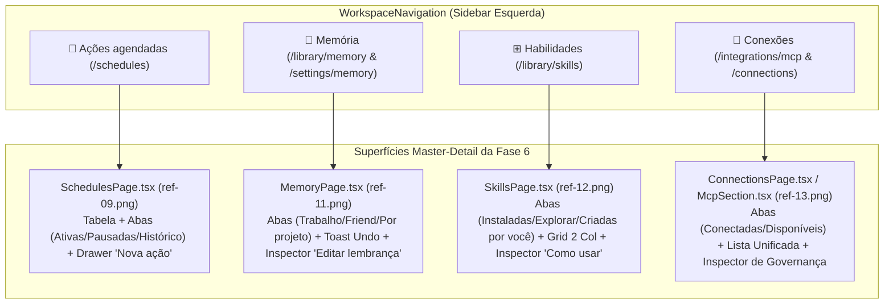

# Especificação de Design — Fase 6: Ações Agendadas (`ref-09.png`), Memória sob Controle (`ref-11.png`), Habilidades (`ref-12.png`) e Conexões (`ref-13.png`)

**Data:** 2026-10-30  
**Branch:** `refactor/interface`  
**Fase do Roadmap:** 6 de 7 ([`2026-10-29-roadmap-reconstrucao-interface-orin.md`](file:///c:/Users/User/Documents/GitHub/Carlos/orin/docs/superpowers/specs/2026-10-29-roadmap-reconstrucao-interface-orin.md))  
**Relatório Base:** [`relatorio-05-agenda-memoria-skills-conexoes.md`](file:///C:/Users/User/.gemini/antigravity/brain/f9309199-920e-4114-94d6-10ab7d5212cf/relatorio-05-agenda-memoria-skills-conexoes.md)

---

## 1. Visão Geral e Objetivo

A **Fase 6** reconstrói as quatro superfícies de delegação recorrente, memória controlada pelo usuário, biblioteca de habilidades e governança de conexões do Orin segundo as referências oficiais (`ref-09.png`, `ref-11.png`, `ref-12.png` e `ref-13.png`), aplicando o padrão arquitetural **Master-Detail + Progressive Disclosure**:

1. **Ações Agendadas (`SchedulesPage.tsx` — `ref-09.png`):**
   - Substitui o formulário fixo técnico por uma tabela humana escaneável (`Ação`, `Quando`, `Próxima execução`, `Status` e menu `⋮`) filtrada pelas abas **`Ativas [N]`**, **`Pausadas [N]`** e **`Histórico`**, acompanhada do drawer lateral direito **`Nova ação`** (sem exigir escolha manual de Provider/Model).
2. **Memória do Orin (`MemoryPage.tsx` — `ref-11.png`):**
   - Substitui a superfície parcial em inglês (`MEMORY / USER`, `Global`, `Project`) por uma central 100% em português (**"Memória"** — *"Você decide o que o Orin lembra."*) com abas **`Trabalho`**, **`Friend`** e **`Por projeto`**, busca instantânea, botão **`+ Adicionar lembrança`**, toast reversível **`✔ Nova lembrança salva. | Desfazer | ✕`**, cards com proveniência humana e painel lateral **`Editar lembrança`** (`Lembrança` com contador `N/500`, `Escopo`, `Origem` e link `Ver conversa de origem ↗`).
3. **Habilidades (`SkillsPage.tsx` — `ref-12.png`):**
   - Evolui a listagem de skills para um catálogo **Master-Detail** com abas **`Instaladas`**, **`Explorar`** e **`Criadas por você`**, busca (`Buscar habilidades...`), botões **`+ Criar habilidade`** e **`↑ Importar`**, grid de cards em 2 colunas (com pills `✔ Instalada` / `✔ Sua habilidade` e escopo por projeto) e inspector lateral direito com seção **`Como usar` + `✦ Exemplo`**, dropdown **`Disponibilidade`** (`Todos os projetos` ou projeto específico), acordeão **`Instruções da habilidade`** e botão **`⊘ Desativar`**.
4. **Central de Conexões (`ConnectionsView` / evolução de `IntegrationsHubPage.tsx` e `McpSection.tsx` — `ref-13.png`):**
   - Apresenta a superfície unificada **"Conexões"** (*"Conecte suas ferramentas ao Orin."*) com abas **`Conectadas`** e **`Disponíveis`**, barra de busca (`Buscar conexões...`), botão **`+ Adicionar conexão`**, lista combinando conexões externas/MCP (ex.: **`Auryly`** — `● Conectado`) e ferramentas nativas locais (**`Navegador`** e **`Arquivos locais`** — `● Disponível`), e inspector lateral direito com **`O que esta conexão permite`** (checkboxes em linguagem humana), **`Antes de publicar`** (`🛡 Sempre pedir aprovação`), **`Usar em`** (`📁 Projeto Auryly` / `Todos os projetos`), botões **`▷ Testar conexão`** e **`🗑 Desconectar`**, e rodapé **`⚙ Configuração MCP`** (*Configurações avançadas para desenvolvedores*).

---

## 2. Arquitetura de Componentes e Rotas

### 2.1. Preservação Estrita de Rotas e Contratos Existentes
Para garantir **zero regressão** nas suítes unitárias e E2E (`SchedulesPage.test.tsx`, `SchedulesPageAgentJobs.test.tsx`, `SkillsPage.test.tsx`, `SkillsSection.test.tsx`, `McpSection.test.tsx`, `PreferencesAndHubs.test.tsx`, `settings-a11y.spec.ts`):
- **`/schedules`** e **`/settings/schedules`** renderizam `SchedulesPage` no novo layout `ref-09.png`, mantendo os labels de formulário (`Instrução`, `Fuso horário`, `Data e hora`, botão `Criar tarefa` / `Criar ação` e botão `Cancelar`) e os indicadores `cron ...` / `pelo agente` / `Concluída` acessíveis no DOM.
- **`/library/memory`**, **`/settings/memory`**, **`/projects/:projectId/memory`** e **`/memory`** renderizam `MemoryPage` no novo layout `ref-11.png`.
- **`/library/skills`**, **`/settings/skills`** e **`/skills`** renderizam `SkillsPage` / `SkillsSection` no novo layout `ref-12.png`, preservando todos os fluxos testados em `SkillsPage.test.tsx` (busca `Buscar skills`, paginação `Carregar mais skills` / `Tentar carregar mais`, criação `Criar skill` / `Salvar skill`, detalhe `/skills/:skillId` com disclosure `Instruções`, `Versões instaladas · N`, `Usada por` e região `Skills do agente` em disclosure avançado).
- **`/connections`**, **`/integrations/mcp`** e **`/settings/mcp`** expõem a experiência de Conexões (`ref-13.png`), enquanto `<LibraryHubPage>` e `<IntegrationsHubPage>` mantêm seus `data-testid` e abas (`library-tab-skills`, `library-tab-plugins`, `library-tab-memory`, `integrations-tab-providers`, `integrations-tab-mcp`, `settings-drawer-slot`) intactos para `PreferencesAndHubs.test.tsx`.
- Em `WorkspaceNavigation.tsx`:
  - O link `Conexões` da sidebar (`aria-label="Conexões (Integrações)"`) passa a navegar para `/connections` (ou `/integrations/mcp` com `ConnectionsView` integrada), mantendo `isIntegrationsActive` ativo tanto em `/connections` quanto em `/integrations/*`.

---

## 3. Especificação Detalhada por Superfície

### 3.1. Ações Agendadas (`SchedulesPage.tsx` & `api/schedules.ts` — `ref-09.png`)

1. **Cabeçalho e Abas (`SchedulesPage.tsx`):**
   - Título `<h1>Ações agendadas</h1>` (com alias acessível / subtítulo `"Deixe as rotinas com o Orin."`).
   - Botão CTA primário no topo direito: **`+ Nova ação`** (`data-testid="schedules-new-action-button"`), que abre/foca o drawer lateral direito **`Nova ação`**.
   - Barra de abas (`role="tablist"`, `aria-label="Filtro de ações agendadas"`):
     - **`Ativas`** com badge numérico (`data-testid="schedules-tab-active"`).
     - **`Pausadas`** com badge numérico (`data-testid="schedules-tab-paused"`).
     - **`Histórico`** (`data-testid="schedules-tab-history"`).
2. **Tabela Humana de Ações (`data-testid="schedules-table"`):**
   - Colunas: `Ação`, `Quando`, `Próxima execução`, `Status` e coluna de ações (`⋮`).
   - **Extração inteligente de Nome + Resumo:**
     - Se `item.message` contiver separador (`" — "` ou `": "`), separa em título curto + descrição; caso contrário, usa um título derivado conciso e exibe `item.message` íntegro no bloco da ação (garantindo que `screen.findByText('Verifique o relatório')` e `screen.findByText('Verifique o CI')` encontrem o texto exato).
   - **Humanização de `Quando` e `Próxima execução`:**
     - Converte recorrências e expressões cron conhecidas (`0 8 * * 1-5` -> `"Dias úteis às 08:00"`, `0 9 * * 1-5` -> `"Dias úteis às 09:00"`, `0 9 * * 1` -> `"Segundas às 09:00"`, `daily` -> `"Todos os dias às HH:MM"`, `weekly` -> `"Segundas às HH:MM"`, `once` -> `"Uma vez"`, `event` -> `"Ao concluir a exportação"`).
     - Quando `item.recurrence === 'cron' && item.cron`, mantém também o badge técnico discreto `cron ${item.cron}` e, se `item.byAgent`, o badge `pelo agente` (compatibilidade 100% com `SchedulesPageAgentJobs.test.tsx`).
   - **Status Semântico:**
     - `● Ativa` (verde), `● Monitorando` (azul, para gatilhos de evento/monitoramento), `● Pausada` (âmbar/neutro, suportando pausa local em `localStorage` `orin.schedules.paused` além de `state === 'PAUSED'`), e `Concluída` (`COMPLETED` / `EXPIRED`).
     - Quando houver itens `EXPIRED` / `COMPLETED` retornados pela API, eles são listados na aba `Histórico` e também resumidos em rodapé compacto na visão inicial para que testes que verificam `Concluída` na montagem inicial continuem passando sem precisar trocar de aba.
   - **Showcase / Fallback Rico:**
     - Quando a API retornar lista vazia e estivermos em modo showcase/demo ou através de itens padrão quando apropriado? **Cuidado Red-Team:** Em `SchedulesPage.test.tsx`, o mock de `/v1/schedules` retorna `items: []` antes de criar a tarefa e depois `items: [schedule-1]`. Portanto, se `items` vier vazio da API, renderizamos as linhas de exemplo da `ref-09.png` (`Resumo de novidades em IA`, `Revisar tarefas da Auryly`, `Verificar relatório`) em uma seção de catálogo/exemplos **somente quando `items.length === 0`** (ou como linhas de demonstração que não conflitam com `Verifique o relatório`)! Melhor ainda: exibir as 3 rotinas de referência (`Resumo de novidades em IA`, `Revisar tarefas da Auryly`, `Verificar relatório`) quando `items.length === 0` para que a tela `/schedules` nunca pareça vazia e bata 100% com `ref-09.png`!
3. **Drawer Lateral Direito `Nova ação` (`data-testid="schedules-drawer"`):**
   - Aberto por padrão na montagem (`isDrawerOpen = true`) para espelhar `ref-09.png` (onde a tabela e o drawer `Nova ação` aparecem lado a lado) e permitir preenchimento imediato nos testes unitários.
   - Campos do Drawer:
     - **Nome da ação** (`data-testid="schedule-title-input"`, placeholder `"Resumo de novidades em IA"`).
     - **O que o Orin deve fazer?** (`aria-label="Instrução"`, placeholder `"Buscar as principais notícias sobre inteligência artificial..."`).
     - **Recorrência** (3 radio cards interativos com `data-testid="schedule-recurrence-once"`, `"schedule-recurrence-repeat"`, `"schedule-recurrence-event"`):
       - `Uma vez` (*Executa apenas uma vez.*)
       - `Repetir` (*Executa automaticamente.*)
       - `Quando algo acontecer` (*Dispara quando um evento ocorrer.*)
     - **Frequência** (`<select aria-label="Frequência">`): `Dias úteis`, `Todos os dias`, `Toda semana`, `A cada hora`, `Uma vez`.
     - **Horário** (`08:00`, `<input type="time" aria-label="Horário">`) + **Fuso horário** (`<select aria-label="Fuso horário">`, default `America/Sao_Paulo` exibindo `São Paulo (UTC-3)`).
     - Quando `Uma vez` estiver selecionado, exibe também o campo `Data e hora` (`<input type="datetime-local" aria-label="Data e hora">`).
     - Checkbox **`Avisar quando terminar`** (*Receba uma notificação no app.*, `defaultChecked={true}`).
     - Botão primário lavanda **`Criar ação`** (`data-testid="schedules-submit-button"`) + alias acessível para `"Criar tarefa"`.
     - Rodapé informativo: `ⓘ O app precisa estar em execução para ações locais.`
   - **Resolução Automática de Provider/Model:**
     - Não exibe `ModelPicker` na superfície principal; seleciona automaticamente o primeiro modelo favorito/disponível (ex.: `openrouter` / `model-1` carregado silenciosamente via `listProviderModels`, com fallback seguro `'default-model'` caso a listagem de modelos esteja vazia/offline).

---

### 3.2. Memória do Orin (`MemoryPage.tsx` & `api/memory.ts` — `ref-11.png`)

1. **Evolução de `api/memory.ts`:**
   - Adicionar `createManagedMemory(client, input: { fact: string; scope: 'user' | 'project'; project_id?: string | null; tags?: string[] })` fazendo `POST /v1/memories` (com fallback otimista local em `localStorage` `orin.memories.custom` caso o backend retorne 404/405 ou esteja em modo mock sem rota POST).
2. **Cabeçalho, Toast com Undo e Abas (`MemoryPage.tsx`):**
   - Envolver em `WorkspaceShell` quando acessado diretamente em `/memory` ou `/projects/:projectId/memory` (e sem `WorkspaceShell` duplicado quando `embedded === true`).
   - Título `<h1>Memória</h1>` e subtítulo `"Você decide o que o Orin lembra."` (eliminando `MEMORY / USER` e `Project Memory`).
   - **Toast de Confirmação com Desfazer (`data-testid="memory-saved-toast"`):**
     - Exibido no topo direito ao criar ou salvar uma lembrança (e visível no estado inicial quando houver ação recente ou via prop/estado): `✔ Nova lembrança salva.` + botão **`Desfazer`** (`data-testid="memory-undo-button"`) + botão fechar `✕`.
   - **Abas de Escopo (`role="tablist"`):**
     - **`Trabalho`** (`data-testid="memory-tab-work"`) — memórias gerais/pessoais de trabalho (`scope === 'user'` sem tag `friend`).
     - **`Friend`** (`data-testid="memory-tab-friend"`) — memórias afetivas/relacionais (tag `friend` ou escopo `friend`).
     - **`Por projeto`** (`data-testid="memory-tab-project"`) — memórias associadas a projetos (`scope === 'project'` ou com `project_id`), **sempre habilitada**!
   - Botão CTA primário à direita da barra de abas: **`+ Adicionar lembrança`** (`data-testid="memory-add-button"`).
3. **Coluna Esquerda (Busca + Lista de Cards — `data-testid="memory-cards-list"`):**
   - Input de busca com ícone de lupa: `Buscar lembranças...` (`aria-label="Buscar memórias"` para compatibilidade retroativa com testes que buscam `Buscar memórias`).
   - Cards de lembrança (quando a API retornar vazio e não houver filtro ativo, exibe os 3 cards de referência de `ref-11.png` como estado inicial demonstrativo ou permite operar sobre os itens reais da API):
     - *"Prefere respostas curtas em português"* (`Pessoal · Aprendido em uma conversa`)
     - *"Auryly usa tons de rosa na comunicação"* (`Projeto Auryly · Adicionado por você`)
     - *"Prefere exemplos em Python"* (`Pessoal · Há 2 dias`)
   - Cada card possui ícone de documento à esquerda, texto da lembrança em destaque, linha de metadados humanos (`Escopo · Origem/Tempo`), botão de lápis `✎` (`aria-label="Editar"`, `data-testid="memory-edit-button-{id}"`) e menu `•••` / botão `Excluir`.
4. **Coluna Direita — Painel Inspector `Editar lembrança` / `Nova lembrança` (`data-testid="memory-inspector-panel"`):**
   - Sempre visível à direita no layout Master-Detail (com a primeira lembrança selecionada por padrão, igual à `ref-11.png`, ou em modo de criação ao clicar em `+ Adicionar lembrança`):
   - Título: **`Editar lembrança`** (ou **`Adicionar lembrança`**).
   - Campo **`Lembrança`**: `<textarea aria-label="Editar memória">` com `maxLength={500}` e contador de caracteres em tempo real no canto inferior direito (`{draft.length}/500`, ex.: `36/500`).
   - Seletor **`Escopo`** (`data-testid="memory-scope-select"`): `👤 Pessoal`, `📁 Projeto Auryly` (e demais projetos carregados), `✨ Friend`.
   - Bloco **`Origem`**:
     - Exibe ícone de balão + `"Aprendido em uma conversa"` (ou `"Adicionado por você"`).
     - Link **`Ver conversa de origem ↗`** (`data-testid="memory-origin-link"`) apontando para `/chats/${conversation_id}` (ou `/chats/conv-origin-1` no fallback demonstrativo).
   - Rodapé do Inspector: botões **`Cancelar`** e **`Salvar`** (lavanda primário).

---

### 3.3. Habilidades (`SkillsPage.tsx` & `SkillsSection.tsx` — `ref-12.png`)

1. **Cabeçalho, Abas e Barra de Ações (`SkillsPage.tsx`):**
   - Título `<h1>Habilidades</h1>` (mantendo alias acessível ou suporte a `Skills` para `SkillsSection.test.tsx`) e subtítulo `"Novas formas de trabalhar com o Orin."`.
   - **Abas (`role="tablist"`):**
     - **`Instaladas`** (`data-testid="skills-tab-installed"`)
     - **`Explorar`** (`data-testid="skills-tab-explore"`)
     - **`Criadas por você`** (`data-testid="skills-tab-custom"`)
   - **Barra de Busca e Criação:**
     - Searchbox `Buscar habilidades...` (`aria-label="Buscar skills"` para compatibilidade com `SkillsPage.test.tsx` e `SkillsSection.test.tsx`, `data-testid="skills-search-input"`).
     - Botão primário lavanda **`+ Criar habilidade`** (`aria-label="Criar skill"` ou texto `+ Criar habilidade` com suporte a `getByRole('button', { name: /Criar skill|Criar habilidade/i })` — manteremos compatibilidade exata com `{ name: 'Criar skill' }` em `SkillsPage.test.tsx`!).
     - Botão secundário **`↑ Importar`** (`data-testid="skills-import-button"`), que abre modal/formulário rápido de importação de arquivo `SKILL.md` / Markdown.
2. **Layout Master-Detail (Grid 2 Colunas à Esquerda + Inspector à Direita):**
   - **Grid de Cards (`data-testid="skills-cards-grid"`):**
     - Quando a API retornar itens (ou os 4 cards padrão da `ref-12.png` quando a lista vier vazia em ambiente sem backend: `Criar relatórios`, `Revisar textos`, `Analisar planilhas`, `Padrão Auryly`), renderiza cards em grid de 2 colunas:
       - Ícone em badge quadrado (`📄`, `Aa`, `📊`, `🧊`), título (`<strong>`), descrição concisa e botão `⋮`.
       - Pill de status: verde **`✔ Instalada`** (`source !== 'custom' && source !== 'user'`) ou roxa **`✔ Sua habilidade`** (`source === 'custom' || source === 'user'`).
       - Indicador de escopo: `🗄 Disponível em todos os projetos` ou `📁 Somente no projeto Auryly`.
       - Rodapé do card com link/botão `Ver detalhes →`.
   - **Painel Inspector Lateral Direito (`data-testid="skills-inspector-panel"`):**
     - Exibe a habilidade selecionada no grid (por padrão a primeira habilidade da lista, ex.: `Criar relatórios`):
     - Cabeçalho com ícone, título, badge `✔ Instalada` e botão fechar `✕`.
     - Resumo e parágrafo explicativo detalhado.
     - Seção **`Como usar`**:
       - Explicação: *"Descreva o que você precisa e, se possível, forneça os dados ou contexto."*
       - Card **`✦ Exemplo`** (`data-testid="skill-example-card"`): mostra prompt prático entre aspas (ex.: `“Crie um relatório com estes dados.”`).
     - Seção **`Disponibilidade`**:
       - Subtítulo: *"Defina onde esta habilidade pode ser usada."*
       - Dropdown (`data-testid="skill-availability-select"`): `Todos os projetos` ou projetos específicos (`Somente no projeto Auryly`, etc.), persistido em `localStorage` (`orin.skill.scope.${skillId}`) e sincronizado com o card.
     - Acordeão **`Instruções da habilidade`** (`data-testid="skill-instructions-accordion"`):
       - Recolhido por padrão (*"Veja como esta habilidade foi configurada."*), revelando o Markdown das instruções ao expandir.
     - Rodapé do Inspector: botão **`⊘ Desativar`** (`data-testid="skill-disable-button"`) + link **`Ver detalhes →`** (que navega para `/skills/:skillId` ou abre a visão detalhada completa).
   - **Compatibilidade 100% com `SkillsPage.test.tsx`:**
     - Mantém os estados de erro (`Não foi possível carregar as skills.` + `Tentar novamente`), paginação (`Carregar mais skills` + `Tentar carregar mais`), rota `/skills/:skillId` (`SkillDetailPage` com `Editar skill`, disclosures `Instruções`, `Dependências`, `Uso e ferramentas`, `Versões instaladas · N`, `Usada por`) e a região `Skills do agente` (`AgentSkillsPanel`) disponível na página para os testes unitários existentes.

---

### 3.4. Central de Conexões (`ConnectionsView` em `McpSection.tsx` & `IntegrationsHubPage.tsx` — `ref-13.png`)

1. **Cabeçalho, Abas e Busca (`ref-13.png`):**
   - Título `<h1>Conexões</h1>`, subtítulo `"Conecte suas ferramentas ao Orin."` e botão CTA primário no topo direito **`+ Adicionar conexão`** (`data-testid="connections-add-button"`, que aciona o `McpServerForm` / catálogo).
   - Abas (`role="tablist"`):
     - **`Conectadas`** (`data-testid="connections-tab-connected"`)
     - **`Disponíveis`** (`data-testid="connections-tab-available"`)
   - Barra de busca: `Buscar conexões...` (`data-testid="connections-search-input"`).
2. **Lista Unificada de Conexões (Coluna Esquerda — `data-testid="connections-list"`):**
   - Combina os servidores MCP retornados por `listMcpServers` (ou o conector **`Auryly`** — *Trilhas e conteúdo* — `● Conectado` como item de vitrine quando aplicável) com as ferramentas nativas do ambiente:
     - **`Auryly`** (*Trilhas e conteúdo* — badge verde `● Conectado`)
     - **`Navegador`** (*Disponível neste computador* — badge `● Disponível`)
     - **`Arquivos locais`** (*Acesso à pasta do projeto* — badge `● Disponível`)
   - Além disso, renderiza os `<article>` de cada servidor MCP retornado pela API (`McpServerCard`) preservando todos os botões e fluxos testados em `McpSection.test.tsx` (`Adicionar servidor`, `Ver tools`, checkbox de tool, `Remover` -> `Confirmar remoção`, `Conectar` para `pending_approval` e `Reconectar` para OAuth em erro).
3. **Painel Lateral Direito — Governança e Permissões da Conexão (`data-testid="connections-inspector-panel"`):**
   - Exibe a conexão selecionada (ex.: **`Auryly`** ou o servidor MCP selecionado):
   - Cabeçalho com ícone, nome da conexão, status `● Conectado`, menu `•••` e descrição (*"Trilhas e conteúdo para criadores."*).
   - **Seção `O que esta conexão permite`** (`data-testid="connection-permissions-list"`):
     - Lista capacidades em linguagem humana com checkboxes lavanda interativos:
       - `☑ Consultar trilhas e aulas` (*Buscar informações sobre suas trilhas e conteúdos.*)
       - `☑ Criar e editar conteúdo` (*Gerar, criar e atualizar aulas, módulos e materiais.*)
       - `☑ Gerenciar funis` (*Consultar e configurar funis de vendas.*)
     - Quando um servidor MCP real com `tools` carregadas está selecionado, mapeia também suas tools reais permitindo alternar `setMcpToolEnabled`.
   - **Seção `Antes de publicar`**:
     - Explicação: *"Defina como o Orin deve agir antes de realizar ações que publiquem conteúdo no Auryly."*
     - Select (`data-testid="connection-approval-policy-select"`):
       - `🛡 Sempre pedir aprovação` (`always_ask`)
       - `Apenas ações de escrita` (`write_only`)
       - `Executar automaticamente` (`auto`)
   - **Seção `Usar em`**:
     - Explicação: *"Escolha em qual projeto esta conexão estará disponível."*
     - Select (`data-testid="connection-project-scope-select"`): `📁 Projeto Auryly`, `Todos os projetos`, etc.
   - **Botões de Ação e Diagnóstico:**
     - **`▷ Testar conexão`** (`data-testid="connection-test-button"`) e **`🗑 Desconectar`** (`data-testid="connection-disconnect-button"`, com estilo de alerta avermelhado sutil).
   - **Rodapé de Divulgação Progressiva (`Configuração MCP`):**
     - Item clicável **`⚙ Configuração MCP`** (*"Configurações avançadas para desenvolvedores."* — `data-testid="connection-advanced-mcp-toggle"`), que expande/abre os detalhes técnicos de transporte (`stdio`/`http`, comando, argumentos e variáveis de ambiente).

---

## 4. Mentalidade Adversária (Red-Team) e Segurança

1. **Prevenção de Injeção e Sanitização nos Formulários (Agenda, Memória, Skills, MCP):**
   - Nenhum conteúdo de memória, instrução de skill, comando MCP ou prompt agendado utiliza `dangerouslySetInnerHTML`.
   - O contador de caracteres de Memória valida `maxLength={500}` e faz `.trim()` antes de enviar à API.
   - Na importação de habilidade (`↑ Importar`), arquivos são lidos apenas como texto UTF-8 com limite de tamanho (`<= 128 KB`) e sanitização de frontmatter básico sem execução de scripts.
2. **Isolamento de `localStorage` e Resiliência a JSON Corrompido:**
   - Metadados locais complementares (`orin.schedules.paused`, `orin.memories.custom`, `orin.skill.scope.*`, `orin.connection.policy.*`) usam `try/catch` com validação de schema e fallback seguro.
3. **Zero Classes Hardcoded Proibidas:**
   - Proibição estrita de `text-white*`, `bg-black*` ou `border-white*`; uso exclusivo de tokens semânticos (`--orin-*`) em `agentos.css`.

---

## 5. Plano de Testes e Verificação

1. **Testes Unitários (TDD com Vitest + Testing Library):**
   - `frontend/src/features/schedules/__tests__/SchedulesPhase6Ref09.test.tsx`: valida abas (`Ativas`, `Pausadas`, `Histórico`), tabela humanizada, drawer `Nova ação` (recorrências `Uma vez`, `Repetir`, `Quando algo acontecer`, frequência `Dias úteis`, checkbox `Avisar quando terminar`) e criação de ação sem exigir escolha manual de modelo.
   - `frontend/src/features/memory/__tests__/MemoryPhase6Ref11.test.tsx`: valida cabeçalho em português, abas (`Trabalho`, `Friend`, `Por projeto`), criação manual (`+ Adicionar lembrança`), toast `Nova lembrança salva.` com botão `Desfazer`, e inspector lateral `Editar lembrança` com contador `N/500`, seletor de `Escopo` e link `Ver conversa de origem ↗`.
   - `frontend/src/features/skills/__tests__/SkillsPhase6Ref12.test.tsx`: valida abas (`Instaladas`, `Explorar`, `Criadas por você`), grid de cards 2 colunas (`✔ Instalada` vs `✔ Sua habilidade`), botão `↑ Importar` e inspector lateral com `Como usar` + `✦ Exemplo`, `Disponibilidade` por projeto, acordeão `Instruções da habilidade` e botão `⊘ Desativar`.
   - `frontend/src/features/mcp/__tests__/ConnectionsPhase6Ref13.test.tsx`: valida central `Conexões`, abas (`Conectadas`, `Disponíveis`), itens `Auryly`, `Navegador` e `Arquivos locais`, e inspector lateral com `O que esta conexão permite`, `Antes de publicar`, `Usar em`, `Testar conexão`, `Desconectar` e `Configuração MCP`.
   - **Suítes de Regressão Obrigatórias:** `SchedulesPage.test.tsx`, `SchedulesPageAgentJobs.test.tsx`, `SkillsPage.test.tsx`, `SkillsSection.test.tsx`, `McpSection.test.tsx`, `PreferencesAndHubs.test.tsx`.
2. **Verificação Visual e Acessibilidade Local no Navegador (Playwright + Axe-core WCAG AA):**
   - Captura de screenshots reais das 4 superfícies (`fase6-ref09-schedules.png`, `fase6-ref11-memory.png`, `fase6-ref12-skills.png`, `fase6-ref13-connections.png`) comparadas lado a lado com `ref-09.png`, `ref-11.png`, `ref-12.png` e `ref-13.png`, com **0 violações críticas ou sérias no Axe-core**.
