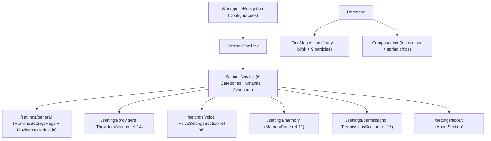

# Especificação de Design — Fase 7: Modelos & Provedores (`ref-14.png`), Segurança & Controle (`ref-15.png`), Consolidação de Configurações e Coreografia Interativa Premium (`orin-home-interativa.html`)

- **Data:** 2026-10-30
- **Fase:** 7 de 7 (Fechamento do Roadmap de Reconstrução Frontend)
- **Referências Visuais:** `ref-14.png` (Modelos e provedores), `ref-15.png` (Segurança e controle) e `c:\Users\User\Downloads\orin-home-interativa.html` (Coreografia de animações e micro-interações premium)
- **Relatório Base:** `relatorio-06-modelos-seguranca-settings.md`

---

## 1. Visão Geral e Escopo da Fase 7

A Fase 7 encerra o roadmap de reconstrução da interface do Orin com quatro entregas integradas:

1. **Menu de Configurações Humanizado em 6 Categorias Primárias (`SettingsNav.tsx` + `SettingsShell.tsx`):**
   - Destaca no topo do menu secundário de `Configurações` (`ref-14.png` e `ref-15.png`) as **6 categorias humanas principais**:
     1. **`Geral`** (`/settings/general`)
     2. **`Modelos e provedores`** (`/settings/providers`)
     3. **`Voz`** (`/settings/voice`)
     4. **`Memória`** (`/settings/memory`)
     5. **`Segurança`** (`/settings/permissions` / `/settings/security`)
     6. **`Atualizações`** (`/settings/about`)
   - Mantém um bloco recolhível/secundário **"Avançado e sistema"** com os links declarativos de `sections.ts` (`Providers`, `Skills`, `MCP`, `MCP por escopo`, `Sessão`, etc.) para preservar **100% de compatibilidade** com as suítes `SettingsNav.test.tsx`, `settingsSections.test.ts`, `settingsSectionsRender.test.tsx`, `SettingsShell.test.tsx` e `settings-a11y.spec.ts`.

2. **Superfície `Modelos e provedores` (`ref-14.png` — `ProvidersSection.tsx`):**
   - Header editorial: título **`Modelos e provedores`** (`data-testid="providers-ref14-heading"`) e subtítulo **`"Escolha a IA que trabalha com você."`**, mantendo `<h1 className="visually-hidden">Providers</h1>` e a descrição acessível para os testes legados (`SettingsShell.test.tsx` e `settings-a11y.spec.ts`).
   - Layout em **2 colunas assimétricas** (`minmax(0, 1.55fr) minmax(280px, 0.95fr)`):
     - **Coluna Principal (Esquerda):**
       - **Card 1 — `Modelo principal`:** seletor de `Provedor` (ex.: `OpenAI`, `Anthropic`, `Google Gemini`, `OpenRouter`, `Groq`) + seletor de `Modelo` (ex.: `GPT-5.4 · Recomendado` ou modelos reais carregados da API `listProviderModels`) + legenda `"Usado por padrão nas novas conversas."`, sincronizado com `localStorage` (`agentos.provider` e `agentos.model`).
       - **Card 2 — `Se houver uma falha` (Fallback):** seletor `Provedor e modelo reserva` (ex.: `Ollama · Modelo local`, `OpenRouter · Auto`, `Anthropic · Claude Sonnet`) + checkbox **`Usar reserva automaticamente`** (`data-testid="providers-fallback-auto-checkbox"`), persistido em `localStorage` (`orin.providers.fallback`).
       - **Card 3 — `Provedores conectados`:** lista limpa em cartões/linhas com nome do provedor, bolinha verde `Conectado` (ou status real de `listProviderKeyCounts`), ação **`Gerenciar ›`** (que abre o `<ProviderDetail>` correspondente em `/settings/providers/:provider`) e botão tracejado **`+ Conectar provedor`** (`data-testid="providers-connect-btn"`), mantendo os links semânticos acessíveis (`OpenAI`, etc.) exigidos por `settings-a11y.spec.ts` e `ProviderSettingsPage.test.tsx`.
     - **Coluna Lateral (Direita):**
       - **Card `Uso e custos`:** checkbox **`Mostrar estimativa por conversa`** (`data-testid="providers-cost-estimate-checkbox"`) + nota de privacidade `"O envio a provedores externos depende da conexão escolhida."`.
       - **Rodapé de Ação:** botão primário **`Salvar alterações`** (`data-testid="providers-save-btn"`) alinhado à direita com feedback imediato de confirmação (`"Alterações salvas."`).

3. **Superfície `Segurança e controle` (`ref-15.png` — `PermissionsSection.tsx` + `TrustedFoldersSection.tsx`):**
   - Header editorial: breadcrumb **`← Configurações`**, título **`Segurança e controle`** (`data-testid="security-ref15-heading"`) e subtítulo **`"Você escolhe como o Orin pode agir."`**.
   - Layout em **2 colunas assimétricas** (`minmax(0, 1.45fr) minmax(300px, 1fr)`):
     - **Coluna Principal (Esquerda):**
       - **Card 1 — `Permissão padrão`:** 3 radio cards interativos conectados a `getCodeModeSettings` / `setCodeModeSettings`:
         - **`Perguntar antes`** (`approval_required`) — *"Pede confirmação antes de editar arquivos ou rodar ações."*
         - **`Só planejar`** (`plan_mode` / somente leitura) — *"Mostra o plano sem alterar nada."*
         - **`Aceitar edições`** (`code_autonomy`) — *"Aplica mudanças em pastas autorizadas."*
       - **Card 2 — `Pastas autorizadas`:** lista as pastas de `listTrustedFolders` (com fallback demonstrativo `C:/Projetos/auryly` quando vazia ou recém-adicionada), seletor de escopo **`Somente esta pasta ▾`** / **`Incluir subpastas ▾`**, botão de exclusão (ícone lixeira) e botão tracejado **`+ Adicionar pasta`** (`data-testid="security-add-folder-btn"`), integrado à API `addTrustedFolder` / `removeTrustedFolder`.
       - **Card 3 — `Ações em serviços externos`:** texto explicativo *"Enviar mensagens, criar eventos ou alterar dados fora do computador sempre pede confirmação."*
     - **Coluna Lateral (Direita):**
       - **Card de Exemplo Interativo — `Aprovar alteração?` (`data-testid="security-approval-preview-card"`):**
         - Subtítulo `"O Orin quer atualizar 3 arquivos em auryly."`
         - Lista de arquivos com badges coloridos:
           - `src/app.ts` — badge verde `+ Adicionar`
           - `src/components/Header.tsx` — badge âmbar `✎ Editar`
           - `package.json` — badge âmbar `✎ Editar`
         - Link interativo `Ver alterações ›` (expande um mini-diff demonstrativo) e botões `Recusar` e `Aprovar esta vez` (permitem testar o comportamento do cartão de aprovação na própria tela).
     - **Rodapé da Página (`ref-15.png`):**
       - Esquerda: link/botão **`Revisar atividades e permissões ›`** (`data-testid="security-review-rules-toggle"`) que expande/exibe o editor avançado de regras granulares (`allow` / `ask` / `deny` de `PermissionsSection`) para preservar todas as capacidades avançadas e testes existentes.
       - Direita: botões **`Cancelar`** e **`Salvar alterações`** (`data-testid="security-save-btn"`).

4. **Melhorias Gerais de Animações e Micro-interações Premium (baseadas em `orin-home-interativa.html`):**
   - **Vida do Mascote (`OrinMascot.tsx` + `agentos.css`):**
     - **Flutuação orgânica contínua (`@keyframes orin-floaty`):** `translateY(0) rotate(-2deg)` → `translateY(-8px) rotate(2deg)` em ciclo suave de `4.3s ease-in-out infinite`, acompanhado de halo/sombra difusa lavanda na base (`home__hero-mascot::after` com `filter: blur(16px)`).
     - **Piscar natural dos olhos (`@keyframes orin-blink`):** elementos `[data-mascot-part="eye"]` com `transform-box: fill-box; transform-origin: center` piscando (`scaleY(1)` → `scaleY(0.12)`) a cada `7s` (no frame `46%–50%`), exatamente como no protótipo `orin-home-interativa.html`.
     - **Celebração com partículas ao enviar prompt na Home (`Home.tsx` + `OrinMascot.tsx`):**
       - Ao submeter um prompt (ou clicar para iniciar conversa), dispara a animação `@keyframes orin-hero-celebrate` no mascote principal, `@keyframes orin-little-celebrate` no mini-mascote do cabeçalho e emite **9 partículas radiais lavanda (`#cbb8ff`)** (`data-testid="home-mascot-particles"`) com vetores `--dx` / `--dy` e `@keyframes orin-particle-pop`.
   - **Coreografia de Palco, Botões, Pílulas e Composer (`agentos.css` + `Home.tsx` + `ChatPage.tsx`):**
     - Curva elástica de assinatura `--orin-ease-spring: cubic-bezier(.23, 1, .32, 1)`.
     - **Hover & Press Physics:**
       - Botões primários (`+ Nova conversa`, `Enviar`, `Salvar alterações`): elevação `translateY(-1px)` + brilho lavanda sutil (`box-shadow: 0 12px 28px rgba(173, 150, 255, .24)`).
       - Pílulas de sugestão rápida (`.home__quick-chip`): elevação `translateY(-3px)` com transição `cubic-bezier(.23, 1, .32, 1)` e realce de borda.
       - Cartões de continuidade (`.home__continue-card`) e cartões de configurações/conexões: elevação suave `translateY(-1px)` e transição de borda.
       - Composer (`.composer`): anel de foco atmosférico (`box-shadow: 0 0 0 3px rgba(160, 135, 255, .09), 0 15px 42px rgba(0, 0, 0, .15)`).
     - **Entrada de Mensagens e Painéis (`@keyframes orin-message-enter` e `@keyframes orin-panel-in`):**
       - Mensagens no chat e cartões de superfície entram com `opacity: 0; transform: translateY(12px) scale(.98)` → `opacity: 1; transform: translateY(0) scale(1)` em `360ms cubic-bezier(.23, 1, .32, 1)`.
   - **Controle de `Movimento reduzido` (`ThemeContext.tsx` / `PreferencesModal.tsx` / `/settings/general`):**
     - Adiciona preferência explícita **`Movimento reduzido`** (`reduceMotion: boolean`, persistida em `localStorage` sob `orin.theme.reduceMotion` e refletida em `document.body.classList.toggle('reduce-motion', ...)`), além de respeitar `@media (prefers-reduced-motion: reduce)`.
     - Quando ativo (`body.reduce-motion` ou `prefers-reduced-motion: reduce`), todas as animações contínuas (`orin-floaty`, `orin-blink`, partículas) são desativadas.

---

## 2. Arquitetura de Componentes e Fluxo

---

## 3. Contratos de Compatibilidade e Red-Team Guards

1. **Preservação Integral dos Testes Existentes de Settings:**
   - `SettingsNav.test.tsx` verifica `getByRole('navigation', { name: 'Settings' })`, `getByText('Sessão')`, `getByRole('link', { name: /Providers/ })`, `getByRole('link', { name: /Skills/ })` e `getByRole('link', { name: /^MCP(?! por escopo)/ })`. Portanto, `SettingsNav` renderizará a lista de **6 categorias humanas** (`Geral`, `Modelos e provedores`, `Voz`, `Memória`, `Segurança`, `Atualizações`) com `data-testid="settings-primary-categories"` e manterá os grupos declarativos de `visibleSettingsGroups(session)` logo abaixo (estilizados de forma limpa ou agrupados), garantindo que todos os seletores de `SettingsNav.test.tsx` continuem funcionando sem quebrar nenhum teste.
   - `settings-a11y.spec.ts` verifica em `/settings/general`: `getByRole('navigation', { name: 'Settings' })`, `getByRole('heading', { level: 1, name: 'General' })` e `expect(page.locator('.app-shell')).toHaveCount(0)`. E ao clicar em `Providers`, verifica `getByRole('heading', { level: 1, name: 'Providers' })` e `getByRole('link', { name: /OpenAI/ })`. Portanto, mantemos os `<h1>General</h1>` e `<h1>Providers</h1>` (com `.visually-hidden` quando houver título visual em português `Modelos e provedores`), e cada item em `Provedores conectados` permanece um `<Link>` acessível contendo o nome do provedor (`OpenAI`, etc.)!
2. **Contraste WCAG AA (Dark + Light Mode):**
   - Todos os textos secundários, badges (`+ Adicionar`, `✎ Editar`, `Conectado`) e botões tracejados (`+ Conectar provedor`, `+ Adicionar pasta`) terão tokens dedicados para `[data-theme="light"]` garantindo contraste `>= 4.5:1` validado pelo `@axe-core/playwright`.
3. **Zero Classes Tailwind Hardcoded Proibidas:**
   - Zero ocorrências de `text-white*`, `bg-black*` ou `border-white*`.
