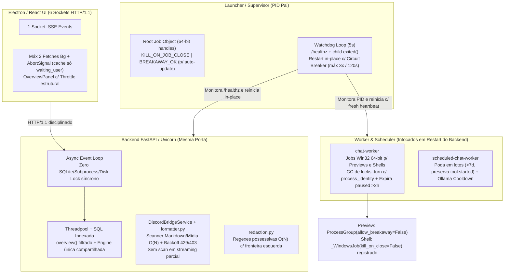

# Especificação de Design: Anti-Travamento do Backend, Isolamento do Event Loop, Auto-Heal de Serviços e Ciclo de Vida de Processos no Windows

- **Data:** 2026-11-15
- **Status:** Aguardando aprovação do Carlos
- **Escopo:** `Architectural` — Resolução estrutural dos congelamentos recorrentes do `backend`/UI e do vazamento de processos, conexões e eventos identificados na investigação forense ao vivo da `v0.12.28`.

---

## 1. Contexto, Diagnóstico Consolidado e Metas de Engenharia

### 1.1 Resumo Forense das Causas Raiz Confirmadas
1. **Monopólio de 100% do GIL por ReDoS exponencial $O(2^N)$ e polinomial $O(N^2)$–$O(N^3)$:**
   - `_MD_TARGET_RE` em `src/agentos/discord/bridge_service.py:85-87` usa quantificadores aninhados `(?P<plain>(?:[^()\s]+|\([^()\s]*\))+)`. Quando `SessionWatchCoordinator` inspeciona conversas `mode='code'` a cada `2,0s` durante streaming (`PostgresChatStore.delta()`), ele lê links Markdown parciais sem `)` final (ex.: 55 chars na `seq=354` do cron do Instagram às `12:14:19.60 BRT`), travando a thread C `_sre` por anos **sem soltar o GIL** e matando de fome o event loop do Uvicorn.
   - `_PLAIN_ABS_OR_REL_MEDIA_PATH_RE` (`bridge_service.py:92-98`) e `_MD_IMAGE_LINK_RE` / `_MD_FILE_LINK_RE` (`src/agentos/discord/formatter.py:56-61`, chamado de forma síncrona no event loop via `strip_attached_workspace_links`) sofrem backtracking quadrático $O(N^2)$ de vários segundos em entradas de `45–80 KB` sem fechamento (`"=/a" * 15000`, `".
   - `_ASSIGNMENT`, `_FLAG` e `_URL_PASSWORD` em `src/agentos/redaction.py:19-26` usam quantificadores sobrepostos (`[A-Za-z0-9_.-]*{_SECRET_WORD}[A-Za-z0-9_.-]*` e `\b[a-z][a-z0-9+.-]*://`), gerando backtracking $O(N^2)$–$O(N^3)$ segurando o GIL em strings longas com tokens/hífens sem delimitadores finais.
2. **Ausência de Watchdog Pós-Boot no `Supervisor`:**
   - `Supervisor._supervise()` (`src/agentos/launcher/supervisor.py:468-494`) testa `/healthz` apenas uma vez na subida. Se o `backend` congela com PID vivo, nunca é reiniciado; se qualquer filho morre, todo o Orin fecha e interrompe turnos saudáveis do `worker`.
3. **Tempestade de `429`, Watches Zumbis e Polling Excessivo no `DiscordBridgeService`:**
   - Falhas `429` em `PATCH`/`POST` de cards de progresso não aplicam *backoff* em memória nem atualizam `last_patched_at` (`bridge_service.py:549-596`), gerando milhares de retries consecutivos; conversas deletadas (`ApplicationNotFoundError`) ou turnos cancelados após `ask_user` mantêm watches zumbis; `_await_turn_with_typing` executa `chat_store.get()` **3x** a cada `150ms` (direto + `_inspect_conversation_by_id` + `_inspect_watched_session`).
4. **Bloqueio Síncrono do Event Loop + Exaustão dos 6 Sockets HTTP/1.1 do Electron:**
   - Rotas `async def` e helpers pré-handler (`principal_for` / `check_rate_limit`, `conversation_workspace`, `conversation_root`, `exclusive_folder`, pré-checagens de SSE) em `src/agentos/api/gateway.py` e `settings_routes.py` executam SQLite (`busy_timeout=30000`), filesystem e subprocessos direto na thread do `asyncio`; `overview()` varre todas as linhas de `conversation_activity_events` (`37.496` linhas = `671ms` CPU) para filtrar apenas 4 tipos em Python; `opencode` em `provider_catalog/service.py:376` dispara `refresh()` síncrono (até `12s`) mesmo com catálogo já populado ou em loop quando offline; `/readyz` cria uma `Engine` SQLAlchemy nova a cada chamada; `OmniRouteProcessManager` segura `self._lock` durante probes HTTP de `5s` e esperas de `45s`.
   - No Electron (`http://127.0.0.1:<port>`, limite Chromium de 6 sockets HTTP/1.1 por origem), 1 socket fica no SSE enquanto `OrinActivityCenter.tsx`, `WorkspaceNavigation.tsx` e `OverviewPanel.tsx` (que recria o timer a cada `liveEvents.length`) saturam os 5 sockets restantes.
5. **Contenção Incompleta de Processos no Windows, Handles 64-bit Truncados, CLI Ociosa em Subagentes, Locks `.turn` Órfãos e Inchaço de DB/Logs:**
   - `ProcessGroup` (`src/agentos/launcher/processes.py:59, 74-127`) usa `POINTER(c_ulong)` em `Affinity`, omite `argtypes`/`restype` 64-bit na `kernel32` e habilita `JOB_OBJECT_LIMIT_BREAKAWAY_OK` globalmente; `PreviewServerManager.stop_server()` mata apenas o PID raiz; `bash.py` descarta o `_WindowsJob` ao auto-backgroundar e não anexa job em `background=True`; `native_turn.py` mantém `agy.EXE` aberto (~370 MB RAM) enquanto espera subagentes em `wait_for_background_work`.
   - `_pid_alive()` em `workspace_lock.py` sofre falsos positivos quando o Windows reutiliza PIDs; turnos antigos interrompidos em `paused` (`EFFECT_RECONCILIATION_REQUIRED`) travam a conversa indefinidamente; `orin.db` acumulou `429,9 MB` (`90,1%` em eventos granulares antigos) e `OllamaEmbedder` gera milhares de `404` sem *cooldown*.

### 1.2 Invariantes e Critérios de Sucesso
- **Invariante 1 (Zero ReDoS / GIL e Zero Vazamento de Segredos):** Extração/limpeza de links Markdown, caminhos de mídia e redaction de segredos operam em tempo linear $O(N)$ garantido (`< 50ms` mesmo para entradas patológicas de `50–100 KB` sem delimitador de fechamento) sem regredir nenhum caso de redaction ou link válido.
- **Invariante 2 (Auto-Heal Transparente):** Um `backend` congelado em `/healthz` por `~15s` ou morto é reiniciado isoladamente **na mesma porta** e no mesmo índice de `self.children`, preservando a propriedade de processos auxiliares (`OmniRoute`), sem fechar a janela Electron e sem interromper turnos em execução no `worker`/`scheduler` (com *circuit-breaker* contra *crash-loop*).
- **Invariante 3 (Event Loop Livre e Orçamento de Sockets):** Nenhum endpoint `async def` bloqueia a thread do event loop com SQLite/disco/subprocesso/lock de pasta; `overview()` responde em `< 30ms` em conversas de 40k eventos preservando `activity_count` exato; o frontend nunca ocupa todos os 6 sockets HTTP/1.1 em background nem oculta aprovações *in-turn*.
- **Invariante 4 (Zero Processos Órfãos sem Quebrar Auto-Update nem Servidores Auto-Background):** `PreviewServerManager` usa `ProcessGroup(allow_breakaway=False)` (`KILL_ON_JOB_CLOSE`), ferramentas shell mantêm `_WindowsJob(kill_on_close=False)` (sem `BREAKAWAY_OK`, retido em registro para `stop_process`/`SessionEnd`), `native_turn.py` fecha CLIs não-persistentes antes de `wait_for_background_work`, e o Job Object raiz do launcher preserva `allow_breakaway=True` para `orin update --apply --detach`.
- **Invariante 5 (Higiene Determinística sem Perda de Metadados):** Eventos estritamente transitórios de turnos encerrados há `> 7 dias` são podados em lotes curtos sem travar o SQLite, **preservando 100% das mensagens, `tool.started` (usado para enriquecer `path`/`command` dos cards históricos), `tool.finished` e histórico semântico**.

---

## 2. Arquitetura Detalhada por Bloco

---

## 3. Bloco 1 — Parsers em Tempo Linear $O(N)$ e Estabilidade do Discord Bridge

### 3.1 Scanner Linear Compartilhado de Markdown e Mídia (`src/agentos/discord/formatter.py`, `src/agentos/discord/bridge_service.py`)
- Remover `_MD_IMAGE_LINK_RE` e `_MD_FILE_LINK_RE` em `formatter.py` e remover `_MD_TARGET_RE` e `_PLAIN_ABS_OR_REL_MEDIA_PATH_RE` em `bridge_service.py`.
- Implementar `iter_markdown_target_spans(text: str, *, include_nested: bool = True) -> Iterator[tuple[int, int, bool, str, str]]` em `src/agentos/discord/formatter.py` (retornando `(start_idx, end_idx, is_image, label, target)`) e `_iter_markdown_targets(text: str) -> Iterator[tuple[bool, str, str]]` em `bridge_service.py`:
  - Suporta `\` escapado no `label` (`\[`, `\]`, `\\`), até 1 nível de imagem aninhada clicável (``), quebras de linha CRLF/LF ao redor do destino (`[doc](\r\n  <workspace://a.pdf>\r\n)`), destinos `<angled>` e destinos `plain` com até 1 nível de parênteses balanceados (`frame_(1).png`) + título opcional entre `"..."` ou `'...'`.
  - Mantém *watermarks* monotônicos (`unclosed_angle_until`, `unclosed_quote_until`) e aborta destinos `plain` se a profundidade interna de `(` exceder `1` ou `2048` chars, garantindo que um `<`, aspas ou `(` não fechado na mesma linha **nunca** engula um link válido subsequente (`[bad](<http://x `) nem reprocesse sufixos em $O(N^2)$.
  - Reescrever `strip_attached_workspace_links` (`formatter.py:77-142`) sobre `iter_markdown_target_spans(part, include_nested=False)` (limpando recursivamente imagens embutidas no `label` quando aplicável).
  - Substituir `_PLAIN_ABS_OR_REL_MEDIA_PATH_RE` em `bridge_service.py` por `_iter_plain_media_paths(text: str) -> Iterator[str]`, que divide por espaços/delimitadores e verifica primeiro em $O(1)$ o sufixo (`.png`, `.jpg`, `.jpeg`, `.webp`, `.gif`) e comprimento `<= 1024` antes de validar o prefixo de caminho.

### 3.2 Redaction Linear $O(N)$ com Quantificadores Possessivos e Zero Vazamento (`src/agentos/redaction.py`)
- Substituir `_ASSIGNMENT`, `_FLAG` e `_URL_PASSWORD` em `src/agentos/redaction.py:19-26` por expressões regulares com fronteira esquerda explícita e quantificadores possessivos do Python 3.12+ (`*+`, `++`):
  - `_ASSIGNMENT = re.compile(rf"""(?i)(?P<name>(?:["'](?=[A-Za-z0-9_.-])|(?<![A-Za-z0-9_.-]))(?=[A-Za-z0-9_.-]*?{_SECRET_WORD})[A-Za-z0-9_.-]++["']?)(?P<sep>\s*+[:=]\s*+)(?P<value>"(?:\\.|[^"\\\r\n])*+"|'(?:\\.|[^'\\\r\n])*+'|[^\s,;&|)\]}]+)""")`
  - `_FLAG = re.compile(rf"""(?i)(?<![A-Za-z0-9_-])(?P<flag>--?(?=[A-Za-z0-9-]*?{_SECRET_WORD})[A-Za-z0-9-]++)(?P<sep>[= ]++)(?P<value>"(?:\\.|[^"\\\r\n])*+"|'(?:\\.|[^'\\\r\n])*+'|\S+)""")`
  - `_URL_PASSWORD = re.compile(r"(?i)(?<![a-z0-9+.-])([a-z][a-z0-9+.-]*+://[^/\s:@]++):[^@\s/]++@")`
- **Por que é estritamente $O(N)$ e zero-leak:** A fronteira esquerda impede re-testar cada sufixo interno de um mesmo token (eliminando o $O(N^2)$/`O(N^3)` em `"auth_" * 5000`, `"--token-" * 5000` e `"token-" * 8000`), enquanto o *lookahead* restrito ao identificador garante que chaves não-secretas (`https:`, `cmd="API_KEY=..."`, `--header="X-Api-Key: ..."`, `sh -c "--api-key ..."`, `env:API_KEY=...`, JSON multilinha e aspas escapadas `\"`) **jamais** consumam o valor e escondam segredos internos.

### 3.3 Proteção contra Leitura Mid-Stream, Cooldown de `429`/`403`, Watches Zumbis e Typing Poll (`src/agentos/discord/rest_client.py`, `src/agentos/discord/bridge_service.py`)
1. **Sem extração de artefatos durante streaming ativo:**
   - Em `_inspect_watched_session()` (`bridge_service.py:3334-3340`), só chamar `_extract_outgoing_file_candidates()` quando `effective_state in {"completed", "completed_with_caveats", "failed", "cancelled", "waiting_user"}`. Enquanto o turno está `running`/`starting`/`queued`, `session_artifacts = []`.
2. **Exposição de `retry_after` e Backoff Unificado em `send_message` e `edit_message`:**
   - Adicionar `retry_after: float | None = None` em `DiscordApiError` (`rest_client.py`), falhando imediatamente (sem dormir `3 x 10s`) quando `retry_after > MAX_RATE_LIMIT_SLEEP_SECONDS` ou `attempt >= MAX_RATE_LIMIT_RETRIES`.
   - Em `SessionWatchCoordinator._process_watch()` (`bridge_service.py`), consultar `_patch_backoff_until[watch.watch_id]` **antes de ambos** `send_message` (`L550`) e `edit_message` (`L581`), evitando também criar `_ensure_stop_binding` quando o card estiver em *backoff*:
     - Se `err.status_code == 404` e `err.error_code != 10003` (mensagem apagada, `10008`): limpar `watch_updates["discord_progress_message_id"] = None`, gravar `watch_updates["last_patched_at"] = now` e aplicar *cooldown* curto de `15s`.
     - Se `err.status_code == 403` ou `err.error_code == 10003` (`Unknown Channel` / sem permissão): aplicar *cooldown* de canal de `300s` e gravar `last_patched_at = now` (evitando loop infinito de `POST /messages` a cada `2s`).
     - Se `err.status_code == 429` ou erro transitório: aplicar `cooldown = max(err.retry_after or 15.0, min(300.0, 15.0 * (2 ** (failures - 1))))` (mínimo `120s` em `429` quando a idade do card via Snowflake ID ou `watch.created_at` exceder `45 min`) e atualizar `watch_updates["last_patched_at"] = now`.
3. **Encerramento Automático de Watches Órfãos e Avanço Seguro de Turno:**
   - Em `_inspect_watched_session()`: capturar `ApplicationNotFoundError` explicitamente retornando `{"missing_conversation": True}` para que `_process_watch` encerre watches de conversas deletadas (`status="cancelled", notified_terminal=True`), mantendo `Exception` genérica como `None` em falhas transitórias de banco.
   - Se `turn_state in _TERMINAL_TURN_STATES`, forçar `pending_block = None` para que turnos cancelados/falhos após `ask_user` fechem imediatamente.
   - Se a conversa iniciou um novo turno ativo (`current_turn_id != watch.target_turn_id`), chamar `self._bridge._advance_watch_to_new_turn(...)` via `asyncio.to_thread` (nunca `update_watch(target_turn_id=...)`, que viola `_UPDATABLE_WATCH_FIELDS` e `uq_friend_session_watches_turn`), preservando `old_watch.origin` (`"friend"`, `"discord"` ou `"code_auto"`).
4. **Otimização de `_await_turn_with_typing`:**
   - Aumentar `turn_poll_interval_seconds` default de `0.15s` para `0.45s` e aceitar `*, conv: Mapping[str, Any] | None = None` em `_inspect_conversation_by_id` e `_inspect_watched_session`, reduzindo de **3 leituras SQLite por tick para 1** (~9x menos carga no banco durante turnos do Orin Friend).

---

## 4. Bloco 2 — Watchdog Contínuo e *Auto-Heal* Isolado no `Supervisor`

### 4.1 Monitoramento Pós-Boot, Preservação de Ordem e Restart Cirúrgico (`src/agentos/launcher/supervisor.py`, `probes.py`, `omniroute/process_manager.py`)
- Constantes configuráveis:
  - `BACKEND_WATCHDOG_INTERVAL = 5.0`, `BACKEND_WATCHDOG_TIMEOUT = 3.0`, `BACKEND_WATCHDOG_FAILURE_THRESHOLD = 3`, `SERVICE_RESTART_MAX_ATTEMPTS = 3`, `SERVICE_RESTART_WINDOW = 120.0`.
- **Regras de disparo e invariantes do loop `_supervise()`:**
  - Inicializar `self._backend_next_health_check = monotonic() + BACKEND_WATCHDOG_INTERVAL` ao entrar em `_supervise()` e avançar `self._backend_next_health_check = now + BACKEND_WATCHDOG_INTERVAL` **em todo tick de probe** (sucesso ou falha), garantindo intervalo real de `5,0s` (`~15s` até restart).
  - `backend`: reiniciado quando `child.exited() is not None` ou após `3` falhas consecutivas de `/healthz`.
  - `worker` e `scheduler`: reiniciados exclusivamente quando `child.exited() is not None`.
- Fluxo de `_restart_child(service: str, reason: str) -> bool`:
  1. Se `stop_requested(self.paths) or self._stop.is_set()`, retornar `False`; em `_supervise()`, checar `stop_requested` / `self._stop.is_set()` antes de `_desktop_failed` para que shutdown limpo encerre com `exit_code = 0`.
  2. Filtrar `_restart_history[service]` para os últimos `120s`. Se `len(history) >= SERVICE_RESTART_MAX_ATTEMPTS` (máx. 3 restarts na janela; a 4ª queda dispara o *circuit-breaker*), retornar `False`.
  3. Parar apenas o `SupervisedProcess` antigo (`old.stop()`) e substituí-lo **in-place no mesmo índice de `self.children`** (`self._spawn(service, replace_at=idx)`), preservando a ordem `[backend, worker, scheduler]` para que `_stop_children()` (`reversed(self.children)`) continue parando `scheduler` → `worker` → `backend`.
  4. Para `backend`, aguardar `/healthz` e `/readyz` com `abort=lambda: self._startup_abort(new_child)`; para `worker`/`scheduler`, capturar `restart_started_at = datetime.now(UTC)` antes do `_spawn` e aguardar `heartbeat_probe(..., minimum_updated_at=restart_started_at)` com `abort=lambda: self._startup_abort(new_child)` (impedindo falso-positivo com o heartbeat recém-gravado pelo processo morto).
  5. Em `OmniRouteProcessManager` (`src/agentos/omniroute/process_manager.py`), persistir `{pid, created}` em `orin_paths().run / "omniroute-owner.json"` ao iniciar processo próprio (e remover ao encerrar), permitindo que um `backend` reiniciado após congelamento re-adote o OmniRoute via `same_process(pid, created)` em vez de marcá-lo `"external"`.

### 4.2 Correção de Vazamento de Handle em `launch_desktop` (`src/agentos/launcher/desktop.py`)
- Em `launch_desktop()` (`desktop.py:46-61`), fechar `log.close()` em bloco `finally:` imediatamente após `subprocess.Popen(...)` retornar.

---

## 5. Bloco 3 — Desbloqueio do Event Loop, Orçamento dos 6 Sockets Electron e Higiene de Banco

### 5.1 Eliminação de Bloqueio Síncrono no `gateway.py`, `settings_routes.py`, `production.py`, `asgi.py`, `provider_catalog` e `OmniRouteProcessManager`
1. **`src/agentos/api/gateway.py` e `src/agentos/api/settings_routes.py`:**
   - Despachar para `run_in_threadpool` tanto os corpos síncronos quanto os helpers pré-handler síncronos chamados dentro de rotas `async def`:
     - Autenticação/rate-limit (`principal_for` + `services.security.check_rate_limit`), resolução de workspace (`conversation_record`, `conversation_workspace`, `conversation_root`, `settings_routes.folder_of`).
     - Rewind seguro: executar o bloco `with exclusive_folder(workspace.root):` **inteiramente dentro de uma única função síncrona** em `run_in_threadpool` em `rewind_conversation_turn` e `rewind_conversation_message` (nunca segurar `exclusive_folder` através de `await`).
     - Pré-checagens de SSE (`conversation_record` em `conversation_events`; `services.events.read` e `delivery_permitted` em `sse`) via `run_in_threadpool`, mantendo `StreamingResponse` no event loop.
     - Rotas de conversas/projetos/uploads/qualidade/catálogo/OmniRoute: `create_upload`, `delete_upload`, `create_conversation`, `list_projects`, `project_sidebar`, `get_project`, `list_conversations`, `get_conversation`, `get_conversation_older_activities`, `send_conversation_message`, `cancel_conversation`, `delete_conversation`, `conversation_overview`, `get_agent_runtime_quality`, `list_provider_models`, `refresh_provider_models`, `add_provider_custom_model`, `remove_provider_custom_model`, `favorite_provider_model`, `unfavorite_provider_model`, `omniroute_installation_status`, `omniroute_runtime_status`, `update_omniroute_runtime`, `control_omniroute_runtime`.
   - Em `OmniRouteProcessManager` (`src/agentos/omniroute/process_manager.py`), não segurar `self._lock` durante o `httpx.get` de `5s` em `status()` nem durante o loop `_wait_for_health()` de `45s` em `start()`/`restart()`.
2. **`src/agentos/bootstrap/production.py` e `src/agentos/api/asgi.py` (`/readyz`):**
   - Adicionar `DependencyProbe.from_engine(cls, engine: Engine)` (usado em `asgi.py` para reutilizar o pool de produção existente sem abrir um segundo pool de 32 conexões), proteger `shared_engine` com `threading.Lock` em `DependencyProbe.from_settings`, e executar `await run_in_threadpool(dependency_probe.ready)` em `/readyz`.
3. **`src/agentos/provider_catalog/service.py` e `src/agentos/provider_catalog/opencode.py`:**
   - Em `service.py`: disparar auto-refresh de `opencode` em `list()` somente quando `not items and not favorites_only`, protegido por *cooldown* monotônico de falha de `60s` (`_auto_refresh_backoff[(user_id, provider)]`, aplicado a auto-refreshes de catálogos locais e limpo em `refresh()` explícito).
   - Em `opencode.py`: se `ensure_running()` estourar timeout de prontidão, remover o processo de `_processes` e encerrar `proc` imediatamente para nunca vazar `opencode serve` órfão.

### 5.2 Otimização de `PostgresChatStore.overview()` (`src/agentos/conversations/chat.py`, `schema.py`, migração `0061`)
- Manter `"activity_count"` exato via `SELECT count(*) FROM conversation_activity_events WHERE conversation_id = :cid AND user_id = :uid` (scan rápido apenas de índice) e buscar linhas completas somente para os 4 `event_type`s estruturais da visão geral (`tool.finished`, `agent.message_sent`, `agent.message_received`, `turn.failed`), limitando `messages` e `errors` aos últimos `200` itens.
- Adicionar índice composto `ix_conversation_activity_conv_type_id` `(conversation_id, event_type, id)` em `schema.py` e na migração idempotente `0061_activity_events_overview_index.py` (`revision = "0061_activity_events_overview_index"`, `down_revision = "0060_discord_bridge_and_session_watches"`).

### 5.3 Poda Automática Segura (`> 7 dias`, Preservando `tool.started`) e Cooldown do `OllamaEmbedder`
1. **Poda em lotes de eventos estritamente transitórios (`src/agentos/conversations/chat.py` + `src/agentos/workers/scheduler.py`):**
   - `prune_transient_activity_events(*, older_than_days: int = 7, batch_size: int = 2000, max_batches: int = 10) -> int`:
     - Remove exclusivamente linhas cujo `event_type` pertença a `TRANSIENT_SETTLED_EVENT_TYPES`:
       `("assistant.delta", "agent.thought_delta", "tool.progressed", "tool.requested", "code_mode.validation_started", "code_mode.validation_finished", "code_mode.stage_changed", "speak.block_started", "speak.delta", "speak.chunk_ready", "speak.filler_triggered", "speak.interrupted", "speak.finished")`
       vinculadas a `conversation_turns` terminais (`completed`, `failed`, `cancelled`) com `finished_at < now - 7 dias`.
     - **Jamais remove `tool.started`** (necessário em `_compact_snapshot_activities` para enriquecer `tool.finished` com `path`, `target_path`, `command`, `description` e `transcript_id`) nem `tool.finished`, `conversation_messages` ou turnos recentes/ativos.
     - No `scheduler.py`, roda a cada `6h` em regime normal, mas re-agenda o próximo lote em **`60s`** quando atingir a cota cheia (`deleted >= batch_size * max_batches`) para drenar bancos legados de centenas de MB rapidamente sem segurar locks longos.
2. **Negative-Cache Cooldown em `OllamaEmbedder` (`src/agentos/retrieval/embeddings/ollama.py`):**
   - Retornar `[]` imediatamente se `not texts` (antes de consultar/acionar `_unavailable_until`).
   - Usar `httpx.Timeout(30.0, connect=3.0)`; memorizar *cooldown* de `300s` em HTTP `404` e `60s` em HTTP `5xx` ou `httpx.HTTPError`, levantando `EmbeddingUnavailable` sem I/O durante a janela.

### 5.4 Disciplina de Conexões HTTP/1.1 no Frontend (`frontend/src/`)
1. **`frontend/src/components/OrinActivityCenter.tsx` (e `chat.py`):**
   - Cachear em `detailCacheRef` **somente sessões estacionadas em `state === 'waiting_user'`** (quando `updatedAt` presente) por `(conversationId, updatedAt, state)` — **nunca** cachear sessões em `ACTIVE_SESSION_STATES` (`running`, `starting`, `queued`, `streaming`, `working`, `cancelling`) entre ciclos para não ocultar aprovações *in-turn* (`tool.permission_required`, `code_mode.plan_ready`, `workspace.trust_required`, `turn.waiting_user`), além de invalidar o cache ao resolver permissões/planos/trust e atualizar `conversations.c.updated_at` em `PostgresChatStore._activity` nos eventos interativos como defesa em profundidade.
   - Limitar `fetchConversationWithRawActivities` a **no máximo `2` requests simultâneos** injetando `AbortSignal` dentro de `proxyClient.request` (`apiClient.request({ ...options, signal })`) e ignorando `AbortError`.
2. **`frontend/src/features/projects/WorkspaceNavigation.tsx`:**
   - Manter o polling de `3s` para todos os 5 estados ativos de execução (`queued`, `starting`, `running`, `streaming`, `cancelling`, excluindo `waiting_user`) e proteger `reload()` com `inFlightRef` + `pendingReloadRef` (executando 1 *trailing reload* se `orin:conversations-updated` disparar durante um fetch em voo).
3. **`frontend/src/features/overview/OverviewPanel.tsx`:**
   - Remover `liveEvents.length` das dependências do `useEffect` do intervalo de `4000ms`, proteger `load()` com `inFlightRef`, e disparar refresh extra com *throttle* de `1500ms` apenas em eventos estruturais reais de `AgentActivityEventType` (`agent.created`, `delegation.created`, `delegation.completed`, `delegation.failed`, `turn.completed`, `turn.failed`, `turn.cancelled`, `turn.waiting_user`).

---

## 6. Bloco 4 — *Job Objects* 64-bit no Windows, Previews, Shells, CLIs e Reconciliação de Locks/Turnos

### 6.1 `ProcessGroup` com Tipagem Win32 64-bit, `Affinity` Corrigido e Snapshot de Descendentes (`src/agentos/launcher/processes.py`)
- Corrigir `Affinity` em `JOBOBJECT_BASIC_LIMIT_INFORMATION` para `ctypes.c_size_t` e configurar `argtypes`/`restype` explícitos 64-bit via `ctypes.WinDLL("kernel32", use_last_error=True)`.
- Alterar `ProcessGroup.__init__(self, *, allow_breakaway: bool = True)` (`LimitFlags = 0x2000 | (0x0800 if allow_breakaway else 0)`):
  - `Supervisor`: mantém `allow_breakaway=True` para `orin update --apply --detach`.
  - `PreviewServerManager`: usa `allow_breakaway=False` (`KILL_ON_JOB_CLOSE`).
- Em `ProcessGroup.adopt(pid)` (e `_WindowsJob.assign(pid)` em `src/agentos/hooks/processes.py`), além de atribuir `pid`, inspecionar descendentes já criados via `_windows_descendants` para fechar a janela de corrida entre `Popen` e `AssignProcessToJobObject`.

### 6.2 Contenção em `PreviewServerManager`, Shells Background/Foreground e Subprocessos CLI (`preview_server.py`, `tools/_shared.py`, `shell/bash.py`, `shell/tasks.py`, `native_turn.py`)
1. **`src/agentos/code_mode/preview_server.py`:**
   - Anexar cada servidor em `start_server()` a um `ProcessGroup(allow_breakaway=False)` em memória e gravar `"created": process_created(proc.pid)` (`agentos.process_identity`) no manifesto.
   - Em `stop_server()`: encerrar via `group.terminate_all(); group.close()` e, para entradas vindas apenas do manifesto em disco, usar `kill_verified(pid, record["created"])` de `agentos.process_identity` (que valida `CreationTime` no handle aberto antes de encerrar descendentes e processo raiz, sem corrida TOCTOU).
2. **Comandos Shell Foreground/Auto-Background/Background (`_shared.py`, `bash.py`, `tasks.py`):**
   - Manter `_WindowsJob(kill_on_close=False)` em `bash.py` (`LimitFlags = 0` já bloqueia `CREATE_BREAKAWAY_FROM_JOB` sem matar servidores auto-backgroundados quando `_run_shell` retorna!).
   - Anexar também `_WindowsJob(kill_on_close=False)` em `background=True` (`bash.py:449`) e reter o job no auto-background (`bash.py:637`) em `register_background_job(pid, job)` (`_shared.py`), permitindo que `stop_process` (`tasks.py:360`) e `SessionEnd` encerrem toda a árvore via `terminate_background_job(pid)` + `kill_verified(pid, info.get("created"))`.
   - Em `_shared.py` (`_DEV_SERVER_CMD_RE`), adicionar apenas frameworks de servidor inequívocos (`uvicorn`, `gunicorn`, `hypercorn`, `fastapi dev|run`, `flask run`, `streamlit run`, `gradio`, `python -m http.server|uvicorn|gunicorn|fastapi|flask`, `manage.py runserver`) para nunca auto-destacar scripts foreground comuns (`python main.py`); e em `ShellTaskTools._is_long_lived` (`tasks.py`), reconhecer `python run.py|server.py|app.py|main.py` quando iniciado explicitamente em background (`not entry.get("auto_backgrounded")`).
3. **Fechamento Antecipado de Subprocesso CLI Não-Persistente (`src/agentos/agentic/native_turn.py`):**
   - Antes de bloquear em `wait_for_background_work(...)` (`native_turn.py:2638-2656`), quando `not persistent_stdin` (ex.: `agy.EXE`), fechar `handle` imediatamente (`handle.close()`), liberando ~370 MB de RAM durante esperas de subagentes/processos em segundo plano.

### 6.3 Anti-Reuso de PID em Locks `.turn` e Destravamento Canônico de Turnos `paused` Órfãos (`workspace_lock.py`, `conversations/chat.py`, `workers/chat.py`, `workers/publisher.py`)
1. **`src/agentos/code_mode/workspace_lock.py`:**
   - Reutilizar `process_created(os.getpid())` e `same_process(pid, created)` de `src/agentos/process_identity.py` nos markers `<digest>.turn.<pid>.<uuid>` e `<digest>.rewind` (mantendo fallback para `_pid_alive` em arquivos legados apenas com `<pid>` e preservando a janela `_UNWRITTEN_SECONDS` de `5s` para arquivos recém-criados).
   - Expor `sweep_stale_workspace_locks(folder: Path | None = None) -> int` varrendo **exclusivamente** `*.turn.*` e `*.rewind` dentro de `workspace-locks` (jamais tocando arquivos `.lock` de `flock`/`msvcrt`), chamado em `Supervisor._prepare()` e no boot de `recover_once` (`publisher.py`).
2. **Expiração Canônica de Turnos `paused` Abandonados (`> 2h`):**
   - Implementar `PostgresChatStore.expire_abandoned_paused_turns(*, older_than: timedelta = timedelta(hours=2)) -> tuple[str, ...]` chamado em `ChatWorker.recover_stale()` (`workers/chat.py:985`, invocado por `publisher.py:recover_once`):
     - Transiciona `Execution` canônica (`PAUSED -> FAILED` via `ExecutionQueryAdapter` + `ExecutionApplicationAdapter`), `conversation_dispatches` (`state="failed"`, preservando `last_error` ou `"ABANDONED_PAUSED_TURN_EXPIRED"`), `conversation_turns` (`state="failed"`, `finished_at=now`), `conversation_messages` da resposta parcial (`status="failed"`, `retryable=True`, preservando 100% do conteúdo parcial), `code_mode_runs` (`stage="blocked"`) e `conversations` (`state="failed"` se ainda estiver `"paused"`), liberando o envio imediato de `"continuar"`.

---

## 7. Análise Adversarial, Segurança e Tratamento de Erros

| Vetor Adversarial / Risco | Mitigação no Design |
|---|---|
| Entradas patológicas de `50–100 KB` (`[a](` / ` | `iter_markdown_target_spans`, `_iter_plain_media_paths` e as regexes possessivas em `redaction.py` operam em tempo estritamente $O(N)$ (`< 50ms`) sem soltar ou segurar o GIL por segundos. |
| Regressão de vazamento de segredos em `redaction.py` (`https://...?api_key=s`, `cmd="API_KEY=s"`, `--header="X-Api-Key: s"`, JSON multilinha, `\"`) | Fronteira esquerda + *lookahead* restrito ao identificador impedem que chaves não-secretas consumam valores contendo segredos; suite adversarial testa todos os 6 vetores. |
| Restart do `backend` durante `orin update --apply`, fechamento limpo ou com OmniRoute ativo | `_restart_child` respeita `stop_requested` / `_stop` (`exit_code = 0`), substitui `self.children` *in-place* preservando ordem de parada e re-adota OmniRoute via `omniroute-owner.json` (`same_process`). |
| *Crash-loop* infinito de `backend` ou `worker` | *Circuit-breaker* permite no máximo `3` restarts em janela deslizante de `120s`; na 4ª falha (`len(history) >= 3`), encerra de forma controlada. |
| Poda de `activity_events` apagando metadados de ferramentas ou travando `orin.db` | `tool.started` é preservado; lotes curtos (`LIMIT 2000`) com dreno adaptativo (`60s` se lote cheio, `6h` ocioso) apenas em turnos terminais `> 7 dias`. |
| Ocultação de aprovações *in-turn* no `OrinActivityCenter` ou morte de dev-server auto-backgroundado | Cache do Activity Center restrito a sessões estacionadas em `waiting_user`; `bash.py` mantém `_WindowsJob(kill_on_close=False)` registrado para término limpo em `stop_process`. |
| Reuso de PID pelo Windows em previews, shells ou locks `.turn` | Validação unificada via `agentos.process_identity` (`process_created`, `same_process`, `kill_verified`) antes de qualquer `TerminateProcess` ou limpeza de marker. |

---

## 8. Estratégia de Testes e Verificação

1. **Testes Unitários & Adversariais de Backend (`pytest` em `tests/unit/...` — TDD RED → GREEN → REFACTOR):**
   - `tests/unit/test_redaction_linear.py` (+ suites existentes `tests/unit/test_redaction*.py`, `tests/unit/agentic/test_*redaction*.py`):
     - Benchmarks lineares (`< 80ms`) para `redact_text`, `iter_markdown_target_spans`, `strip_attached_workspace_links` e `_iter_plain_media_paths` em entradas adversariais de `20–50 KB`; cobertura dos 6 vetores de não-vazamento de segredos e dos 4 casos especiais de links Markdown.
   - `tests/unit/discord/test_bridge_markdown_and_rate_limit.py` (+ `tests/unit/discord/`, `tests/integration/discord/`):
     - Fail-fast em `429` acima do cap; *backoff* em `send_message` e `edit_message` (`429`, `404` msg vs `10003`/`403` canal); ausência de scan de artefatos em `running`; fechamento de watches de conversas deletadas (`ApplicationNotFoundError`) e canceladas após `ask_user`; avanço de turno via `_advance_watch_to_new_turn` preservando `origin`; 1 leitura SQLite por tick em `_await_turn_with_typing`.
   - `tests/unit/launcher/test_supervisor_watchdog_and_jobs.py` (+ `tests/unit/launcher/`):
     - Fechamento de `desktop.log` no pai; restart *in-place* de `backend` congelado preservando índice e workers vivos; probe espaçado em `5s`; `heartbeat_probe` com `minimum_updated_at`; *circuit-breaker* na 4ª falha; parada limpa com `exit_code = 0`; re-adoção de OmniRoute.
   - `tests/unit/api/test_gateway_nonblocking_and_overview.py` (+ `tests/unit/provider_catalog/`, `tests/unit/persistence/`):
     - Reuso thread-safe de `Engine` em `DependencyProbe`; `opencode` sem `refresh()` redundante + *backoff* de `60s` em falha + limpeza de timeout em `opencode.py`; `overview()` preservando `activity_count` total e filtrando SQL com índice `0061`; poda `> 7 dias` preservando `tool.started` e `tool.finished`; `OllamaEmbedder` com `embed([]) == []` e *cooldown* `300s`/`60s`.
   - `tests/unit/code_mode/test_workspace_lock_and_preview_tree.py` (+ `tests/unit/code_mode/`):
     - `ProcessGroup(allow_breakaway=False)` 64-bit matando netos e capturando descendentes rápidos; `ShellTaskTools._is_long_lived` distinguindo `python run.py` explícito em background de scripts foreground; fechamento antecipado de `handle` CLI não-persistente antes de `wait_for_background_work`; detecção de reuso de PID via `process_identity` em `workspace_lock.py`; expiração canônica completa de turnos `paused` órfãos permitindo enviar `"continuar"`.
2. **Testes Unitários & Verificação Visual Real de Frontend (`vitest` em `frontend/tests/unit/...` + Navegador Real):**
   - `frontend/tests/unit/OverviewPanelPolling.test.tsx` (+ `frontend/tests/unit/OverviewPanel.test.tsx`): validação ESM-safe com `ApiClient` + `fetchImpl` garantindo zero cascata de `/overview` em deltas de streaming, refresh estrutural com *throttle*, cache seguro apenas em `waiting_user` no `OrinActivityCenter` com `AbortSignal` e concorrência `<= 2`, e `WorkspaceNavigation` preservando os 5 estados ativos com `pendingReloadRef`.
   - **Verificação Visual Obrigatória:** Subir instância isolada em porta/DB temporários e validar em navegador real (**desktop `1440x900`** e **mobile `390x844`**) `OverviewPanel`, `OrinActivityCenter`, `WorkspaceNavigation` e aba Network (`<= 3` conexões HTTP/1.1 concorrentes de background, zero tempestade de `/overview`).
