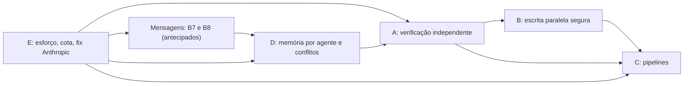

# Especificação de Design: Orin 0.13 — Orquestração e Multiagentes

- **Data:** 2026-11-18
- **Versão de referência do código:** 0.12.31
- **Status:** Decisões do Carlos aplicadas em 18/11 (seção 10). Pronta para implementação.
- **Base:** `docs/reports/2026-11-18-planejamento-0.13-orquestracao-multiagentes.md` (lacunas L1–L13, M1–M10, E1–E9, pacotes A–E). Pesquisa externa em `.orin/tool-outputs/check_subagent-7aca209b9bf2.txt`, `check_subagent-4ca1ad7aa505.txt` e `check_subagent-a40e5fd6b995.txt`.
- **Ordem de entrega (decisão do Carlos):** E → mensagens (B7 e B8, antecipados) → D → A → B (restante) → C. Todos os pacotes entram.
- **Releases (decisão do Carlos, 18/11):** a **0.13 (0.13.0)** entrega E, mensagens, D, A e B inteiros, como etapas internas sem tag própria; a **0.13.1** entrega o pacote C (pipelines). Branch de trabalho: `feat/0.13-orquestracao-multiagentes`.
- **Revisão 2 (18/11):** hipótese do Fable 5.2 e janela efetiva por modelo (seção 3.2, E-RF28 a E-RF31), leitura de cota do Claude por `~/.claude.json` (E-RF23), mensagem para subagente em execução (B7) e Friend no turno em andamento (B8).
- **Revisão 3 (18/11):** decisões finais do Carlos (seção 10): B7 e B8 antecipados para logo depois de E, com migração própria (`0063`), o que desloca D, A, B e C para `0064` a `0067`; auto-verificação desligada por padrão; Friend entrega na hora; sem teste pago da janela do Fable 5.2; testes reais só com modelos baratos.

---

## 1. Objetivo, fora de escopo e princípios

### 1.1 Objetivo

Transformar os recursos de subagente que o Orin já tem em orquestração controlável: esforço por modelo e por agente, cota das assinaturas visível, memória própria por agente sem mistura de versões, verificação independente por outro modelo, escrita paralela isolada e pipelines declarativos com retomada. Junto, corrigir o bug do print (`.orin/uploads/image (27).png`): estouro de contexto no Claude CLI tratado como queda de conexão.

### 1.2 Fora de escopo

- Pipelines com scripts arbitrários (Python, JS, shell embutido como etapa de código). Só YAML declarativo na 0.13.
- Migrar índices para `sqlite-vec` ou trocar a identidade dos chunks (`path:linha-linha`).
- Paralelismo real de ferramentas dentro de um turno de CLI (L11). Continua dependendo de `run_in_background`.
- Consenso multimodelo como ferramenta genérica (existe só como pipeline pronto em C).
- Modo orquestrador restrito, `mcp_servers` e `color` nas definições (itens avulsos do relatório). Ficam para a 0.14.
- Reescrever a RFC 203 para "agentes persistentes com Execution própria". A 0.13 alinha a RFC ao runtime real (seção 9).

### 1.3 Princípios

1. **Tudo é opcional.** Toda funcionalidade que impõe comportamento tem chave em settings e chave visível em Configurações. A tabela única está na seção 8.
2. **Padrões.** O que gasta tokens ou cota começa desligado. Correções de bug e de consistência ficam sempre ligadas e não têm chave (fix da Anthropic, frescor do índice, aviso de nível ignorado, tratamento de estouro de contexto).
3. **Medível.** Cada pacote grava o que fez (eventos, métricas por par autor×revisor, uso por agente). Critério de aceite é teste automatizado, não impressão.
4. **Sem descarte silencioso.** Nível de esforço ajustado, verificação pulada, memória quarentenada, etapa de pipeline repetida: tudo gera evento visível na timeline.
5. **Custo visível.** Antes de disparar trabalho extra (verificador, fan-out, retomada automática) o Orin mostra o que vai rodar e em qual assinatura. A cota de cada assinatura fica à vista no compositor.
6. **Repositório não liga gasto.** Chaves que gastam tokens entram em `ALWAYS_IGNORED_FROM_PROJECT` (`src/agentos/settings/loader.py:22-39`), como já acontece com `effort` e `autoDreamEnabled`. A camada de projeto só pode desligar (mesmo padrão de `PROJECT_TRUE_IGNORED`, `loader.py:60`).

---

## 2. Visão geral e dependências



| Dependência | Motivo |
|---|---|
| E-RF5 (`effort` no `Agent`) → A | O verificador roda com esforço próprio, normalmente `high`. |
| E (catálogo de níveis e tabela de famílias) → A-RF4/A-RF5 | A política `cross_family` precisa saber nível e família de cada modelo. |
| E (cota) → A, C | Verificação cruzada e fan-out consomem outra assinatura; a decisão usa a cota medida. |
| D-RF10 (promoção só de resultado verificado) → A | O veredito do verificador é o sinal que promove a memória proposta. D funciona sem A usando o gate de auto-verificação. Com `orchestration.selfVerify.enabled` e `orchestration.verifier.enabled` desligados (padrão), não há sinal automático: a memória proposta por agente só é promovida por aprovação manual na página Memória, ou desligando `memory.agent.learnFromVerifiedOnly`. |
| A1 (`provider`/`model`/`effort` por chamada) → C | Cada etapa de pipeline escolhe agente, modelo e esforço. |
| B1/B2 (worktree e fila de merge) → C | Fan-out com escrita exige isolamento. |
| B4 (background persistido) ↔ C2 (diário) | Mesmo problema (retomar) em camadas diferentes. Compartilham a tabela de execução (seção 7.3). |
| B7 (mensagem por `agent_id`) | Entregue logo depois de E. Não depende de E, D nem A: usa a fila de controles que já existe. O verificador (A) e os filhos de pipeline (C) são subagentes comuns e podem receber mensagem pelo mesmo canal, mas nenhum requisito de A ou C depende disso. A seta M → D no diagrama é só ordem de entrega. |
| B8 (Friend no turno em andamento) | Independente dos outros pacotes. Usa `enqueue` e `conversation_input_queue`, que já existem. |
| E-RF28 (janela efetiva) ↔ E-RF23 (leitor de `~/.claude.json`) | O mesmo leitor alimenta a cota e a regra de créditos da janela. |

B7 e B8 não dependem de nada anterior. Por decisão do Carlos (seção 10, item 1) eles são entregues logo depois do pacote E, antes de D, com migração própria. Os rótulos B7, B8 e os requisitos B-RF7 a B-RF15 continuam os mesmos; só a ordem de entrega muda. O resto do pacote B (worktree, fila de integração, quadro de tarefas, background persistido, progresso) segue depois de A.

Novas migrações Alembic (a última hoje é `0061_activity_events_overview_index`):

| Revisão | Pacote | Conteúdo |
|---|---|---|
| `0062_subscription_quota_snapshots` | E | Tabela de cota das assinaturas e janela de contexto aprendida por modelo. |
| `0063_agent_message_delivery` | B7 e B8 (antecipados) | Só colunas novas, com padrão, em `conversation_agent_controls` e `conversation_input_queue` (seção 6.3). |
| `0064_memory_lifecycle_and_agent_scope` | D | Colunas novas em `agent_memories`, tabela `memory_events`, escopo `agent`. |
| `0065_verification_reviews` | A | Revisões, achados e métricas por par. |
| `0066_agent_runs_and_task_board` | B (restante) | Agentes em background persistidos, quadro de tarefas, worktrees. |
| `0067_pipeline_runs` | C | Execuções de pipeline e diário de etapas. |

---

## 3. Pacote E — Esforço, cota das assinaturas e correção do provider Anthropic

### 3.1 Problema

Lacunas E1–E9 do relatório: sem seletor de esforço no chat (E1, `frontend/src/features/commands/moreCommands.ts:40`), `turn["effort"]` lido mas nunca gravado (E2, `src/agentos/agentic/session.py:6229-6252`), subagente não herda nem tem padrão por tipo (E3, `session.py:2384-2392`), caminho da API Anthropic no formato legado (E4, `src/agentos/agentic/effort.py:67-76`), colapso `xhigh`/`max` → `high` (E5, `effort.py:14`), suporte binário por regex (E6, `effort.py:16-48`), descarte silencioso no Codex e no agy (E7, `providers/codex_cli/command.py:528-536`, `providers/antigravity_cli/command.py:1216-1246`), cota só reativa (E8, `runtime.py:734-735`), sem escalada (E9). Mais o bug do print (seção 3.2).

### 3.2 Bug do print: "Prompt is too long" tratado como "Conexão com o modelo caiu"

#### Sintoma

No print (`.orin/uploads/image (27).png`), depois da mensagem do Carlos, o chat mostra "Prompt is too long" como se fosse a resposta do agente, seguido de "Conexão com o modelo caiu; retomando (1/2)", de novo "Prompt is too long", "retomando (2/2)" e "Execução cancelada". O turno não compacta o histórico e não diz ao usuário que o contexto estourou.

#### Evidência (banco local, leitura somente, `orin.db` em modo `ro`)

| Turno | Provedor / modelo | Primeiro `context.updated` | O que veio depois |
|---|---|---|---|
| `turn_695b988d…` (18:15, outra conversa) | `anthropic` (ponte Claude CLI) / `claude-fable-5-2` | 155.626 de 1.000.000 (`history_tokens` 147.238) | 3 rodadas de "Prompt is too long" + `stream_resuming` 1/2 e 2/2 cada; termina `paused` com `PROVIDER_STREAM_INTERRUPTED` |
| `turn_34d993f3…` (18:48, conversa do print) | idem | 196.151 de 1.000.000 (`history_tokens` 186.775) | "Prompt is too long", `stream_resuming` 1/2 e 2/2 com `end_reason=error_result`, `turn.failed` `TURN_CANCELLED` |
| `turn_95b48fb7…` (18:50) | idem | 198.355 de 1.000.000 | mesmo padrão |

- O texto "Prompt is too long" foi gravado como `assistant.delta` (eventos 380073, 380076, 380127, 380130).
- Logo após o erro chega `context.updated` com `used_tokens: 0`: o medidor de contexto zera.
- Os três turnos com falha começam com o histórico inteiro do Orin reidratado na primeira mensagem do CLI (`history_tokens` > 0). Turnos do mesmo modelo que crescem dentro da sessão do CLI passaram de 200 mil sem erro (`turn_27b09f92…` chegou a 292.443; `turn_32d28ad2…` a 227.416, com 2 compactações internas do CLI).
- O provedor `anthropic` desses turnos é a ponte do Claude CLI (`provider_stream.py:922`, `is_claude_cli_bridge_url`), não a API HTTP. O `effort.py` (formato `budget_tokens`) **não participa** desse caminho: o CLI recebe `--effort` (`providers/claude_cli/command.py:767-771`).

#### Causa raiz (confirmada no código)

1. **O tipo do erro se perde.** `classify_result_error_info` reconhece "prompt is too long" como `CliErrorKind.CONTEXT_OVERFLOW` (`src/agentos/providers/claude_cli/errors.py:211-218`), mas `error_info_to_transport_error` devolve a exceção montada por `classify_result_error` (`errors.py:259-263`), que só conhece status HTTP: sem `api_error_status` a exceção sai com status 500 (`errors.py:165-173`). O `native_loop` levanta essa exceção (`providers/claude_cli/native_loop.py:847-859`).
2. **O caminho nativo não trata estouro de contexto.** O laço clássico chama `_is_context_length_error` e `_force_compact` (`src/agentos/agentic/runtime.py:1218-1226`, `:1361-1365`). O `NativeTurnRunner` não: no `except Exception` (`src/agentos/agentic/native_turn.py:3246-3288`) só verifica limite e prazo (`_stop_code_after_stream_error`, `native_turn.py:2299-2305`).
3. **A mensagem de erro do CLI conta como saída visível.** O CLI emite o texto "Prompt is too long" como mensagem de assistente, o tradutor transforma em delta de texto (`providers/claude_cli/stream.py:365-414`), `sink.had_visible_output` fica verdadeiro e `_stream_did_work` (`native_turn.py:3419-3426`) manda para `_handle_stream_interrupted` (`native_turn.py:3428-3487`).
4. **A retomada piora o problema.** `_handle_stream_interrupted` emite "Conexão com o modelo caiu; retomando" (`runtime.py:3309-3327`), anexa o texto de erro como resposta do assistente e um lembrete, e reenvia o mesmo histórico, agora maior, até `MAX_STREAM_RESUMES = 2` (`runtime.py:132`). Cada tentativa falha igual.
5. **A compactação preventiva não dispara.** Para `claude-fable-5-2` o Orin usa janela de 1.000.000 (catálogo em cache do CLI, `~/.claude/cache/model-catalog/*-cc.json`, `runtime.max_input_tokens`; leitura em `providers/claude_cli/catalog.py:139-162`). Com 196 mil estimados (20%), `_compact_prior_history` (`native_turn.py:2551-2585`) não chega ao limiar. Para o Fable 5.2 nesta conta a janela real é menor do que a do catálogo (hipótese abaixo), e por isso o erro só aparece com ele.

#### Hipótese específica do Fable 5.2 (provável, sem gasto de cota para levantar)

O Carlos observou que o erro só aparece com o Fable 5.2. Isso bate com a recusa entre 147 e 198 mil tokens e com a hipótese de que, nesta conta, a janela efetiva do Fable é de 200 mil e não de 1 milhão. Evidência coletada só lendo arquivos locais e o binário do CLI (`claude` 2.1.309, `%APPDATA%/npm/node_modules/@anthropic-ai/claude-code/bin/claude.exe`), sem chamar modelo:

| Fonte | O que mostra |
|---|---|
| Catálogo em cache do CLI (`~/.claude/cache/model-catalog/37595fe4-…-cc.json`, `fetchedAt` 17/11) | `claude-fable-5-2`: `runtime.max_input_tokens: 1000000`, `default_effort: medium`, capacidades novas em relação ao 5.1: `rejects_disabled_thinking`, `org_locked_thinking`, `per_turn_effort`, `refusal_fallback`. Aviso do catálogo: "Fable … draws down usage much faster than Opus". |
| Catálogo do Orin (`providers/claude_cli/catalog.py:32-42`) | A tabela fixa nem tem `claude-fable-5-2` (para em `claude-fable-5-1`, 200 mil). O 5.2 entra pelo cache do CLI com 1 milhão (`catalog.py:179-185`). `FAMILY_DEFAULTS["fable"]` ainda é `claude-fable-5-1` (`catalog.py:29`). |
| `~/.claude.json`, flags do CLI | `tengu_usage_overage_included_models = ["Fable", "Fable 5", "Fable 5.1", "Fable 5.2", "Mythos 5.2"]`; `oauthAccount.hasExtraUsageEnabled = false`; `cachedExtraUsageDisabledReason = "org_level_disabled"`; `cachedUsageUtilization.utilization.extra_usage.is_enabled = false` (`user_disabled: true`). Ou seja, o Fable entra na lista de modelos cobrados à parte e os créditos de uso estão desligados na conta. |
| Binário do CLI (strings) | Distingue janela com e sem opt-in (`apiContextWindowWithoutOptIn`, `longContextWindowWithoutOptIn`, `optIn1mHonored`), com limite padrão `200000` (`Kwt=200000`). Tem trava de conta `longContext1mCreditsBlocked`, código `credits_clamp_200k` e as mensagens "Usage credits are required for long context requests", "Usage credits required for 1M context" e "Extra usage is required for long context". Orienta "append [1m] to the model name for 1M" e aceita `CLAUDE_CODE_MAX_CONTEXT_TOKENS`, `CLAUDE_CODE_AUTO_COMPACT_WINDOW`, `CLAUDE_CODE_DISABLE_1M_CONTEXT` e o setting `autoCompactWindow` ("'auto', or between 100k and 1M"). |
| Linha de comando do Orin | `--model claude-fable-5-2`, sem `[1m]` (`providers/claude_cli/command.py:763-765`). `--autocompact auto` quando ligado (`command.py:751-759`). |
| Opus, para comparação | Nas sessões interativas do Carlos o modelo é `opus[1m]` (`~/.claude/settings.json`) e `lastModelUsage` registra `claude-opus-5-5[1m]` com leituras de cache acima de 1 milhão. O Opus 5.x não aparece na lista de modelos cobrados à parte. |

Leitura: para o Fable, a janela de 1 milhão depende de créditos de uso (extra usage), que estão desligados nesta conta. Sem eles, o CLI trava a própria janela em 200 mil (`credits_clamp_200k`) e compacta a sessão dele antes disso, o que explica as "2 compactações internas do CLI" em `turn_32d28ad2…` e os turnos que cresceram dentro da sessão sem erro (os 292 mil de `turn_27b09f92…` são a estimativa acumulada do Orin, não o tamanho de uma requisição). O que o CLI não consegue compactar é uma **primeira mensagem** que já passa de 200 mil sozinha: é exatamente o caso do histórico reidratado pelo Orin. O Orin, por sua vez, acredita em 1 milhão, coloca o limiar de compactação em 400 mil (`runtime.py:1956-1968`, teto `AUTOCOMPACT_MAX_TOKENS`) e nunca compacta antes de reenviar. Os modelos Opus e Sonnet não erram porque a janela que o Orin usa para eles bate com a real. Além disso, `workers/chat.py:1055-1057` sempre fica com a **maior** janela entre o catálogo do Orin e o do CLI, o que piora o caso.

#### O que ainda falta confirmar

- O texto exato do erro da API. O CLI resume como "Prompt is too long", mas a API costuma trazer `prompt is too long: N tokens > M maximum`. Com E-RF14 o primeiro caso real grava o pacote bruto e confirma o `M`.
- Se a regra vale só com créditos desligados ou para todo plano. A lista `tengu_saffron_credits_only_tiers = ["enterprise", "pro", "max"]` sugere que depende do plano, mas o nome é opaco.
- Reproduzir sem gastar nada não é possível. Uma chamada com cerca de 250 mil tokens no Fable confirma na hora, mas consome a cota do Fable, que já é mais cara. O Carlos decidiu não fazer essa chamada (seção 10, item 4): a correção abaixo não depende da confirmação e ajusta o limite direto.

#### Correção (sempre ligada, sem chave, exceto E-RF29 e E-RF31, que são opcionais)

Duas partes: a correção genérica do tratamento de "Prompt is too long" (E-RF10 a E-RF15), que vale para qualquer modelo, e a janela efetiva por modelo (E-RF13 e E-RF28 a E-RF31), que evita o estouro no Fable 5.2.

- **E-RF10.** `ProviderTransportError` ganha `error_kind: CliErrorKind | None`. `error_info_to_transport_error` preenche o campo a partir de `CliErrorInfo.kind`. O mesmo vale para os adaptadores Codex e Antigravity, que já classificam `CONTEXT_OVERFLOW` (`providers/antigravity_cli/errors.py:216-221`).
- **E-RF11.** No `NativeTurnRunner`, antes de `_stream_did_work`, se `exc.error_kind is CONTEXT_OVERFLOW` ou `runtime._is_context_length_error(exc)`: drenar ferramentas em voo, descartar o texto sintético do erro (não vira mensagem de assistente nem conta como saída visível), fechar o efeito como `NOT_APPLIED` com `CONTEXT_LENGTH_EXCEEDED_COMPACTING`, forçar `_age_tool_results(keep_recent=0)` e `_compact_keeping_recent` e abrir um processo novo com `_build_initial_user_content`. No máximo uma vez por turno (`reactive_compacted`, como no laço clássico). Não consome `_stream_resumes_used` e não emite `stream_resuming`.
- **E-RF12.** Se o segundo processo estourar de novo ou a compactação falhar: o turno falha com `CONTEXT_LENGTH_EXCEEDED` e mensagem "O histórico passou do limite que o modelo aceitou. Use /compact, troque para um modelo com janela maior ou abra uma conversa nova." Nunca `reconciliation_required`.
- **E-RF13. Aprender a janela real com o erro.** Em `CONTEXT_OVERFLOW`, o Orin extrai o limite do pacote bruto quando ele vem (regex `(\d+)\s*tokens?\s*>\s*(\d+)\s*maximum`, fonte `error_raw`). Sem número no erro, grava `floor(0,9 × N)`, sendo `N` a estimativa da primeira mensagem (fonte `estimate`). O valor é gravado em `model_context_observations` (seção 3.6) para `(user_id, provider, model_id)` e **fica guardado**, sem prazo. Ele só é descartado quando: (a) um turno do mesmo modelo passa do valor sem erro (a janela real é maior); (b) muda o estado de créditos da conta (`hasExtraUsageEnabled` ou `extra_usage.is_enabled` em `~/.claude.json`); (c) muda a versão do CLI. Cada aprendizado emite `context.window_learned {model, tokens, source}`.
- **E-RF28. Janela efetiva por modelo.** `context_window_for` (`providers/claude_cli/catalog.py:139-162`) continua devolvendo um inteiro (compatibilidade com os chamadores atuais) e é envolvida por uma função nova, `effective_window_for`, que devolve `EffectiveWindow {tokens, source}`. A primeira regra que der valor vence:
  1. Override manual (`context.windowOverrides["provider/model"]`, E-RF29).
  2. Janela aprendida com erro (E-RF13).
  3. Regra de créditos: modelo cujo nome de exibição está em `tengu_usage_overage_included_models` **e** conta com créditos desligados (`hasExtraUsageEnabled = false`) usa 200.000. Leitura somente de `~/.claude.json`, tolerante a campos ausentes. Se as flags não existirem, a regra não se aplica.
  4. `runtime.max_input_tokens` do catálogo em cache do CLI.
  5. Tabela fixa do Orin, que ganha `claude-fable-5-2` com 200.000 e atualiza `FAMILY_DEFAULTS["fable"]` para `claude-fable-5-2`.
  6. 200.000.
  `workers/chat.py:1055-1057` deixa de ficar com o maior valor e usa a janela efetiva. O medidor de contexto mostra a janela efetiva e a fonte ("200 mil, limite da conta sem créditos").
- **E-RF29. Override manual.** `context.windowOverrides` (mapa `provider/model` → tokens, entre 50.000 e 1.000.000), editável em Configurações > Cota e esforço > Janela de contexto por modelo. A mesma tela mostra, por modelo, a janela do catálogo, a aprendida (com data e botão "Esquecer") e a efetiva.
- **E-RF30. Autocompactação antes do limite efetivo.** O limiar de `_context_trigger_tokens` (`runtime.py:1956-1968`) e `_compact_prior_history` (`native_turn.py:2551-2585`) usam a janela efetiva. Na reidratação de uma sessão nova do CLI (`_build_initial_user_content`), se a primeira mensagem estimada passar de 85% da janela efetiva, o Orin envelhece resultados de ferramenta e compacta **antes** de abrir o processo. Quando a janela efetiva veio das regras 1 a 3 de E-RF28, o Orin também passa `--autocompact <janela efetiva>` ao CLI (faixa aceita de 100 mil a 1 milhão, `command.py:754-759`), para a compactação interna do CLI usar o mesmo limite.
- **E-RF31. Sem `[1m]` automático.** O Orin não acrescenta `[1m]` ao modelo. Com `claudeCli.longContextWithCredits = true` (padrão `false`, porque gasta créditos pagos), e só se a conta estiver com créditos ligados, o Orin passa `<modelo>[1m]` para modelos da lista de cobrança à parte, e a regra 3 de E-RF28 deixa de valer. Se o CLI responder "Usage credits required for 1M context", o turno volta para a janela de 200 mil, com evento, sem repetir o pedido em 1 milhão.
- **E-RF14.** Em `CONTEXT_OVERFLOW`, registrar em WARNING o pacote `result` bruto (texto truncado em 2 KB, `api_error_status`, `usage`, `modelUsage`) e os bytes da primeira mensagem, sem conteúdo do usuário.
- **E-RF15.** Pacote de uso todo zerado vindo de resultado com erro não atualiza o medidor de contexto (`context.updated` com `used_tokens: 0` não é emitido).

#### Testes de regressão

- `tests/unit/providers/claude_cli/test_errors.py`: `error_info_to_transport_error(classify_result_error_info(result("Prompt is too long", api_error_status=None)))` tem `error_kind == CONTEXT_OVERFLOW` (hoje sai com status 500 e sem tipo).
- Fixture nova `tests/unit/providers/claude_cli/fixtures/prompt-too-long.jsonl`: `system/init`, mensagem de assistente com texto "Prompt is too long", `result` com `is_error: true`, `result: "Prompt is too long"`, uso zerado. Montada a partir da evidência do banco; trocar por captura real quando E-RF14 registrar uma.
- `tests/unit/agentic/test_native_turn_context_overflow.py`:
  1. Primeiro processo devolve a fixture, segundo devolve resposta normal: nenhum evento `stream_resuming`, `compaction_count == 1`, a primeira mensagem do segundo processo é menor que a do primeiro, a mensagem final do assistente não contém "Prompt is too long", turno `completed`.
  2. Os dois processos devolvem a fixture: turno `failed` com `CONTEXT_LENGTH_EXCEEDED`, um único processo extra, nenhum `PROVIDER_STREAM_INTERRUPTED`.
  3. Após o estouro, `model_context_observations` tem a linha do modelo e o turno seguinte compacta antes de chamar o CLI.
- `tests/unit/agentic/test_native_turn.py`: uso zerado com erro não emite `context.updated`.
- `tests/unit/providers/claude_cli/test_effective_window.py`:
  1. Fixture de `~/.claude.json` com `hasExtraUsageEnabled: false` e `tengu_usage_overage_included_models` contendo "Fable 5.2", e catálogo em cache com 1.000.000: `claude-fable-5-2` → 200.000, fonte `account_credits`; `claude-opus-5-5` → 1.000.000.
  2. Mesma fixture com `hasExtraUsageEnabled: true` → 1.000.000.
  3. `~/.claude.json` ausente ou sem as flags → valor do catálogo, sem exceção.
  4. Override `{"anthropic/claude-fable-5-2": 300000}` vence tudo; janela aprendida vence catálogo e regra de créditos.
  5. Erro bruto `prompt is too long: 205123 tokens > 200000 maximum` grava 200.000 com fonte `error_raw`; erro sem número grava `floor(0,9 × N)` com fonte `estimate`.
  6. Turno sem erro acima do valor aprendido apaga a observação; mudar `hasExtraUsageEnabled` também.
- `tests/unit/workers/test_context_window.py`: com janela efetiva de 200.000, `_context_window_for` devolve 200.000 mesmo com catálogo de 1.000.000 (hoje vence o maior).
- `tests/unit/agentic/test_native_turn_context_overflow.py`, caso 4: histórico reidratado de 190 mil estimados com janela efetiva de 200 mil compacta antes de abrir o processo; o CLI falso recebe primeira mensagem abaixo de 170 mil e a linha de comando tem `--autocompact 200000`.

### 3.3 Correção do caminho da API Anthropic (E4, sempre ligada)

Afeta só o provedor `anthropic` com chave de API (`provider_stream.py:877-885`). Hoje `apply_effort` manda `thinking={"type":"enabled","budget_tokens":N}` (`effort.py:67-76`).

- **E-RF16.** Modelos marcados no catálogo como `adaptive_thinking` (família Claude 5.x: Opus, Sonnet, Haiku e Fable 5.x) recebem `thinking={"type":"adaptive"}` e `output_config={"effort": nível}`. O `max_tokens` não é inflado pelo orçamento.
- **E-RF17.** `budget_tokens` fica só para modelos marcados `legacy_thinking_budget` (Claude 3.7 e 4.x anteriores ao suporte de `output_config`). A lista vem do catálogo de níveis (E-RF6), não de regex.
- **E-RF18.** Nunca enviar `{"type":"disabled"}` para modelo com a capacidade `rejects_disabled_thinking` (presente em `claude-fable-5-2` no catálogo do CLI). Sem esforço escolhido, o Orin omite os dois campos e o modelo usa o padrão dele.
- **E-RF19.** `tool_choice` forçado (`any` ou `tool`, `provider_stream.py:267-282`) junto com thinking é combinação que a API recusa. Quando o runtime força ferramenta, o pedido sai sem `thinking`/`output_config` e o evento `effort.adjusted` registra o motivo.
- Não verificado: comportamento real da API atual com o formato legado nos modelos 5.x. A correção não depende disso. Teste de contrato com payload gravado; teste ao vivo só manual (custa crédito de API).

### 3.4 Requisitos funcionais de esforço

- **E-RF1. Seletor no compositor.** Botão ao lado do seletor de modelo. Lista só os níveis que o modelo aceita (E-RF6), com o padrão do modelo marcado. O valor fica lembrado por modelo (`effortByModel`). Grava `effort` no corpo de `POST` de mensagem, que vira `turn["effort"]` (fecha E2).
- **E-RF2. Comando `/effort`.** `/effort high` define o nível do próximo turno e o lembrado do modelo; `/effort` sem argumento mostra o atual e os aceitos. Substitui a resposta fixa de `moreCommands.ts:40`.
- **E-RF3. Elevar um turno.** Botão "pensar mais" no compositor sobe um nível só neste turno. A palavra-chave `ultrathink` faz o mesmo apenas com `effort.boostKeyword = true`.
- **E-RF4. Esforço do plan mode.** `effort.planMode` (nulo = herda).
- **E-RF5. `effort` por chamada no `Agent`** (contrato na seção 5.4). Junto com `provider` e `model_id`, entra aqui porque o verificador depende disso.
- **E-RF6. Catálogo de níveis por modelo.** `CliModelInfo.supported_efforts` (`providers/cli_adapter.py:201`) passa a valer para todos os provedores, com `default_effort`. Fontes: Claude CLI lê `runtime.effort_levels` e `runtime.default_effort` do catálogo em cache (hoje ignorados por `catalog.py:168-185`); Codex já lê `reasoning_levels` (`codex_cli/catalog.py:124-140`); agy infere pelo sufixo (`antigravity_cli/catalog.py:36-41`); API Anthropic e OpenAI usam tabela estática versionada. `reasoning_supported` (`effort.py:27-48`) passa a ser `bool(supported_efforts)`.
- **E-RF7. Fim do colapso.** `OPENAI_EFFORT` (`effort.py:14`) só rebaixa quando o modelo não aceita o nível. OpenRouter e opencode recebem `xhigh` quando o catálogo diz que aceitam.
- **E-RF8. Ajuste com aviso.** Nível pedido fora do aceito vira o maior nível aceito que não passa do pedido, e o runtime emite `effort.adjusted {requested, applied, reason, model}` na timeline. Vale para Codex (`codex_cli/command.py:528-536`), agy (`antigravity_cli/command.py:1242-1246`) e API. Sempre ligado.
- **E-RF9. Fallback de modelo preserva esforço.** Hoje zera (`runtime.py:734-735`); passa a aplicar E-RF8 ao novo modelo.
- **E-RF20. Política de esforço de subagente** (`effort.subagentPolicy`): `model_default` (comportamento atual, padrão), `inherit` (herda o nível do pai, ajustado por E-RF8) ou `by_type` (`effort.byType`: `explore: low`, `plan: high`, `verifier: high`, `general: inherit`, `fork: inherit`). Teto opcional `effort.maxForSubagents`.
- **E-RF21. Escalada por falha** (`effort.escalateOnFailure`, desligada): depois de `n` reprovações do verificador no mesmo turno (padrão 2), a próxima rodada sobe um nível; no teto, propõe trocar de modelo (não troca sozinha).

#### Ordem de resolução do esforço

Para cada chamada de modelo, a primeira regra que der valor vence:

| # | Fonte | Vale para |
|---|---|---|
| 1 | Parâmetro `effort` da chamada (`Agent`, etapa de pipeline) | subagente, etapa |
| 2 | Elevação do turno (botão ou `ultrathink`) | turno principal |
| 3 | `turn["effort"]` gravado pelo compositor ou `/effort` | turno principal |
| 4 | `effort` do arquivo do agente (frontmatter) | subagente |
| 5 | Esforço do papel: `orchestration.verifier.effort`, `effort.planMode`, `effort.byType[tipo]` (com `by_type`) | verificador, plan mode, subagente |
| 6 | Esforço do pai (com `inherit`) | subagente |
| 7 | `effortByModel[modelo]` | turno principal |
| 8 | `effortLevel` / `effort` global (`session.py:6236-6238`) | todos |
| 9 | Nada: o modelo usa o próprio padrão | todos |

Depois da escolha: aplicar o teto `effort.maxForSubagents` (só subagentes) e o ajuste E-RF8. O nível final vai no evento `turn.started` e no registro de uso do agente.

### 3.5 Cota das assinaturas

#### Fontes investigadas

| Assinatura | Fonte | O que traz | Situação no Orin hoje | Confiança |
|---|---|---|---|---|
| Claude CLI | Pacote `rate_limit_event` no stream-json (`providers/claude_cli/stream.py:164-168`) | `status` (`allowed`, `allowed_warning`, `rejected`), `rateLimitType` (`five_hour`, `seven_day`…), `resetsAt`; e, nos fixtures de teste, `unifiedWindows.{five_hour,seven_day}.{utilization,resetsAt}` (`tests/unit/provider_catalog/test_claude_code_bridge.py:474-478`) | `RateLimitState.from_info` guarda só status, tipo e um `resetsAt` (`providers/cli_adapter.py:99-132`); `utilization` é descartado | Medido, mas só quando um turno Claude roda. A presença de `unifiedWindows` em pacote real não foi conferida nesta sessão (só em fixture). |
| Claude CLI | `~/.claude.json`, chave `cachedUsageUtilization` (gravada pelo próprio CLI) | `fetchedAtMs`; `utilization.five_hour` e `seven_day` com `utilization` (%) e `resets_at`; `limits[]` com `kind` (`weekly_all`, `weekly_scoped`), `percent`, `severity`, `resets_at` e `scope.model.display_name` (há linha própria para "Fable"); `extra_usage` (créditos ligados ou não). Conferido em 18/11: semanal 77%, `severity: warning`, Fable 0% | Não lido | Medido pelo servidor no último momento em que o CLI atualizou o cache (inclusive fora do Orin). Pode estar defasado; a idade vem de `fetchedAtMs`. Formato interno, sem contrato. |
| Claude CLI | `/usage` interativo, `claude --help` | `claude -p` não tem subcomando de uso | — | Não dá para ler sem abrir sessão interativa. Desnecessário com o cache acima. |
| Codex CLI | Arquivos de sessão `~/.codex/sessions/AAAA/MM/DD/rollout-*.jsonl` | `rate_limits.primary` (janela 300 min) e `secondary` (10.080 min) com `used_percent`, `window_minutes`, `resets_at`, mais `credits` (conferido em `rollout-2026-11-13T16-46-38-…jsonl`) | Não lido. O Orin não define `CODEX_HOME` próprio (`data/codex-cli` só tem `workdir`), então os turnos do Orin gravam nessa pasta | Medido pelo servidor no último uso do Codex (inclusive fora do Orin). Pode estar defasado. |
| Codex CLI | `codex exec --json`, `codex app-server` | Não verificado se o stream do `exec` traz `rate_limits` nem se o app-server expõe leitura de limites | — | Não verificado. Spike de 1 h no início do pacote. |
| Antigravity | `agy --help` | Nenhum subcomando de cota (`acp`, `agent`, `models`, `mcp`, `plugin`, `remote-control`, `update`…) | — | — |
| Antigravity | `~/.gemini/antigravity-cli/cli.log` | Linhas `quota_manager.go doRefreshQuota` sem valores | — | Não dá para saber o restante. |
| Antigravity | Erros 429/quota (`antigravity_cli/errors.py:48-56`, `:99-111`) | Momento do bloqueio e, às vezes, `resets_at` | Usado só para mensagem de erro | Medido, mas só depois de bater no limite. |
| Todos | Uso registrado pelo Orin (`record_usage` por agente, migração 0025) | Tokens e chamadas por provedor nas janelas de 5 h e 7 dias | Existe, não é agregado por janela | Estimativa de consumo do Orin. Não é percentual da cota (a cota da assinatura não é publicada em tokens). |

Resumo para a interface:

- **Medido com certeza:** status e horário de liberação do Claude quando há `rate_limit_event`; percentuais de 5 h e semanal do Codex no último uso; percentual semanal (e por modelo, como o Fable) do Claude no último `cachedUsageUtilization`, com a idade do dado; momento de bloqueio dos três.
- **Medido se o CLI mandar:** percentual do Claude no próprio stream (`utilization` no `rate_limit_event`).
- **Estimado:** consumo do Orin por janela (tokens e chamadas), sem percentual.
- **Não dá para saber:** percentual restante do Antigravity; consumo feito em outro computador até o próximo evento; percentual do Claude quando o pacote não traz `utilization`.

#### Requisitos

- **E-RF22. Coleta passiva (sempre ligada, sem custo).** `RateLimitState` passa a guardar todas as janelas (`windows: tuple[QuotaWindow, ...]` com `kind`, `utilization`, `resets_at`, `status`). Cada `rate_limit_event`, cada erro de cota e cada leitura de arquivo vira um `QuotaSnapshot` gravado em `subscription_quota_snapshots`.
- **E-RF23. Leitores de arquivo.** `CodexQuotaReader` lê o `rate_limits` mais recente do rollout mais novo (busca só os 3 arquivos mais recentes, de trás para frente, no máximo 2 MB por arquivo). `ClaudeUsageCacheReader` lê só `cachedUsageUtilization` e `oauthAccount.hasExtraUsageEnabled` de `~/.claude.json` (o arquivo tem tokens e permissões; nada além dessas chaves é lido para a memória nem gravado em `raw`). Os dois rodam em thread, a cada 60 s enquanto a interface está aberta e após cada turno do CLI correspondente. Somente leitura. O mesmo leitor do Claude alimenta a regra de créditos da janela efetiva (E-RF28).
- **E-RF24. API.** `GET /v1/quota` devolve, por assinatura: `windows[]` (`kind`, `used_percent | null`, `resets_at | null`, `status`), `confidence` (`measured`, `partial`, `estimated`, `unknown`), `observed_at`, `source` e `orin_usage` (tokens e chamadas do Orin em 5 h e 7 dias). Evento SSE `quota.updated` quando chega snapshot novo.
- **E-RF25. Indicador no compositor.** Ao lado do seletor de modelo, um anel com o maior percentual conhecido da assinatura do modelo atual (verde < 70%, âmbar 70–90%, vermelho > 90% ou `rejected`). Sem percentual, mostra só o status ou "?" com dica "o Antigravity não informa a cota". Tooltip com cada janela, horário local de liberação e "visto há X min".
- **E-RF26. Painel detalhado.** Clique no indicador abre um popover com as três assinaturas lado a lado (janelas, fonte, idade do dado, consumo do Orin). O mesmo conteúdo aparece em Configurações > Cota e esforço.
- **E-RF27. Política por cota (opcional, desligada).** `quota.policy.enabled = false`. Quando ligada: (a) acima de `quota.policy.warnPercent` (80) avisa antes de disparar verificador, fan-out ou retomada automática; (b) acima de `quota.policy.blockBackgroundPercent` (90) não inicia trabalho de fundo naquela assinatura (padrão do `min_rate_limit_remaining_percent` do Codex); (c) com `quota.fallback.enabled` e `quota.fallback.chain` (lista de `provider/model`), um turno novo que encontrar a assinatura `rejected` começa no próximo da cadeia. A troca só acontece entre turnos, nunca no meio de um turno com efeitos de ferramenta, e sempre com evento `quota.fallback_applied`.

### 3.6 Modelo de dados (migração `0062_subscription_quota_snapshots`)

```text
subscription_quota_snapshots
  id              INTEGER PK
  user_id         VARCHAR(255) NOT NULL
  provider        VARCHAR(64)  NOT NULL   -- anthropic-cli | openai-codex | google-antigravity
  window_kind     VARCHAR(32)  NOT NULL   -- five_hour | seven_day | weekly | unknown
  used_percent    FLOAT NULL
  status          VARCHAR(24)  NOT NULL   -- allowed | allowed_warning | rejected | unknown
  resets_at       DATETIME NULL
  source          VARCHAR(32)  NOT NULL   -- rate_limit_event | codex_rollout | claude_usage_cache | error | orin_usage
  scope_model     VARCHAR(64)  NULL       -- janela por modelo (ex.: "Fable" em weekly_scoped)
  observed_at     DATETIME NOT NULL
  raw             JSON NULL               -- pacote original, sem conteúdo do usuário
  INDEX (user_id, provider, window_kind, observed_at DESC)

model_context_observations
  user_id, provider, model_id   PK composta
  observed_limit_tokens INTEGER NOT NULL
  source                VARCHAR(16) NOT NULL  -- error_raw | estimate
  first_message_tokens  INTEGER NULL          -- estimativa N do pedido recusado
  cli_version           VARCHAR(32) NULL
  account_credits_on    BOOLEAN NULL          -- estado de extra usage quando aprendeu
  observed_at           DATETIME NOT NULL
  invalidated_at        DATETIME NULL         -- E-RF13 (a), (b), (c) ou "Esquecer" na UI
```

O override manual (E-RF29) fica no settings, não nesta tabela.

Retenção: snapshots com mais de 14 dias são podados pela mesma rotina do scheduler da 0.12.29.

### 3.7 Interface, settings e eventos do pacote E

- Compositor: seletor de esforço (E-RF1), botão "pensar mais" (E-RF3), indicador de cota (E-RF25).
- Configurações: item novo **Cota e esforço** no grupo "Inteligência" (`frontend/src/features/settings/sections.ts:28-34`), com esforço global, política de subagente, níveis por tipo, teto, escalada, plan mode, palavra-chave, painel de cota e política de cota.
- Agentes (`frontend/src/features/agents/CustomAgentsSection.tsx`, `codeSettings/AgentsSection.tsx`): o select de esforço passa a listar só os níveis aceitos pelos modelos do agente.
- Configurações > Cota e esforço > Janela de contexto por modelo (E-RF29): catálogo, aprendida, efetiva e fonte, com override e "Esquecer".
- Medidor de contexto do compositor: denominador é a janela efetiva; tooltip com a fonte.
- Eventos: `effort.adjusted`, `quota.updated`, `quota.fallback_applied`, `context.overflow_compacted`, `context.window_learned`.

### 3.8 Critérios de aceite do pacote E

1. Os testes de regressão da seção 3.2 passam.
2. Escolher `xhigh` no compositor com `claude-sonnet-5-5` gera `--effort xhigh` na linha de comando do CLI e o nível aparece em `turn.started`.
3. Pedir `max` para um modelo Codex sem `max` em `supported_efforts` gera `effort.adjusted` com o nível aplicado e a flag correspondente (hoje a flag some sem aviso).
4. Pedir `low` para `gemini-4-argon-high` no agy gera `effort.adjusted` (`reason: model_slug_fixed`).
5. Payload da API Anthropic para `claude-opus-5-5` com `high` contém `thinking.type == "adaptive"` e `output_config.effort == "high"` e não contém `budget_tokens`; para um modelo legado contém `budget_tokens`; nenhum payload contém `type: disabled`.
6. `Agent(subagent_type="explore", effort="low")` roda o filho com `low`; com `effort.subagentPolicy = model_default` e sem parâmetro, o filho roda sem esforço (comportamento atual).
7. Fixture com `rate_limit_event` contendo `unifiedWindows` gera dois snapshots com `used_percent` 45 e 34; um rollout do Codex gera snapshots de 5 h e semanal; `GET /v1/quota` devolve `confidence: unknown` para o Antigravity sem erro recente.
8. Com `quota.policy.enabled = false`, nenhum turno muda de provedor ou de comportamento por causa de cota.
9. Os testes de janela efetiva da seção 3.2 passam; com a fixture de conta sem créditos, um turno do Fable 5.2 com histórico reidratado de 190 mil compacta antes de chamar o CLI e não produz "Prompt is too long".
10. Fixture de `~/.claude.json` com `cachedUsageUtilization` gera snapshot `seven_day` com `used_percent` 77 e `source = claude_usage_cache`, e `GET /v1/quota` mostra a idade do dado a partir de `fetchedAtMs`. O leitor nunca devolve outras chaves do arquivo.

### 3.9 Riscos do pacote E

- Formato do `rate_limit_event` pode mudar entre versões do CLI (hoje 2.1.309). Leitura tolerante: campos ausentes viram `null`, nunca exceção.
- Ler `~/.codex/sessions` depende de formato interno do Codex. Se mudar, o indicador cai para `unknown` sem quebrar nada.
- O seletor de esforço com nível alto acelera o consumo da cota. O indicador ao lado é a mitigação.
- A regra de créditos (E-RF28) e o leitor de cota do Claude dependem de chaves internas de `~/.claude.json` (`tengu_usage_overage_included_models`, `hasExtraUsageEnabled`, `cachedUsageUtilization`), sem contrato. Se sumirem, a regra não se aplica e o Orin volta ao catálogo; o aprendizado pelo erro (E-RF13) continua cobrindo o caso. O arquivo tem tokens de acesso: o leitor carrega só essas chaves e nunca grava o arquivo.

---

## 4. Pacote D — Memória por agente e conflitos (INS-023 revisto)

### 4.1 Problema

M1–M10 do relatório: sem detecção de contradição na gravação (M1, `src/agentos/persistence/postgres/agent_memory.py:187-325`), quase-duplicata sobrescreve o texto (M2, `agent_memory.py:263-290`), busca por id devolve memória superada (M3, `agent_memory.py:415-437`), `forget` é DELETE físico (M4, `agent_memory.py:716-733`), corte em 500 (M5, `agent_memory.py:770`), sem validade e proveniência (M6, `persistence/postgres/schema.py:905-935`), sem escopo de agente (M7, `agents/models.py:84`; o filho usa `memory=self.memory` do pai, `session.py:5062-5064`), índice de código defasado até 60 s (M8, `retrieval/service.py:114-137`), arquivo ilegível mantém chunks (M9, `retrieval/indexer.py:145-176`), conflito memória × instruções (M10). E o campo `memory` das definições é lido e ignorado (L8, `agentic/agent_definitions.py:68`, `:176`).

O que já funciona e não muda: troca atômica por arquivo no índice de código (`retrieval/store.py:144-164`), filtro `superseded_by IS NULL` antes do ranking (`agent_memory.py:741`, `:757`), poda do índice híbrido (`memory/hybrid_index.py:239-353`), `replaces_memory_id` no `Remember`.

### 4.2 Requisitos funcionais

- **D-RF1. Frescor na consulta (sempre ligado).** Em `RetrievalService.search`, para os arquivos dos `limit` primeiros resultados, comparar `mtime_ns` e tamanho com `files`. Divergência: reindexar o arquivo em linha se couber em 200 ms, senão descartar o resultado e agendar reindexação. Arquivo que não existe mais: `forget_file` e descartar.
- **D-RF2. Arquivo ilegível sai do índice (sempre ligado).** Em `_index_one`, arquivo que ficou ilegível, passou de 2 MB ou deixou de ser UTF-8 chama `forget_file` em vez de devolver `None` mantendo os chunks.
- **D-RF3. Histórico (sempre ligado).** Toda mudança em memória grava uma linha em `memory_events`. A quase-duplicata deixa de sobrescrever: cria a versão nova e supera a antiga, preservando o texto antigo.
- **D-RF4. Tombstone (sempre ligado).** `forget` muda `status` para `deleted`, apaga o texto (`fact = ''`), guarda `text_hash` e grava `forgotten`. O hash impede que o aprendizado automático recrie a mesma memória; o usuário pode recriar à mão. Purga física do tombstone depois de `memory.tombstoneRetentionDays` (90).
- **D-RF5. Busca por id respeita supersessão (sempre ligado).** `get_memory` de uma memória superada devolve a sucessora mais recente com `superseded_from: <id>`; de uma `deleted`, devolve "memória esquecida". `_all()` deixa de cortar em 500: o filtro de escopo vai para o SQL e a sincronização do índice híbrido pagina de 500 em 500.
- **D-RF6. Detecção de conflito na gravação.**
  1. Normalizar (minúsculas, espaços, pontuação final) e calcular `text_hash` (blake2b). Hash igual ativo no mesmo escopo: NOOP (atualiza `last_used_at`).
  2. Buscar as 5 ativas mais parecidas no mesmo escopo e `kind` pelo índice híbrido.
  3. Regras determinísticas, nesta ordem: similaridade ≥ 0,98 ou Jaccard ≥ 0,88 sem inversão de polaridade → supersede; inversão de polaridade (guarda atual de `agent_memory.py:327-374`) com mesma origem e confiança ≥ à antiga → supersede; memória do usuário (`source_kind = user`) só é superada por outra do usuário; agente contra usuário → conflito.
  4. Faixa ambígua (0,85–0,98) ou conflito: com `memory.conflicts.llmAdjudication = true`, um modelo pequeno decide devolvendo só `{"decision": "add|supersede|conflict|noop", "target_index": i}`; nunca texto novo. Com a chave desligada (padrão), vira conflito.
  5. Conflito: a memória nova entra com `status = proposed`, a antiga continua ativa, e a página Memória mostra um cartão "Conflito" com as duas e os botões "Ficar com a nova", "Ficar com a antiga", "Manter as duas".
- **D-RF7. Validade e proveniência (sempre ligado).** Toda memória nova recebe `valid_from`, `source_kind`, `source_ref` e `trust`. Supersessão grava `invalid_at` na antiga.
- **D-RF8. Quarentena** (`memory.quarantine.enabled`, padrão ligado). Memória com `source_kind` em `tool`, `web` ou `file` entra como `quarantined`: não vai para o prompt, não entra na consolidação e aparece na página Memória para aprovar ou descartar. Padrão ligado porque não gasta tokens e protege contra memória envenenada; quem desligar aceita que saída de ferramenta vire memória ativa.
- **D-RF9. Memória por agente** (`memory.agent.enabled`, padrão desligado, porque injeta tokens em todo subagente e grava memória a cada execução). Com a chave ligada, **todo agente custom** tem memória própria:
  - Escopo pelo campo `memory` da definição: `project` (padrão quando o campo falta), `user`, `local` ou `none` (desliga para aquele agente). Builtins (`explore`, `plan`, `general`, `fork`) não têm memória própria; `verifier` tem, com escopo `project`.
  - Chave do escopo: `project` = (usuário, projeto, agente); `user` = (usuário, agente) em todos os projetos; `local` = (usuário, hash da raiz do workspace, agente). Conversa sem projeto usa `local`.
  - **Resumo congelado.** No início do subagente, as memórias ativas do escopo são resumidas em até `memory.agent.maxPromptChars` (4.000) e entram numa seção fixa do prompt ("## O que o agente <nome> aprendeu"). O resumo não muda durante a execução para não invalidar o cache de prompt.
  - O filho continua lendo a memória de usuário e de projeto do pai (somente leitura), como hoje.
- **D-RF10. Subagente propõe, um escritor promove.** `Remember` dentro de um subagente com memória própria grava no escopo `agent` com `status = proposed`. A promoção para `active` acontece num único ponto (o serviço de memória da sessão do pai, com trava por escopo) quando: o turno teve verificação aprovada (gate de VERIFY ou veredito `pass` do verificador do pacote A) e `memory.agent.learnFromVerifiedOnly = true` (padrão), ou o usuário aprova na página Memória. Propostas não promovidas expiram em 14 dias (`status = invalid`, evento `expired`).
- **D-RF11. Lint de instruções** (`memory.instructionLint.enabled`, padrão desligado, usa modelo). Cruza memórias ativas com `CLAUDE.md`, `ORIN.md`, `AGENTS.md` e `.orin/ORIN.md` (`memory_files/loader.py:29`) e lista contradições para o usuário resolver. Botão "Verificar agora" sempre disponível na página Memória (roda sob demanda, custo visível). Caso real que motiva: `ORIN.md` pede `claude-sonnet-4-6` em subagentes e uma memória diz `claude-sonnet-5-5`.

### 4.3 Modelo de dados (migração `0064_memory_lifecycle_and_agent_scope`)

Adapta `agent_memories` sem reescrever o que funciona: `superseded_by` continua sendo o elo, as consultas atuais que filtram `superseded_by IS NULL` continuam corretas durante a transição.

Colunas novas em `agent_memories`:

| Coluna | Tipo | Padrão / backfill | Uso |
|---|---|---|---|
| `status` | VARCHAR(16) NOT NULL | `active` se `superseded_by IS NULL`, senão `superseded` | `active`, `proposed`, `quarantined`, `superseded`, `invalid`, `deleted` |
| `agent_key` | VARCHAR(64) NULL | NULL | Nome do agente no escopo `agent` |
| `text_hash` | VARCHAR(64) NOT NULL | blake2b do `fact` normalizado | Dedup e tombstone |
| `valid_from` | DATETIME NULL | `created_at` | Início da validade |
| `invalid_at` | DATETIME NULL | `updated_at` das superadas | Fim da validade |
| `source_kind` | VARCHAR(16) NOT NULL | de `source`: `user_explicit` → `user`; `consolidation` → `consolidator`; `mechanical` → `agent`; demais → `agent` | `user`, `agent`, `tool`, `web`, `file`, `consolidator` |
| `source_ref` | VARCHAR(512) NULL | `source_message_id` ou `source_execution_id` | Conversa/mensagem, ou caminho + hash |
| `trust` | SMALLINT NOT NULL | 2 para `user`, 1 para os demais | 0 = não confiável, 1 = agente, 2 = usuário |

`scope_type` passa a aceitar `agent` (`agent_memory.py:37` e `tools/orin/memory.py:34`). A coluna `source` atual continua para compatibilidade e deixa de ser lida pelo código novo.

Restrições:

- A restrição `uq_agent_memories_scope_fact` (`user_id`, `scope_type`, `project_id`, `fact`) é removida (com `batch_alter_table`, necessário no SQLite). Motivo: ela impede o mesmo fato em dois agentes do mesmo projeto e colide com tombstones.
- Entra o índice único parcial `uq_agent_memories_active_hash` em (`user_id`, `scope_type`, `scope_id`, `coalesce(project_id,'')`, `coalesce(agent_key,'')`, `text_hash`) `WHERE status = 'active'`.
- Índice `ix_agent_memories_scope_status` em (`user_id`, `scope_type`, `project_id`, `agent_key`, `status`).
- Invariante verificado em teste: `status = 'active'` ⇔ `superseded_by IS NULL AND invalid_at IS NULL`.

Tabela nova:

```text
memory_events
  id             INTEGER PK
  memory_id      VARCHAR(255) NOT NULL
  user_id        VARCHAR(255) NOT NULL
  event          VARCHAR(24)  NOT NULL  -- created | superseded | updated | proposed | promoted | quarantined
                                        -- approved | rejected | conflict | forgotten | restored | expired
  old_text       VARCHAR(4000) NULL     -- nunca preenchido em forgotten
  new_text       VARCHAR(4000) NULL
  related_id     VARCHAR(255) NULL      -- a outra memória (sucessora ou conflitante)
  actor          VARCHAR(80)  NOT NULL  -- user | agent:<nome> | consolidator | system
  conversation_id, turn_id  VARCHAR(255) NULL
  created_at     DATETIME NOT NULL
  INDEX (memory_id, created_at)
```

Escritas: supersessão é uma transação só (INSERT da nova, UPDATE da antiga com `status`, `superseded_by` e `invalid_at`, INSERT do evento). O índice híbrido continua derivado e poda pelo `status` na próxima sincronização.

### 4.4 Contratos

- `Remember` (`tools/orin/memory.py`): `scope` aceita `agent` (só dentro de subagente com memória própria); novo `source_kind` opcional, preenchido pelo runtime e não pelo modelo (o modelo não consegue se declarar `user`).
- `Recall`: dentro de subagente, procura em `agent` + `project` + `user`, nessa ordem de bônus.
- API nova: `GET /v1/memory/review` (propostas, quarentena, conflitos), `POST /v1/memory/{id}/approve|reject|restore`, `GET /v1/memory/{id}/history`, `POST /v1/memory/lint`.

### 4.5 Interface

- Página Memória (`frontend/src/features/memory/MemoryPage.tsx`): abas "Ativas", "Para revisar" (propostas, quarentena, conflitos) e "Histórico" por memória; filtro por agente.
- Configurações > Memória: chaves `memory.agent.enabled`, `memory.agent.maxPromptChars`, `memory.agent.learnFromVerifiedOnly`, `memory.quarantine.enabled`, `memory.conflicts.llmAdjudication`, `memory.instructionLint.enabled`.
- Editor de agente: select "Memória" (`project`, `user`, `local`, `none`), com nota "sem efeito enquanto a memória por agente estiver desligada".

### 4.6 Critérios de aceite do pacote D

1. Editar um arquivo fora do Orin e buscar em menos de 60 s devolve o conteúdo novo ou nenhum trecho do arquivo, nunca o antigo.
2. Arquivo que passa a ter bytes inválidos em UTF-8 some da busca na varredura seguinte.
3. Gravar "o projeto usa pnpm" e depois "o projeto usa npm" com polaridade igual e similaridade alta resulta em uma ativa (a nova), uma `superseded` com `invalid_at`, dois eventos e o texto antigo preservado em `memory_events`.
4. Memória do usuário contradita por um agente gera `proposed` + `conflict`; a do usuário continua ativa.
5. `forget` deixa linha `deleted` com `fact = ''`; o aprendizado automático com o mesmo texto não recria; `Remember` explícito do usuário recria.
6. Com `memory.agent.enabled = true`, um agente `revisor-sql` sem campo `memory` grava em `scope_type = agent`, `agent_key = revisor-sql`, projeto atual; outro projeto não vê essa memória; o pai não a recebe no prompt.
7. Proposta de subagente sem verificação aprovada não vira `active`; com verificação aprovada vira e grava `promoted`.
8. Com `memory.agent.enabled = false`, o prompt e o comportamento dos subagentes são idênticos aos da 0.12.31 (teste de snapshot do prompt).
9. Saída de `WebFetch` gravada como memória fica `quarantined` e não aparece no prompt.
10. Migração em banco com mais de 500 memórias preserva todas, e `get_memory` de uma superada devolve a sucessora.

### 4.7 Riscos do pacote D

- Remover a restrição única no SQLite exige recriar a tabela (`batch_alter_table`). Fazer em transação, com backup automático do `orin.db` antes da migração (o banco local tem ~870 MB; medir tempo).
- Memória por agente aumenta a superfície de envenenamento. Por isso quarentena e promoção só de resultado verificado vêm no mesmo pacote.
- Escopo `user` em agente por papel mistura projetos. Por isso o padrão é `project`.

---

## 5. Pacote A — Verificação independente (INS-022)

### 5.1 Problema

L1: a fase VERIFY é feita pelo mesmo agente e modelo que implementou (`src/agentos/agentic/runtime.py:1526-1546`, com `_needs_verification` em `runtime.py:3521-3533` e orçamento de 4 iterações e 10 ações em `phases.py:46`). L2: o `verifier` não tem provedor, modelo nem esforço (`agent_definitions.py:225-240`). L3: subagentes ficam fora do gate (`runtime.py:3508-3510`). L4: `Agent` só aceita `model_id` (`tools/agents/agent.py:343-368`); outro CLI só com arquivo de agente com provedor fixo (`session.py:2417-2497`). L12: hook do tipo agente roda `explore` (`session.py:5517-5534`).

Evidência que baliza o desenho (relatório, seção 4.1): revisão por outra família ajuda quando o revisor é igual ou mais forte e pode piorar quando é mais fraco (arXiv 2607.21656); erros são correlacionados entre famílias (2506.07962); revisores alucinam bugs. Daí: revisor independente, nível igual ou superior, outra família quando houver, com execução e achados que exigem prova.

### 5.2 Requisitos funcionais

- **A-RF1. `provider`, `model_id` e `effort` por chamada no `Agent`** (contrato em 5.4). Fecha L4 e é base de A2, A3 e C.
- **A-RF2. Verificador automático por limiar** (`orchestration.verifier.enabled`, padrão desligado). No ponto do gate de VERIFY (`runtime.py:1526-1546`) e no gate equivalente do turno nativo (`native_turn.py:2975-3012`, com `force_verify` em `:2984`; o trecho `:3170-3191` só calcula o status final), se a mudança do turno passar do limiar (A-RF3), o runtime lança o `verifier` como subagente em primeiro plano em vez de pedir ao próprio agente que se confira. Abaixo do limiar vale o gate atual (A-RF8).
- **A-RF3. Limiar.** Dispara se qualquer condição for verdadeira:

  | Setting | Padrão | Regra |
  |---|---|---|
  | `orchestration.verifier.threshold.files` | 3 | arquivos alterados no turno ≥ valor |
  | `orchestration.verifier.threshold.lines` | 150 | linhas adicionadas + removidas ≥ valor |
  | `orchestration.verifier.threshold.sensitivePaths` | lista abaixo | algum arquivo alterado casa com um glob |
  | `orchestration.verifier.threshold.ignore` | `**/*.lock`, `**/package-lock.json`, `**/pnpm-lock.yaml`, `**/dist/**`, `**/build/**`, `**/*.min.*`, `.orin/**` | arquivos fora da contagem |

  Caminhos sensíveis padrão: `**/migrations/**`, `**/alembic/**`, `**/*.sql`, `**/auth/**`, `**/security/**`, `**/permissions/**`, `.github/workflows/**`, `**/Dockerfile*`, `**/.env*`. A lista é editável e pode ficar vazia. Contagem feita sobre o checkpoint de arquivos do turno (o mesmo usado pelo rewind), não sobre git, para funcionar fora de repositório. Lido uma vez por turno, sem custo de modelo.
- **A-RF4. Política de modelo do verificador** (`orchestration.verifier.modelPolicy`, padrão `cross_family` quando o verificador está ligado). Seção 5.3.
- **A-RF5. Esforço do verificador** `orchestration.verifier.effort` (padrão `high`), resolvido pela ordem da seção 3.4 (regra 5).
- **A-RF6. Revisor não edita e prova o que diz.** O `verifier` continua somente leitura com execução (`Read, Glob, Grep, Bash, PowerShell, TaskOutput, WebFetch`). A saída é estruturada (5.5). Achado sem evidência vira `unproven` e não bloqueia.
- **A-RF7. Implementador confirma.** Com achados `blocker` ou `major` provados, o implementador recebe os achados e só pode responder depois de chamar `resolve_findings` com `confirmed`, `rejected` (com razão) ou `fixed` para cada um. Achados `fixed` disparam nova verificação, até `orchestration.verifier.maxRounds` (2). Esgotadas as rodadas, o turno termina `completed_with_caveats` listando o que ficou aberto.
- **A-RF8. Gate de auto-verificação atual** (`orchestration.selfVerify.enabled`, padrão **desligado** por decisão do Carlos; ver seção 10). Junto com `friend.sessionDelivery = now` e as chaves de proteção que nascem ligadas (seção 8), é uma das mudanças de comportamento padrão em relação à 0.12.31 que não são correção de bug, e passa a valer na 0.13.0 (a chave nasce no pacote A). Desligado, o turno que alterou arquivos responde sem a rodada extra; quem quiser a rodada liga a chave em Configurações > Orquestração. Quando o verificador independente dispara, ele substitui a auto-verificação naquele turno (não roda os dois).
- **A-RF9. Subagentes no gate** (`orchestration.verifier.includeSubagents`, padrão desligado). Ligado, `_code_verification` deixa de retornar `None` para subagentes (`runtime.py:3509`) e o limiar vale também para filhos `general`.
- **A-RF10. Métricas por par (sempre ligado, local, sem custo).** Cada revisão grava autor, revisor, política, motivo do disparo, tamanho da mudança, veredito, tokens e custo; cada achado grava severidade, se tinha prova e como foi resolvido.
- **A-RF11. Hook do tipo agente escolhe o agente.** A definição de hook `type: agent` aceita `agent: verifier | explore` (padrão `explore`, como hoje, para não dar execução de comando a hooks existentes). Fecha L12.
- **A-RF12. Custo visível.** Antes de lançar o verificador, a timeline mostra "Verificando com <modelo> (<assinatura>, esforço <nível>): <motivo do disparo>". Com `quota.policy.enabled` e a assinatura escolhida acima do limiar de bloqueio, a política escolhe o próximo candidato (5.3) e registra o motivo.

### 5.3 Política de modelo do verificador

| Política | Regra |
|---|---|
| `cross_family` | Entre os modelos disponíveis (provedor configurado, modelo favorito, assinatura não `rejected`), escolhe um de **outra família** com nível ≥ ao do autor. Empate: nível igual antes de superior (mais barato), depois menor uso de cota conhecido. |
| `same_model` | Mesmo provedor e modelo do autor, contexto novo (o filho não herda o histórico), esforço do verificador. |
| `explicit` | `orchestration.verifier.explicit = {provider, model, effort}`. Se indisponível, cai no fallback. |

Fallback, nesta ordem, sempre com evento `verifier.model_selected {policy, chosen, reason}`:

1. Outra família, nível ≥ autor.
2. Mesma família, modelo de nível ≥ autor diferente do autor.
3. Mesmo modelo, contexto novo, esforço `high` (ou o maior aceito).
4. Nenhum disponível (todas as assinaturas bloqueadas): pula a verificação independente, aplica A-RF8 e avisa.

A família é a do **modelo**, não do CLI: `claude-opus-5-5-high` no Antigravity é família Anthropic. Escolher o agy com modelo Claude para revisar um autor Claude não conta como outra família.

Tabela inicial de famílias e níveis (`src/agentos/agentic/model_tiers.py`, editável pelo usuário em `orchestration.modelTiers`). Os níveis são estimativa inicial minha, sem benchmark próprio; as métricas de A-RF10 servem para recalibrar.

| Família | Modelo (id) | Onde roda | Nível |
|---|---|---|---|
| anthropic | `claude-fable-5-2`, `claude-fable-5-1` | Claude CLI | 5 |
| anthropic | `claude-opus-5-5` (e `-low/-medium/-high` no agy) | Claude CLI, agy | 4 |
| anthropic | `claude-sonnet-5-5` (e variantes do agy) | Claude CLI, agy | 3 |
| anthropic | `claude-haiku-5-5` | Claude CLI | 2 |
| openai | `gpt-6.1-sol`, `gpt-6.1-terra`, `gpt-6-sol` | Codex CLI | 4 |
| openai | `gpt-6-astra`, `gpt-5.6-sol`, `gpt-5.6-terra` | Codex CLI | 3 |
| openai | `gpt-6-luna`, `gpt-5.6-luna` | Codex CLI | 2 |
| openai-oss | `gpt-oss-120b-*` | agy | 1 |
| google | `gemini-4-hydrogen-*`, `gemini-4-argon-*` | agy | 4 |
| google | `gemini-4-carbon-*` | agy | 3 |
| google | `gemini-3.8-flash-*` | agy | 2 |
| outros | modelo sem entrada | API | 0 (nunca escolhido como revisor por `cross_family`) |

Fontes dos ids: `providers/claude_cli/catalog.py:32-42`, `providers/codex_cli/catalog.py:48-100`, `providers/antigravity_cli/catalog.py:84-104`. Modelo novo descoberto em catálogo herda o nível do irmão de mesma família e mesmo nome-base, ou 0.

### 5.4 Contrato da ferramenta `Agent` (`run_subagent`)

Parâmetros novos em `tools/agents/agent.py:346-359` (os pacotes B e C acrescentam os seus, listados aqui para ter um contrato só):

| Parâmetro | Tipo | Pacote | Regra |
|---|---|---|---|
| `provider` | string | A | Id do provedor (`anthropic`, `openai-codex`, `google-antigravity`, provedores de API configurados). Ausente: o do pai. Definição com provedor fixo e `provider` diferente: erro `CHILD_PROVIDER_PINNED`. Provedor não configurado: `CHILD_PROVIDER_UNAVAILABLE`. |
| `model_id` | string | existente | Agora relativo ao `provider` escolhido: precisa ser favorito daquele provedor (`CHILD_MODEL_NOT_FAVORITE`). |
| `effort` | `low`…`max` (`ultra` no Codex) | E/A | Regra 1 da ordem de resolução; ajuste com `effort.adjusted`. |
| `isolation` | `none` \| `worktree` | B | Seção 6. |
| `output_schema` | objeto JSON Schema (até 16 KB) | C | Seção 7. |
| `budget` | `{max_tokens?, max_seconds?, max_cost_usd?}` | C | Teto do filho (C-RF4). |

O `public_description` passa a dizer que o pai pode escolher outro CLI por chamada. Cotas: `CHILD_QUOTA_BLOCKED` quando a política de cota está ligada e a assinatura escolhida está acima do bloqueio.

### 5.5 Formato do achado e do veredito

O verificador termina chamando `report_verification` (`tools/orin/verify.py:188`), estendido. Os campos atuais (`passed`, `findings` texto) continuam aceitos; o runtime converte o formato antigo em um achado `unproven`.

```json
{
  "verdict": "pass | fail | inconclusive",
  "checked": [
    {"command": "pytest tests/unit/x -q", "exit_code": 0, "summary": "42 passed"}
  ],
  "findings": [
    {
      "id": "F1",
      "severity": "blocker | major | minor | nit",
      "category": "bug | regression | security | requirement | test | performance | consistency",
      "claim": "Texto curto do problema.",
      "evidence": {
        "kind": "failing_test | command | code_ref",
        "command": "pytest tests/unit/test_a.py::test_b -q",
        "exit_code": 1,
        "output_excerpt": "AssertionError: ...",
        "file": "src/agentos/x.py",
        "line": 120,
        "reason": "Por que esta linha está errada."
      },
      "suggested_fix": "Opcional."
    }
  ],
  "unverified": ["O que não deu para checar e por quê."]
}
```

Regras: `failing_test` e `command` exigem `command` e `exit_code`; `code_ref` exige `file`, `line` e `reason`. Achado sem evidência válida vira `severity: unproven`. `verdict: pass` com achado `blocker` provado é rejeitado pela ferramenta.

`resolve_findings` (nova, só para o implementador depois de uma revisão): `[{"id": "F1", "status": "confirmed | rejected | fixed", "reason": "..."}]`.

### 5.6 Modelo de dados (migração `0065_verification_reviews`)

```text
verification_reviews
  review_id            VARCHAR(64) PK
  user_id, conversation_id, turn_id, agent_id   VARCHAR(255)
  round                SMALLINT
  trigger_reason       VARCHAR(32)   -- files | lines | sensitive_path | manual | pipeline
  files_changed        INTEGER, lines_changed INTEGER
  author_provider, author_model, author_effort        VARCHAR
  reviewer_provider, reviewer_model, reviewer_effort  VARCHAR
  policy               VARCHAR(16)   -- cross_family | same_model | explicit
  fallback_step        SMALLINT      -- 1..4 (5.3)
  verdict              VARCHAR(16)
  input_tokens, output_tokens INTEGER, cost_usd NUMERIC NULL
  started_at, finished_at DATETIME

verification_findings
  review_id, finding_id   PK composta
  severity, category      VARCHAR(16)
  has_evidence            BOOLEAN
  resolution              VARCHAR(16) NULL   -- confirmed | rejected | fixed | open
  resolution_reason       VARCHAR(1000) NULL
```

Métricas derivadas por par (autor×revisor): taxa de achados confirmados, taxa de rejeitados (falso positivo), achados por 100 linhas, tokens por revisão.

### 5.7 Interface

- Configurações > item novo **Orquestração** no grupo "Inteligência": verificador (liga/desliga, limiares, caminhos sensíveis, política, modelo explícito, esforço, rodadas, subagentes no gate, auto-verificação atual) e tabela de famílias e níveis.
- Timeline: cartão "Verificação independente" com modelo, motivo, comandos rodados, achados por severidade e resolução de cada um.
- Configurações > Orquestração > "Métricas do verificador": tabela por par com os números de 5.6.

### 5.8 Critérios de aceite do pacote A

1. `Agent(subagent_type="general", provider="openai-codex", model_id="gpt-6-sol", effort="high")` chamado por um pai no Claude CLI roda o filho no Codex com `model_reasoning_effort="high"`.
2. Com o verificador desligado e `orchestration.selfVerify.enabled = true`, um turno que altera 10 arquivos se comporta como na 0.12.31 (auto-verificação). Com as duas chaves desligadas (padrão), o mesmo turno responde sem rodada extra.
3. Com o verificador ligado e autor `claude-opus-5-5`: mudança de 2 arquivos e 40 linhas não dispara; 3 arquivos dispara; 1 arquivo em `alembic/` dispara; revisor escolhido é de outra família com nível ≥ 4; sem Codex nem agy configurados, cai para o passo 2 ou 3 e registra `fallback_step`.
4. Achado `blocker` sem evidência é gravado como `unproven` e não exige `resolve_findings`.
5. O implementador não consegue responder com achado `blocker` provado sem `resolve_findings`; depois de 2 rodadas o turno fecha `completed_with_caveats`.
6. Cada revisão gera uma linha em `verification_reviews` e uma por achado em `verification_findings`.
7. Hook `type: agent` sem campo `agent` continua rodando `explore`; com `agent: verifier` roda o verificador.

### 5.9 Riscos do pacote A

- Revisor pior que o autor: regra de nível, prova obrigatória e métrica por par.
- Custo: o verificador cruzado gasta outra assinatura. Mitigação: desligado por padrão, limiar, indicador de cota, política de cota.
- Achado falso positivo gerando retrabalho: `resolve_findings` com `rejected` e métrica de taxa de rejeição por par.
- Tabela de níveis sem base própria: valores iniciais editáveis e recalibrados pelas métricas.

---

## 6. Pacote B — Escrita paralela segura

### 6.1 Problema

L5: todos os agentes escrevem no mesmo `workspace.root` (`session.py:3638-3659`); `isolation` é lido e ignorado (`agent_definitions.py:63`, `:173`); `write_claims.py` só atribui autoria; o worktree é manual e só muda a raiz do próprio agente (`tools/git/worktree.py:16-46`). L6: cada subagente começa com lista de tarefas vazia (`session.py:3658`). L7: estado e histórico de background só em memória (`background_agents.py:107-117`); após reinício, órfãos viram `failed` (`background_agents.py:441-481`). Seção 3.1 do relatório: `CheckSubagent` só responde "running", sem sinal de progresso, e espera no máximo 60 s (`tools/agents/agent.py:369-393`).

Dois problemas novos, levantados pelo Carlos depois do relatório:

- **O pai não consegue orientar um subagente em execução.** `SendMessage` só resolve teammates por nome (`agentic/session.py:4112-4119`); para um subagente comum a resposta é "No teammate named '…'", como aconteceu nesta sessão com `claude-4`. Mesmo com teammate, se ele estiver rodando a mensagem só é lida quando ele termina a tarefa atual (`session.py:4122-4123`).
- **O Friend não fala com um turno em andamento.** `manage_session(action="send_message")` (`agentic/tools/orin/projects.py:1441-1521`) e `control_code_session(action="send_message")` (`projects.py:531-580`) sempre chamam `chat_store.create(...)`, que cria um turno novo. Com um turno rodando, o novo fica `queued` e a conversa continua `running` (`conversations/chat.py:1355`, `:1394`): a mensagem só é lida depois que o turno atual termina. A única exceção é `respond`, que já usa `enqueue_input` quando o turno está vivo (`projects.py:1709-1767`).

#### O que já existe e será reaproveitado (conferido no código)

| Peça | Onde | O que faz hoje |
|---|---|---|
| Rota de mensagem do usuário para um agente | `POST /v1/conversations/{id}/agents/{agent_id}/messages` (`api/gateway.py:1649-1650`) → `send_agent_message` (`conversations/chat.py:3825-3831`) | Valida que o agente está `running`/`working` (`chat.py:3781-3804`), grava em `conversation_agent_controls` e devolve `status: queued`. 409 `AGENT_NOT_RUNNING` se ele já parou. |
| Fila persistente com resultado | `AgentControlStore` (`conversations/agent_controls.py:32-169`), tabela `conversation_agent_controls` (`persistence/postgres/schema.py:1075-1087`) | `post_message`, `take` atômico (`consumed_at IS NULL` no `UPDATE`), `withdraw`, `set_outcome` com `delivered`, `stopped`, `expired` ou `forwarded`. |
| Leitura no worker | `_AgentControlWatcher` (`agentic/session.py:899-1083`), criado em `_execute_subagent_run` (`session.py:3348-3360`), usado por subagentes em primeiro plano e em background | `poll` no máximo 1 vez por segundo, chamado pelo predicado de cancelamento (`session.py:5549-5554`). Mensagem vira lembrete `user_message` na `ReminderQueue` do filho (`session.py:992-1005`) e atividade `AGENT_MESSAGE_SENT`. Se o filho está parando ou a fila está cheia, repassa ao Orin principal (`_forward`, `session.py:1036-1058`); no fim, o que não foi lido também é repassado (`finalize`, `session.py:1060-1083`). |
| Ponto seguro no laço dos CLIs | `_turn_notes` (`agentic/native_turn.py:1264-1272`), anexado aos resultados de ferramenta depois de cada lote (`native_turn.py:1627-1641`) | Drena lembretes e mensagens da fila. Vale para Claude CLI, Codex e agy, porque as ferramentas passam pelo MCP do Orin. |
| Continuação depois do fim do turno do CLI | `native_turn.py:3118-3146` | Com stdin persistente (Claude CLI e agy, `providers/claude_cli/native_loop.py:617-641`) manda `send_user` e segue; sem stdin persistente (Codex) retoma a sessão. Hoje só é usado para avisos de background e mensagens do usuário na fila do turno principal. |
| Mensagem do usuário no meio do turno | `ChatApplication.enqueue` (`conversations/chat.py:4406-4429`) → `conversation_input_queue` → `_claim_queued_texts` (`native_turn.py:1180-1253`) | Lida entre rodadas de ferramenta, passa pelo hook `USER_PROMPT_SUBMIT`, vira `STEP_QUEUED_INPUT` e evento `queued_input`. `on_queued_input_claimed` → `_note_queued_input_claimed` (`session.py:3065-3069`) avisa `_run_foreground_subagent_watching_queue` (`session.py:3143`), que promove o filho em primeiro plano a background para o Orin ler a mensagem. O que sobra no fim do turno vira o turno seguinte (`promote_queued_inputs`, `chat.py:4447-4454`). |
| Interface | `sendConversationAgentMessage` e `stopConversationAgent` (`frontend/src/api/conversations.ts:344`, `:373`), `ChatPage.tsx:2057`, `:2084`, `:2843` | Só a Cena tem caixa de mensagem (`scene/SceneAgentActions.tsx:198-204`). A árvore de agentes e o cartão de atividade não têm. |

Lacunas que sobram: (1) o modelo pai não tem ferramenta para mandar mensagem por `agent_id`; (2) o resultado vira `delivered` quando a mensagem entra na `ReminderQueue` do filho (`session.py:1004-1005`), não quando chega ao modelo; (3) um filho de CLI que não chama ferramenta até o fim do turno nunca lê a mensagem, que vai para o pai; (4) a interface só vê `status: queued`, sem o que aconteceu depois; (5) o Friend não usa a fila de entrada do turno.

### 6.2 Requisitos funcionais

- **B-RF1. Worktree por subagente** (`orchestration.worktree.enabled`, padrão desligado). Com a chave ligada, um filho com `isolation: worktree` na definição ou `Agent(isolation="worktree")` roda numa worktree própria:
  - Só em repositório git. Fora de git: o filho roda sem isolamento e o runtime emite `isolation.unavailable` (nunca falha calado).
  - Caminho `<workspace>/.orin/worktrees/<agent_id>`; branch `orin/agent-<agent_id>` (o `WorktreeManager` que já existe usa `orin/<slug>`; ver seção 10, item 9).
  - Base: `git stash create` (gera um commit com as alterações rastreadas do pai sem mexer na árvore de trabalho nem na lista de stash) ou `HEAD` quando não há alterações; `git worktree add` a partir dela. Arquivos não rastreados e não ignorados do pai são copiados.
  - Dependências ignoradas: padrões de `.worktreeinclude` (mesmo nome usado pelo Claude Code) são copiados; diretórios em `orchestration.worktree.linkDirs` (padrão `node_modules`, `.venv`) viram junção (`mklink /J`) no Windows ou symlink nos demais.
  - O toolset do filho usa a worktree como raiz; leitura antes de edição (`ReadState`) passa a valer por raiz.
  - Ao terminar sem alterações: remove a worktree e a branch.
- **B-RF2. Integração serializada.** Filho com alterações entra numa fila por workspace. Um item por vez, sob um mutex próprio da fila por workspace. Não usa `exclusive_folder` de `code_mode/workspace_lock.py`: esse lock exige que nenhum turno da pasta esteja rodando (existe para o rewind) e o merge acontece com o turno do pai em andamento:
  1. Diff da worktree contra a base.
  2. `git apply --3way` na árvore do pai, sem commit (o Orin não comita pelo usuário).
  3. Se `orchestration.worktree.mergeCheckCommand` estiver definido, roda; saída ≠ 0 desfaz a aplicação (patch reverso) e marca o item `check_failed`.
  4. Conflito: nada é aplicado, a worktree fica, e o pai recebe `merge.conflict` com os arquivos e trechos. O usuário ou o pai decide (aplicar manual, descartar, pedir ao filho para rebasear).
  5. Sucesso: remove worktree e branch, evento `merge.applied` com a lista de arquivos.
- **B-RF3. Quadro de tarefas compartilhado** (`orchestration.taskBoard.enabled`, padrão desligado, porque publica ferramentas a mais para todo subagente). Ligado, as ferramentas de tarefa (`tools/planning/tasks.py`) ganham o quadro da conversa, visível ao pai, aos filhos e aos teammates, com dependências (`blocked_by`) e `TaskClaim` atômico (um `UPDATE` só: pega a tarefa se estiver `pending`, sem dono e com todas as dependências `done`). O claim tem prazo (`lease`, 15 min) renovado a cada atividade do dono; vencido, volta a `pending`.
- **B-RF4. Agentes em background persistidos (sempre ligado).** Cada subagente em background grava linha em `agent_runs` e o histórico em `<data>/agent-runs/<agent_id>.json` após cada chamada de modelo. Após reinício, os que estavam `running` viram `interrupted` (não `failed`) e a interface oferece "Retomar". `orchestration.background.autoResume` (padrão desligado, porque gasta tokens sem pedido) retoma sozinho no boot, respeitando a política de cota.
- **B-RF5. Progresso visível (sempre ligado).** `CheckSubagent` passa a devolver `state`, `elapsed_seconds`, `last_activity_at`, `current_tool`, `tool_calls`, `input_tokens`, `output_tokens`, `cost_usd` e `stalled`. A árvore de agentes (`frontend/src/features/conversations/agentTree.ts`) mostra os mesmos dados. Evento `agent.progress` no máximo a cada 10 s por agente.
- **B-RF6. Travamento.** Sem atividade por `orchestration.stall.minutes` (10), o agente fica `stalled` (só marcação e aviso). `orchestration.stall.autoCancel` (padrão desligado) cancela.

#### B7. Mensagem para subagente em execução

- **B-RF7. Endereçamento por `agent_id`.** `SendMessage` (`agentic/tools/agents/team.py:20-43`) aceita `agent_id` como alternativa a `to`. Contrato: `SendMessage(to?: str, agent_id?: str, message: str, summary?: str)`, com exatamente um entre `to` e `agent_id`. Regras:
  - Alvo: qualquer subagente `running` que o chamador iniciou, direta ou indiretamente. O Orin principal pode mandar para qualquer agente do turno. Mandar para si mesmo ou para um agente fora da sua subárvore devolve `INVALID_ARGUMENTS`.
  - Vale para primeiro plano e background. Na prática, com o filho em primeiro plano o pai está bloqueado na chamada `Agent`, então o uso real do pai é com filhos em background e com lotes paralelos. Para o usuário, vale sempre.
  - Grava com `AgentControlStore.post_message` (mesma fila da interface), com `sender_kind = parent` e `sender_agent_id`. Devolve `{status: "queued", control_id, agent_id}`.
  - A ferramenta passa a ser publicada para todo agente que tem filhos vivos, não só em times (hoje `available` exige `_send_team_message`, `team.py:43`).
  - Teammate em execução: `SendMessage(to=<nome>)` passa a usar o mesmo caminho e entrega no meio da tarefa. Teammate parado continua usando a mailbox atual (`conversations/mailbox.py`), sem mudança.
- **B-RF8. Pontos seguros de injeção.** A mensagem entra no filho como lembrete de usuário (`<system-reminder>`), com o texto `Message from the user|parent agent <nome> (sent to you directly while you work):`, no primeiro destes pontos:
  1. Laço clássico: antes da próxima chamada de modelo (drenagem atual da `ReminderQueue`).
  2. Laço dos CLIs (Claude CLI, Codex, agy): nas notas anexadas ao resultado do lote de ferramentas atual (`_turn_notes`, `native_turn.py:1627-1641`). Uma ferramenta em andamento nunca é interrompida: um `Bash` de 5 minutos atrasa a entrega em até 5 minutos.
  3. Fim do turno do CLI com mensagem ainda não lida: em vez de repassar ao pai, o filho continua com a mensagem. Claude CLI e agy usam `send_user` no stdin persistente; o Codex retoma a sessão (mesmo caminho de `native_turn.py:3132-3146`). A continuação conta no orçamento de ações do filho. Se o orçamento acabou, o filho foi parado ou o resultado já foi entregue ao pai, a mensagem é repassada ao pai como hoje (`forwarded`).
  Nunca no meio de um stream de modelo nem no meio de uma ferramenta.
- **B-RF9. Confirmação de entrega.** Os estados de `conversation_agent_controls.outcome` passam a ser `queued` → `injected` (o watcher pegou e pôs na fila de lembretes do filho) → `delivered` (o lembrete foi drenado para uma requisição de modelo, com `delivered_at`), ou `forwarded`, `expired` e `stopped`. O ack vem da drenagem: o item entra na `ReminderQueue` com a chave `user-msg:<control_id>` (`session.py:997-1001`), mas hoje `Reminder` é só `(kind, text)` e `drain()` não devolve a chave (`reminders.py:50-53`, `:88-92`); B7 acrescenta `Reminder.key` para isso. Quem drena (`_turn_notes` e o laço clássico) chama `ack(control_id)`. Hoje `delivered` é gravado cedo demais (`session.py:1005`); passa a ser `injected` nesse ponto.
- **B-RF10. Eventos.** `agent.message_queued`, `agent.message_delivered`, `agent.message_forwarded` e `agent.message_expired`, com `control_id`, `agent_id`, `sender_kind` e uma prévia de até 200 caracteres. A atividade `AGENT_MESSAGE_SENT` existente recebe `source: user|parent` e o estado.
- **B-RF11. Interface.** Caixa "Mandar mensagem" no nó da árvore de agentes (`features/conversations/agentTree.ts`) e no cartão de atividade do agente, além da Cena. Cada mensagem enviada mostra o estado: "Na fila", "Entregue" (com horário), "Repassada ao Orin" ou "Expirou". Rota nova `GET /v1/conversations/{id}/agents/{agent_id}/messages` lista as mensagens e os estados; os eventos SSE atualizam ao vivo.

#### B8. Friend mandando mensagem para uma sessão em andamento

- **B-RF12. Entrega no turno em andamento.** `send_message` em `manage_session` e em `control_code_session` ganha o parâmetro `delivery: "now" | "queue"`. O padrão vem de `friend.sessionDelivery` (padrão `now`).
  - `now` com turno vivo (`queued`, `starting` ou `running`): usa `ChatApplication.enqueue` (`chat.py:4406-4429`), o mesmo caminho das mensagens que o usuário digita no meio do turno. A mensagem é lida no próximo ponto seguro (`_claim_queued_texts`, `native_turn.py:1180-1253`), passa pelo hook `USER_PROMPT_SUBMIT` e, se houver filho em primeiro plano, aciona a promoção atual (`_note_queued_input_claimed`).
  - `now` sem turno vivo: cria um turno novo, como hoje (`enqueue` já faz isso, `chat.py:4422-4424`).
  - `queue`: comportamento atual, um turno novo depois do atual.
  - Troca de provedor, modelo ou modo de permissão junto com a mensagem não dá para aplicar no meio de um turno. Nesse caso a entrega cai para `queue` e o resultado diz `delivery_fallback: "model_change"`. A fila cheia (`MAX_QUEUED_INPUTS`) também cai para `queue`, com `delivery_fallback: "queue_full"`.
- **B-RF13. Origem marcada.** A linha da fila grava `origin = friend` e `origin_conversation_id`. No transcript da sessão alvo, o texto injetado vai com o prefixo "Mensagem enviada pelo Orin Friend em nome do usuário:" e aparece na timeline com o selo "via Friend". A chave de idempotência passa a ser derivada da chamada da ferramenta (`friend:<tool_call_id>`), não de um `uuid4` novo (`projects.py:1479`), para que uma repetição não duplique a mensagem.
- **B-RF14. Confirmação para o Friend.** O resultado da ferramenta traz `delivery: "pending_in_turn" | "queued_next_turn" | "new_turn"`, `queue_id` e `turn_id`. Quando a fila é lida (`state` de `pending` para `injected`, `chat.py:2898-2914`), o Friend recebe um lembrete pela vigilância de sessão que já existe (`_notify_session_watch`, `projects.py:688-730`): "entregue no turno em andamento". Se o turno acabar sem ler, `promote_queued_inputs` transforma em turno novo e o Friend recebe "ficou para o próximo turno". Com isso o Friend pode dizer por voz o que de fato aconteceu.
- **B-RF15. Interface.** No chat do Friend, o cartão da ferramenta mostra "Entregue no turno em andamento", "Aguardando o próximo ponto seguro", "Na fila para depois do turno" ou "Novo turno iniciado", atualizado pelos eventos da conversa alvo. Enquanto o estado for "Aguardando", o cartão tem a ação "Deixar para depois do turno", que cancela o item (`cancel_queued_input`, `chat.py:2887-2896`) e cria o turno seguinte. A instrução do Friend ensina a usar `delivery: "queue"` quando o usuário diz "manda depois" ou "quando terminar".

### 6.3 Modelo de dados (migrações `0063_agent_message_delivery` e `0066_agent_runs_and_task_board`)

As tabelas novas abaixo entram na `0066`. As colunas de B7 e B8, no fim desta seção, entram na `0063`, que é entregue antes (seção 2).

```text
agent_runs
  agent_id          VARCHAR(64) PK
  user_id, conversation_id, turn_id, parent_agent_id  VARCHAR(255)
  subagent_type     VARCHAR(64)
  provider, model_id, effort  VARCHAR
  state             VARCHAR(16)   -- queued | running | stalled | interrupted | completed | failed | cancelled
  task_digest       VARCHAR(64)
  history_path      VARCHAR(512)
  worktree_path     VARCHAR(512) NULL
  pipeline_run_id   VARCHAR(64) NULL
  last_activity_at  DATETIME
  tool_calls, input_tokens, output_tokens INTEGER
  cost_usd          NUMERIC NULL
  result_ref        VARCHAR(512) NULL   -- .orin/agent-outputs/<id>.md
  created_at, finished_at DATETIME

agent_worktrees
  agent_id          VARCHAR(64) PK
  workspace_root    VARCHAR(1024)
  base_commit       VARCHAR(64)
  branch            VARCHAR(255)
  merge_state       VARCHAR(16)   -- pending | applied | conflict | check_failed | discarded | empty
  merge_detail      JSON NULL
  queued_at, merged_at DATETIME NULL

task_board_items
  item_id           VARCHAR(64) PK
  conversation_id   VARCHAR(255)
  team_name         VARCHAR(64) NULL
  title             VARCHAR(500), description TEXT
  status            VARCHAR(16)   -- pending | in_progress | blocked | done | cancelled
  owner_agent_id    VARCHAR(64) NULL
  blocked_by        JSON          -- lista de item_id
  lease_expires_at  DATETIME NULL
  result_ref        VARCHAR(512) NULL
  created_at, updated_at DATETIME
  INDEX (conversation_id, status)
```

`BackgroundAgentRegistry` continua sendo o cache em memória; a fonte de verdade passa a ser `agent_runs`.

Migração `0063_agent_message_delivery`, tabelas existentes (B7 e B8), só colunas novas com padrão, sem reescrever dados:

```text
conversation_agent_controls          (schema.py:1075-1087)
  + sender_kind      VARCHAR(16) NOT NULL DEFAULT 'user'   -- user | parent | agent
  + sender_agent_id  VARCHAR(64) NULL
  + delivered_at     DATETIME NULL
  outcome passa a aceitar: injected | delivered | forwarded | expired | stopped
  (NULL continua significando "na fila")

conversation_input_queue             (schema.py:716-725)
  + origin                  VARCHAR(16) NOT NULL DEFAULT 'user'   -- user | friend | discord | agent
  + origin_conversation_id  VARCHAR(255) NULL
```

### 6.4 Interface

- Configurações > Orquestração: worktree (liga/desliga, `linkDirs`, comando de checagem), quadro de tarefas, retomada automática, minutos para travamento e cancelamento automático.
- Árvore de agentes: progresso, estado `stalled`/`interrupted`, botão "Retomar", e para filhos com worktree o estado da integração.
- Cartão `merge.conflict` com arquivos em conflito e ações "Abrir worktree", "Descartar", "Pedir ao agente para resolver".
- Árvore de agentes e cartão de atividade: caixa "Mandar mensagem" com o estado de cada mensagem (B-RF11).
- Chat do Friend: cartão de entrega com estado e a ação "Deixar para depois do turno" (B-RF15). Sessão alvo: selo "via Friend" na mensagem injetada.
- Configurações > Orquestração: "Pai pode mandar mensagem a subagente" e "Continuar o subagente quando chega mensagem no fim do turno". Configurações > Orquestração, bloco Friend: "Mensagens para sessões em andamento" (entregar agora ou deixar para depois do turno).

### 6.5 Critérios de aceite do pacote B

1. Com `orchestration.worktree.enabled = false`, `isolation: worktree` não tem efeito e o comportamento é o da 0.12.31.
2. Dois filhos em worktree editando arquivos diferentes: ambos aplicados na árvore do pai, worktrees e branches removidas, nenhum commit criado.
3. Dois filhos editando a mesma linha: o primeiro aplica, o segundo gera `merge.conflict` e nada dele é aplicado.
4. `mergeCheckCommand = "python -c \"import sys; sys.exit(1)\""` desfaz a aplicação e marca `check_failed`; a árvore do pai fica idêntica à de antes.
5. Filho sem alterações não deixa worktree nem branch.
6. Matar o processo do worker com um subagente em background `running` e reiniciar: a linha fica `interrupted`, "Retomar" continua do último histórico salvo.
7. `CheckSubagent` de um agente parado há 11 min devolve `stalled: true`.
8. Dois agentes chamando `TaskClaim` ao mesmo tempo na mesma tarefa: exatamente um recebe.
9. Orin principal com um filho em background rodando (CLI falso): `SendMessage(agent_id=<id>, message="pare de editar X")` devolve `queued`. O filho recebe o texto nas notas do próximo lote de ferramentas, a linha fica `delivered` com `delivered_at`, e saem `agent.message_queued` e `agent.message_delivered`. Antes da drenagem, o estado é `injected`, não `delivered`.
10. `SendMessage(agent_id=<id de um agente que não é descendente>)` devolve `INVALID_ARGUMENTS`; para um agente que já terminou devolve `AGENT_NOT_RUNNING`, sem gravar nada.
11. Filho de CLI (Claude CLI falso com stdin persistente) que termina o turno sem chamar ferramenta com uma mensagem não lida: o runner manda `send_user` com a mensagem e o filho continua; com o orçamento de ações esgotado, a mensagem vai ao pai como `forwarded`. O mesmo caso com o Codex falso retoma a sessão.
12. Teammate em execução recebe `SendMessage(to=<nome>)` no próximo lote de ferramentas, não só depois de terminar.
13. Friend com a sessão alvo em turno `running`: `manage_session(action="send_message")` sem `delivery` cria uma linha em `conversation_input_queue` com `origin = friend` e **não** cria turno novo. O turno alvo lê a mensagem na rodada seguinte, e o Friend recebe o lembrete "entregue no turno em andamento".
14. O mesmo com `delivery: "queue"` cria um turno `queued`, como na 0.12.31. Com `provider` diferente do turno vivo, cai para turno novo com `delivery_fallback: "model_change"`.
15. Turno alvo que termina sem ler a mensagem do Friend: `promote_queued_inputs` cria o turno seguinte e o Friend recebe "ficou para o próximo turno".
16. Repetir a mesma chamada de ferramenta do Friend (mesmo `tool_call_id`) não duplica a mensagem.

### 6.6 Riscos do pacote B

- Windows: caminhos longos (habilitar `core.longpaths` na worktree), arquivos travados por antivírus ou servidores de desenvolvimento, junções em `node_modules` compartilhadas entre agentes que instalam pacotes (instalação dentro da worktree não deve escrever pela junção; o `linkDirs` é somente para leitura por convenção, sem garantia do sistema). Não testado no ambiente do Orin; o plano começa com um spike.
- Repositório com submódulos ou LFS: fora do suporte da 0.13; o runtime recusa isolamento e avisa.
- Integração sem commit depende de `git apply --3way` aplicar em árvore suja. Conflito sempre para e pergunta.
- B7: uma ferramenta longa atrasa a entrega, e a interface precisa deixar claro que "Na fila" não é "Entregue". A continuação no fim do turno gasta uma rodada a mais do filho; o teto é o orçamento de ações dele.
- B7: mensagem do pai é tratada com a mesma confiança da tarefa original. Mensagem de um agente que não é ancestral é recusada, para um filho não dirigir um irmão.
- B8: a mensagem do Friend passa pelo mesmo hook `USER_PROMPT_SUBMIT` das mensagens do usuário, então pode ser bloqueada (`mark_queued_input_blocked`). O Friend recebe o bloqueio como estado e não diz que entregou.

---

## 7. Pacote C — Pipelines

### 7.1 Problema

L9 (sem teto de tokens ou custo por subagente; só 20 ações, 16.384 tokens de saída e profundidade 3, `session.py:176-177`, `:191-192`) e L10 (o único encadeamento são as fases dentro do turno de um agente, `phases.py:26-83`). Não há como dizer "planeje com A, implemente com B, verifique com C, repita até passar, e se cair retome de onde parou".

### 7.2 Decisão de formato

**Arquivos YAML declarativos, executados por um motor Python com diário durável em SQLite. Sem scripts arbitrários na 0.13.**

Motivos:

1. **Determinismo.** O fluxo (ordem, paralelismo, repetição, parada) é decidido pelo motor, não por um modelo nem por código do usuário. As fontes da pesquisa convergem em "fluxo determinístico antes de agente" (Anthropic, Microsoft, Pydantic AI, smolagents) e o MAST atribui ~44% das falhas a desenho do sistema.
2. **Retomada barata.** Com etapas declaradas e entradas com hash, o diário sabe exatamente o que já rodou e repete só o que falhou. Script arbitrário exigiria replay de efeitos colaterais (o Claude Code resolve com replay de resultados salvos; aqui o formato declarativo dá isso de graça).
3. **Segurança.** YAML de projeto não executa código Python/JS. O único ponto que executa algo é o gate de comando, que passa pelo mesmo sistema de permissões do `Bash` e só é lido de workspace confiável (mesma regra dos hooks, `settings/loader.py:41-58`).
4. **Revisável pelo usuário.** Um YAML curto é legível na interface e versionável no repositório.
5. **Saída para o futuro.** Se a 0.14 precisar de lógica que o YAML não expressa, o motor pode ganhar etapa de script com sandbox sem quebrar o esquema v1.

Locais (o de maior precedência vence por `id`): `.orin/pipelines/*.yaml` no projeto (só em workspace confiável), `~/.orin/pipelines/*.yaml` no usuário, prontos embutidos em `src/agentos/pipelines/builtin/*.yaml`.

### 7.3 Esquema v1

```yaml
version: 1                      # obrigatório
id: implementar-verificar       # [a-z0-9-], único
name: Implementar e verificar
description: Planeja, implementa, verifica e corrige até passar.
inputs:                         # digitados pelo usuário ao iniciar
  objetivo: {type: string, required: true, max_length: 8000}
  testes:   {type: string, default: "pytest -q"}
budget:                         # teto do pipeline inteiro; qualquer um estourado para tudo
  max_tokens: 2000000
  max_cost_usd: 15
  max_minutes: 120
defaults:                       # valem para toda etapa que não sobrescrever
  provider: anthropic
  model: claude-opus-5-5
  effort: medium
  retries: {max: 1, on: [failed, stalled]}
  stall_minutes: 10
steps:
  - id: plano
    agent: plan                 # builtin ou agente custom
    effort: high
    prompt: |
      Faça um plano para: ${{ inputs.objetivo }}
    output_schema:              # C3: saída validada; até 5 tentativas de correção
      type: object
      required: [tarefas]
      properties:
        tarefas: {type: array, items: {type: object, required: [titulo, arquivos], properties: {titulo: {type: string}, arquivos: {type: array, items: {type: string}}}}}

  - id: implementar
    agent: general
    map:                        # fan-out
      over: ${{ steps.plano.output.tarefas }}
      as: tarefa
      max_parallel: 3           # teto; o motor também respeita o limite global de subagentes
    isolation: worktree         # exige B-RF1 ligado; senão a etapa falha na validação
    prompt: |
      Implemente: ${{ tarefa.titulo }} (arquivos: ${{ tarefa.arquivos }})
    budget: {max_tokens: 400000}

  - id: verificar
    gate:                       # etapa sem agente: só checa
      all:
        - command: ${{ inputs.testes }}     # passa com saída 0
          timeout_seconds: 600
        - verifier:                          # pacote A
            policy: cross_family
            effort: high
            pass_on: [pass]
    on_fail:
      goto: corrigir            # ou: stop | continue
      max_loops: 2              # condição de parada do laço

  - id: corrigir
    agent: general
    when: ${{ steps.verificar.failed }}
    prompt: |
      Corrija os achados confirmados: ${{ steps.verificar.findings }}
    next: verificar
```

Regras do esquema:

| Campo | Regra |
|---|---|
| `agent` | Nome de agente builtin ou custom carregado. Etapa tem `agent` ou `gate`, nunca os dois. |
| `provider`, `model`, `effort` | Mesmo contrato do `Agent` (5.4); passam pela ordem de resolução (regra 1) e pelo ajuste de nível. |
| `map` | `over` precisa resolver para lista (máx. 50 itens); `max_parallel` de 1 a 8. Cada item vira uma linha no diário com `item_key`. |
| `gate` | `command` (saída 0, ou `expect: nonzero` para exigir falha real do comando), `schema` (valida a saída de uma etapa anterior contra JSON Schema), `verifier` (pacote A). Combinação por `all` ou `any`. O gate `verifier` roda porque o pipeline o declara: não depende de `orchestration.verifier.enabled` nem de `orchestration.selfVerify.enabled`, que só valem para turnos comuns. |
| `when` | Expressão booleana restrita (seção 7.4). Falsa: etapa `skipped`. |
| `on_fail` | `stop` (padrão), `continue`, `goto: <id>` com `max_loops` obrigatório (1 a 5). |
| `next` | Pula para outra etapa; só para trás quando a etapa de destino tem `max_loops`. |
| `retries` | `max` 0 a 3; `on` ⊆ {`failed`, `stalled`, `schema_invalid`, `gate_failed`}. Espera exponencial de 5 s a 60 s. |
| `budget` | Por etapa e por pipeline: `max_tokens`, `max_cost_usd`, `max_minutes`. Estouro marca `budget_exceeded` e para o pipeline. |
| `output_schema` | JSON Schema (até 16 KB). A saída do agente é validada; inválida volta ao mesmo agente com o erro até 5 vezes. |
| `stall_minutes` | Sem atividade nesse tempo: `stalled`. |

Validação na carga: grafo sem ciclo fora dos `goto` com `max_loops`, referências `${{ }}` só para entradas e etapas anteriores, agentes e modelos existentes, `isolation: worktree` só com B-RF1 ligado. Erros aparecem na interface antes de rodar.

### 7.4 Expressões e segurança

- `${{ }}` aceita só caminhos (`inputs.x`, `steps.id.output.campo`, `steps.id.failed`, `steps.id.findings`, variável do `map`) e os operadores `==`, `!=`, `and`, `or`, `not`, `len()`. Implementado com um parser próprio pequeno, sem `eval`.
- Saída de modelo **nunca** é interpolada em `gate.command`. Só `inputs` podem entrar num comando, e entram citadas (`shlex.quote` / regra equivalente do PowerShell). Há duas formas: uma referência no meio do texto do comando vira um único argumento citado; uma referência que é o valor inteiro de `command` (como `command: ${{ inputs.testes }}`) é separada em palavras (`shlex.split`) e cada palavra é citada, de modo que `pytest -q` continua funcionando e `; rm -rf x` nunca vira comando extra. Quando o pipeline é iniciado por um agente (`RunPipeline`), o agente não fornece valor para entrada usada como comando inteiro de gate: vale o `default` do arquivo.
- O comando de gate passa pelas regras de permissão do usuário. Na primeira execução de um pipeline de projeto, a interface mostra os comandos e pede aprovação (guardada por hash do arquivo).

### 7.5 Motor e diário

- **C-RF1. Motor** `src/agentos/pipelines/engine.py`: lê a definição, resolve a ordem, cria cada etapa de agente como subagente pelo mesmo caminho do `Agent` (herda permissões, profundidade e limites), aplica `map` com semáforo, avalia gates, aplica retries e orçamentos. Roda no worker, fora do turno do chat, com eventos na conversa que iniciou.
- **C-RF2. Diário.** Antes de cada etapa, grava `pipeline_step_runs` com `input_hash` (hash do prompt resolvido + agente + modelo + esforço + item). Ao terminar, grava estado, saída validada e uso. `orin pipeline resume <run_id>` ou o botão "Retomar" reaproveita toda etapa `succeeded` com o mesmo `input_hash` e roda só as `failed`, `stalled`, `interrupted` e `pending`. Etapa com worktree já integrada não é refeita.
- **C-RF3. Saída estruturada de subagente.** O parâmetro `output_schema` também existe no `Agent` (5.4), fora de pipeline.
- **C-RF4. Orçamentos.** `budget` no `Agent` e nas etapas; padrões globais `orchestration.budget.subagent.maxTokens` e `.maxCostUsd` (nulos = sem teto, comportamento atual). O contador soma uso do filho e dos netos.
- **C-RF5. Prontos embutidos:**

  | id | Fluxo |
  |---|---|
  | `implementar-verificar` | plano → implementação (fan-out opcional) → gate comando + verificador → correção (até 2 laços) |
  | `revisao-multimodelo` | revisão em paralelo por até 3 modelos de famílias diferentes, cegos entre si → etapa de consolidação que lista achados por número de revisores que os provaram |
  | `corrigir-bug` | teste que reproduz (gate: o teste novo falha) → correção → gate: o teste passa e a suíte passa → verificador |
  | `pesquisa` | exploradores em paralelo (`explore`, esforço baixo) → redutor que cruza e cita fontes |

- **C-RF6. `/goal`.** `/goal <objetivo> [--max-tokens N]` continua o trabalho em turnos sucessivos até um avaliador pequeno (modelo de nível ≤ 2 da mesma assinatura, saída `{done: bool, reason}`) dizer que terminou, ou até o teto (`goal.defaultMaxTokens`, 300.000). Só roda quando o usuário digita o comando.
- **C-RF7. Agente iniciar pipeline** (`pipelines.agentMayStart`, padrão desligado). Ligado, publica a ferramenta `RunPipeline` (só pipelines já aprovados).

### 7.6 Modelo de dados (migração `0067_pipeline_runs`)

```text
pipeline_runs
  run_id           VARCHAR(64) PK
  user_id, conversation_id, workspace_root  VARCHAR
  pipeline_id      VARCHAR(64)
  definition_hash  VARCHAR(64)     -- retomada exige o mesmo hash, senão pergunta
  source           VARCHAR(16)     -- builtin | user | project
  inputs           JSON
  state            VARCHAR(16)     -- running | succeeded | failed | cancelled | interrupted | budget_exceeded
  used_tokens, used_cost_usd, used_seconds
  started_at, finished_at

pipeline_step_runs
  run_id, step_id, item_key, attempt   PK composta
  input_hash       VARCHAR(64)
  state            VARCHAR(16)     -- pending | running | succeeded | failed | stalled | skipped | interrupted | gate_failed
  agent_id         VARCHAR(64) NULL -- liga com agent_runs
  output           JSON NULL
  error            VARCHAR(2000) NULL
  loop_count       SMALLINT
  input_tokens, output_tokens, cost_usd
  started_at, finished_at
```

### 7.7 Interface

- Painel **Pipelines** no projeto: lista (prontos, do usuário, do projeto), editor YAML com validação ao vivo, botão "Rodar" com formulário de entradas e estimativa de assinaturas envolvidas.
- Execução: grafo das etapas com estado, tokens e custo por etapa, saída de cada uma, botões "Cancelar" e "Retomar".
- Configurações > Orquestração: `pipelines.enabled`, `pipelines.agentMayStart`, orçamentos padrão, `goal.defaultMaxTokens`.

### 7.8 Critérios de aceite do pacote C

1. YAML com referência a etapa inexistente, ciclo sem `max_loops` ou `isolation: worktree` com B desligado é recusado na carga com mensagem que aponta a linha.
2. `implementar-verificar` num repositório de teste com um bug plantado termina `succeeded` com no máximo 2 laços.
3. Matar o worker durante a etapa `verificar`: após "Retomar", `plano` e `implementar` não rodam de novo (mesmo `input_hash`) e só `verificar` roda.
4. `map` com 6 itens e `max_parallel: 2` nunca tem mais de 2 filhos simultâneos.
5. Saída inválida contra `output_schema` volta ao agente; na sexta falha a etapa fica `failed` com `schema_invalid`.
6. Orçamento do pipeline estourado para tudo com `budget_exceeded` e nenhum filho continua rodando.
7. Um `inputs.testes` com `; rm -rf x` chega ao shell como argumento citado, não como comando extra; saída de modelo nunca aparece num comando.
8. Pipeline de projeto em workspace não confiável não aparece.

### 7.9 Riscos do pacote C

- É o item mais caro da 0.13. Mitigação: começar pelos prontos sobre A e B e só depois abrir o editor.
- Custo: fan-out multiplica tokens (multiagente gasta ~15× um chat). Orçamento obrigatório no nível do pipeline e indicador de cota.
- Esquema v1 pode se mostrar pequeno. `version` permite evoluir sem quebrar arquivos existentes.

---

## 8. Tabela única de chaves

Todas as chaves ficam no settings em camadas (`src/agentos/settings/loader.py`, camadas `user`, `project`, `local`, `cli`, `managed`) e aparecem em Configurações. A interface grava na camada do usuário por uma rota nova `PUT /v1/settings/orchestration` (no padrão de `src/agentos/api/settings_routes.py:489-629`) e mostra de qual camada vem o valor efetivo (`/v1/settings/effective` já devolve a proveniência).

Escopo: **usuário** = só na camada do usuário (ou `managed`); entra em `ALWAYS_IGNORED_FROM_PROJECT`. **Usuário; projeto só desliga** = o projeto pode pôr `false` ou um valor mais restritivo, nunca ligar ou ampliar. **Usuário/projeto** = qualquer camada. **Agente** = campo no frontmatter do agente.

"Sempre ligado" = correção de bug ou de consistência, sem chave.

| Setting | Padrão | Onde aparece na UI | Escopo |
|---|---|---|---|
| **Pacote E** | | | |
| (fix estouro de contexto no CLI, E-RF10 a E-RF15) | sempre ligado | — | — |
| (fix API Anthropic, E-RF16 a E-RF19) | sempre ligado | — | — |
| (aviso de nível ajustado, E-RF8; fallback preserva esforço, E-RF9) | sempre ligado | — | — |
| (coleta passiva de cota, E-RF22/23, incluindo leitura de `~/.claude.json`) | sempre ligado | — | — |
| (janela efetiva por modelo, E-RF28; aprender a janela com o erro, E-RF13; autocompactação antes do limite efetivo, E-RF30) | sempre ligado | Cota e esforço > Janela de contexto por modelo (só leitura, com "Esquecer") | — |
| `context.windowOverrides` | `{}` | Cota e esforço > Janela de contexto por modelo | usuário; projeto só reduz |
| `claudeCli.longContextWithCredits` | `false` (gasta créditos pagos) | Cota e esforço > Usar 1M com créditos de uso (Fable) | usuário |
| `effortLevel` (existente) | nulo (padrão do modelo) | Cota e esforço > Esforço padrão | usuário |
| `effortByModel` | `{}` | Compositor (seletor lembra por modelo) | usuário |
| `effort.boostKeyword` | `false` | Cota e esforço > "Palavra ultrathink eleva um turno" | usuário |
| `effort.planMode` | nulo (herda) | Cota e esforço > Esforço no modo plano | usuário |
| `effort.subagentPolicy` | `model_default` | Cota e esforço > Esforço dos subagentes | usuário |
| `effort.byType` | `explore: low, plan: high, verifier: high, general: inherit, fork: inherit` | Cota e esforço > Por tipo (ativo com `by_type`) | usuário |
| `effort.maxForSubagents` | nulo | Cota e esforço > Teto para subagentes | usuário; projeto só restringe |
| `effort.escalateOnFailure` | `false` | Cota e esforço > Subir esforço após reprovação | usuário |
| `effort` (frontmatter) | ausente | Agentes > editor > Esforço | agente |
| `quota.display.enabled` | `true` (não gasta nada) | Cota e esforço > Mostrar cota no compositor | usuário |
| `quota.policy.enabled` | `false` | Cota e esforço > Política por cota | usuário |
| `quota.policy.warnPercent` | 80 | idem | usuário |
| `quota.policy.blockBackgroundPercent` | 90 | idem | usuário |
| `quota.fallback.enabled` | `false` | Cota e esforço > Trocar de assinatura ao esgotar | usuário |
| `quota.fallback.chain` | `[]` | idem | usuário |
| **Pacote D** | | | |
| (frescor do índice D-RF1, ilegível sai D-RF2, histórico D-RF3, tombstone D-RF4, busca por id D-RF5, proveniência D-RF7, regras determinísticas de conflito D-RF6 1–3) | sempre ligado | — | — |
| `memory.quarantine.enabled` | `true` (não gasta, protege) | Memória > Quarentena de memórias vindas de ferramentas e web | usuário |
| `memory.conflicts.llmAdjudication` | `false` | Memória > Usar modelo para decidir conflitos ambíguos | usuário |
| `memory.agent.enabled` | `false` | Memória > Memória própria de cada agente | usuário |
| `memory.agent.maxPromptChars` | 4000 | Memória > Tamanho do resumo por agente | usuário |
| `memory.agent.learnFromVerifiedOnly` | `true` | Memória > Só aprender de trabalho verificado | usuário |
| `memory` (frontmatter) | ausente = `project` | Agentes > editor > Memória (`project`, `user`, `local`, `none`) | agente |
| `memory.instructionLint.enabled` | `false` | Memória > Conferir memórias contra CLAUDE.md/ORIN.md/AGENTS.md | usuário |
| `memory.tombstoneRetentionDays` | 90 | Memória > Avançado | usuário |
| **Pacote A** | | | |
| (métricas por par, A-RF10) | sempre ligado | Orquestração > Métricas do verificador | — |
| `orchestration.selfVerify.enabled` | `false` (decisão do Carlos; na 0.12 a rodada era fixa) | Orquestração > Auto-verificação antes de responder | usuário; projeto só desliga (ligado gasta tokens, princípio 6) |
| `orchestration.verifier.enabled` | `false` | Orquestração > Verificador independente | usuário; projeto só desliga |
| `orchestration.verifier.threshold.files` | 3 | Orquestração > Limiar | usuário/projeto |
| `orchestration.verifier.threshold.lines` | 150 | Orquestração > Limiar | usuário/projeto |
| `orchestration.verifier.threshold.sensitivePaths` | lista de A-RF3 | Orquestração > Caminhos sensíveis | usuário/projeto |
| `orchestration.verifier.threshold.ignore` | lista de A-RF3 | Orquestração > Arquivos ignorados na contagem | usuário/projeto |
| `orchestration.verifier.modelPolicy` | `cross_family` | Orquestração > Política de modelo | usuário |
| `orchestration.verifier.explicit` | nulo | Orquestração > Modelo fixo (com `explicit`) | usuário |
| `orchestration.verifier.effort` | `high` | Orquestração > Esforço do verificador | usuário |
| `orchestration.verifier.maxRounds` | 2 | Orquestração > Rodadas de correção | usuário; projeto só reduz |
| `orchestration.verifier.includeSubagents` | `false` | Orquestração > Verificar também subagentes | usuário |
| `orchestration.modelTiers` | tabela de 5.3 | Orquestração > Famílias e níveis | usuário |
| `agent` em hook `type: agent` | `explore` | Hooks > editor | usuário/projeto (projeto só com workspace confiável) |
| **Pacote B** | | | |
| (background persistido B-RF4, progresso B-RF5, marcação de travamento B-RF6) | sempre ligado | Árvore de agentes | — |
| `orchestration.worktree.enabled` | `false` | Orquestração > Worktree por subagente | usuário; projeto só desliga |
| `isolation` (frontmatter) | ausente = `none` | Agentes > editor > Isolamento | agente (efeito só com a chave global ligada) |
| `orchestration.worktree.linkDirs` | `["node_modules", ".venv"]` | Orquestração > Worktree > Pastas ligadas | usuário/projeto |
| `orchestration.worktree.mergeCheckCommand` | nulo | Orquestração > Worktree > Comando de checagem | usuário/projeto (projeto só confiável) |
| `orchestration.taskBoard.enabled` | `false` | Orquestração > Quadro de tarefas compartilhado | usuário |
| `orchestration.background.autoResume` | `false` | Orquestração > Retomar agentes após reinício | usuário |
| `orchestration.stall.minutes` | 10 | Orquestração > Considerar travado após | usuário/projeto |
| `orchestration.stall.autoCancel` | `false` | Orquestração > Cancelar agente travado | usuário |
| (confirmação de entrega B-RF9, eventos B-RF10, caixa de mensagem na árvore B-RF11) | sempre ligado | Árvore de agentes, cartão de atividade | — |
| `orchestration.agentMessages.parentTool` | `true` (não dispara chamada de modelo; só acrescenta o texto à próxima) | Orquestração > Pai pode mandar mensagem a subagente | usuário/projeto |
| `orchestration.agentMessages.continueOnUnread` | `true` (a rodada extra só acontece porque alguém mandou mensagem) | Orquestração > Continuar o subagente quando chega mensagem no fim do turno | usuário |
| `friend.sessionDelivery` | `now` | Orquestração > Friend: mensagens para sessões em andamento (`now` entrega no turno; `queue` deixa para depois). Não há seção Friend em `sections.ts` hoje | usuário |
| **Pacote C** | | | |
| `pipelines.enabled` | `true` (nada roda sem comando do usuário) | Orquestração > Pipelines | usuário; projeto só desliga |
| `pipelines.agentMayStart` | `false` | Orquestração > Agente pode iniciar pipeline | usuário |
| `orchestration.budget.subagent.maxTokens` | nulo | Orquestração > Teto por subagente | usuário; projeto só restringe |
| `orchestration.budget.subagent.maxCostUsd` | nulo | idem | usuário; projeto só restringe |
| `goal.defaultMaxTokens` | 300000 | Orquestração > Teto do /goal | usuário |

Itens novos em `frontend/src/features/settings/sections.ts`: "Orquestração" e "Cota e esforço" no grupo "Inteligência". A página Memória e o editor de agentes recebem os campos listados.

---

## 9. Mudanças nos RFCs 202 e 203

L13: `docs/architecture/200-agents/202-orchestrator.md` e `203-multi-agent.md` descrevem agentes persistentes com Execution própria, handoff estruturado e Blackboard futuro, enquanto o runtime real roda subagentes em threads dentro de `AgentSession`.

| RFC | Seção | Mudança |
|---|---|---|
| 202 | Objetivo / Arquitetura e fronteiras | Registrar que o orquestrador real é o `AgentSession` + `AgenticTurnRuntime`/`NativeTurnRunner`, com subagentes em threads e, na 0.13, o motor de pipelines no worker. Execução filha com Execution própria vira "Futuro". |
| 202 | Entidades e dados | Acrescentar `agent_runs`, `pipeline_runs`, `pipeline_step_runs`, `verification_reviews`. |
| 202 | Contratos públicos | Contrato do `Agent` da seção 5.4, `CheckSubagent` com progresso, `RunPipeline`, `report_verification` estendido, `resolve_findings`. |
| 202 | Deadlines, timeout e recuperação | Retomada por `agent_runs` e pelo diário de pipeline; estado `interrupted`; travamento. |
| 202 | Propagação de falha e retry | Estouro de contexto compacta uma vez e falha com `CONTEXT_LENGTH_EXCEEDED` (seção 3.2); retries de pipeline. |
| 202 | Eventos | `effort.adjusted`, `quota.*`, `context.window_learned`, `verifier.*`, `agent.progress`, `agent.message_*`, `merge.*`, `pipeline.*`, `memory.*`. |
| 203 | Topologia e ownership | Pai é dono dos filhos; worktree por filho; fila de integração única por workspace. |
| 203 | Handoff estruturado | Substituir pelo `output_schema` (C-RF3) e pelo formato de achado (5.5). |
| 203 | Mensagens e entrega | Mailbox atual (`conversations/mailbox.py`) e quadro de tarefas compartilhado (B-RF3) no lugar do Blackboard. Mensagem a agente em execução por `agent_id` pela fila `conversation_agent_controls`, com pontos seguros e estados `queued`/`injected`/`delivered`/`forwarded` (B-RF7 a B-RF10). Entrada de outra conversa (Friend) no turno em andamento pela `conversation_input_queue` com `origin` (B-RF12 a B-RF14). |
| 203 | Delegação e contexto | Escolha de provedor, modelo e esforço por chamada; memória por agente (D-RF9) e o que o filho herda. |
| 203 | Segurança | Revisor não edita; memória proposta só promovida por um escritor; quarentena; comandos de gate sob permissões. |
| 203 | Invariantes | "Nenhuma funcionalidade que gasta tokens liga sozinha"; "nenhum nível de esforço muda sem evento". |

---

## 10. Decisões do Carlos (18/11/2026)

Todas as questões que estavam em aberto foram fechadas. Os itens 1 a 7 seguem a numeração das respostas dele; 8 e 9 são ajustes técnicos que os planos encontraram no código e que foram adotados; o 10 é a divisão de releases que ele definiu ao abrir a branch de trabalho.

| # | Questão | Decisão | Onde está aplicado |
|---|---|---|---|
| 1 | Antecipar B7 e B8? | Sim. Entregues logo depois de E, antes de D, com a migração `0063_agent_message_delivery`. | Seções 2 e 6.3 |
| 2 | Auto-verificação ligada por padrão? | Não. `orchestration.selfVerify.enabled = false`; fica como escolha do usuário em Configurações > Orquestração. | A-RF8, seção 8 |
| 3 | Padrão do Friend | `friend.sessionDelivery = now` (entrega na hora); `queue` continua disponível por mensagem e na configuração. | B-RF12, seção 8 |
| 4 | Gastar cota para confirmar a janela de 200 mil do Fable 5.2? | Não. O limite é ajustado direto: janela efetiva de 200 mil para o Fable 5.2 sem créditos de uso (E-RF28), compactação antes do limite e aprendizado pelo erro (E-RF13). A confirmação vem do registro automático (E-RF14) no uso normal. | Seção 3.2 |
| 5 | Níveis de Codex e Gemini na tabela de famílias | Entregar com a tabela inicial; as métricas por par do verificador recalibram (A-RF10). | Seção 5.3 |
| 6 | Testes reais com gasto de cota | Só com modelos baratos: Gemini `gemini-3.8-flash-*`, Claude `claude-haiku-5-5` ou `claude-sonnet-5-5`, Codex `gpt-6-luna` ou `gpt-5.6-luna`. Nenhum teste real com Fable ou Opus. | Seção 11 |
| 7 | Pontos em aberto dos pipelines (G3, G4, G5, G8, G9, G13 do plano do pacote C) | Decididos no plano C (o Carlos delegou). G4, G9 e G13 como propostos; G3, G5 e G8 com ajuste de segurança (falha real de comando, aviso de orçamento em `map`, teto padrão também em dólar). | Plano C, seção 11 |
| 8 | Chaves `memory.*` na camada de projeto | Só usuário. O loader já ignora o namespace `memory` vindo do repositório (`settings/loader.py:25`), então "projeto só liga/desliga" não é implementável sem abrir essa porta. | Seção 8 |
| 9 | Nome da branch de worktree de subagente | `orin/agent-<agent_id>`, alinhado ao `WorktreeManager` existente (`code_mode/worktree.py`). | B-RF1 |
| 10 | Divisão de releases | A 0.13 (0.13.0) é o plano E-D-A-B inteiro (E, mensagens, D, A e B restante, migrações `0062` a `0066`); a 0.13.1 é o pacote C (migração `0067`). Sem tag por pacote. | Cabeçalho; planos (seção 9 do E-D-A-B, seção 0 do C) |

Texto original das questões, mantido como registro:

1. **Auto-verificação atual ligada por padrão.** A regra "o que gasta tokens começa desligado" diria `orchestration.selfVerify.enabled = false`, mas isso tiraria um comportamento que existe hoje. A proposta era manter `true`; o Carlos decidiu por `false`.
2. **Confirmar a janela de 200 mil do Fable 5.2.** A evidência local (seção 3.2) aponta para 200 mil sem créditos de uso, mas não fecha a questão. Opções: (a) rodar uma vez `claude -p --model claude-fable-5-2` com ~250 mil tokens sintéticos, o que gasta cota do Fable, que já consome mais rápido que o Opus; (b) esperar o registro automático (E-RF14) capturar um caso real; (c) usar o Fable 5.2 com 1M ligando os créditos de uso na conta, o que custa dinheiro e hoje está desligado no nível da organização (`org_level_disabled`). A correção não depende de nenhuma delas. Decidido: (b), sem chamada paga.
3. **Níveis da tabela de famílias.** Os níveis dos modelos Codex e Gemini são estimativa minha. Decidido: as métricas do verificador recalibram.
4. **Antecipar B7 e B8.** Mensagem para subagente em execução e entrega do Friend no turno em andamento não dependem de E, D nem A, e corrigem atritos de uso diário. Decidido: antecipados para logo depois do pacote E.
5. **Padrão do Friend.** `friend.sessionDelivery = now` muda o comportamento atual: hoje a mensagem do Friend sempre espera o turno acabar. Decidido: `now`, com `queue` disponível por mensagem e na configuração.

---

## 11. Estratégia de testes

- **Backend (pytest, TDD):** cada critério de aceite vira teste em `tests/unit/` na área correspondente (`agentic/`, `providers/claude_cli/`, `providers/codex_cli/`, `providers/antigravity_cli/`, `persistence/`, `retrieval/`, `memory/`, `pipelines/`). Migrações testadas em banco SQLite temporário com dados da 0.12.31 (incluindo mais de 500 memórias e memórias superadas).
- **Contratos de CLI:** fixtures `jsonl` por CLI para `rate_limit_event`, rollout do Codex, estouro de contexto e erros de cota; fixture de `~/.claude.json` reduzida (só as chaves lidas, sem tokens) para janela efetiva e cota.
- **Mensagens (B7, B8):** CLIs falsos com stdin persistente e sem ele; `AgentControlStore` e `conversation_input_queue` em SQLite temporário; concorrência entre `take` do watcher e `withdraw` da rota.
- **Frontend (vitest):** seletor de esforço filtra níveis; indicador de cota nos três estados de confiança; chaves de Configurações gravam e leem a proveniência; árvore de agentes com progresso e `interrupted`.
- **Verificação visual:** instância isolada em porta e banco temporários; compositor, popover de cota, Configurações > Orquestração e Cota e esforço, página Memória, painel de Pipelines, em 1440×900 e 390×844.
- **Sem gasto de cota nos testes automáticos.** Tudo com CLIs falsos e fixtures. Smoke tests reais ficam manuais e listados no plano de cada pacote.
- **Modelos permitidos nos testes reais (decisão do Carlos):** Gemini `gemini-3.8-flash-*`, Claude `claude-haiku-5-5` ou `claude-sonnet-5-5`, Codex `gpt-6-luna` ou `gpt-5.6-luna`. Nenhum teste real usa Fable ou Opus; o caminho do Fable 5.2 é coberto por CLI falso e pelo registro automático (E-RF14). Nos testes do verificador cruzado, os pares respeitam a regra de nível (revisor igual ou acima do autor): Haiku → Luna, Luna → Sonnet, Flash → Sonnet. Como `cross_family` pode escolher um revisor mais caro que esses, os testes reais fixam o par com `orchestration.verifier.modelPolicy = explicit`.

---

## 12. Relação com as metas

Nada desta versão avança as metas do Q4/2026 nem as de novembro (Educly, pós-vendas, ClickUp interno), que vencem no fim de dezembro. O tempo da 0.13 concorre com elas. O ganho indireto é o pacote E e o fix do estouro de contexto, que reduzem turnos perdidos nos outros projetos.
