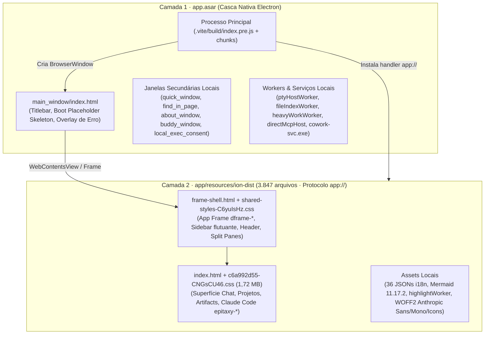

# 01 — Engenharia Reversa de UX/UI do Claude Desktop (v2.37337.1)

> **Alvo analisado:** Pacote MSIX `Claude_2.37337.1.0_x64__pzs8sxrjxfjjc` instalado localmente em `C:\Program Files\WindowsApps\Claude_2.37337.1.0_x64__pzs8sxrjxfjjc`.
> **Objetivo:** Mapear padrões de arquitetura de interface, layout, tokens do sistema de design (`--cds-*` e `--df-*`), tipografia, microinterações, atalhos, acessibilidade e fluxos de supervisão de agente/código (`epitaxy-*`) para fundamentar uma especificação original de reformulação do **Orin Chat** e do **Orin Code** (`02-spec-reformulacao-ux-ui.md`).
> **Restrição de propriedade intelectual:** Nenhum código-fonte proprietário, ativo gráfico, fonte ou logotipo foi copiado para o repositório do Orin. Todos os achados abaixo descrevem padrões arquiteturais, métricas, variáveis CSS e comportamentos observados.

---

## 1. Metodologia, Proveniência e Ledger de Evidências (REA)

A investigação combinou análise estática autenticada via servidor MCP **REA (`reverse-engineer-anything`)** sobre os binários e pacotes distribuídos (`shipped-artifact`) com extração e inspeção estruturada de folhas de estilo, manifests HTML e catálogos de internacionalização em diretório de rascunho isolado fora do repositório (`scratch/claude-re/`).

### 1.1 Artefatos Primários e Digests SHA-256

| Artefato | Caminho Local | Tamanho (Bytes) | Digest SHA-256 | Papel na Arquitetura |
|---|---|---|---|---|
| **Executável Principal (`claude.exe`)** | `...\app\claude.exe` | `246.468.944` | `71c6fda9880855477b70531c034f2ebfc3e42d247d6fcda4ae2e7f88e400ee64` | Binário PE x64 do runtime Electron com fuses embutidos. |
| **Pacote Electron (`app.asar`)** | `...\app\resources\app.asar` | `49.152.598` | `6290a54e1472e26e3cd6324a2ba23fccb7a5bb1cc9329eeb841a405d377634cc` | Processo principal (`.vite/build/`), preloads e janelas auxiliares locais (`.vite/renderer/`). |
| **Bundle Web Local (`ion-dist`)** | `...\app\resources\ion-dist` | `3.847 arquivos` (3.496 inventariados pelo REA) | `ec34292b7d85207e70a6246a2d60cd2bb9c8d51cf3c85e255520ae79496881fb` (root digest) | SPA completa da interface principal (Chat, Projetos, Artifacts e Claude Code Desktop) servida localmente via protocolo `app://`. |
| **Bundle de Evidências REA** | `scratch\claude-re\rea-evidence-bundle.json` | `416.110.267` | Exportação determinística (8 registros, 0 unknowns residuais não declarados) | Pacote portável com todas as evidências estáticas geradas na sessão. |

### 1.2 Ledger de Evidências do REA

| Evidence ID (`rea`) | Operação REA | Escopo / Parâmetros | Principais Conclusões Confirmadas |
|---|---|---|---|
| `ev_5abf0fbd2d751aa8ada648149231fb3dbe3d0f30327b7fdec207be83b57ffb64` | `inspect_electron_fuses` | `path: "...\app\claude.exe"` (offset do sentinela: `199416024`, wire v1) | `RunAsNode=disabled`, `EnableNodeCliInspectArguments=disabled`, `EnableCookieEncryption=enabled`, `EnableEmbeddedAsarIntegrityValidation=enabled`, `OnlyLoadAppFromAsar=enabled`, `GrantFileProtocolExtraPrivileges=enabled`, `WasmTrapHandlers=enabled`. |
| `ev_2b641215d5879c80a9e703c6d620c98f2a8155f85673a194c33f5495d06535f4` | `analyze_javascript_application` (parent) | `input_path: "...\app.asar"`, `source_paths: ["package.json", ".vite/build/mainWindow.js", ".vite/renderer/main_window/index.html", ".vite/renderer/main_window/assets/MainWindowPage-Dg0RuIiZ.js", ".vite/renderer/main_window/assets/main-DptQaAq1.js", ".vite/build/quickWindow.js"]` | Grafo estático da casca Electron: 443 arquivos relevantes inventariados, 79.143 nós AST visitados, 9 APIs `contextBridge` expostas pelos preloads (`mainWindow.js` e `quickWindow.js`), 34 operações IPC (26 transmissões e 8 listeners). |
| `ev_f2aac47c6d84bf26960c8691e43ea6647664a54bce980ea259c1785e5ca5f1b2` | `analyze_javascript_application` (summary view) | Projeção sumária de `ev_2b641215d5879c80a9e703c6d620c98f2a8155f85673a194c33f5495d06535f4` | Confirmação de metadados de empacotamento (`@ant/desktop` v2.37337.1, `main: ".vite/build/index.pre.js"`, workspace packages `@ant/cds`, `@ant/typography`, `@ant/icons`). |
| `ev_223d4a7e7c3c6fc61b19af2836ad523d52b2bcd1f3a51518aceb94d7d79b1735` | `inspect_analysis_view` | `collection: "modules", limit: 40, offset: 0` sobre `ev_2b641215...` | Inventário de módulos do processo principal e workers: `coworkArtifact.js`, `quickWindow.js`, `pty-host/ptyHostWorker.js`, `file-index-worker/fileIndexWorker.js`, `heavy-work-worker/heavyWorkWorker.js`, `mcp-runtime/directMcpHost.js`. |
| `ev_600ae883f803ed3ce64c52d320582daac43d3f700a8dc1c6afbc076765677003` | `trace_application_feature` | `seed: { kind: "api", value: "BrowserWindow" }` sobre `ev_2b641215...` | Confirma que a instanciação de `BrowserWindow` não ocorre nos preloads/renderers selecionados, mas sim nos chunks de processo principal (`.vite/build/index.chunk-CHpJbW9_.js` e `.vite/build/index.chunk-CFtIIcWC.js`). |
| `ev_558b47c7b12fe599d53b80e402b81c9cc7fa3f71246fff75cfdb5327242a8617` | `analyze_javascript_application` (parent) | `input_path: "...\app\resources\ion-dist"`, `format: "directory"`, `source_paths: ["index.html", "frame-shell.html", "assets/v1/c518a31cc-B7StIRUX.js"]` | Grafo estático da camada web empacotada (`ion-dist`): 3.496 arquivos relevantes inventariados, análise do registro de atalhos (`c518a31cc-B7StIRUX.js`, 3.832 nós AST, 98 findings) e shells HTML (`index.html`, `frame-shell.html`). |
| `ev_2cfd508537097be7bd77467c9141ce8e292e3c6a7d7d6f5c79762c5d8b5ef1d9` | `analyze_javascript_application` (summary view) | Projeção sumária de `ev_558b47c7b12fe599d53b80e402b81c9cc7fa3f71246fff75cfdb5327242a8617` | Confirmação de integridade e cobertura do diretório `ion-dist` (`sha256: ec34292b...`). |

---

## 2. Arquitetura do Aplicativo: Thin Shell Electron + SPA Local (`ion-dist`)

### 2.1 Fuses do Electron e Postura de Segurança (`ev_5abf0fbd...`)
O binário `claude.exe` aplica endurecimento no nível de fuse do Electron:
- **Inspeção e execução arbitrária desativadas:** `RunAsNode` (`disabled`), `EnableNodeOptionsEnvironmentVariable` (`disabled`), `EnableNodeCliInspectArguments` (`disabled`). Isso impede anexar um depurador CDP externo via flags de linha de comando sem modificar o binário.
- **Integridade de pacote:** `EnableEmbeddedAsarIntegrityValidation` (`enabled`) e `OnlyLoadAppFromAsar` (`enabled`) garantem que o código do processo principal só carregue de `app.asar` validado.
- **Privilégios de protocolo e WebAssembly:** `GrantFileProtocolExtraPrivileges` (`enabled`) e `WasmTrapHandlers` (`enabled`) dão suporte aos módulos `.wasm` locais em `ion-dist/assets/v1/` (`cf4728005-C0phcBAH.wasm` de 8,25 MB e `c35955a62-DsUXHNAG.wasm` de 1,35 MB).
- **`webPreferences` congeladas no processo principal (`rGn` em `index.chunk-CHpJbW9_.js`):** `sandbox: true`, `contextIsolation: true`, `nodeIntegration: false`, `nodeIntegrationInSubFrames: false`, `nodeIntegrationInWorker: false`, `webviewTag: false`, `navigateOnDragDrop: false`.

### 2.2 Modelo de Duas Camadas: Casca Nativa vs. `ion-dist` via `app://`
Ao contrário de wrappers Electron tradicionais que apenas apontam para uma URL remota ou embutem toda a UI no `app.asar`, o Claude Desktop separa a UI em duas camadas:

1. **Casca de primeiro frame (`main_window/index.html` em `app.asar`):**
   - Contém um comentário explícito de arquitetura explicando que o HTML desenha apenas a barra de título, o *boot placeholder* (esqueleto estático da sidebar e da página) e a tela de erro de carregamento.
   - Define `class="cds-root" data-mode="system" data-density="comfortable" data-platform="desktop"`.
   - Aplica regras CSS inline sem `@layer` para pintar o fundo no primeiro frame antes de qualquer JS carregar: `#fcfcfb` (texto `black`) no modo claro e `#151515` (texto `white`) em `@media (prefers-color-scheme: dark)` ou `body.darkTheme`.
2. **Protocolo `app://` e `ion-dist` (`app/resources/ion-dist`):**
   - No boot (`index.chunk-CHpJbW9_.js`), o processo principal registra um handler para o protocolo `app://` apontando para `path.join(resourcesPath, "ion-dist")`.
   - O diretório `ion-dist` contém **3.847 arquivos**, incluindo:
     - `index.html` (46,6 KB): documento de entrada da aplicação com esqueleto estático do composer (`#static-composer-box`) e da sidebar (`#static-sidebar-skeleton`) para zero *layout shift* no boot.
     - `frame-shell.html` (26,0 KB), `frame-connect.html` e `frame-manage.html`: estrutura de hospedagem multi-painel (`dframe-*`).
     - `assets/v1/c6a992d55-CNGsCU46.css` (1.720.886 bytes) e `assets/v1/shared-styles-C6yuIsHz.css` (78.856 bytes): folhas de estilo completas do sistema de design **CDS** (`--cds-*`), do frame (`--df-*`) e da superfície de código (`epitaxy-*`).
     - `_frame-rt/_runtime/mermaid-11.17.2.min.js` (3,57 MB) e `assets/highlightWorker-DC5uhXj0.js` (1,57 MB): renderização de diagramas Mermaid e syntax highlighting em Web Worker dedicado (fora da thread principal).
     - `i18n/*.json`: 36 catálogos de tradução completos (`en-US.json` com 34.954 chaves / 2,52 MB; `pt-BR.json` com 2,90 MB).

### 2.3 Janelas Secundárias, Dimensões e Jump List
- **Dimensões da janela principal (`index.chunk-CHpJbW9_.js`):**
  - Estado deslogado (`signedOut`, constante `yR`): `width: 600, height: 600`.
  - Estado logado (`signedIn`, constante `FJn`): `width: 1200, height: 800` (com interpolação animada de redimensionamento ao autenticar e persistência de bounds).
- **Titlebar Overlay Nativo (Windows WCO / macOS hiddenInset):**
  - Altura base (`OHn` / `kHn`): **`36px`** em janelas normais e popouts; **`44px`** (`XWn`) quando a barra superior expandida está ativa; altura mínima absoluta (`ZWn`) de **`24px`**.
  - A altura do overlay escala dinamicamente com o `zoomFactor` da janela: `Math.max(24, Math.round(baseHeight * zoomFactor))`.
  - Cores do `titleBarOverlay` (`$Wn` e `GHn` em `index.chunk-CHpJbW9_.js`):
    - **Modo Escuro (`shouldUseDarkColors = true`):** fundo da janela `#151515` (ou `#141412`), `color: "#00000000"` (transparente sobre o header), `symbolColor: "#c2c0b6"` (ícones de minimizar/maximizar/fechar em cinza quente suave, evitando branco puro estourado).
    - **Modo Claro (`shouldUseDarkColors = false`):** fundo da janela `#fcfcfb` (ou `#f9f8f4`), `color: "#00000000"`, `symbolColor: "#3d3d3a"`.
- **Janelas secundárias em `.vite/renderer/` e `.vite/build/` (`ev_223d4a7e...`):**
  1. `quick_window` (`quick-window.html` + `quickWindow.js`): entrada rápida flutuante global (Quick Entry / Quick Chat).
  2. `find_in_page` (`find-in-page.html` + `findInPage.js`): barra de busca na página sobreposta como view isolada usando componentes `CdsPortal` e `Tooltip`.
  3. `about_window` (`about.html` + `aboutWindow.js`): janela "Sobre".
  4. `buddy_window` (`buddy.js` + `index.chunk-CFtIIcWC.js`): janela *"Hardware Buddy & Maker Devices"* (`titleBarStyle: "hiddenInset"`, `backgroundColor: "#F4F3EE"`).
  5. `local_exec_consent` (`localExecConsent.html` + `localExecConsent.js`): modal nativo de consentimento de execução local.
  6. `coworkArtifact.js` e janelas `popout`: janelas destacadas para Artifacts, simulador e sessões em split/popout, com suporte a `popoutTitleBarOverlay` e `popoutZoom`.
- **Jump List / Desktop Actions (`Gmr()` em `index.chunk-CHpJbW9_.js`):**
  - `NewChat` → `"New Chat"` (`claude://claude.ai/new?surface=chat&source=desktop_action`)
  - `NewCode` → `"New Claude Code Session"` (`claude://code/new?source=desktop_action`)
  - `ContinueLast` → `"Continue Last Claude Code Session"`

---

## 3. Arquitetura de Informação, Shell (`dframe-*`) e Navegação

### 3.1 Estrutura do App Frame (`dframe-root`)
O shell visual (`shared-styles-C6yuIsHz.css`) adota uma arquitetura de **sidebar como card flutuante** no modo desktop (`data-variant="desktop"`) e barra lateral contínua com borda de `0.5px` na variante web (`data-variant="web"`):

| Variável / Seletor | Valor Observado | Papel no Layout |
|---|---|---|
| `--df-chrome-bar-height` | `0px` (padrão) · `36px` em `.dframe-root[data-wco]` | Altura reservada para a barra de controles de janela (Window Controls Overlay no Windows). |
| `--df-header-h` | `48px` | Altura do cabeçalho interno da sessão/conversa. |
| `--df-sidebar-width` | `288px` | Largura padrão da sidebar expandida. |
| `--df-sidebar-left` | `8px` (desktop card) · `0px` (web) | Recuo esquerdo da sidebar quando renderizada como card flutuante. |
| `--df-radius-card` | `8px` (`-electron-corner-smoothing: system-ui`) | Raio de borda do card da sidebar e do popover de peek. |
| `--df-content-gutter` | `8px` | Espaçamento entre a sidebar e o painel primário de conteúdo. |
| `--df-sidebar-clearance` | `calc(var(--df-sidebar-width) + var(--df-sidebar-left))` (`296px`) | Espaço reservado à esquerda do `.dframe-content-inner` quando a sidebar está aberta. |
| `--df-traffic-light-spacer` | `74px` | Espaçador horizontal para os botões de janela do macOS (ou controles equivalentes). |

### 3.2 Medidas e Densidade da Sidebar (`dframe-sidebar`)
A sidebar possui duas densidades (`compact` base em `.dframe-root` e `comfortable` em `[data-density="comfortable"]`):

| Métrica | Modo `compact` (`.dframe-root`) | Modo `comfortable` Web | Modo `comfortable` Desktop (`[data-variant=desktop]`) |
|---|---|---|---|
| Altura da linha (`--df-row-h`) | `26px` | `32px` | `30px` |
| Fonte do item (`--df-row-font`) | `13px` | `14px` | `14px` |
| Fonte de grupo (`--df-group-font`) | `12px` | `13px` | `13px` |
| Tamanho do ícone (`--df-icon-size`) | `16px` | `20px` | `20px` |
| Slot esquerdo (`--df-leading-slot`) | `24px` | `28px` | `28px` |
| Botão circular "Novo" (`--df-new-circle-size`) | `18px` (glifo `13px`) | `22px` (glifo `16px`) | `22px` (glifo `16px`) |
| Padding superior de grupo (`--df-group-pt`) | `12px` | `16px` | `14px` |
| Raio de pílula/item (`--df-radius-pill`) | `6px` | `8px` | `8px` |
| Botões do rodapé (`--df-footer-btn-size`) | `24px` (gap `3px`) | `32px` (gap `6px`) | `32px` (gap `6px`) |

### 3.3 Comportamento Colapsado (`data-collapsed`) e *Hover-Peek* (`data-peeked`)
- Quando a sidebar é recolhida (`Ctrl+B` / `Cmd+B`), `.dframe-root[data-collapsed]` zera `--df-sidebar-clearance: 0px`, liberando 100% da largura para a conversa/código.
- Os controles superiores da sidebar viram uma barra horizontal compacta no canto superior esquerdo (`z-index: 50`), enquanto o header do painel principal aplica `padding-inline-start: calc(var(--df-trigger-right, 180px) + var(--df-header-collapsed-gap, 8px) + var(--df-ceded-gutter))` para **nunca colidir** com os botões da janela/sidebar.
- Ao passar o mouse na borda esquerda ou no gatilho (`[data-peeked]`), `.dframe-sidebar-body` surge como um card flutuante (`width: 280px`, `max-height: 70vh`, `box-shadow: var(--df-shadow-pop)`) com transição suave:
  - `transition: opacity .14s ease, transform .18s cubic-bezier(.32, .72, 0, 1)` (saindo de `translate(0, -6px) scale(.98)` para a posição natural).
- Uma alça de redimensionamento (`.dframe-resize-handle`, `z-index: 25`) permite ajustar a largura da sidebar sem transições artificiais durante o arraste (`.dframe-root[data-resizing]` aplica `transition: none`).

### 3.4 Taxonomia de Navegação e Superfícies
A partir do registro de comandos (`shared-1-7J3IM-U8.js`) e do catálogo i18n (`en-US.json`), a navegação principal organiza-se em:
- **Ações primárias e busca:** `New chat` (`Ctrl+N` / `Ctrl+Shift+O`), `Search chats and sessions...` / `Quick chat or search` (`Ctrl+K`), `Search` (`Ctrl+Shift+K`).
- **Superfícies de navegação:** `Projects`, `Artifacts`, `Code` (Claude Code Desktop), `Customize`, `Connectors` (integrações MCP/OAuth como Linear, GitHub, Office 365).
- **Seções da lista lateral:** `Starred` (ou itens fixados `[data-pinned-list]`), `Recents`, agrupamento por projeto/repositório e suporte a sessões aninhadas (`show_nested_sessions` / `hide_nested_sessions` para subagentes/tarefas filhas).

---

## 4. Layout do Chat, Mensagens, Composer e Painel de Artifacts

### 4.1 Coluna de Leitura e Ritmo Vertical
- **Largura máxima da coluna de transcrição (`c6a992d55-CNGsCU46.css` e `cd5a31703-Byc-oNJo.js`):**
  - Token central: `--transcript-width: 48rem` (**`768px`** na base 16px, ou **`~723px`** quando escalado por `--cds-rem-scale: calc(16 / 17)`).
  - Variantes utilitárias: `max-w-[var(--transcript-width,48rem)]`, `max-w-[calc(var(--transcript-width,48rem)+2.5rem)]` e `max-w-3xl` (`48rem`).
  - Gutter horizontal (`--chat-gutter`): **`32px`** no desktop e **`16px`** em telas estreitas.
- **Espaçamento entre turnos e itens (`cd5a31703-Byc-oNJo.js` e `c6a992d55-CNGsCU46.css`):**
  - **Entre turnos completos (`--chat-turn-gap`):** **`34px`** no chat padrão (`mt-[var(--chat-turn-gap,34px)]`), ou `calc(var(--spacing) * 5)` no modo confortável e `calc(var(--spacing) * 4)` no modo compacto (`data-density="compact"`). Na superfície de código (`epitaxy-root`), é calculado proporcionalmente à tipografia: `calc(var(--chat-body) * var(--chat-leading, 1.42857) * 0.75)`.
  - **Entre itens consecutivos do mesmo turno (`--chat-item-gap`):** **`13px`** no chat padrão (`mt-[var(--chat-item-gap,13px)]`), ou `calc(var(--chat-body) * var(--chat-leading, 1.42857) * 0.5)` na superfície de código.
  - **Resultado visual:** A separação entre pedidos do usuário (`34px`) é **2,6× maior** que o espaçamento interno entre blocos de atividade e parágrafos do mesmo turno (`13px`), criando agrupamento Gestalt imediato sem depender de bordas pesadas.

### 4.2 Mensagens do Usuário vs. Respostas do Assistente
- **Mensagem do Usuário (`[data-cds="UserMessage"]` / `.epitaxy-user-turn`):**
  - Fundo neutro sutil: `--cds-bg-user-message: var(--cds-bg-neutral)` (`var(--cds-alpha-1)`, equivalente a 5% de contraste sobre a superfície), ou `--cds-bg-tint-blue` no estilo pessoal.
  - Padding horizontal: `--cds-message-bubble-pad-x: calc(1rem * var(--cds-rem-scale, 1))` (`~15px`).
  - Tipografia: `--font-user-message: var(--font-ui)` (**sans-serif**), distinguindo visualmente a voz do usuário da voz analítica do assistente.
  - Animação de entrada: `cds-um-enter` (`.45s cubic-bezier(.34, 1.3, .64, 1)` com `scale(.92) translateY(6px) → none`, `transform-origin: 100%` alinhado à direita).
  - **Sticky Prompt Bubble (`.epitaxy-sticky-prompt-bubble`):** quando o usuário rola uma resposta longa na superfície de código, o prompt do turno atual fica fixado no topo com `padding: var(--cds-pad-md) var(--cds-pad-lg)`, cantos inferiores arredondados `calc(var(--cds-radius) + 4px)` e animação `epitaxy-sticky-prompt-enter` (`.22s cubic-bezier(.215, .61, .355, 1)`).
- **Resposta do Assistente (`[data-cds="AssistantMessage"]` / `[data-cds="Prose"]`):**
  - Renderizada diretamente sobre a superfície da página (sem caixa ou borda ao redor da resposta padrão), exceto quando o modo experimental `[data-feed-all-bubbles]` está ativo (onde recebe `background: var(--cds-surface-2)` e hairline ring).
  - Tipografia editorial: `--font-claude-response: var(--font-anthropic-serif)` (serifada com tamanho óptico `opsz` ajustado e peso reduzido `wght: 360` no tema escuro), enquanto a superfície de código (`epitaxy-transcript-typography`) utiliza sans-serif técnica com `--chat-body: calc(.875rem * var(--cds-rem-scale, 1))` e `line-height: 1.42857`.
  - **Revelação da barra de ações da mensagem:** controlada por tokens dedicados (`--cds-message-actions-reveal-in-duration: var(--cds-dur-snap)` = `120ms`, `delay: .1s`, saída em `60ms`), mantendo os botões (`Copy to clipboard`, `Retry`, `Edit message`, feedback) invisíveis durante a leitura passiva, mas acessíveis ao hover/foco e visíveis em dispositivos de ponteiro grosso (`@media (any-pointer: coarse) { opacity: 1 }`).

### 4.3 Composer (`#static-composer-box`)
A estrutura do composer extraída de `ion-dist/index.html` e `c6a992d55-CNGsCU46.css` revela decisões críticas de ergonomia:
- **Posicionamento persistente:** `dock:sticky dock:bottom-0 dock:z-10 dock:bg-surface-1 dock:pb-10`. O composer **nunca fica invisível (`opacity: 0`) ao rolar a conversa para cima**.
- **Largura máxima:** `max-w-[40rem]` (`640px`) na variante `marlin` ou `max-w-2xl` (`42rem` / `672px`) na variante clássica, centralizado (`mx-auto w-full`).
- **Superfície, borda e sombra:**
  - Fundo: `bg-surface-3` (`--cds-surface-3`, que vale `#ffffff` no claro e `--cds-gray-800` `~#20201f` no escuro, destacando-se suavemente sobre `--cds-surface-1`).
  - Raio de borda: `.rounded-composer` → `border-radius: var(--cds-radius-composer)` = `calc(.75rem * var(--cds-rem-scale, 1))` (`~11.3px`, com override `0.875rem` / `~13.2px` em variantes destacadas).
  - Sombra em repouso (`.shadow-composer`): `0 0.25rem 1.25rem color-mix(in srgb, var(--cds-black) 3.5%, transparent)` combinada com anel hairline `0 0 0 var(--cds-ring-outer) var(--cds-ring-color)` (no escuro, `inset 0 0 0 1px var(--cds-alpha-2)`).
  - Sombra em foco (`.shadow-composer-focus`): eleva a sombra para `7.5%` de preto e troca o anel para `--cds-border-strong` (`--cds-alpha-3`, 20% de contraste).
- **Piso de tamanho de fonte (`--cds-font-size-text-entry-floor: 16px`):** garante que o campo de entrada nunca renderize abaixo de `16px` efetivos (`max(16px, var(--cmp-font-size))`), prevenindo zoom involuntário em telas touch/DPI alto e assegurando legibilidade imediata durante a digitação.
- **Tiles de Anexo (`#static-composer-attachment-tiles`):**
  - Grade horizontal com scroll (`display: flex; flex-direction: row; gap: 0.75rem; overflow-x: auto; padding: 0.5rem`).
  - Cada tile (`.static-composer-attachment-tile`) mede `calc(7.5rem * var(--cds-rem-scale, 1))` × `calc(7.5rem * var(--cds-rem-scale, 1))` (`~113px × 113px`), entrando com a animação `cds-chip-in` (`opacity: 0; filter: blur(2px); transform: scale(.8)` em `200ms`) e escalonamento `--cds-chip-in-base-delay: 50ms`.
- **Responsividade por Container Query:** `@container static-composer-box (width < 14.5rem)` aumenta a altura do espaçador interno de `2.75rem` para `5.25rem` quando o composer é comprimido por painéis laterais.

### 4.4 Painel Lateral e Artifacts
- **Tokens do painel (`tokens-cds.txt`):**
  - `--cds-surface-panel: var(--cds-surface-2)`
  - `--cds-panel-radius: calc(.625rem * var(--cds-rem-scale, 1))` (`~9.4px`)
  - `--cds-panel-inset: calc(.5rem * var(--cds-rem-scale, 1))` (`~7.5px` de margem em relação à janela, formando um card emoldurado)
  - `--cds-panel-gap: calc(.5rem * var(--cds-rem-scale, 1))`
  - `--cds-panel-shadow: 0 0 0 1px var(--cds-border), var(--cds-shadow-sm)`
- **Animação de abertura:** `@keyframes side-panel-in { 0% { opacity: 0; transform: translate(24px) } }` executada em `var(--cds-dur-base)` (`200ms`) com curva `var(--cds-ease-out)` (`cubic-bezier(.165, .84, .44, 1)`).
- **Popout e isolamento:** Artifacts podem ser abertos no painel lateral (`Open artifact`) ou destacados em janela própria (`coworkArtifact.js`), com aviso de segurança explícito quando compartilhados por terceiros (`"This artifact was shared with you. Only open artifacts from people you trust."`).

---

## 5. Sistema de Design CDS (`--cds-*`): Tokens Completos (Claro e Escuro)

O Claude Design System (**CDS**, pacote `@ant/cds`) utiliza uma arquitetura de tokens em três camadas:
1. **Primitivos HSL de matiz quente (`--cds-hsl-*` e `--_*` em `:root`):** cinzas com leve matiz creme/papel (`Hue 40°–60°`) nos tons claros e neutros puros/quentes nos tons escuros.
2. **Escala Neutra Invertível (`--cds-neutral-0` a `--cds-neutral-900`):** no modo claro, `neutral-0` é branco (`gray-0`) e `neutral-900` é quase preto (`gray-900`); no modo escuro, a escala **inverte completamente** (`neutral-0` aponta para `gray-900` e `neutral-900` aponta para `gray-0`), permitindo que tokens de borda alfa (`--cds-alpha-1..9`) funcionem automaticamente nos dois temas.
3. **Tokens Semânticos de Superfície, Texto, Preenchimento e Borda (`--cds-surface-*`, `--cds-text-*`, `--cds-fill-*`, `--cds-bg-*`, `--cds-border-*`).**

### 5.1 Fator de Escala Global (`--cds-rem-scale`)
Em `:root` (`tokens-core.txt#L212`), o CDS declara:
- `--cds-rem-scale: calc(16 / 17)` (`≈ 0.941176`)
Todos os tokens dimensionais (`--cds-pad-*`, `--cds-gap-*`, `--cds-h-control`, `--cds-font-size-*`) multiplicam seu valor em `rem` por `--cds-rem-scale`, produzindo uma densidade de aplicativo desktop ligeiramente mais enxuta e precisa que páginas web convencionais.

### 5.2 Escala Primitiva de Cinzas (`--cds-hsl-gray-*`)

| Token Primitivo | Valor HSL (`tokens-core.txt`) | Hex Equivalente Aproximado | Uso Principal |
|---|---|---|---|
| `--cds-hsl-gray-0` | `0 0% 100%` | `#FFFFFF` | Superfície elevada clara (`surface-2`, `surface-3`), texto branco puro no escuro |
| `--cds-hsl-gray-10` | `60 14.2857% 98.6275%` | `#FCFCFB` | Fundo de janela claro (`GHn.light`), `surface-1` claro, sidebar clara |
| `--cds-hsl-gray-20` | `60 14.2857% 97.2549%` | `#F9F9F7` | Fundo de página claro (`surface-0` / `page-bg`) |
| `--cds-hsl-gray-30` | `60 10% 96.0784%` | `#F6F6F4` | Superfície sutil clara |
| `--cds-hsl-gray-50` | `45 11.7647% 93.3333%` | `#F0EFEA` | Texto primário no modo escuro (`--cds-text-primary` dark) |
| `--cds-hsl-gray-100` | `52.5 11.7647% 86.6667%` | `#E0DFD9` | Hover de botão primário no escuro |
| `--cds-hsl-gray-200` | `55 9.0909% 74.1176%` | `#C1C0B8` | Texto secundário no modo escuro (`--cds-text-secondary` dark) |
| `--cds-hsl-gray-400` | `~42 2.9% 49%` | `#807E78` | Texto silenciado (`--cds-text-muted` em ambos os modos) |
| `--cds-hsl-gray-600` | `45 2.5% 31.3725%` | `#52514E` | Texto secundário no modo claro (`--cds-text-secondary` light) |
| `--cds-hsl-gray-800` | `60 1.5873% 12.3529%` | `#20201F` | `surface-3` no modo escuro (composer, popovers) |
| `--cds-hsl-gray-830` | `60 1.9608% 10%` | `#1A1A19` | `surface-2` no modo escuro (painéis laterais, cards) |
| `--cds-hsl-gray-850` | `0 0% 8.2353%` | `#151515` | `surface-1` no modo escuro e fundo nativo da BrowserWindow (`GHn.dark`) |
| `--cds-hsl-gray-900` | `0 0% 4.3137%` | `#0B0B0B` | `surface-0` / `page-bg` no modo escuro e texto primário no modo claro |

### 5.3 Comparativo Completo de Tokens Semânticos: Modo Claro vs. Modo Escuro

| Categoria | Token CDS | Modo Claro (`.cds-root` base) | Modo Escuro (`[data-mode=dark]` / `system` dark) |
|---|---|---|---|
| **Superfícies** | `--cds-page-bg` / `--cds-surface-0` | `var(--cds-gray-20)` (`#F9F9F7`) | `var(--cds-gray-900)` (`#0B0B0B`) |
| | `--cds-surface-1` | `var(--cds-gray-10)` (`#FCFCFB`) | `var(--cds-gray-850)` (`#151515`) |
| | `--cds-surface-2` / `--cds-surface-panel` | `var(--cds-gray-0)` (`#FFFFFF`) | `var(--cds-gray-830)` (`#1A1A19`) |
| | `--cds-surface-3` / `--cds-surface-popover` | `var(--cds-gray-0)` (`#FFFFFF`) | `var(--cds-gray-800)` (`#20201F`) |
| | `--df-sidebar-bg` | `var(--cds-gray-10)` (`#FCFCFB`) | `color-mix(in srgb, hsl(var(--_gray-850)) 80%, black)` (`~#111111`) |
| **Texto** | `--cds-text-primary` | `var(--cds-neutral-900)` (`#0B0B0B`) | `var(--cds-gray-50)` (`#F0EFEA`) |
| | `--cds-text-secondary` | `var(--cds-neutral-600)` (`#52514E`) | `var(--cds-gray-200)` (`#C1C0B8`) |
| | `--cds-text-muted` | `var(--cds-neutral-400)` (`~#807E78`) | `var(--cds-gray-400)` (`~#807E78`) |
| | `--cds-text-disabled` | `var(--cds-alpha-4)` (`35%` de `neutral-900`) | `var(--cds-alpha-4)` (`35%` de `gray-0`) |
| **Bordas e Anéis** | `--cds-border` | `var(--cds-alpha-2)` (`10%` de preto) | `var(--cds-alpha-2)` (`10%` de branco) |
| | `--cds-border-strong` | `var(--cds-alpha-3)` (`20%` de preto) | `var(--cds-alpha-3)` (`20%` de branco) |
| | `--cds-border-stronger` | `40%` de `neutral-900` | `40%` de `neutral-900` |
| | `--cds-ring-outer` / `--cds-ring-inner` | `outer: 1px` · `inner: 0px` | `outer: 0px` · `inner: 1px` (anel interno sutil no escuro!) |
| | `--cds-focus-shadow` | `inset 0 0 0 1px var(--cds-page-bg), 0 0 0 1px var(--cds-fill-accent), 0 0 6px 1px var(--cds-bg-accent)` | `inset 0 0 0 1px var(--cds-page-bg), 0 0 0 1px var(--cds-fill-accent), 0 0 6px 1px hsl(from var(--cds-role-accent-600) h s l / 60%)` |
| **Preenchimentos** | `--cds-fill-brand` / `-hover` | `#c6613f` (`--cds-clay-emphasized`) / `#d97757` (`--cds-clay`) | `#c6613f` / `#d97757` |
| | `--cds-fill-primary` / `-hover` | `var(--cds-neutral-900)` / `var(--cds-neutral-750)` | `var(--cds-gray-0)` / `var(--cds-gray-100)` |
| | `--cds-fill-secondary` / `-hover` | `#ffffff1a` / `var(--cds-alpha-1)` (`5%`) | `var(--cds-alpha-2)` (`10%`) / `14%` |
| | `--cds-fill-ghost-hover` / `-selected` | `5%` / `10%` | `7.5%` / `15%` |
| | `--cds-fill-control` / `-hover` | `10%` / `20%` | `10%` / `20%` |
| **Semânticos** | `--cds-text-accent` / `--cds-bg-accent` | `role-accent-600` (`hsl(213.6 72.3% 33.9%)`) / `role-accent-100` | `role-accent-300` / `role-accent-800` |
| | `--cds-text-danger` / `--cds-bg-danger` | `role-danger-600` (`hsl(0 57.8% 35.3%)`) / `role-danger-100` | `role-danger-300` / `role-danger-800` |
| | `--cds-text-success` / `--cds-bg-success` | `role-success-600` (`hsl(120 100% 19.4%)`) / `role-success-100` | `role-success-400` (`hsl(120 86.3% 34.3%)`) / `role-success-800` |
| | `--cds-text-warning` / `--cds-bg-warning` | `role-warning-600` (`hsl(36 100% 22.5%)`) / `role-warning-100` | `role-warning-300` / `role-warning-800` |
| | `--cds-text-pro` / `--cds-bg-pro` | `role-pro-600` (`hsl(248.8 48.4% 44.1%)`) / `role-pro-100` | `role-pro-300` / `role-pro-800` |
| **Sombras** | `--cds-shadow-color` | `hsl(from var(--cds-gray-900) h s l / 8%)` | `#0000003d` (`24%`) |
| | `--cds-shadow-popover` | `0 8px 24px #0000001f, 0 2px 6px #00000014` | `0 8px 24px #00000052, 0 2px 6px #0003` |
| | `--cds-backdrop` | `#0006` (`40%`) | `#00000080` (`50%`) |

> [!TIP]
> **Insight técnico sobre bordas em modo escuro (`--cds-ring-outer` vs `--cds-ring-inner`):** No modo claro, os cards e o composer usam um anel externo (`--cds-ring-outer: 1px; --cds-ring-inner: 0px`) de 10% de preto. No modo escuro, o CDS inverte para um **anel interno** (`--cds-ring-outer: 0px; --cds-ring-inner: 1px`) de 10% de branco (`--cds-alpha-2`), criando um *inner highlight* de superfície que evita que bordas claras vazem ou pareçam caixas brancas pesadas.

### 5.4 Escala Dimensional: Espaçamentos, Alturas de Controle e Raios

| Categoria | Token CDS | Fórmula CSS | Valor Efetivo (`rem-scale = 16/17`) | Variante Compacta (`--xs` / `--sm`) | Variante Grande (`--lg`) |
|---|---|---|---|---|---|
| **Paddings** | `--cds-pad-xs` | `calc(.25rem * var(--cds-rem-scale,1))` | `3.76px` (`~4px`) | `1.88px` (`.125rem`) | `5.65px` (`.375rem`) |
| | `--cds-pad-sm` | `calc(.375rem * var(--cds-rem-scale,1))` | `5.65px` (`~6px`) | `3.76px` (`.25rem`) | `7.53px` (`.5rem`) |
| | `--cds-pad-md` | `calc(.5rem * var(--cds-rem-scale,1))` | `7.53px` (`~8px`) | `5.65px` (`.375rem`) | `9.41px` (`.625rem`) |
| | `--cds-pad-lg` | `calc(.75rem * var(--cds-rem-scale,1))` | `11.29px` (`~12px`) | `9.41px` (`.625rem`) | `13.18px` (`.875rem`) |
| | `--cds-pad-xl` | `calc(1.25rem * var(--cds-rem-scale,1))` | `18.82px` (`~20px`) | `13.18px` (`.875rem`) | `20.71px` (`1.375rem`) |
| **Gaps** | `--cds-gap-xs` | `calc(.375rem * var(--cds-rem-scale,1))` | `5.65px` (`~6px`) | — | — |
| | `--cds-gap-sm` | `calc(.5rem * var(--cds-rem-scale,1))` | `7.53px` (`~8px`) | — | — |
| | `--cds-gap-md` | `calc(.75rem * var(--cds-rem-scale,1))` | `11.29px` (`~12px`) | — | — |
| | `--cds-gap-lg` | `calc(1.25rem * var(--cds-rem-scale,1))` | `18.82px` (`~20px`) | — | — |
| | `--cds-gap-xl` | `calc(2rem * var(--cds-rem-scale,1))` | `30.12px` (`~32px`) | — | — |
| **Controles** | `--cds-h-control` | `calc(1.5rem * var(--cds-rem-scale,1))` | `22.59px` (`24px` nom.) | `18.82px` (`1.25rem`) | `26.35px` (`1.75rem`) |
| | `--cds-h-control-nested` | `calc(1.125rem * var(--cds-rem-scale,1))` | `16.94px` (`18px` nom.) | `15.06px` (`1rem`) | `18.82px` (`1.25rem`) |
| | `--cds-icon` | `calc(1rem * var(--cds-rem-scale,1))` | `15.06px` (`16px` nom.) | `11.29px` (`.75rem`) | `15.06px` (`1rem`) |
| **Raios** | `--cds-radius` | `calc(.375rem * var(--cds-rem-scale,1))` | `5.65px` (`6px` nom.) | `4.71px` (`.3125rem`) | `6.59px` (`.4375rem`) |
| | `--cds-radius-composer` | `calc(.75rem * var(--cds-rem-scale,1))` | `11.29px` (`12px` nom.) | — | `13.18px` (`.875rem`) |
| | `--cds-panel-radius` | `calc(.625rem * var(--cds-rem-scale,1))` | `9.41px` (`10px` nom.) | — | — |

---

## 6. Tipografia e Compensação Óptica no Tema Escuro

### 6.1 Famílias Tipográficas Empacotadas (`app.asar` e `ion-dist`)
O aplicativo empacota fontes variáveis próprias (local-first, zero dependência de CDN externo) e oferece alternativas dedicadas para acessibilidade:
1. **UI Sans (`--cds-font-sans` / `--font-anthropic-sans`):** `AnthropicSans-Roman-Variable-DDVos-BJ.woff2` (118 KB) e `AnthropicSans-Italic-Variable-CJtkx3-S.woff2` (129 KB), com fallback para `system-ui, "Segoe UI", Roboto` e cadeias completas CJK/Indic (`--font-cjk-sans-fallback`, `--font-script-fallbacks`).
2. **Prosa / Editorial (`--font-claude-response` / `--cds-font-voice`):** `--font-anthropic-serif` com fallbacks calibrados (`Georgia`, `Times New Roman`).
3. **Código e Dados Técnicos (`--cds-font-mono` / `--cds-font-mono-ui`):** `--font-anthropic-mono` (`"SF Mono", ui-monospace, Menlo, Consolas, monospace`).
4. **Ícones Variáveis:** `anthropicons-variable-cvFTkbeX.woff2` (102 KB), com suporte a peso óptico (`font-weight: 433.25`).
5. **Fontes de Acessibilidade (`tokens-core.txt#L18-L19`):** `--font-open-dyslexic: "OpenDyslexic"` e `--font-atkinson-hyperlegible: "Atkinson Hyperlegible Next"`, selecionáveis pelo usuário (`[data-font="system"]` ou variantes de leitura).

### 6.2 Escala Tipográfica (`tokens-cds.txt#L257-L293`)

| Papel Semântico | Token de Tamanho | Valor Nominal (`rem`) | Token de Line-Height | Line-Height Nominal | Variante `textsm` | Variante `textlg` |
|---|---|---|---|---|---|---|
| **Caption** | `--cds-font-size-caption` | `.6875rem` (`11px`) | `--cds-leading-caption` | `1.0625rem` (`17px`) | — | `.75rem` (`12px`) |
| **Footnote** | `--cds-font-size-footnote` | `.75rem` (`12px`) | `--cds-leading-footnote` | `.9375rem` (`15px`) | — | — |
| **Code** | `--cds-font-size-code` | `.75rem` (`12px`) | `--cds-leading-code` | `1.0625rem` (`17px`) | — | — |
| **Body (UI)** | `--cds-font-size-body` | `.8125rem` (`13px`) | `--cds-leading-body` | `1.1875rem` (`19px`) | `.8125rem` | `.9375rem` (`15px`) |
| **Prose (Chat)** | `--cds-font-size-prose` | `.875rem` (`14px`, não reduzido por `rem-scale`) | `--cds-leading-prose` | `1.25rem` (`20px`) | `.8125rem` (`13px`) | `.9375rem` (`15px`, ou `1rem`/`24px` em `--lg`) |
| **Heading** | `--cds-font-size-heading` | `.875rem` (`14px`) | `--cds-leading-heading` | `1.125rem` (`18px`) | `.8125rem` (`13px`) | `.9375rem` (`15px`) |
| **Title** | `--cds-font-size-title` | `1.25rem` (`20px`) | `--cds-leading-title` | `1.5625rem` (`25px`) | — | — |
| **Page Header** | `--cds-page-header-title-size` | `1.5rem` (`24px`) | `--cds-page-header-title-leading` | `2rem` (`32px`) | — | — |

### 6.3 Compensação de Irradiação no Modo Escuro (`font-variation-settings`)
Texto claro sobre fundo escuro sofre de *irradiação óptica* (parece mais grosso e borrado que texto escuro sobre fundo claro). O CDS corrige isso automaticamente reduzindo o eixo `wght` da fonte variável em `[data-mode="dark"]` (`tokens-cds.txt#L596-L606` e `tokens-core.txt#L392-L462`):
- **Pesos base (Claro → Escuro):**
  - Regular: `400` → `"wght" 360` (e até `320` na saudação do composer `dark:[font-variation-settings:'wght'_320]`)
  - Medium: `500` → `"wght" 460`
  - Semibold: `580` → `"wght" 540`
  - Bold: `600` → `"wght" 560`
- **Prosa do assistente no escuro (`.font-claude-response-*`):** corpo em `"wght" 360` e negrito/títulos em `"wght" 530` com tamanho óptico `--font-opsz: 20` (headings) e `28` (títulos).

---

## 7. Animações, Transições e Keyframes

### 7.1 Tokens de Tempo e Easing (`tokens-cds.txt#L75-L83`)
- **Durações:**
  - `--cds-dur-fast`: `60ms` (saída de tooltips/ações de mensagem)
  - `--cds-dur-snap`: `120ms` (`.12s` — entrada de ações, reveals rápidos, saída de faixas)
  - `--cds-dur-base`: `200ms` (`.2s` — abertura de painel lateral, entrada de chips)
  - `--cds-dur-sheet`: `300ms` (`.3s` — gavetas, expansão de linhas em grid)
  - `--cds-dur-slow`: `450ms` (`.45s` — entrada da bolha do usuário com leve overshoot)
- **Curvas de Easing:**
  - `--cds-ease-out`: `cubic-bezier(.165, .84, .44, 1)` (desaceleração suave padrão)
  - `--cds-ease-snap`: `cubic-bezier(.32, .72, 0, 1)` (curva estilo iOS/macOS usada no peek da sidebar e modais)
  - `--cds-ease-overshoot`: `cubic-bezier(.34, 1.3, .64, 1)` (mola sutil para entrada de bolhas e checks)
  - `--cds-btn-spring`: `linear(0, .2459, .6526, .9468, 1.0764, 1.0915, 1.0585, 1.0219, .9993, .9914, .9921, .9957, .9988, 1.0004, 1)` (mola física para cliques de botão)
  - Pressão de card: `--cds-card-press-sx: .99; --cds-card-press-sy: .99; --cds-card-press-d: 2px`.

### 7.2 Inventário de Keyframes Principais (`c6a992d55-CNGsCU46.css`)

| Keyframe | Definição e Parâmetros Observados | Onde é Aplicado |
|---|---|---|
| `cds-um-enter` / `code-user-bubble-enter` | `0% { opacity: 0; transform: scale(.92) translateY(6px) } to { opacity: 1; transform: none }` · `.45s cubic-bezier(.34, 1.3, .64, 1)` | Entrada de nova mensagem enviada pelo usuário. |
| `message-fade-up` | `0% { opacity: 0; transform: translateY(10px) }` · `1.1s cubic-bezier(.34, 1.56, .64, 1)` | Entrada suave de blocos de mensagem/saudação. |
| `side-panel-in` | `0% { opacity: 0; transform: translate(24px) }` · `200ms var(--cds-ease-out) both` | Abertura do painel lateral (Artifacts, Changes, Files, Terminal). |
| `expand-rows` | `0% { grid-template-rows: 0fr }` · `.3s cubic-bezier(.25, .1, .35, 1)` + `fade-in-to-current` | Expansão e colapso suave de blocos colapsáveis (Thinking, Tool Calls). |
| `cds-chip-in` | `0% { opacity: 0; filter: blur(2px); transform: scale(.8) }` · `200ms var(--cds-ease-out) backwards` | Entrada de chips e tiles de anexo no composer. |
| `code-approval-promote` | `0% { opacity: .75; transform: translateY(-6px) scale(.97) } to { opacity: 1; transform: none }` · `.22s cubic-bezier(.215, .61, .355, 1)` | Promoção do próximo card de aprovação de permissão na fila do Code. |
| `epitaxy-sticky-prompt-enter` | `.22s cubic-bezier(.215, .61, .355, 1)` | Fixação do prompt do usuário no topo da thread ao rolar. |
| `epitaxy-check-draw` | `.18s var(--cds-ease-out) both` | Desenho do ícone de check ao concluir uma etapa/tarefa. |
| `cds-working-dot-halo` | `50% { opacity: .3; transform: scale(1.5) }` · `2.5s ease-in-out infinite` | Pulso calmo do indicador de trabalho em andamento. |
| `cds-shimmer-text-shine` | `3s linear infinite` | Brilho sutil sobre o texto de status ("Thinking...", "Running..."). |
| `cds-skeleton-sweep` | `0% { transform: translate(-100%) } to { transform: translate(100%) }` · `2s linear infinite` | Carregamento skeleton com `--placeholder-reveal-delay: .5s` e `--transcript-placeholder-reveal-delay: 2s` (evita piscar skeleton em respostas rápidas!). |
| `cds-drop-ring-in` | `0% { opacity: 0; transform: scale(1.005) }` · `.15s cubic-bezier(.215, .61, .355, 1)` | Anel de drag-and-drop de arquivos (`--cds-shadow-drop-ring` + `--cds-shadow-drop-glow`). |

---

## 8. Acessibilidade e Adaptação de Preferências

A contagem estática sobre `c6a992d55-CNGsCU46.css` confirma uma cobertura sistemática de acessibilidade:
- **Foco de teclado explícito (`683` regras `:focus-visible`):** todos os controles interativos usam `:focus-visible` com `--cds-focus-shadow` (anel duplo: `1px` da cor de fundo da página para separação + `1px` de `--cds-fill-accent` + halo de `6px`), garantindo contraste acima de 3:1 sobre qualquer superfície.
- **Redução de movimento em dupla camada (`90` blocos `@media (prefers-reduced-motion: reduce)` + `387` seletores `[data-reduce-motion="true"]`):** respeita tanto a preferência do sistema operacional quanto uma preferência interna do app. Em modo reduzido, animações como `epitaxy-check-draw`, `epitaxy-pill-pulse`, `epitaxy-sticky-prompt-clip` e rotações de rótulos de status (`shouldReduceMotion` em `yPe`, `cd5a31703-Byc-oNJo.js`) são desativadas.
- **Alto contraste e cores forçadas (`96` regras `forced-colors` + `prefers-contrast`):** preserva contornos de botões, cards e indicadores de estado no modo de Alto Contraste do Windows.
- **Suporte a RTL nativo:** uso extensivo de propriedades lógicas (`padding-inline-start`, `inset-inline-start`, `border-inline-end`) e seletores `:dir(rtl)` em animações e layouts.
- **Tipografia adaptável:** suporte a `data-chat-text-size="s"|"l"`, `data-density="compact"|"comfortable"` e fontes para dislexia (`OpenDyslexic`) e baixa visão (`Atkinson Hyperlegible Next`).

---

## 9. Mapa de Atalhos de Teclado e Command Palette

A partir da extração combinada do menu nativo Electron (`index.chunk-CHpJbW9_.js`), do registro global de comandos (`shared-1-7J3IM-U8.js`) e do modal de atalhos (`c518a31cc-B7StIRUX.js`), o Claude Desktop estrutura os atalhos em grupos claros, sempre adaptando os glifos à plataforma (`platform: "mac"` vs `platform: "non-mac"`):

### 9.1 Navegação Geral, Janela e Conversa

| Ação (UI String) | ID no Registro | Windows / Linux (`non-mac`) | macOS (`mac`) | Escopo / Observação |
|---|---|---|---|---|
| **Command Palette** (*Quick chat or search* / *Search or start a session*) | `command_palette` | `Ctrl+K` | `⌘K` | Abre a paleta unificada de busca e comandos. |
| **Busca Global** (*Search*) | `search_palette` | `Ctrl+Shift+K` | `⌘⇧K` | Abre direto no modo de busca de conversas/projetos. |
| **Quick Chat Global** | `quick_chat` | `Ctrl+Alt+K` | `⌘⌥K` | Aciona a janela rápida (`quick_window`). |
| **Alternar Sidebar** (*Toggle sidebar*) | `toggle_sidebar` | `Ctrl+B` | `⌘B` | `skipInEditable: true` para não conflitar com negrito em editores ricos. |
| **Nova Conversa / Sessão** (*New chat* / *New session*) | `newConversation` | `Ctrl+N` (ou `Ctrl+Shift+O`) | `⌘N` / `⌘⇧O` | Cria nova conversa ou sessão. |
| **Nova Sessão Code a partir da atual** | `new_code_session_from_current` | `Ctrl+Shift+N` | `⌘⇧N` | Cria sessão de código herdando o contexto/repositório. |
| **Chat Lateral** (*New Side Chat* / *Toggle side chat*) | `btw_side_chat` / `toggle_side_chat` | `Ctrl+;` | `⌘;` | Abre um chat auxiliar sem poluir a thread principal. |
| **Fechar Painel Lateral** (*Close pane*) | `close_side_pane` | `Ctrl+\` | `⌘\` | Fecha o painel direito ativo. |
| **Reabrir Sessão Fechada** (*Reopen Closed Session*) | — | `Ctrl+Shift+T` | `⌘⇧T` | Restaura a última aba/sessão fechada. |
| **Próxima / Anterior Sessão** | `shortcutNext` / `shortcutPrevious` | `Ctrl+Tab` / `Ctrl+Shift+Tab` (ou `Alt+Down` / `Alt+Up`) | `⌘⇧]` / `⌘⇧[` | Navegação rápida entre sessões. |
| **Pular para Sessão 1…9** | `shortcutJumpTo` | `Ctrl+1…9` | `⌘1…9` | Acesso direto por índice na sidebar. |
| **Configurações** (*Settings*) | `settings` | `Ctrl+,` / `Ctrl+Shift+,` | `⌘,` | Abre as configurações. |
| **Modal de Atalhos** (*Keyboard shortcuts*) | `shortcuts_modal` | `Ctrl+/` | `⌘/` | Exibe o mapa completo de atalhos. |
| **Buscar na Página** (*Find…*) | — | `Ctrl+F` (`F3` / `Shift+F3`) | `⌘F` (`⌘G` / `⌘⇧G`) | Abre a view `find_in_page`. |

### 9.2 Composer, Mensagens e Execução

| Ação (UI String) | ID no Registro | Atalho (`non-mac`) | Comportamento |
|---|---|---|---|
| **Enviar mensagem** (*Send message*) | — | `Enter` | Envia o prompt (ou enfileira se já houver execução em andamento). |
| **Nova linha** (*New line in message*) | — | `Shift+Enter` | Insere quebra de linha no composer. |
| **Parar resposta** (*Stop Claude's response*) | — | `Esc` | Interrompe imediatamente a geração/execução (também registrado como `globalShortcut` durante automação de computador `[cu-esc]`). |
| **Editar última mensagem / Rewind** | — | `Esc Esc` (duplo Esc) | No Chat: *Edit your last message*; no Code: *Rewind the session to an earlier message*. |
| **Alternar Extended Thinking** (*Toggle thinking*) | `extended_thinking` | `Ctrl+Shift+E` | Liga/desliga o raciocínio estendido ou abre o seletor de esforço (`Effort`). |
| **Seletor de Modelo** (*Open model menu*) | `model_selector` | `Ctrl+Shift+.` (ou `Ctrl+Shift+I` no Code) | Abre o combobox de seleção de modelo com foco na busca. |
| **Menu de Modo de Permissão** (*Open mode menu*) | — | `Ctrl+Alt+M` (`⌘⇧M` no Mac) | Abre o seletor de modo de permissão no Code. |
| **Adicionar arquivos ou fotos** (*Add files or photos*) | `file_upload` | `Ctrl+U` | Abre o seletor de anexos. |
| **Ditado por voz** (*Dictation*) | `toggle_dictation` | `Ctrl+D` | Exclusivo do app desktop (`app: "desktop"`). |
| **Prompt anterior / próximo na thread** | `jump_prev_prompt` / `jump_next_prompt` | `Alt+Up` / `Alt+Down` | Navega diretamente entre as mensagens do usuário ao longo da conversa. |
| **Selecionar opção de menu / aprovação** | — | `1…9` | Aciona diretamente a opção numerada em menus e cards de aprovação de permissão. |

### 9.3 Painéis e Gestão de Sessão no Claude Code Desktop

| Ação (UI String) | ID no Registro | Atalho (`non-mac`) | Papel no Fluxo de Engenharia |
|---|---|---|---|
| **Alternar Painel de Alterações** (*Toggle changes*) | `toggle_diff_pane` | `Ctrl+Shift+D` | Abre/fecha o painel consolidado de diffs da sessão. |
| **Alternar Painel de Arquivos** (*Toggle Files*) | `toggle_files_pane` | `Ctrl+Shift+F` | Abre/fecha a árvore de arquivos do repositório. |
| **Alternar Terminal** (*Toggle terminal*) | `toggle_terminal_pane` | `` Ctrl+` `` | Abre/fecha o painel de terminal integrado (`ptyHostWorker`). |
| **Alternar Preview / Browser** | `toggle_preview_pane` / `toggle_browser_pane` | `Ctrl+Shift+P` / `Ctrl+Shift+B` | Abre a prévia ao vivo da aplicação web ou navegador integrado. |
| **Anexar seleção como contexto** | — | `Ctrl+Shift+L` | Envia o trecho de código/arquivo selecionado direto para o composer. |
| **Fixar / Renomear / Arquivar / Fork de sessão** | `pin_code_session` / `rename_code_session` / `archive_code_session_chord` / `fork_code_session` | `Ctrl+Alt+P` / `Ctrl+Alt+R` / `Ctrl+Alt+A` / `Ctrl+Alt+O` | Gestão completa do ciclo de vida das sessões de código pelo teclado. |
| **Abrir PR da sessão** (*Open session PR*) | `open_code_session_pr` | `Ctrl+Alt+G` | Abre o Pull Request vinculado à sessão. |

---

## 10. Vocabulário de UI, Tool Calls e Experiência de Código (`epitaxy-*`)

### 10.1 Vocabulário de Atividade e Resumo em Passado Simples
A pesquisa no catálogo `en-US.json` (`step 159`) demonstra que o Claude Desktop **nunca expõe nomes internos de funções ou payloads técnicos crus** na linha principal da conversa. Em vez disso, utiliza verbos humanos concisos no passado com contagem pluralizada (ICU MessageFormat):
- **Execução:** `Ran {count} commands`, `Ran {count} agents`.
- **Leitura:** `Read {count} files`, `Read {count} pages`, `Read {count} memories`, `read {count} files from this artifact`.
- **Edição:** `Edited {fileName}`, `Edited {relativeTime}`, `Edited PR`, `Edited a notebook`.
- **Busca:** `Searched the web`, `Searched {count} sites`, `Searched project knowledge`.
- **Raciocínio:** `Thinking` (durante geração, com `cds-shimmer-text-shine`) → colapsa ao concluir, expansível sob demanda com `expand-rows`.
- **Modos de visualização da transcrição (`Transcript view`):** permite alternar por sessão entre `Normal`, `Summary` e `Verbose` (para quem deseja inspecionar todos os detalhes técnicos sem poluir o padrão).

### 10.2 Arquitetura da Superfície de Código (`epitaxy-*`)
O Claude Code Desktop compartilha o mesmo sistema de tokens CDS, mas adiciona uma camada especializada (`.epitaxy-root` em `c6a992d55-CNGsCU46.css`, `c3fde7009-Bw3E3o9_.css` e `c19e90103-Bp96IXnQ.css`):
1. **Painéis Coexistentes (`epitaxy-chat-panel` + `epitaxy-rail-panel`):**
   - A conversa (`epitaxy-chat-panel`) coexiste lado a lado com o painel de trilho (`epitaxy-rail-panel`), que abriga as abas **`Changes`** (`Ctrl+Shift+D`), **`Files`** (`Ctrl+Shift+F`), **`Terminal`** (`` Ctrl+` ``) e **`Preview`** (`Ctrl+Shift+P`), além de suportar `split view` (`Alt+Click` na sessão).
   - Abrir `Changes`, `Files` ou `Preview` **jamais esconde o composer nem o botão Stop**.
2. **Renderizador de Diff Unificado (`.epitaxy-diff` e `diffs-container`):**
   - Usa `--diffs-font-size: var(--cds-font-size-code)` (`12px`), `--diffs-line-height: var(--cds-leading-code)` (`17px`) e `--diffs-font-family: var(--cds-font-mono)`.
   - Cores semânticas de diff calculadas com `color-mix` para legibilidade perfeita em claro e escuro:
     - Adicionado: texto `--cds-text-git-added`, fundo `--cds-bg-git-added` (`20%` da cor de texto via `color-mix`), borda `--cds-border-git-added` (`40%`).
     - Removido: texto `--cds-text-git-removed`, fundo `--cds-bg-git-removed` (`20%`), borda `--cds-border-git-removed` (`40%`).
     - Modificado: texto `--cds-text-git-modified`, fundo `--cds-bg-git-modified` (`20%`), borda `--cds-border-git-modified` (`40%`).
3. **Dock de Aprovação de Permissões (`epitaxy-approval-card` e `cd5a31703-Byc-oNJo.js#L586156`):**
   - **Ancoragem e visibilidade:** o pedido de permissão ativo não fica perdido no meio do scroll nem coberto por barras flutuantes; ele é renderizado em um container dedicado no fim do fluxo ativo com escopo de atalho próprio (`data-approval-hotkey-scope`) e bloqueio contra envio acidental por Enter (`data-skip-approval-enter`).
   - **Fila de aprovações (`queued`):** quando múltiplas ferramentas aguardam decisão simultaneamente, o card principal exibe a decisão imediata com animação `code-approval-promote` (`.22s`), e agrupa as demais logo abaixo sob o rótulo discreto **`"Also waiting"`** (`pendingCollapsed: true`), evitando empilhar dezenas de cards abertos.
   - **Escopo explícito de aprovação (`Allow once` vs `Always allow` vs `Deny`):** o texto do prompt explica exatamente o alcance da decisão (*"Allow once applies to this page only. Always allow saves on this device (revoke in Settings)"*) e permite desativar opções permanentes para MCP tools se a organização preferir aprovações apenas por chamada ou por sessão.
4. **Modos de Permissão Seguros por Padrão (`en-US.json`):**
   - Os modos expostos são **`Ask before edits`**, **`Accept edits`**, **`Plan mode`** e **`Bypass permissions`**.
   - **Salvaguarda crítica contra *Bypass permissions*:** as strings de sistema confirmam que *Bypass permissions* **não é ativado por acidente**:
     - *"Bypass permissions mode isn't enabled. The session started in Accept edits. Turn on bypass permissions mode in Settings to use it."*
     - *"Bypass permissions isn't allowed here, so this session switched to Accept edits."*
     - *"Bypass permissions isn't available when running as root. The session started in Accept edits instead."*
5. **Fila de Mensagens durante Execução (`Message queued`):**
   - O composer **não bloqueia o usuário** enquanto o agente trabalha. Se o usuário enviar uma instrução durante um turno em andamento, ela entra em fila (`"1 message queued. Will send after the current response."`, `"Queued messages collapse into a stack — click to expand"`), com ações para editar, reordenar ou cancelar antes do envio.

---

## 11. Lacunas e Incertezas da Investigação

Em conformidade com a disciplina de evidências do REA (`reverse-engineer-anything`), registramos explicitamente o que não pôde ser verificado e o motivo:

1. **Ausência de inspeção de runtime via CDP no Claude Desktop (`list_electron_targets` / `inspect_electron_page`):**
   - **Causa:** O binário `claude.exe` possui os fuses `RunAsNode=disabled`, `EnableNodeOptionsEnvironmentVariable=disabled` e `EnableNodeCliInspectArguments=disabled` (`ev_5abf0fbd...`), e o aplicativo desktop não estava em execução durante a coleta (apenas processos CLI do Claude Code estavam ativos). Iniciar o aplicativo ou injetar flags exigiria alterar binários assinados da pasta `WindowsApps` e exporia dados privados da conta do usuário.
   - **Mitigação aplicada:** Como toda a camada de UI (`ion-dist`) e a casca Electron (`app.asar`) estão presentes localmente em disco, 100% dos tokens CSS (`--cds-*`, `--df-*`), keyframes, templates HTML (`index.html`, `frame-shell.html`), estruturas de componentes (`dframe-*`, `epitaxy-*`), atalhos e strings i18n foram extraídos diretamente dos artefatos estáticos.
2. **2 blocos `<script>` inline em `.vite/renderer/main_window/index.html` (linhas 16 e 197):**
   - **Causa:** O analisador AST do REA (`ev_f2aac47c...`) reporta como *limitation* que scripts inline dentro de arquivos HTML não são incluídos no grafo semântico JS.
   - **Mitigação aplicada:** O conteúdo de `main_window/index.html` foi inspecionado diretamente em texto, confirmando tratar-se apenas do bootstrap de tema inicial (`darkTheme`) e da lógica de exibição do `#boot-placeholder`.
3. **Valores dinâmicos de largura do painel direito (`epitaxy-rail-panel` / Artifact panel) calculados em estado React:**
   - **Causa:** Enquanto a largura da sidebar esquerda (`--df-sidebar-width: 288px`) e da coluna de chat (`--transcript-width: 48rem`) estão declaradas em CSS estático, a fração exata de divisão do painel direito quando redimensionado pelo usuário é mantida em estado JS (`useBoundStore`) e aplicada via estilos inline.
   - **Mitigação aplicada:** Na especificação do Orin (`02-spec-reformulacao-ux-ui.md`), definimos medidas exatas, limites mínimos/máximos e breakpoints determinísticos para o painel direito (`380px–560px`, `min-width: 420px` para a conversa central).
