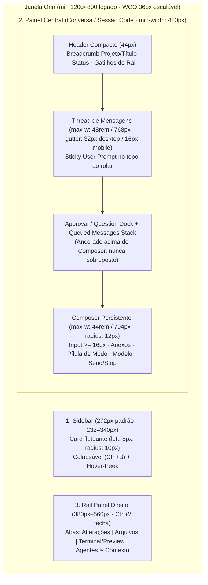

# 02 — Especificação Completa de Reformulação de UX/UI: Orin Chat & Orin Code

> **Status:** Especificação Canônica de Reformulação (v1.0)
> **Escopo:** Shell Desktop/Web (`desktop/electron/`, `frontend/src/app/`), Sistema de Design (`frontend/src/styles/`, `tailwind.config.ts`), Superfície **Orin Chat**, Superfície **Orin Code** e Contratos de Fluxo do Harness (`src/agentos/`).
> **Insumos Consolidados:**
> - [01 — Engenharia Reversa de UX/UI do Claude Desktop (v2.37337.1)](./01-claude-desktop-re-findings.md)
> - [03 — Auditoria Heurística do Orin Chat](./03-auditoria-orin-chat.md)
> - [04 — Auditoria Heurística do Orin Code](./04-auditoria-orin-code.md)
> - [05 — Diagnóstico Forense da Conversa `chat_e65477...` e Gap do Harness](./05-diagnostico-chat-e65477-e-gap-harness-code.md)
> - Contratos atuais do repositório: [`DESIGN.md`](../../DESIGN.md) e [`UX-CONTRACT.md`](../../UX-CONTRACT.md)

---

## 1. Visão e Princípios de Design

O Orin é um **workspace local-first de supervisão de agentes**. A pessoa usuária não está operando um emulador de terminal bruto nem preenchendo formulários de configuração: ela está **supervisionando um sistema inteligente com calma, clareza espacial e controle imediato**.

As auditorias (`03`, `04`, `05`) demonstraram que a experiência atual falha porque:
1. **Quebra do sistema de tokens:** 43 referências a variáveis CSS inexistentes (`--border-subtle`, `--surface-raised`, `--text-primary`, `--accent-primary`…) caem em `currentColor`, transformando a thread em uma parede de caixas com bordas brancas acesas (`rgba(245, 241, 255, 0.93)`) e fundos transparentes.
2. **Perda de controle durante a execução:** o botão **Stop** desaparece quando o turno entra em `state = "starting"`, o botão **Send** desabilitado permanece 100% opaco, o **Composer** desaparece ao rolar a página para cima (`data-at-bottom="false"`), e a `TodoBar` transparente sobrepõe botões de aprovação e mensagens de erro.
3. **Ruído de atividade e cegueira de diagnóstico:** diffs de 74–121 linhas abrem expandidos por padrão, `stdout`/`stderr` exibem `[REDACTED]`, chamadas de subagentes ficam despejadas no nível principal sem agrupamento `Task(...)`, e falhas repetidas não são agrupadas nem mostram a causa completa.
4. **Ausência de um workspace real de engenharia no Modo Code:** o Modo Code vive espremido em uma única coluna de chat sem painel lateral coexistente para **Alterações (Diffs)**, **Arquivos**, **Terminal/Preview** e **Topologia Multi-Agente**.

### 1.1 Os 7 Princípios Canônicos do Novo Orin

1. **Hierarquia por Espaço e Superfície, Não por Caixas:** no escuro, superfícies elevadas usam luz interna sutil (`inset 0 0 0 1px var(--orin-ring-color)`) em vez de bordas externas pesadas; a separação entre turnos (`32px`) é ~2,5× maior que o espaçamento entre itens do mesmo turno (`12px`).
2. **Controle Incondicional e Sempre Alcançável:** o **Composer** e o botão **Stop** (ou `Esc`) nunca desaparecem ao rolar a conversa ou ao abrir painéis laterais/Visão Geral. Enquanto houver qualquer turno em `queued | starting | running | streaming | cancelling`, o usuário pode interromper em `< 100ms` ou enviar uma mensagem para a **fila de redirecionamento (*steering queue*)**.
3. **Atividade Silenciosa por Padrão, Auditável sob Demanda:** sequências contínuas de ferramentas de leitura/busca/execução colapsam em uma única linha humana no passado (*"Explorou 4 arquivos, executou 2 comandos — 8s"*), e delegações a subagentes ficam aninhadas dentro de um bloco colapsável **`Task(@agente — objetivo)`**. Erros e pedidos de decisão são as únicas exceções que abrem automaticamente em destaque.
4. **Coexistência Conversa + Painel de Engenharia (`Rail Panel`):** no Modo Code (e ao abrir Artifacts no Chat), a conversa convive lado a lado com um painel direito de abas (**Alterações**, **Arquivos**, **Terminal/Preview**, **Agentes/Contexto**), sem jamais ocultar o Composer.
5. **Segurança e Reversibilidade Explícitas:** `Ask before edits` (`approval_required`) é o padrão real; `Shift+Tab` cicla apenas entre modos seguros (`Pedir permissão → Aceitar edições → Modo Plano`), nunca incluindo `Bypass`; toda ação destrutiva (`Reverter alterações`) exige confirmação listando o escopo exato (código + conversa vs. apenas código).
6. **Bitemático Real (Espaço Violeta Escuro + Papel Quente Claro):** preserva a identidade *Atmospheric Dark + Violet Signal* do Orin no tema escuro (com compensação óptica de peso tipográfico) e introduz um tema claro de alto conforto visual (tons papel/creme `#F9F8F6` + violeta profundo `#6D28D9`), respeitando `prefers-color-scheme` e escolha manual.
7. **Valorização dos Diferenciais Exclusivos do Orin:** paridade total de ergonomia com o Claude Desktop / Claude Code, mantendo em primeiro plano o que o Orin tem a mais: **Multi-Provider local/cloud**, **Gate nativo de verificação (`verify_project`/`verify_frontend`)**, **Preview/Browser integrado**, **Inspetor de Contexto em tempo real**, **Worktree em 1 clique** e **Topologia Multi-Agente Orbital**.

---

## 2. Arquitetura de Informação, Shell (`orin-frame`) e Navegação

### 2.1 Estrutura Espacial da Janela (3 Regiões Coexistentes)

Inspirado na arquitetura `dframe-*` + `epitaxy-*` levantada no documento `01`, o shell do Orin adota um layout de três zonas com **Sidebar em Card Flutuante** (variante Desktop) e **Painel Direito de Trilho (`Rail Panel`)** sob demanda:



### 2.2 Métricas Estruturais do Shell (`--of-*`)

| Token Estrutural | Valor Desktop (`>= 1024px`) | Valor Tablet (`768px–1023px`) | Valor Compacto (`< 768px`) | Comportamento |
|---|---|---|---|---|
| `--of-titlebar-h` | `36px * zoomFactor` (min `24px`) | `36px` | `36px` | Altura do Window Controls Overlay (Electron) / faixa de arraste. |
| `--of-header-h` | `44px` | `44px` | `44px` | Altura única do cabeçalho da conversa (**nunca quebra em múltiplas linhas**). |
| `--of-sidebar-w` | `272px` (redimensionável `232px–340px`) | Colapsada por padrão (`0px`, abre em drawer/peek `280px`) | Drawer modal (`280px`) com backdrop | Persistida em `localStorage` + `Ctrl+B` para alternar. |
| `--of-sidebar-inset` | `8px` | `8px` (no modo peek) | `0px` | Margem que destaca a sidebar como card flutuante. |
| `--of-transcript-max-w` | `48rem` (`768px`) | `48rem` (`768px`) | `100%` | Largura máxima da coluna de leitura das mensagens. |
| `--of-composer-max-w` | `46rem` (`736px`) | `46rem` (`736px`) | `100%` | Largura máxima do composer (ligeiramente mais contida ou alinhada à coluna). |
| `--of-chat-gutter` | `32px` | `20px` | `16px` | Padding lateral mínimo da thread e do composer. |
| `--of-turn-gap` | `32px` (`28px` no modo Code compacto) | `28px` | `24px` | Espaçamento vertical entre turnos completos (usuário → assistente). |
| `--of-item-gap` | `12px` | `12px` | `10px` | Espaçamento vertical entre blocos dentro do mesmo turno. |
| `--of-rail-w` | `440px` (redimensionável `360px–600px`) | Overlay lateral (`420px`) | Sheet em tela cheia (`100%`) | Painel direito de Alterações, Arquivos, Terminal/Preview e Agentes. |

> [!IMPORTANT]
> **Correção definitiva de `C01`, `C02`, `C03` e `OC-02`:**
> 1. O layout **não usa `padding-bottom: 168px` fixo** com rodapé flutuante sobreposto. A coluna central é um flex/grid container vertical (`height: 100dvh; display: grid; grid-template-rows: var(--of-header-h) minmax(0, 1fr) auto;`), onde a thread ocupa a linha `1fr` (`overflow-y: auto`) e o conjunto `Dock + TodoBar + Composer` ocupa a linha `auto` no fluxo normal do layout! Assim, é **fisicamente impossível** a `TodoBar` ou o `Composer` cobrirem botões de permissão, mensagens de erro ou o final da resposta.
> 2. A regra `.chat__foot > * { opacity: 0; pointer-events: none }` quando `data-at-bottom="false"` (`agentos.css:741-748`) **deve ser removida**. O Composer permanece 100% visível e interativo em qualquer posição de rolagem.
> 3. Abaixo de `1024px`, quando a sidebar colapsa automaticamente, o Header exibe obrigatoriamente o botão **Menu / Sidebar (`☰`, `aria-label="Abrir navegação"`, `Ctrl+B`)** e o botão **Nova conversa (`+`)**.

### 2.3 Arquitetura da Sidebar (`WorkspaceNavigation.tsx`)

1. **Topo da Sidebar (Fixo):**
   - Marca compacta **Orin** + botão de recolher sidebar (`Ctrl+B`).
   - Botão primário único **Nova sessão** (`Ctrl+N`) com ação secundária acoplada para **Nova sessão Code** (`Ctrl+Shift+N`) — eliminando a duplicação atual de dois botões *"Nova conversa"* na mesma tela (`C23`).
   - Campo/gatilho de **Busca rápida e Comandos** (`Ctrl+K`).
2. **Navegação de Superfícies (Compacta, altura de linha `30px` confortável / `26px` compacta):**
   - `Chats` · `Code` · `Projetos` · `Agendamentos` · `Memória` · `Skills & Conectores (MCP)`.
3. **Listas de Sessões (Rolável):**
   - **Fixados (`Fixados`)**: conversas e sessões de código marcadas com estrela/pin.
   - **Em execução agora** (se houver): sessões com turno ativo mostram indicador pulsante ao vivo.
   - **Recentes (`Recentes`)**: agrupadas por data (*Hoje*, *Ontem*, *Últimos 7 dias*) ou por Projeto, exibindo ícone de superfície (`💬` Chat vs `>_` Code), título com `title` tooltip completo e tempo relativo curto (`2m`, `1h`), evitando itens duplicados indistinguíveis (`V-12`).
4. **Rodapé da Sidebar (Fixo):**
   - Perfil do usuário / instância local + botão **Configurações** (`Ctrl+,`, sempre em português, corrigindo `C26`) + alternador rápido de tema (`Claro / Escuro / Sistema`).
   - *(A gaveta crua de arquivos que antes aparecia espremida no rodapé da sidebar — `OC-05` — sai da sidebar esquerda e passa a ser a aba **Arquivos** do `Rail Panel` direito).*

### 2.4 Header Compacto da Sessão (`44px`, Linha Única)

Para eliminar a quebra vertical palavra por palavra em `768px` (`C01`) e a repetição de metadados entre o Header e o Composer (`C25`, `V-11`):
- **Lado Esquerdo (`min-width: 0; flex: 1`):**
  - Botão de abrir/fechar sidebar (visível quando a sidebar está colapsada ou em telas `< 1024px`).
  - Breadcrumb truncável com `text-overflow: ellipsis; white-space: nowrap` e `title` completo: `[Projeto / Pasta] / Título da Conversa` (com clique para renomear inline).
  - Badge discreto de modo quando em sessão de código (`Code` + branch/worktree git ativo, se houver).
- **Lado Direito (`flex-shrink: 0; display: flex; gap: 6px`):**
  - **Chip de Contexto Clicável (`Contexto 14%`):** usa cor legível (`--orin-text-secondary`, contraste `>= 4.5:1`), muda para âmbar acima de `75%` e abre um popover com o detalhamento completo de tokens (`system`, `histórico`, `ferramentas`, `skills`, `MCP`) e botão **`Compactar agora (/compact)`** (`OC-27`).
  - **Gatilhos do Rail Panel Direito (com badges de contagem):**
    - `Alterações (3)` (`Ctrl+Shift+D`) — mostra `+42 -18` colorido quando há arquivos modificados no turno/sessão.
    - `Arquivos` (`Ctrl+Shift+F`) — árvore do workspace.
    - `Terminal / Preview` (`` Ctrl+` ``) — saída de processos em background e preview web integrado.
    - `Agentes` (`Ctrl+Shift+A`) — abre a **Visão Geral Orbital** como aba do painel direito (ou split view), **sem desmontar a conversa nem esconder o Composer/Stop** (`OC-14`).

---

## 3. Sistema de Design Orin v2: Tokens Semânticos (Escuro & Claro)

### 3.1 Correção dos 43 Tokens Órfãos + Arquitetura Bitemática (`theme.css`)

O Orin v2 adota a mesma disciplina arquitetural do CDS (`01-claude-desktop-re-findings.md` §5):
- **Primitivos de superfície e escala alfa (`--orin-alpha-1..6`)** que se invertem automaticamente entre o tema escuro e o tema claro.
- **Mapeamento 100% compatível** tanto para os nomes `--orin-*` quanto para os nomes semânticos padrão (`--surface-*`, `--text-*`, `--border-*`, `--accent-*`), eliminando imediatamente as **43 referências quebradas** em `CodeToolCallBlock.tsx`, `PlanApprovalCard.tsx`, `TodoBar.tsx` e `FileMentionPicker.tsx` (`C05`, `OC-06`, `V-04`).

```css
/* frontend/src/styles/theme.css — Especificação Canônica Orin v2 */
:root,
[data-theme="dark"] {
  color-scheme: dark;
  --orin-rem-scale: calc(16 / 17); /* ~0.9412 para densidade desktop precisa */

  /* 1. Superfícies (Atmospheric Space Dark) */
  --orin-page-bg: #070611;
  --orin-surface-0: #070611;
  --orin-surface-1: #0b0a14;          /* Superfície base da conversa */
  --orin-surface-2: #12101f;          /* Sidebar, Rail Panel, Cards (OPACO!) */
  --orin-surface-3: #181528;          /* Composer, Popovers, Modais, TodoBar (OPACO!) */
  --orin-surface-translucent: rgba(245, 241, 255, 0.045);
  --orin-surface-translucent-strong: rgba(245, 241, 255, 0.08);
  --orin-surface-hover: rgba(245, 241, 255, 0.065);
  --orin-surface-selected: rgba(166, 108, 255, 0.14);

  /* 2. Escala Alfa e Bordas (Hairline & Inner Ring no Escuro) */
  --orin-alpha-1: rgba(245, 241, 255, 0.05);
  --orin-alpha-2: rgba(245, 241, 255, 0.10);
  --orin-alpha-3: rgba(245, 241, 255, 0.18);
  --orin-alpha-4: rgba(245, 241, 255, 0.32);
  --orin-border: var(--orin-alpha-2);          /* 10% — borda padrão sutil */
  --orin-border-subtle: rgba(245, 241, 255, 0.08);
  --orin-border-strong: var(--orin-alpha-3);   /* 18% — hover/focus de card */
  --orin-ring-outer: 0px;
  --orin-ring-inner: 1px;                      /* Anel interno sutil no escuro */
  --orin-ring-color: var(--orin-alpha-2);

  /* 3. Texto (Todos com contraste WCAG AA verificado sobre #0b0a14 e #12101f) */
  --orin-text-primary: #f5f1ff;                /* Contraste 17.7:1 */
  --orin-text-secondary: rgba(245, 241, 255, 0.72); /* Contraste 9.6:1 */
  --orin-text-muted: rgba(245, 241, 255, 0.56);     /* Contraste 5.9:1 (substitui .34!) */
  --orin-text-disabled: rgba(245, 241, 255, 0.36);  /* Exclusivo para estados disabled */
  --orin-mono-readable: rgba(245, 241, 255, 0.82);

  /* 4. Acento (Violet Signal) */
  --orin-accent: #a66cff;                      /* Contraste 5.4:1 sobre #0b0a14 */
  --orin-accent-strong: #8b5cf6;
  --orin-accent-soft: #dfd0ff;                 /* Para inline code e badges (12.8:1) */
  --orin-accent-bg: rgba(166, 108, 255, 0.14);
  --orin-focus-ring: inset 0 0 0 1px var(--orin-page-bg), 0 0 0 2px var(--orin-accent), 0 0 8px 1px rgba(166, 108, 255, 0.45);

  /* 5. Semânticos e Diffs (Git) */
  --orin-success: #7ee2a8;
  --orin-success-bg: rgba(126, 226, 168, 0.14);
  --orin-success-border: rgba(126, 226, 168, 0.35);
  --orin-warn: #f5c97b;
  --orin-warn-bg: rgba(245, 201, 123, 0.14);
  --orin-warn-border: rgba(245, 201, 123, 0.35);
  --orin-danger: #ff9d91;
  --orin-danger-bg: rgba(255, 157, 145, 0.14);
  --orin-danger-border: rgba(255, 157, 145, 0.38);
  --orin-info: #9ac7ff;
  --orin-info-bg: rgba(154, 199, 255, 0.14);

  --orin-diff-add-text: #86efac;
  --orin-diff-add-bg: rgba(34, 197, 94, 0.14);
  --orin-diff-add-line-bg: rgba(34, 197, 94, 0.22);
  --orin-diff-del-text: #fda4af;
  --orin-diff-del-bg: rgba(244, 63, 94, 0.14);
  --orin-diff-del-line-bg: rgba(244, 63, 94, 0.22);

  /* 6. Compensação Óptica de Peso Tipográfico no Escuro */
  --orin-font-weight-regular: 370;
  --orin-font-weight-medium: 470;
  --orin-font-weight-semibold: 560;
}

/* Tema Claro (Warm Paper & Deep Violet) — Ativado por data-theme="light" ou prefers-color-scheme: light quando data-theme="system" */
[data-theme="light"] {
  color-scheme: light;

  --orin-page-bg: #f6f5f2;
  --orin-surface-0: #f6f5f2;
  --orin-surface-1: #fbfaf8;
  --orin-surface-2: #ffffff;
  --orin-surface-3: #ffffff;
  --orin-surface-translucent: rgba(20, 18, 28, 0.035);
  --orin-surface-translucent-strong: rgba(20, 18, 28, 0.065);
  --orin-surface-hover: rgba(20, 18, 28, 0.05);
  --orin-surface-selected: rgba(109, 40, 217, 0.10);

  --orin-alpha-1: rgba(20, 18, 28, 0.05);
  --orin-alpha-2: rgba(20, 18, 28, 0.10);
  --orin-alpha-3: rgba(20, 18, 28, 0.18);
  --orin-alpha-4: rgba(20, 18, 28, 0.35);
  --orin-border: var(--orin-alpha-2);
  --orin-border-subtle: rgba(20, 18, 28, 0.08);
  --orin-border-strong: var(--orin-alpha-3);
  --orin-ring-outer: 1px;
  --orin-ring-inner: 0px;
  --orin-ring-color: var(--orin-alpha-2);

  --orin-text-primary: #14121c;                /* Contraste 16.9:1 */
  --orin-text-secondary: #4a4656;              /* Contraste 8.4:1 */
  --orin-text-muted: #6e6a7c;                  /* Contraste 4.9:1 */
  --orin-text-disabled: rgba(20, 18, 28, 0.38);
  --orin-mono-readable: #2d2938;

  --orin-accent: #6d28d9;                      /* Contraste 7.2:1 sobre #fbfaf8 */
  --orin-accent-strong: #5b21b6;
  --orin-accent-soft: #4c1d95;                 /* Contraste 10.4:1 para inline code */
  --orin-accent-bg: rgba(109, 40, 217, 0.09);
  --orin-focus-ring: inset 0 0 0 1px var(--orin-page-bg), 0 0 0 2px var(--orin-accent), 0 0 6px 1px rgba(109, 40, 217, 0.30);

  --orin-success: #15803d;
  --orin-success-bg: rgba(21, 128, 61, 0.10);
  --orin-success-border: rgba(21, 128, 61, 0.30);
  --orin-warn: #b45309;
  --orin-warn-bg: rgba(180, 83, 9, 0.10);
  --orin-warn-border: rgba(180, 83, 9, 0.30);
  --orin-danger: #be123c;
  --orin-danger-bg: rgba(190, 18, 60, 0.09);
  --orin-danger-border: rgba(190, 18, 60, 0.30);
  --orin-info: #1d4ed8;
  --orin-info-bg: rgba(29, 78, 216, 0.09);

  --orin-diff-add-text: #166534;
  --orin-diff-add-bg: rgba(22, 163, 74, 0.10);
  --orin-diff-add-line-bg: rgba(22, 163, 74, 0.18);
  --orin-diff-del-text: #9f1239;
  --orin-diff-del-bg: rgba(225, 29, 72, 0.10);
  --orin-diff-del-line-bg: rgba(225, 29, 72, 0.18);

  --orin-font-weight-regular: 400;
  --orin-font-weight-medium: 500;
  --orin-font-weight-semibold: 600;
}

/* Aliases Semânticos Unificados (Garante zero tokens órfãos em todos os componentes) */
:root,
[data-theme="dark"],
[data-theme="light"] {
  --orin-ink: var(--orin-page-bg);
  --orin-surface: var(--orin-surface-1);
  --orin-surface-raised: var(--orin-surface-2);
  --orin-surface-raised-strong: var(--orin-surface-3);
  --orin-line: var(--orin-border);
  --orin-line-strong: var(--orin-border-strong);
  --orin-text: var(--orin-text-primary);
  --orin-muted: var(--orin-text-secondary);
  --orin-faint: var(--orin-text-muted);

  /* Aliases usados por CodeToolCallBlock, PlanApprovalCard, TodoBar, FileMentionPicker */
  --surface-raised: var(--orin-surface-2);
  --surface-hover: var(--orin-surface-hover);
  --border-subtle: var(--orin-border-subtle);
  --text-primary: var(--orin-text-primary);
  --text-secondary: var(--orin-text-secondary);
  --text-muted: var(--orin-text-muted);
  --accent-primary: var(--orin-accent);
}
```

### 3.2 Escala Tipográfica e Regras de Markdown

| Papel | Token | Tamanho | Line-Height | Família | Uso |
|---|---|---|---|---|---|
| **Caption / Badge** | `--orin-font-caption` | `11px` (`.6875rem`) | `16px` (`1.45`) | `--font-sans` (ou `--font-mono` apenas para contadores/hashes) | Badges de status, contadores de linhas `+12 -4`, atalhos `Ctrl+K`. |
| **Code / Diff / Terminal** | `--orin-font-code` | `12.5px` (`.78125rem`) | `18px` (`1.44`) | `--font-mono` | Blocos de código, linhas de diff, saída de terminal, paths de arquivos. |
| **UI Body** | `--orin-font-body` | `13.5px` (`.84375rem`) | `19px` (`1.40`) | `--font-sans` | Itens da sidebar, botões, títulos de atividades de ferramentas, menus. |
| **Prose (Mensagens)** | `--orin-font-prose` | `15px` (`.9375rem`) | `24px` (`1.60`) | `--font-sans` | Corpo de leitura das respostas do assistente e mensagens do usuário. |
| **Composer Input** | `--orin-font-entry` | `max(16px, 0.9375rem)` | `22px` (`1.375`) | `--font-sans` | Piso estrito de `16px` no `<textarea>` do composer (`--cds-font-size-text-entry-floor`). |
| **Section Heading** | `--orin-font-heading` | `16px` (`1rem`) | `22px` (`1.375`) | `--font-sans` (`600`) | Cabeçalhos `h2`/`h3` dentro de respostas e títulos de modais/painéis. |
| **Page / Hero Title** | `--orin-font-title` | `22px` (`1.375rem`) | `28px` (`1.27`) | `--font-sans` (`600`) | Saudação inicial da Home e títulos de páginas de configuração. |

**Regras obrigatórias para `.markdown-message` (corrigindo `C06`, `C10`, `C11`):**
- **Listas (`ul`, `ol`):** restaurar explicitamente `ul { list-style-type: disc; padding-inline-start: 1.5rem; }` e `ol { list-style-type: decimal; padding-inline-start: 1.5rem; }` com `li::marker { color: var(--orin-text-muted); }` e `li + li { margin-top: 0.25rem; }`.
- **Inline code (`:not(pre) > code`):** `color: var(--orin-accent-soft); background: var(--orin-accent-bg); border: 1px solid rgba(166, 108, 255, 0.22); border-radius: 5px; padding: 0.12rem 0.38rem; font-size: 0.86em;` (contraste `12.8:1` no escuro e `10.4:1` no claro, substituindo o contraste ilegível de `2.0:1` reportado em `C06`).
- **Blocos de código (`pre > code`):** cabeçalho fixo de `32px` com **nome da linguagem** à esquerda e botão **`Copiar` (`Copied!` com check por `1.5s`)** à direita, mais syntax highlighting via Web Worker (`highlight.js` / `shiki`) sem bloquear a thread principal.

---

## 4. Inventário de Componentes e Contratos de Estado (Chat & Code)

### 4.1 Composer Unificado (`Composer.tsx`)

O Composer é um card elevado (`background: var(--orin-surface-3)`, `border-radius: 12px`, anel interno de `1px var(--orin-ring-color)` no escuro e sombra suave) com altura contida (máximo `116px` quando vazio, em vez dos `309px` atuais medidos em `OC-12`):

1. **Faixa Superior Condicional (`TodoBar` Compacta, somente quando há tarefas no turno ativo):**
   - Renderizada como uma barra colapsável de **1 linha (`32px`)** acoplada ao topo do Composer (`background: var(--orin-surface-2)`, **100% opaca**, borda inferior `1px solid var(--orin-border-subtle)`):
     - Mostra: `☑ 2/4 tarefas · Criando componente Hero… [▾]`.
     - Clicar expande a lista completa em popover/acordeão com `max-height: 180px; overflow-y: auto`.
     - **Regra de integridade (`OC-11`, `C03`):** se o turno terminar com falha ou cancelamento, as tarefas pendentes **nunca** são marcadas automaticamente como concluídas; permanecem como `pendente` / `interrompida`.
2. **Área de Entrada (`<textarea>`):**
   - `font-size: 16px`, auto-resize de `1` a `8` linhas (`max-height: 200px`), placeholder com contraste `>= 4.5:1` (`--orin-text-muted`).
   - Suporte a `@menção` de arquivos (usando `query` param correto em `listWorkspaceFiles` — correção de 1 linha de `OC-05`) e `/` para comandos built-in + skills + plugins.
3. **Barra Inferior de Controles do Composer (`height: 36px`, sem duplicar o Header):**
   - **Esquerda:**
     - Botão `+` (`Anexar arquivos`, `Ctrl+U`).
     - Seletor compacto de **Superfície / Modo**:
       - No Chat: toggle discreto `>_ Code` + seletor de Modelo (`ModelPicker`).
       - No Code: **Pílula de Modo de Permissão** traduzida e sem truncamento (`🔒 Pedir permissão` | `⏵⏵ Aceitar edições` | `⏸ Modo Plano`, com tooltip `"Alternar modo (Shift+Tab no campo de texto)"`), botão de **Pasta / Worktree** real (conectado ao backend também na Home) e `ModelPicker` compacto.
   - **Direita (Slot de Ação Primária + Stop Incondicional):**
     - **Quando `running === false`:** botão **Enviar (`↑`)**. Se `disabled` (texto vazio e sem anexos), renderiza obrigatoriamente com `opacity: 0.32` no próprio `animate` do Framer Motion (`animate={{ scale: 1, opacity: isSendDisabled ? 0.32 : 1, rotate: 0 }}`), corrigindo `V-01`.
     - **Quando `running === true` (`queued | starting | running | streaming | cancelling`):**
       - Se o `<textarea>` estiver vazio: exibe o botão **Parar (`■`, `aria-label="Parar execução (Esc)"`)** em destaque (`background: var(--orin-danger-bg); color: var(--orin-danger); border: 1px solid var(--orin-danger-border)`).
       - Se o usuário digitar texto enquanto o agente roda: exibe **dois botões lado a lado**: o botão secundário **`Enfileirar (↵)`** (que adiciona a mensagem à *Steering Queue* do turno atual) e o botão **`Parar (■)`** sempre visível e clicável!

### 4.2 Máquina de Estados de Execução (`running`) e Fila de Mensagens (*Steering Queue*)

Para eliminar de vez o bug `T-01` / `OC-01` (onde o botão Stop sumia em `state = "starting"`):

```ts
// Regra canônica de derivação de execução ativa no Frontend (ChatPage.tsx)
const ACTIVE_TURN_STATES = new Set(['queued', 'starting', 'running', 'streaming', 'cancelling'])

const running =
  !stopping &&
  activeTurn !== null &&
  ACTIVE_TURN_STATES.has(activeTurn.state) &&
  !hasTerminalEventForActiveTurn &&
  !isActivityTerminal
```

- **No Backend (`src/agentos/conversations/chat.py` e `runtime.py`):**
  - Assim que `AgenticTurnRuntime` inicia a primeira chamada ao modelo/ferramenta, transiciona `conversation_turns.state` de `"starting"` para `"running"` e emite `turn.running`.
  - `request_cancel` sinaliza um `threading.Event` / `asyncio.Event` de cancelamento por `turn_id` que fecha imediatamente o `httpx` stream em voo (tanto do agente principal quanto de qualquer subagente ativo), reduzindo a latência de parada de `~6.7s` para `< 200ms`.
- **Fila de Redirecionamento Intra-Turno (*Steering Queue*):**
  - Enviar uma mensagem enquanto `running === true` **não cria um Turno 2 órfão**. A mensagem entra em uma pilha visual logo acima do composer (`"1 mensagem na fila — será entregue após a ferramenta atual [Editar] [Enviar agora interrompendo] [×]"`).
  - Na fronteira imediatamente seguinte ao término da tool call em andamento, o `AgenticTurnRuntime` consome a mensagem enfileirada e a injeta no mesmo turno como instrução do usuário.

### 4.3 Linha de Atividade Agrupada (`ToolActivityGroup`) vs. Bloco Individual (`CodeToolCallBlock`)

Cumprindo o contrato `UX-CONTRACT.md` ("Activity in chat") e o padrão do Claude Desktop (`01` §10.1):

1. **Agrupamento Automático de Leituras, Buscas e Comandos Sucessivos (`turnTimelineFold.ts`):**
   - Chamadas consecutivas de `read_file`, `glob_files`, `list_files`, `search_files` e `run_command` bem-sucedidas colapsam em **uma única linha silenciosa sem borda de caixa**:
     - **Enquanto roda:** `● Lendo contentflow-lp/src/index.css… · 14s · 3 ferramentas ▸`
     - **Após concluir:** `✓ Explorou 3 arquivos, executou 2 comandos · 18s ▸` (clicar expande a lista compacta de cada chamada).
2. **Aninhamento Hierárquico de Subagentes (`Task` Card — corrigindo `V-08` e `T-09`):**
   - Toda invocação de `run_subagent` renderiza um container colapsável de 1º nível:
     - Cabeçalho: `◈ Task(@general) — Criar documento de produto digital · 4 ações · 10.4s [▾]`
     - Todos os eventos com `agentId === subagentId` ficam **aninhados dentro desse container**, nunca soltos na timeline principal.
   - Se um subagente (ou o agente principal) falhar na mesma ferramenta `>= 2` vezes seguidas, a timeline agrupa as falhas repetidas em uma linha de alerta: `⚠ Write falhou 8 vezes seguidas (argumento 'path' ausente por limite de 4.096 tokens) [Ver detalhes]`.
3. **Regras de Renderização do `CodeToolCallBlock` (quando expandido ou em edições de arquivo):**
   - **Borda e superfície:** `border: 1px solid var(--orin-border-subtle); background: var(--orin-surface-2); border-radius: 8px;` (zero bordas brancas).
   - **Diffs de `Write` / `Edit` (`V-05`, `OC-10`):**
     - Mostra até **`10` linhas de prévia** por padrão quando o arquivo faz parte do resumo de edição recente, com barra inferior **`Mostrar todas as 74 linhas (+74 -0) · Abrir no painel de Alterações`**.
     - Se um turno tiver mais de `3` edições de arquivo, apenas a última fica com prévia de 10 linhas aberta; as anteriores iniciam recolhidas (`+12 -4 linhas`).
     - Arquivos `.md` e `.txt` usam `whitespace-pre-wrap break-words` para nunca causar overflow horizontal.
   - **Saída de Terminal (`Bash` — corrigindo `V-03`, `V-06`):**
     - Ignora qualquer valor literal `"[REDACTED]"` vindo de registros antigos, fazendo fallback imediato para `outputTail`.
     - Nunca exibe badge verde `exit 0` se `visualStatus === 'failed'` (exibe badge vermelho `cancelado` ou `recusado`).
     - Sempre preserva o comando tentado no cabeçalho (`$ cd contentflow-lp && ...`) e exibe a mensagem de erro completa em bloco expansível logo abaixo.

### 4.4 Dock de Aprovação de Permissões e de Plano (`ToolPermissionCard` & `PlanApprovalCard`)

Corrigindo `C14`, `OC-02`, `OC-03` e `OC-04`:
1. **Estado Resolvido Imutável (`Receipt State`):**
   - Assim que o usuário clica em *Permitir*, *Negar* ou *Aprovar plano* — ou assim que o turno entra em estado terminal (`completed | failed | cancelled`) — o card **desabilita imediatamente todos os botões** e se transforma em um recibo compacto de 1 linha:
     - `✓ Plano aprovado por você (Aceitar edições) · 16:31`
     - `✓ Permissão concedida para Bash(npm test) · nesta sessão`
2. **Atalhos de Teclado Diretos e Escopo Claro:**
   - Enquanto houver uma aprovação pendente no turno ativo, o card fica ancorado no `Dock` (acima do composer, nunca coberto pela `TodoBar`) e aceita teclas rápidas quando o composer não está com texto em digitação:
     - `[1]` **Permitir uma vez** (*apenas esta chamada*)
     - `[2]` **Permitir na sessão** (*para este comando/diretório*)
     - `[3]` ou `[Esc]` **Negar e orientar** (*foca o composer para explicar o ajuste*)
3. **Ciclo Seguro de `Shift+Tab`:**
   - O listener de `Shift+Tab` é registrado **apenas no `<textarea>` do Composer** (nunca em `window`, devolvendo a navegação reversa `Shift+Tab` para a página — `OC-08`).
   - O ciclo percorre exclusivamente os 3 modos seguros da sessão atual:
     `ask_permissions` (*Pedir permissão*) → `accept_edits` (*Aceitar edições*) → `plan_mode` (*Modo Plano*).
   - `full_autonomy` (*Ignorar permissões / Bypass*) **nunca entra no ciclo `Shift+Tab`** e só pode ser ativado nas Configurações de Runtime com modal de confirmação explícito (`OC-04`).
   - Trocar o modo na pílula do Composer altera **apenas a conversa atual**, sem sobrescrever a preferência global do usuário.

### 4.5 Painel Direito de Engenharia (`Rail Panel` no Modo Code e Artifacts no Chat)

Quando o usuário está no Modo Code ou clica em um arquivo/diff/artifact, o `Rail Panel` direito (`width: 440px` padrão, redimensionável, fechável com `Ctrl+\`) oferece 4 abas integradas:

1. **Aba `Alterações` (`Ctrl+Shift+D`):**
   - Lista todos os arquivos criados/modificados/removidos no turno e na sessão, com contadores `+linhas / -linhas`.
   - Permite visualizar o diff unificado ou lado a lado por arquivo, abrir o arquivo inteiro e acionar **`↺ Reverter alterações...`**, que abre um modal de confirmação listando os arquivos afetados e oferecendo:
     - *(1) Reverter arquivos e mensagens até este ponto*
     - *(2) Reverter apenas os arquivos no disco (manter conversa)*
2. **Aba `Arquivos` (`Ctrl+Shift+F`):**
   - Árvore navegável do workspace da sessão (`listWorkspaceFiles` corrigido com `query` param), busca rápida por nome, indicador de arquivos lidos/modificados pelo agente e botão `"Anexar ao contexto (@)"`.
3. **Aba `Terminal & Preview` (`` Ctrl+` `` / `Ctrl+Shift+P`):**
   - Mostra os processos em background (`preview_start`, servidores Vite/Next, testes) com saída ao vivo não-redacted, botão **"Enviar comando atual para background (`Ctrl+B`)"**, botão de parar processo e iframe de **Preview Web** quando uma `detectedUrl` local estiver ativa.
4. **Aba `Agentes & Contexto` (`Ctrl+Shift+A`):**
   - Incorpora a **Cena Orbital Multi-Agente (`OverviewPanel`)** e o **Inspetor de Janela de Contexto** lado a lado com a conversa, permitindo acompanhar o agente principal e os subagentes trabalhando em tempo real **sem sair da thread e sem esconder o Composer/Stop**.

---

## 5. Mapa Canônico de Atalhos de Teclado

Todos os atalhos adaptam automaticamente o glifo exibido (`Ctrl` no Windows/Linux vs `⌘` no macOS, corrigindo `C26`):

| Atalho (Win/Linux) | Atalho (macOS) | Escopo | Ação |
|---|---|---|---|
| `Ctrl+K` | `⌘K` | Global | Abrir Command Palette (busca de conversas, comandos `/`, troca de rota). |
| `Ctrl+N` | `⌘N` | Global | Nova conversa (Chat). |
| `Ctrl+Shift+N` | `⌘⇧N` | Global | Nova sessão no Modo Code. |
| `Ctrl+B` | `⌘B` | Global (`skipInEditable`) | Mostrar / recolher a Sidebar esquerda. |
| `Ctrl+\` | `⌘\` | Global | Fechar / reabrir o Rail Panel direito. |
| `Ctrl+Shift+D` | `⌘⇧D` | Sessão Code | Abrir aba **Alterações (Diffs)** no Rail Panel. |
| `Ctrl+Shift+F` | `⌘⇧F` | Sessão Code | Abrir aba **Arquivos** no Rail Panel. |
| `` Ctrl+` `` | `` ⌘` `` | Sessão Code | Abrir aba **Terminal & Preview** no Rail Panel. |
| `Ctrl+Shift+A` | `⌘⇧A` | Sessão | Abrir aba **Agentes & Contexto (Visão Orbital)** no Rail Panel. |
| `Ctrl+,` | `⌘,` | Global | Abrir Configurações. |
| `Ctrl+/` | `⌘/` | Global | Abrir modal de referência de atalhos de teclado. |
| `Enter` | `Enter` | Composer | Enviar mensagem (ou adicionar à *Steering Queue* se o turno estiver rodando). |
| `Shift+Enter` | `Shift+Enter` | Composer | Inserir quebra de linha. |
| `Shift+Tab` | `⇧Tab` | **Somente `<textarea>` do Composer** | Ciclar modo da sessão (`Pedir permissão → Aceitar edições → Modo Plano`). |
| `Esc` | `Esc` | Global na Sessão | **Se `running === true`:** interromper a execução imediatamente (`stop()`). **Se modal/drawer aberto:** fechar modal. |
| `Esc Esc` (duplo) | `Esc Esc` | Sessão | No Chat: editar última mensagem enviada; no Code: abrir modal de Rewind/Checkpoint. |

---

## 6. Matriz de Delta: Orin Atual vs. Orin Reformulado (v2)

| Dimensão | Estado Atual Auditado (`03`, `04`, `05`) | Estado Especificado no Orin v2 | Referência de Origem |
|---|---|---|---|
| **Tokens CSS (`theme.css`)** | 25 variáveis `--orin-*`, apenas tema escuro; **43 usos de variáveis inexistentes** (`--border-subtle` etc.) gerando bordas brancas `rgba(245,241,255,.93)` e fundos transparentes. | Sistema bitemático completo (Espaço Violeta Escuro + Papel Quente Claro) com superfícies opacas (`--orin-surface-2/3`), anel interno no escuro e 100% dos aliases mapeados. | `C04`, `C05`, `OC-06`, `V-04`, `01` §5 |
| **Layout do Composer e Thread** | Thread com `padding-bottom: 168px` fixo; Composer flutuante que **some ao rolar para cima** (`opacity: 0; pointer-events: none`) e `TodoBar` transparente de `309px` que cobre botões de permissão e erros. | Grid vertical sem sobreposição (`1fr` thread + `auto` dock/composer); Composer sempre visível; `TodoBar` opaca de 1 linha (`32px`) expansível em popover. | `C02`, `C03`, `OC-02`, `V-02`, `01` §4.3 |
| **Botão Stop e Estado `running`** | Backend deixa turno em `"starting"`; frontend só checa `'running' \| 'queued'`; Stop some após `375ms`; Send desabilitado fica com `opacity: 1` inline; sem atalho `Esc`. | `ACTIVE_TURN_STATES` inclui `'starting'` e `'streaming'`; backend emite `turn.running`; Stop sempre visível + `Esc` global que aborta o stream HTTP em `< 200ms`; Send desabilitado com `opacity: 0.32`. | `T-01`, `T-06`, `OC-01`, `V-01` |
| **Envio durante Execução** | Bloqueado quando `running=true` (ou cria Turno 2 separado por acidente quando `running=false`, que é destruído ao cancelar). | **Steering Queue intra-turno:** usuário pode digitar e enfileirar instruções que são injetadas na próxima fronteira de ferramenta do mesmo turno. | `T-01`, `01` §10.2, `05` §5.1 |
| **Ciclo de Permissões (`Shift+Tab`)** | Listener global em `window` (quebra foco reverso WCAG); inclui `full_autonomy` (bypass) a 1 tecla de distância; sobrescreve preferência global; default `"accept edits"` contra o contrato. | Listener restrito ao `<textarea>`; ciclo seguro de 3 estados (`Pedir permissão → Aceitar edições → Modo Plano`) sem bypass; escopo por sessão; default sincronizado com o servidor (`approval_required`). | `OC-04`, `OC-07`, `OC-08`, `01` §10.2 |
| **Cards de Permissão e Plano** | Permanecem com botões ativos para sempre mesmo em turnos já concluídos ou cancelados. | Transicionam imediatamente para **Estado de Recibo (`Receipt State`)** imutável após decisão ou término do turno; suportam teclas rápidas `1`, `2`, `3`/`Esc`. | `C14`, `OC-03`, `01` §10.2 |
| **Visualização de Ferramentas e Subagentes** | 1 card com borda branca por chamada; subagentes despejados no nível principal (`run_subagent`); 11 falhas repetidas empilhadas; diffs de 74–121 linhas abertos por padrão; `[REDACTED]` no Bash. | Leituras/buscas agrupadas em 1 linha silenciosa; subagentes aninhados em card **`Task(@agente)`**; falhas repetidas agrupadas com erro completo; diffs limitados a 10 linhas de prévia; `stdout`/`stderr` reais visíveis. | `C13`, `OC-10`, `V-03` a `V-09`, `01` §10.1 |
| **Workspace do Modo Code** | Apenas a coluna do chat; gaveta de arquivos quebrada (`?query` no path de `safeUrl`) e sem CSS no rodapé da sidebar; abrir "Visão Geral" esconde o Composer e o Stop. | **Rail Panel Direito coexistente** com 4 abas (`Alterações`, `Arquivos`, `Terminal/Preview`, `Agentes & Contexto`), mantendo a conversa e o Composer sempre visíveis. | `OC-05`, `OC-09`, `OC-14`, `01` §10.2 |
| **Confiabilidade do Harness (Backend)** | `SUBAGENT_MAX_OUTPUT_TOKENS = 4096` trunca `write_file` antes de `path`; `done_reason="length"` mascarado; `self._current_cwd` muda sem avisar o modelo; cache `read_file` compartilhado bloqueia subagente. | `SUBAGENT_MAX_OUTPUT_TOKENS = 16384`; detecção explícita de truncamento (`TOOL_CALL_TRUNCATED`); `path` antes de `content` no schema; `[cwd: ...]` explícito no retorno de `run_command`; cache de leitura isolado por agente. | `T-02`, `T-04`, `T-05`, `T-07`, `05` §3 |

---

## 7. Critérios de Aceite Verificáveis (Definition of Done)

Cada fase de implementação deverá passar pelos seguintes testes automatizados (Vitest + Playwright E2E/Visual + Pytest):

1. **Zero Tokens CSS Indefinidos:**
   - Em `browser_evaluate`, `getComputedStyle(document.documentElement)` deve retornar valores válidos não-vazios para todos os tokens `--orin-*` e aliases (`--border-subtle`, `--surface-raised`, `--text-primary`, `--text-secondary`, `--text-muted`, `--accent-primary`, `--surface-hover`) tanto em `[data-theme="dark"]` quanto em `[data-theme="light"]`.
   - Nenhum `[data-testid="code-tool-call-block"]` pode ter `borderTopColor === "rgba(245, 241, 255, 0.93)"` ou `backgroundColor === "rgba(0, 0, 0, 0)"`.
2. **Controle de Execução e Botão Stop (`P0`):**
   - Ao iniciar um turno (mesmo enquanto `turn.state === "starting"` antes do primeiro delta), `[aria-label^="Parar execução"]` deve estar visível (`opacity === "1"`, `pointerEvents === "auto"`) em `< 100ms`, permanecer visível ao rolar a conversa para o topo (`scrollTop = 0`) e interromper o turno ao pressionar `Escape` ou clicar no botão.
   - Quando `running === false` e o composer estiver vazio, o botão `Send` deve ter `disabled === true` e `getComputedStyle(btn).opacity <= 0.35`.
3. **Zero Sobreposição Geométrica no Fim da Thread (`P0`):**
   - Com `TodoBar` visível e um `ToolPermissionCard` ou botão de erro no final da thread, `elementFromPoint(x, y)` no centro de todos os botões de ação da última mensagem deve atingir o próprio `<button>`, nunca `[data-testid="todo-bar"]` ou `.chat__foot`.
4. **Responsividade e Navegação em `1440px`, `1024px` e `768px` (`P0`):**
   - Em `768×1024`, a altura computada do `.chat__head` deve ser `<= 52px` (linha única sem quebra vertical de palavras), `scrollWidth <= clientWidth` (zero overflow horizontal) e o botão de abrir a navegação lateral deve estar visível e acessível por teclado.
5. **Segurança de Permissões e Acessibilidade (`P0`/`P1`):**
   - Pressionar `Shift+Tab` fora do `<textarea>` do composer deve mover o foco normalmente para o elemento anterior da página.
   - Pressionar `Shift+Tab` 10 vezes dentro do `<textarea>` nunca deve selecionar `full_autonomy` (`bypass permissions`).
   - Auditoria `@axe-core/playwright` nas rotas Home, Chat (com markdown rico e código) e Sessão Code (com ferramentas e diffs) deve reportar **0 violações `serious` ou `critical`** de contraste (`color-contrast`) e de controles aninhados (`nested-interactive`) nos temas claro e escuro.
6. **Harness de Código e Subagentes (`P0`):**
   - `listWorkspaceFiles` deve responder `200 OK` ao abrir a aba `Arquivos` e ao digitar `@` no composer.
   - Comandos `run_command` concluídos devem exibir o `stdout`/`stderr` real no card (nunca a string literal `"[REDACTED]"`).
   - Subagentes devem conseguir escrever arquivos de `> 4.096` tokens sem truncamento de `path`, ler arquivos já lidos pelo agente pai sem bloqueio de deduplicação, e ter seus eventos agrupados dentro de um card `Task(...)` colapsável na UI.
