# 03 — Auditoria heurística do Orin Chat

> Escopo: superfície de conversa do Orin (Home → Chat/Code, thread, composer, atividade de ferramentas, sidebar, seletor de modelo, estados). Nenhum código-fonte foi alterado.
> Complementa (sem editar) a spec `02-spec-reformulacao-ux-ui.md`.

## 0. Resumo executivo

O Orin tem boas fundações de engenharia (reconexão SSE, pinagem de scroll, eco otimista, Stop no lugar do Send, `prefers-reduced-motion` respeitado, rótulos ARIA em botões só com ícone). O problema é que **a camada visual e de interação do chat não segue o próprio design system**, e isso aparece na tela como um "terminal com caixas brancas":

1. **Tokens inexistentes.** 43 usos de variáveis CSS que não existem em lugar nenhum (`--text-primary`, `--border-subtle`, `--surface-raised`, `--accent-primary`…). Por isso blocos de ferramenta, cards de plano, TodoBar e pílulas de arquivo ficam com **borda branca de 1px** (fallback `currentColor`) e fundo transparente.
2. **O composer some** quando a pessoa rola para cima (`opacity: 0` + `pointer-events: none`).
3. **Abaixo de 900px o app perde a navegação** (sidebar some e nada a substitui), e em 768px o header quebra palavra por palavra e ocupa cerca de 30% da altura.
4. **O markdown perde o significado**: listas sem marcador nem numeração (reset do Tailwind), inline code com contraste de 2,0:1, blocos de código sem botão de copiar, sem linguagem e sem highlight.
5. **A atividade do agente vira uma parede**: diffs abertos por padrão, chamadas repetidas com falha sem agrupamento, exceções Python cruas e 3–4 linhas redundantes de status no fim do turno. Isso contradiz o `UX-CONTRACT.md` ("uma linha de atividade expansível, texto discreto com chevron, não uma caixa").
6. **Ações perigosas ou velhas continuam clicáveis**: o card de aprovação do plano segue ativo depois que o turno terminou, e "Reverter alterações" não pede confirmação.
7. **Faltam recursos básicos de um chat de IA**: copiar mensagem, editar e reenviar, regenerar, feedback, timestamps, busca/renomear/excluir conversa na sidebar, tema claro.

**Placar por severidade:** 4 × P0 · 13 × P1 · 12 × P2 · 3 × P3 (32 achados numerados, mais as observações de performance da seção 4.10).

---

## 1. Método, ambiente e limitações

| Item | Detalhe |
|---|---|
| Instância | Orin em execução local em `http://127.0.0.1:49200` (perfil `development`, v0.7.0), servindo `frontend/dist` com build de 16:18:28, **posterior** à última alteração em `frontend/src` (16:18:03). Ou seja, o build reflete o código atual. |
| Navegador | MCP `playwright` (Chromium), em **contexto de navegador isolado**, porque a página padrão do MCP estava compartilhada com outro agente que tinha mocks de rota ativos. Navegação só de leitura: nenhuma mensagem foi enviada. |
| Dados | Conversas reais do banco local (5 conversas, todas em modo Code: concluída, com falha, cancelada). Para avaliar **markdown rico** e o estado **rodando** no modo Chat, usei uma conversa fictícia `audit-md` interceptada por `page.route` só no meu contexto. |
| Larguras | 1440 / 1024 / 768 px, altura 900, `reducedMotion: reduce` (para capturar estados estáveis). |
| Tema | **Não existe tema claro.** Emulei `prefers-color-scheme: light` e a tela fica idêntica ao escuro (ver C26). Por isso não há pares claro/escuro, só a evidência de que o claro não existe. |
| Medições | Contraste calculado no navegador (WCAG 2.x, cor com alfa composta sobre `#0b0a14`), sequência de foco por `Tab`, inventário de regiões ARIA, `document.fonts`. |
| Não coberto | Shell Electron (barra de título nativa e overlay), streaming token a token ao vivo, anexos de imagem e PDF, telas de Settings (fora do escopo do chat). |

### Definição de severidade

| Nível | Critério |
|---|---|
| **P0** | Bloqueia uma tarefa central, esconde informação crítica ou quebra o layout num cenário comum. |
| **P1** | Degrada muito o fluxo principal, a confiança ou a acessibilidade. Corrigir no próximo ciclo. |
| **P2** | Atrito moderado, inconsistência ou débito que se acumula. |
| **P3** | Polimento. |

---

## 2. Galeria de evidências

| Arquivo | O que mostra |
|---|---|
| 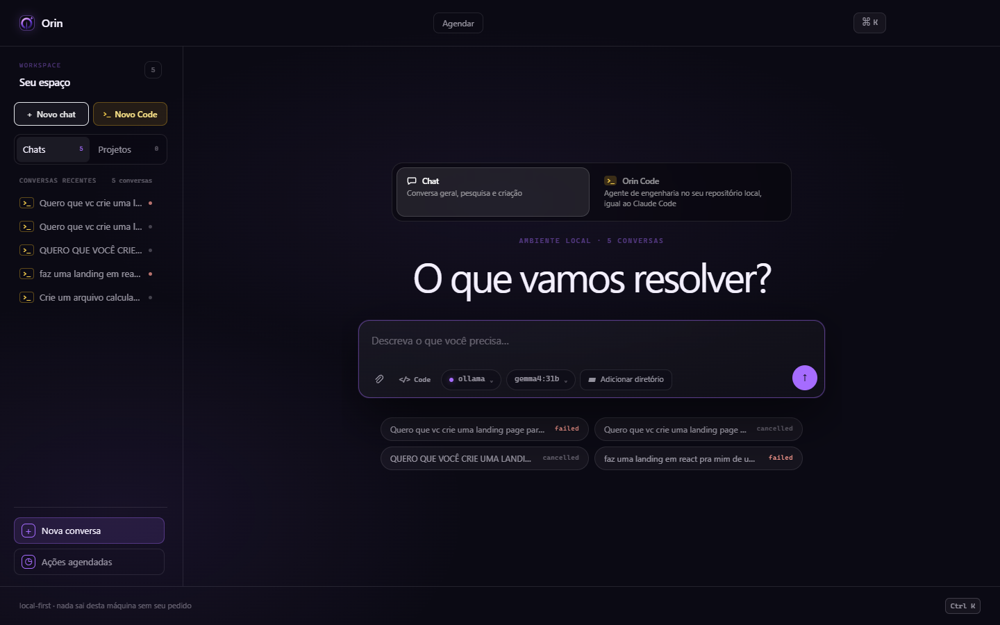 | Home 1440: seletor de modo duplicado, 3 CTAs de "novo", estados crus em inglês (`failed`, `cancelled`). |
| 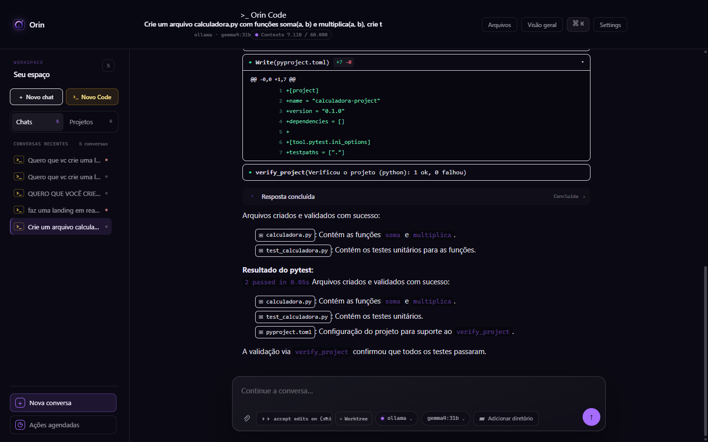 | Conversa Code concluída: blocos com borda branca, inline code ilegível, resposta duplicada, header com 3 linhas. |
| 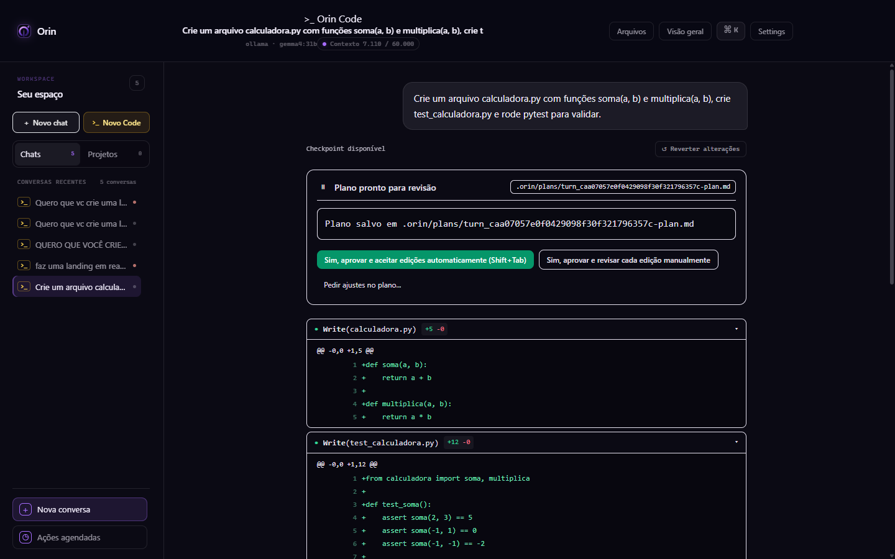 | Rolado para o topo: **composer invisível**, card de plano velho com botões ativos, "Reverter alterações". |
| 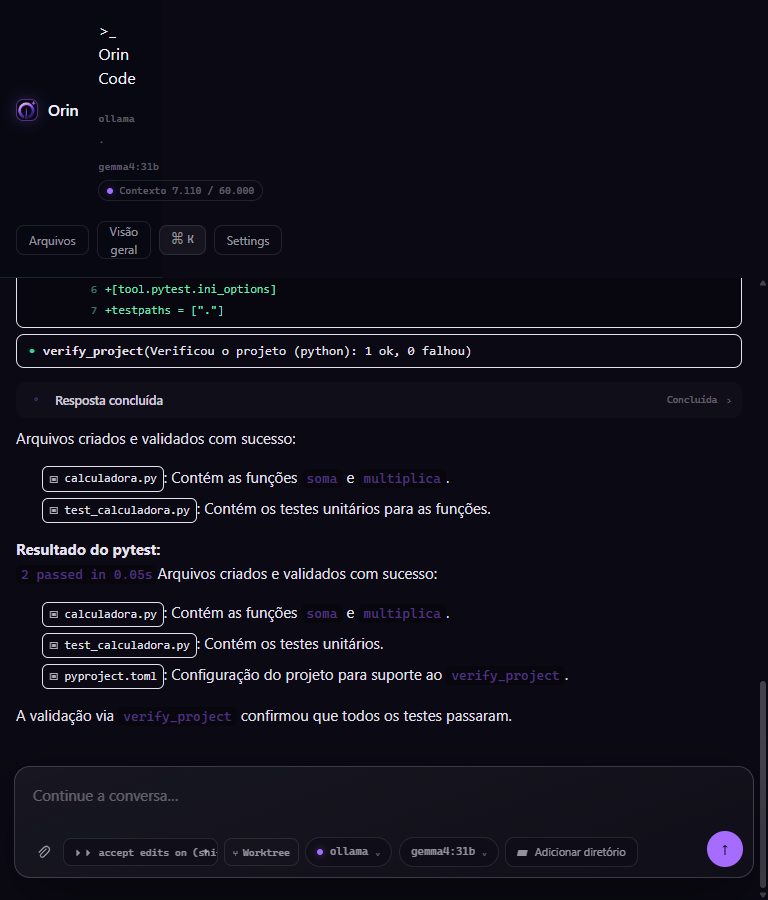 | 768 px: header quebrado (cerca de 275 px), título some, sidebar some sem substituto. |
| 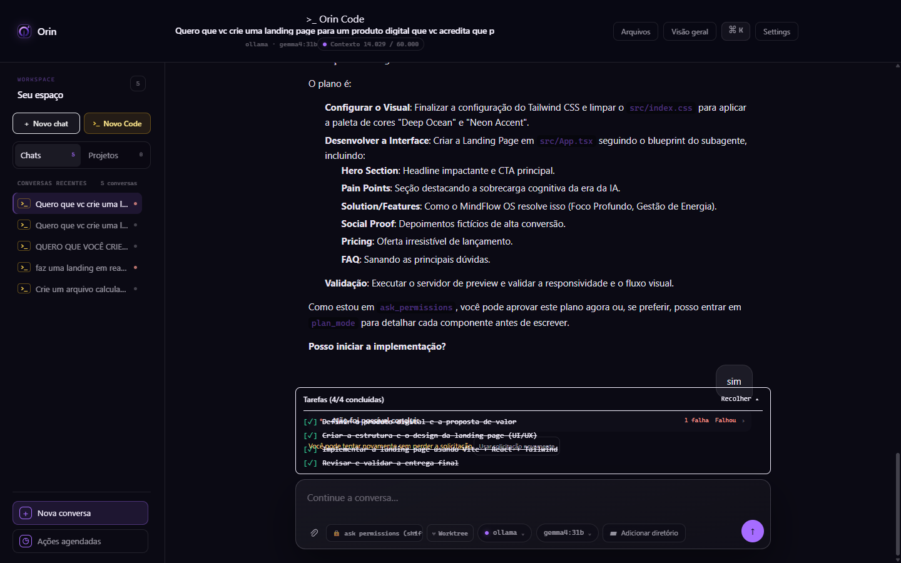 | Turno com falha: TodoBar sobreposta à mensagem de erro e ao "tentar novamente"; tarefas riscadas como concluídas num turno que falhou. |
| 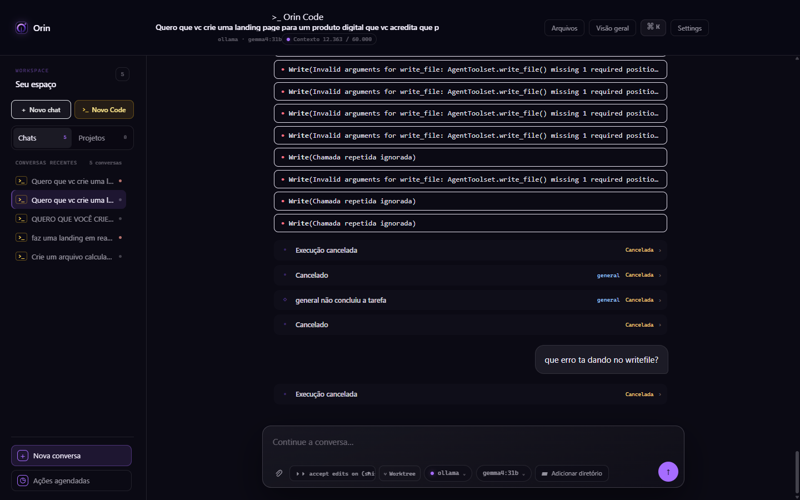 | Turno cancelado: 8 caixas `Write(Invalid arguments…)` repetidas, exceção Python crua, 4 linhas de "cancelado". |
| 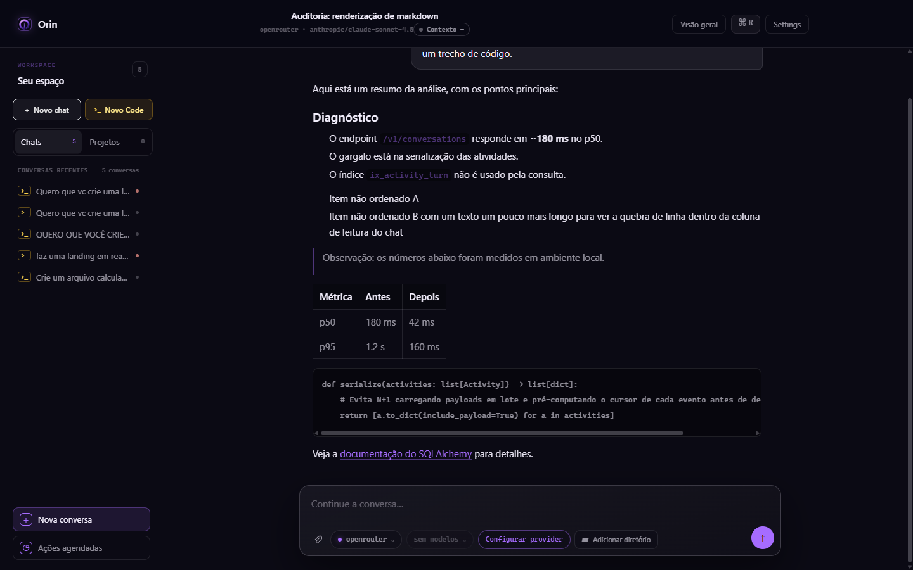 | Markdown rico (mock): listas sem marcador/numeração, código sem copiar/highlight, inline code com baixo contraste. |
| 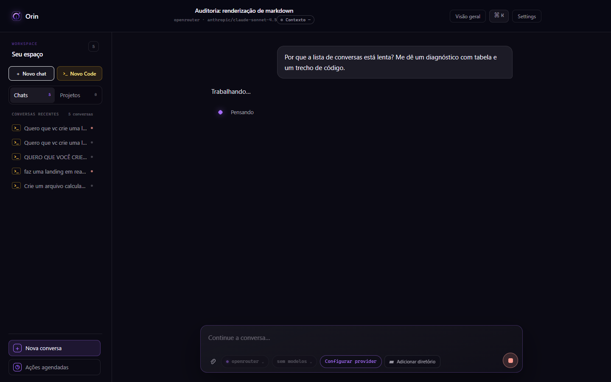 | Estado rodando (mock): "Trabalhando…" e "Pensando" duplicados; picker diz "sem modelos" enquanto o header mostra o modelo. |
| 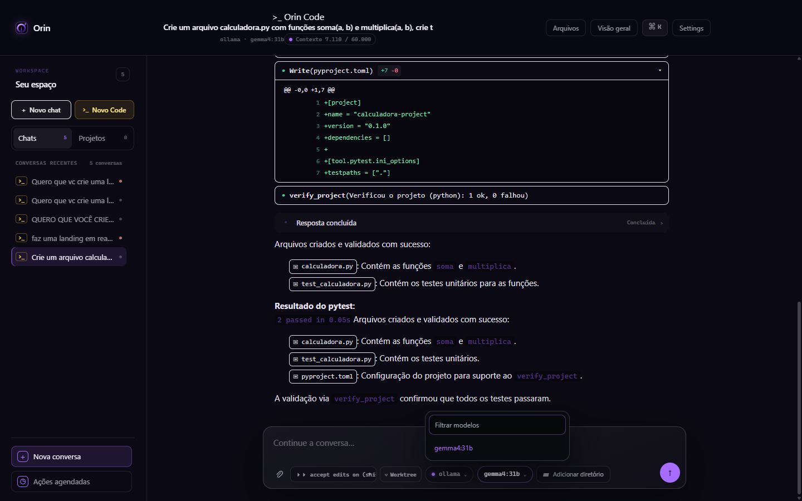 | Seletor de modelo aberto: sem navegação por setas, selecionado indicado só por cor. |
| 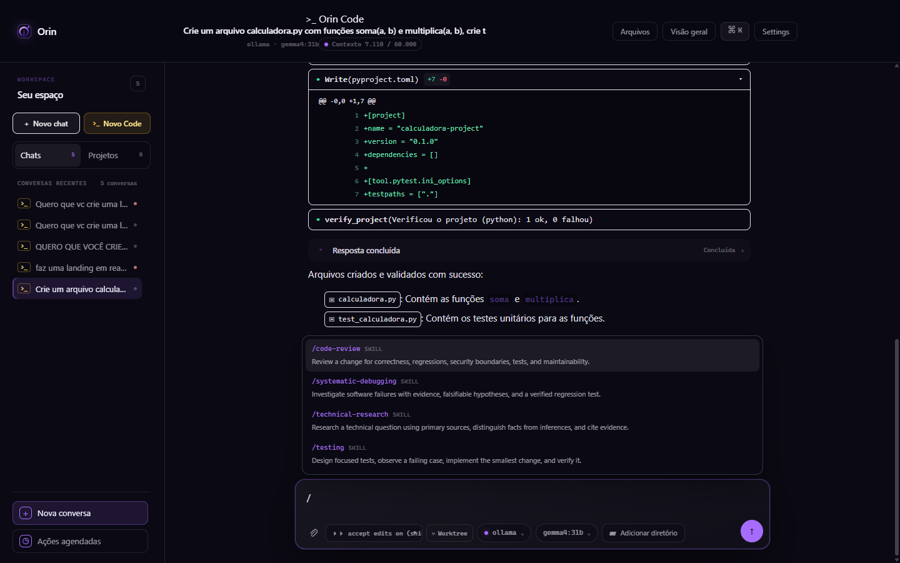 | Picker `/`: descrições em inglês, sobrepõe a thread. |
| 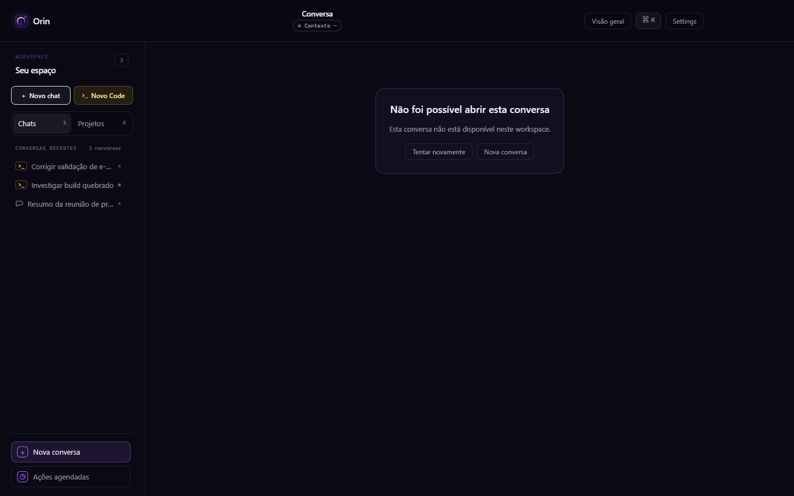 | Erro de carga: header ainda mostra "Conversa", "Contexto –" e "Visão geral". |
|  | `prefers-color-scheme: light` emulado: idêntico ao escuro. |

Outras capturas: `home-dark-1024.png`, `home-dark-768.png`, `chat-completed-dark-1024.png`, `chat-markdown-1024.png`, `chat-markdown-768.png`, `chat-middle-1440.png`, `focus-ring-sample-1440.png`.

---

## 3. Placar por área heurística

| Área | Nota (0–5) | Síntese |
|---|---|---|
| Hierarquia visual | 1,5 | Ferramentas (borda branca) gritam mais que a resposta; header com 3 linhas centralizadas; 4 botões ghost com o mesmo peso. |
| Tipografia | 2 | Inter declarada e **nunca carregada**; 9 tamanhos na moldura do chat; rótulos mono de 9–10 px em caixa alta com tracking .16em. |
| Espaçamento / ritmo | 2,5 | Coluna de 760 px boa; gap de 14 px uniforme não separa turnos; lista sem recuo semântico. |
| Densidade | 1,5 | Diffs completos abertos por padrão; status redundantes; toolbar do composer com 6 controles. |
| Coluna de leitura | 3,5 | `min(100%, 760px)`, corpo 15 px / 1,62. Bom, mas o composer flutuante cobre o fim da coluna. |
| Composer | 2 | Some ao rolar; altura variável sobre um padding fixo; pílula de permissão truncada e em inglês. |
| Markdown / código | 1,5 | Listas quebradas, sem copiar, sem highlight, sem rótulo de linguagem, inline code ilegível. |
| Tool calls / thinking | 1,5 | Contradiz o UX-CONTRACT; sem agrupamento; erros técnicos crus; sem bloco de "thinking" distinto. |
| Streaming / status | 2,5 | AgentPulse com modos é uma boa ideia, mas duplica o placeholder; o fim do turno gera ruído. |
| Estados (vazio, carregando, erro, offline) | 2,5 | Existem, mas são texto cru, sem skeleton; o erro mantém controles inúteis no header. |
| Sidebar / histórico | 2 | Sem busca, renomear, excluir, fixar ou agrupar por data; título truncado em cerca de 15 caracteres; status só por cor. |
| Seletor de modelo | 2,5 | Pesquisável, mas sem teclado, ids crus de provider, limite silencioso de 60. |
| Feedback / ações na mensagem | 0,5 | Não há copiar, editar, regenerar, 👍/👎 nem timestamp. |
| Acessibilidade | 2 | Contraste reprovado em vários tokens, sem região live para respostas, foco fraco em cards, layout quebra < 900px. |
| Performance percebida | 2,5 | Conteúdo chega em pedaços (scrollHeight de 824 → 1795 após o load), sem skeleton nem virtualização. |
| Consistência com o DS | 1 | Tokens inexistentes, verde-esmeralda e âmbar fora da paleta, mistura de BEM com utilitários arbitrários, baselines visuais desatualizadas. |

---

## 4. Achados detalhados

> Formato: **ID · Severidade · Título**, seguido de Evidência, Impacto e Recomendação.

### 4.1 Layout, composer e responsividade

#### C01 · P0 · Abaixo de 900px a navegação desaparece e o header colapsa
- **Evidência:** [agentos.css#L361-L366](file:///c:/Users/User/Documents/GitHub/Carlos/orin/frontend/src/styles/agentos.css#L361-L366) (`.workspace-navigation { display: none; }` sem drawer alternativo); [agentos.css#L208-L214](file:///c:/Users/User/Documents/GitHub/Carlos/orin/frontend/src/styles/agentos.css#L208-L214) e [#L1036-L1042](file:///c:/Users/User/Documents/GitHub/Carlos/orin/frontend/src/styles/agentos.css#L1036-L1042) (grid do header + `padding-right: 146px`). Screenshot `chat-completed-dark-768.png`: o badge ">_ Orin Code" quebra uma palavra por linha, o `<h1>` fica com largura 0 e o header ocupa cerca de 275 de 900 px.
- **Impacto:** em janelas estreitas (metade da tela, notebooks de 13" com zoom), a pessoa não troca de conversa, não vê o título e perde cerca de 30% da altura útil.
- **Recomendação:** sidebar vira **drawer** (botão ☰ no header, `aria-expanded`, foco preso e Esc para fechar) abaixo de 900px. Header em uma linha: título com ellipsis; badge, modelo e contexto passam para um menu "ⓘ" ou para a toolbar do composer abaixo de 1024px. Reservar `padding-right` para os controles de janela **só no Electron** (`env(titlebar-area-width)` ou classe `is-desktop`).

#### C02 · P0 · O composer fica invisível e inclicável ao rolar para cima
- **Evidência:** [agentos.css#L741-L748](file:///c:/Users/User/Documents/GitHub/Carlos/orin/frontend/src/styles/agentos.css#L741-L748): `.chat__foot > * { opacity: 0; pointer-events: none }` exceto em hover, `focus-within` ou `data-at-bottom`. Medido: `opacity: 0`, `pointer-events: none` com `scrollTop = 0`. Screenshot `chat-top-composer-hidden-1440.png`.
- **Impacto:** quem está lendo a resposta anterior para citar um trecho não tem onde digitar. O controle principal do produto some sem nenhuma pista. Isso fere visibilidade do estado e controle do usuário. No teclado, o composer é o **último** item do Tab (ver Apêndice B).
- **Recomendação:** o composer fica **sempre visível**. Se a intenção era reduzir o ruído, basta diminuir a sombra e o blur quando a pessoa não está no fim, nunca a opacidade. Acrescentar atalho para focar o composer (`/` ou `Ctrl+L`) e link "Pular para a mensagem".

#### C03 · P0 · Overlays do composer cobrem a thread e escondem o erro do turno
- **Evidência:** a thread reserva `padding-bottom: 168px` fixo ([agentos.css#L662](file:///c:/Users/User/Documents/GitHub/Carlos/orin/frontend/src/styles/agentos.css#L662)), mas o composer é uma sobreposição de altura variável: TodoBar ([Composer.tsx#L261](file:///c:/Users/User/Documents/GitHub/Carlos/orin/frontend/src/features/conversations/Composer.tsx#L261)), chips de anexo, textarea de até 260 px e aviso de conexão. Screenshot `chat-failed-bottom-1440.png`: a TodoBar fica **por cima** de "Não foi possível concluir" e de "Usar solicitação novamente", com texto sobreposto e ilegível.
- **Impacto:** justo no momento de falha a pessoa não consegue ler o erro nem clicar em tentar de novo. A TodoBar ainda mostra "4/4 concluídas" com tudo riscado num turno que **falhou**, um sinal de sucesso enganoso (fere o `DESIGN.md`: "must not imply validation that did not happen").
- **Recomendação:** colocar o composer numa **linha própria do grid** (thread `1fr`, composer `auto`) em vez de sobrepô-lo; se mantiver a sobreposição, medir a altura com `ResizeObserver` e aplicar como `padding-bottom` dinâmico. A TodoBar vira uma linha recolhida (1 linha + chevron) que herda o estado do turno: em falha, mostrar "Interrompido em 3/4".

#### C04 · P0 · Sem tema claro e sem respeito a `prefers-color-scheme`
- **Evidência:** [index.css#L5-L13](file:///c:/Users/User/Documents/GitHub/Carlos/orin/frontend/src/styles/index.css#L5-L13) (`color-scheme: dark` fixo); [theme.css](file:///c:/Users/User/Documents/GitHub/Carlos/orin/frontend/src/styles/theme.css) tem um único `:root`. Screenshot `chat-light-scheme-emulated-1440.png`, idêntico ao escuro. Além disso, cerca de 20 cores rgba estão escritas direto no CSS (`rgba(9, 11, 14, .96)` etc.), o que impede trocar a paleta.
- **Impacto:** uso diurno, ambientes claros, baixa visão e fotofobia invertida ficam sem opção. É requisito básico de um app desktop em 2026 e foi pedido nesta auditoria.
- **Recomendação:** dois conjuntos de tokens semânticos (`[data-theme="light"|"dark"]` mais `prefers-color-scheme` como padrão, com preferência em Configurações). Migrar as cores literais para tokens antes. *P0 porque o pedido e a acessibilidade exigem, mas o esforço é M/L: ver o roadmap.*

### 4.2 Design system e consistência visual

#### C05 · P1 · 43 usos de tokens CSS inexistentes, origem das "caixas brancas"
- **Evidência:** `--text-primary`, `--text-secondary`, `--text-muted`, `--border-subtle`, `--surface-raised`, `--surface-hover` e `--accent-primary` não estão definidos em nenhum CSS. Distribuição: CodeToolCallBlock (17, p.ex. [L113](file:///c:/Users/User/Documents/GitHub/Carlos/orin/frontend/src/features/conversations/CodeToolCallBlock.tsx#L113)), PlanApprovalCard (11), TodoBar (10), TurnTimeline (2), ChatPage, Composer, WorkspaceFileCard. Com isso, `border-color` cai para `currentColor` (borda branca), o fundo fica transparente e as cores secundárias herdam o branco. Visível em todos os screenshots de conversa Code.
- **Impacto:** inverte a hierarquia: a atividade de ferramenta e as pílulas de arquivo ficam mais fortes que a resposta. É a principal razão da sensação de "terminal" que o `DESIGN.md` diz querer evitar.
- **Recomendação (quick win):** criar os aliases em `theme.css` (`--text-primary: var(--orin-text)`, `--text-secondary: var(--orin-muted)`, `--text-muted: var(--orin-faint)`, `--border-subtle: var(--orin-line)`, `--surface-raised: var(--orin-surface-raised)`, `--surface-hover: var(--orin-surface-raised-strong)`, `--accent-primary: var(--orin-accent)`). Depois, adicionar uma regra de lint ou teste que falhe em `var(--x)` não declarado.

#### C06 · P1 · Contraste reprovado em tokens recorrentes
- **Evidência (medido):** inline code `rgba(166,108,255,.44)` = **2,0:1** ([agentos.css#L717-L720](file:///c:/Users/User/Documents/GitHub/Carlos/orin/frontend/src/styles/agentos.css#L717-L720)); eyebrows `--signal-dim` = **2,0:1**; `--orin-faint` (`.34`) = **2,84:1**, usado no modelo do header (10 px), no placeholder do composer, no indicador de contexto, nos títulos de seção da sidebar (9 px) e no caret dos chips ([theme.css#L13](file:///c:/Users/User/Documents/GitHub/Carlos/orin/frontend/src/styles/theme.css#L13)). Os mínimos WCAG são 4,5:1 para texto normal e 3:1 para texto grande. `--orin-muted` (6,28:1) e `--orin-text` (17,7:1) passam.
- **Impacto:** nomes de funções, caminhos e comandos citados na resposta, justamente a informação mais acionável num agente de engenharia, ficam quase invisíveis.
- **Recomendação:** inline code em `--orin-accent-soft` (`#d8b4fe`) ou texto `--orin-text` sobre fundo `--raised-strong`; subir `--orin-faint` para alfa ≥ .52 (cerca de 4,6:1) e usá-lo só ≥ 12 px; eliminar texto de 9–10 px em conteúdo informativo.

#### C07 · P1 · Cores fora da paleta e controle primário inconsistente
- **Evidência:** botão primário do plano `bg-emerald-600` ([PlanApprovalCard.tsx#L80](file:///c:/Users/User/Documents/GitHub/Carlos/orin/frontend/src/features/conversations/PlanApprovalCard.tsx#L80)); âmbar `text-amber-300` em "Novo Code" ([WorkspaceNavigation.tsx#L160](file:///c:/Users/User/Documents/GitHub/Carlos/orin/frontend/src/features/projects/WorkspaceNavigation.tsx#L160)) e `bg-amber-400` na TodoBar ([TodoBar.tsx#L36](file:///c:/Users/User/Documents/GitHub/Carlos/orin/frontend/src/features/conversations/TodoBar.tsx#L36)); o `tailwind.config.ts` ainda define `accent: '#c8ff6a'` (verde-limão da marca antiga "AgentOS"). Isso contraria o [DESIGN.md#L18-L20](file:///c:/Users/User/Documents/GitHub/Carlos/orin/DESIGN.md#L18-L20): o violeta é a cor de affordance e o semântico usa os tokens existentes.
- **Impacto:** três "cores de ação" competem (violeta, verde, âmbar), sem dizer qual é o primário de cada contexto.
- **Recomendação:** um único primário (violeta) e semânticas só para estados; remover as cores hardcoded do Tailwind; mapear `theme.extend.colors` para os tokens `--orin-*`.

#### C08 · P2 · Tipografia sem fonte carregada e escala inflada
- **Evidência:** `font-family: Inter, …` ([index.css#L7](file:///c:/Users/User/Documents/GitHub/Carlos/orin/frontend/src/styles/index.css#L7)) sem `@font-face`/`@import`; `document.fonts` vazio, então o Windows renderiza Segoe UI e o Linux outra fonte. Na moldura do chat aparecem 9, 10, 11, 11,5, 12, 12,5, 13, 14 e 15 px, além de caixa alta mono com `letter-spacing: .16em` em rótulos.
- **Impacto:** a aparência muda entre plataformas, falta ritmo vertical e os microtextos ficam pouco legíveis.
- **Recomendação:** empacotar a fonte variável localmente (local-first); escala de 5 passos (12 / 13 / 15 / 17 / 22) com mono só para dados técnicos ≥ 12 px; rótulos de seção em *sentence case*.

#### C09 · P2 · Débito de CSS e baselines visuais obsoletas
- **Evidência:** `agentos.css` com 139 KB e 1.605 linhas, seletores redefinidos (`.chat__bar` em L200 e L208, `.bubble__retry` em L489 e L687, `.settings-shell__body` duas vezes), legado `.chat-shell` em [index.css#L399](file:///c:/Users/User/Documents/GitHub/Carlos/orin/frontend/src/styles/index.css#L399), BEM misturado com utilitários Tailwind de valores arbitrários. A baseline `tests/visual/.../home-win32.png` ainda mostra a marca **AgentOS** em verde-limão, e não há baseline da conversa.
- **Impacto:** regressões visuais (como C05) passam despercebidas e cada mudança tem efeito colateral imprevisível.
- **Recomendação:** congelar `agentos.css`, extrair componentes para camadas (`@layer components`), atualizar as baselines e adicionar cenários visuais de chat (concluído, rodando, falha, markdown, 768 px).

### 4.3 Conteúdo da resposta: markdown e código

#### C10 · P1 · Listas markdown sem marcador nem numeração
- **Evidência:** o preflight do Tailwind aplica `list-style: none` a `ul`/`ol`; [agentos.css#L711](file:///c:/Users/User/Documents/GitHub/Carlos/orin/frontend/src/styles/agentos.css#L711) repõe só o `padding-left`. Screenshot `chat-markdown-1440.png`: "1. 2. 3." do diagnóstico viraram três parágrafos recuados; os bullets sumiram (também visíveis em `chat-failed-bottom-1440.png`).
- **Impacto:** passos ordenados perdem a sequência, e listas parecem parágrafos soltos ou citações. É uma perda direta de significado.
- **Recomendação (quick win):** `.markdown-message ul { list-style: disc } ol { list-style: decimal } li::marker { color: var(--orin-muted) }`.

#### C11 · P1 · Blocos de código sem copiar, sem linguagem e sem highlight
- **Evidência:** [MarkdownMessage.tsx#L34-L68](file:///c:/Users/User/Documents/GitHub/Carlos/orin/frontend/src/features/conversations/MarkdownMessage.tsx#L34-L68) só personaliza `a`; não há highlighter no `package.json`; `pre code` em `--muted` a 0,82 em ([agentos.css#L721-L725](file:///c:/Users/User/Documents/GitHub/Carlos/orin/frontend/src/styles/agentos.css#L721-L725)). Screenshot `chat-markdown-1440.png`: o comentário longo some na rolagem horizontal, sem opção de quebrar linha.
- **Impacto:** num produto cujo modo principal é engenharia, copiar código é a ação mais frequente depois de ler. Sem highlight, a leitura de diffs e trechos fica lenta.
- **Recomendação:** componente `CodeBlock` com header (linguagem · Copiar · Quebrar linha), highlight leve e lazy (Shiki ou Prism por linguagem sob demanda), fonte mono a 13 px e line-height 1,5.

#### C12 · P1 · Texto da resposta duplicado e persistido
- **Evidência:** `GET /v1/conversations/chat_6300…` devolve `content` com "Arquivos criados e validados com sucesso: …" **duas vezes** (a segunda colada a `2 passed in 0.05s`). Screenshot `chat-completed-dark-1440.png`. O frontend já descarta o texto em streaming ao receber `code_mode.validation_started` ([ChatPage.tsx#L547-L563](file:///c:/Users/User/Documents/GitHub/Carlos/orin/frontend/src/features/conversations/ChatPage.tsx#L547-L563)), mas o backend concatena as duas tentativas na mensagem final.
- **Impacto:** passa a impressão de bug ou alucinação e mina a confiança na resposta final.
- **Recomendação:** no backend, a mensagem final da validação deve **substituir** o rascunho (reset da mensagem, não append). Na UI, quando houver revisão, mostrar "Resposta revisada após validação" com acesso à versão anterior.

### 4.4 Atividade do agente (tool calls, plano, status)

#### C13 · P1 · A atividade vira uma parede de caixas, contrariando o UX-CONTRACT
- **Evidência:** `diffOpen` começa `true` ([CodeToolCallBlock.tsx#L54](file:///c:/Users/User/Documents/GitHub/Carlos/orin/frontend/src/features/conversations/CodeToolCallBlock.tsx#L54)), então cada `Write` abre o diff inteiro; o modo Code renderiza um `CodeToolCallBlock` por evento ([TurnTimeline.tsx#L304-L341](file:///c:/Users/User/Documents/GitHub/Carlos/orin/frontend/src/features/conversations/TurnTimeline.tsx#L304-L341)) sem agrupar. Screenshot `chat-cancelled-bottom-1440.png`: 8 caixas seguidas de `Write(Invalid arguments for write_file: AgentToolset.write_file() missing 1 required positio…)`. O `UX-CONTRACT.md` (§ Activity in chat) pede "uma linha expansível, texto discreto com chevron, não uma caixa; resumo 'Explorou 3 arquivos, executou 4 comandos'".
- **Impacto:** a resposta, que é o que importa, fica soterrada; a pessoa precisa rolar telas de diff que não pediu; erros internos do runtime aparecem como se fossem culpa dela.
- **Recomendação:** agrupar chamadas consecutivas do mesmo turno numa **linha-resumo** ("Editou 3 arquivos · executou 1 comando · 1 falha ›"); diffs recolhidos com `+N −M` visíveis; repetições colapsadas ("Write falhou 6× · ver detalhes"); traduzir erros do runtime ("O agente chamou a ferramenta com argumentos incompletos; ele tentou novamente") e manter o texto técnico em "Detalhes".

#### C14 · P1 · Card de aprovação de plano continua acionável depois do turno
- **Evidência:** screenshot `chat-top-composer-hidden-1440.png`: o turno concluído ainda mostra os botões ativos "Sim, aprovar e aceitar edições…" e "Sim, aprovar e revisar…". Sem `toolPermission`, o handler envia uma nova mensagem "Plano aprovado. Pode prosseguir…" ([ChatPage.tsx#L838-L841](file:///c:/Users/User/Documents/GitHub/Carlos/orin/frontend/src/features/conversations/ChatPage.tsx#L838-L841)); o card não recebe `openQuestionTurnIds` para se desabilitar ([TurnTimeline.tsx#L248-L267](file:///c:/Users/User/Documents/GitHub/Carlos/orin/frontend/src/features/conversations/TurnTimeline.tsx#L248-L267)). O card mostra o caminho do plano duas vezes e não mostra o conteúdo.
- **Impacto:** um clique acidental dispara um novo turno com efeitos colaterais (edições automáticas) numa conversa já encerrada.
- **Recomendação:** cards de decisão resolvidos viram **recibo** ("Plano aprovado às 13:15 · aceitar edições") sem botões; mostrar o plano renderizado (markdown recolhível) em vez de só o caminho.

#### C15 · P1 · "Reverter alterações" destrutivo, sem confirmação e sem escopo claro
- **Evidência:** [TurnTimeline.tsx#L400-L416](file:///c:/Users/User/Documents/GitHub/Carlos/orin/frontend/src/features/conversations/TurnTimeline.tsx#L400-L416): um clique chama `rewindTurn` direto; o rótulo "Checkpoint disponível" aparece em mono de 11 px no **topo** do turno.
- **Impacto:** risco de perder trabalho sem desfazer; a pessoa não sabe quais arquivos serão revertidos.
- **Recomendação:** mover para o menu "⋯" do turno; diálogo de confirmação listando os arquivos afetados (com +/−); toast com "Desfazer" quando tecnicamente possível.

#### C16 · P1 · Status redundantes e ruidosos no início e no fim do turno
- **Evidência:** rodando: placeholder "Trabalhando…" ([ChatPage.tsx#L1312](file:///c:/Users/User/Documents/GitHub/Carlos/orin/frontend/src/features/conversations/ChatPage.tsx#L1312)) **mais** o AgentPulse "Pensando" ([L1159-L1169](file:///c:/Users/User/Documents/GitHub/Carlos/orin/frontend/src/features/conversations/ChatPage.tsx#L1159-L1169)), ver `chat-running-1440.png`. Concluído: linha "Resposta concluída · Concluída ›". Cancelado: "Execução cancelada", "Cancelado", "general não concluiu a tarefa", "Cancelado" e de novo "Execução cancelada" (`chat-cancelled-bottom-1440.png`), com o id interno `general` exposto.
- **Impacto:** ruído visual e cognitivo; a pessoa lê cinco vezes a mesma coisa e não descobre o que fazer a seguir.
- **Recomendação:** **um** indicador vivo por turno (o AgentPulse, com o verbo atual e o cronômetro); no fim, um rodapé único do turno ("Cancelado por você · 2 min · Tentar novamente"); ids de agente traduzidos ("Agente principal").

#### C17 · P2 · Sem bloco de raciocínio ("thinking") distinto
- **Evidência:** não há componente para raciocínio ou thinking; o estado "Pensando" é só um rótulo animado ([AgentPulse.tsx#L160-L171](file:///c:/Users/User/Documents/GitHub/Carlos/orin/frontend/src/features/conversations/AgentPulse.tsx#L160-L171)).
- **Impacto:** quando o modelo expõe raciocínio, não há onde mostrar com hierarquia própria (recolhido, itálico, duração).
- **Recomendação:** um "Pensou por 12 s ›" recolhível, acima da resposta, com o mesmo padrão de linha discreta das ferramentas.

### 4.5 Thread, mensagens e feedback

#### C18 · P1 · Mensagens sem ações nem metadados
- **Evidência:** não há copiar, editar, regenerar, 👍/👎 nem timestamp em `article.bubble` ([ChatPage.tsx#L1061-L1115](file:///c:/Users/User/Documents/GitHub/Carlos/orin/frontend/src/features/conversations/ChatPage.tsx#L1061-L1115)); a única ação é "Usar solicitação novamente", e só quando `retryable`. Busca por `clipboard`/`Copiar` no chat: nenhum resultado.
- **Impacto:** padrões que qualquer pessoa espera de um chat de IA estão ausentes, o que obriga a selecionar texto à mão e reescrever o prompt para iterar.
- **Recomendação:** barra de ações no hover/foco por mensagem: assistente (Copiar · Regenerar · 👍 · 👎 · ⋯) e usuário (Editar e reenviar · Copiar); horário relativo com tooltip absoluto; acessível por teclado.

#### C19 · P1 · Thread sem semântica para leitor de tela
- **Evidência (probe):** sem nenhuma região `aria-live`, `role=log` ou `role=status` quando ocioso; `article.bubble` sem `aria-label`; só dois headings na página (`H1` título e `H2` "Seu espaço"). O AgentPulse tem `role=status` só enquanto roda ([AgentPulse.tsx#L78](file:///c:/Users/User/Documents/GitHub/Carlos/orin/frontend/src/features/conversations/AgentPulse.tsx#L78)).
- **Impacto:** quem usa leitor de tela não é avisado quando a resposta chega ou o turno falha, e não consegue navegar mensagem a mensagem.
- **Recomendação:** `role="log" aria-live="polite"` na thread com anúncio **resumido** ("Resposta pronta" / "Falhou: …"), não token a token; cada mensagem com heading oculto ("Você disse" / "Orin respondeu") ou `aria-labelledby`.

#### C20 · P2 · Bolha do usuário e separação entre turnos fracas
- **Evidência:** gap uniforme de 14 px ([agentos.css#L662](file:///c:/Users/User/Documents/GitHub/Carlos/orin/frontend/src/styles/agentos.css#L662)); bolha do usuário a 78% de largura, mesmo raio e fundo `--raised-strong`; nada separa um turno do seguinte (`chat-cancelled-bottom-1440.png`).
- **Impacto:** em conversas longas fica difícil achar onde começa cada pedido.
- **Recomendação:** espaçamento maior entre turnos (32–40 px) do que dentro do turno (12 px); bolha do usuário até 70%, alinhada à direita e com cor neutra; âncoras de turno para navegação.

#### C21 · P2 · Indicador "Ir para o fim" conta eventos, não conteúdo
- **Evidência:** `Ir para o fim · {n} novas atividades` soma eventos de ferramenta ([ChatPage.tsx#L1174-L1178](file:///c:/Users/User/Documents/GitHub/Carlos/orin/frontend/src/features/conversations/ChatPage.tsx#L1174-L1178)); posição fixa `bottom: 174px` ([agentos.css#L669-L675](file:///c:/Users/User/Documents/GitHub/Carlos/orin/frontend/src/styles/agentos.css#L669-L675)), que colide com o composer quando ele cresce.
- **Recomendação:** botão circular "↓" ancorado ao topo do composer; rótulo "Nova resposta" ou "Agente trabalhando".

### 4.6 Composer e controles

#### C22 · P2 · Toolbar do composer sobrecarregada e pílula de permissão truncada
- **Evidência:** até 7 controles com o mesmo peso (anexar, Code, permissão, Worktree, provider, modelo, "Adicionar diretório") em mono de 10–11 px ([Composer.tsx#L308-L384](file:///c:/Users/User/Documents/GitHub/Carlos/orin/frontend/src/features/conversations/Composer.tsx#L308-L384)). Pílula com `max-width: 155px` ([agentos.css#L435](file:///c:/Users/User/Documents/GitHub/Carlos/orin/frontend/src/styles/agentos.css#L435)) e texto "⏵⏵ accept edits on (shift+tab to cycle)" ([Composer.tsx#L65-L76](file:///c:/Users/User/Documents/GitHub/Carlos/orin/frontend/src/features/conversations/Composer.tsx#L65-L76)), que aparece como "accept edits on (shi" em todos os screenshots. Na Home Code a toolbar quebra em duas linhas.
- **Impacto:** o modo de permissão, que define a segurança do agente, é o controle menos legível.
- **Recomendação:** à esquerda, [+] num menu de anexo, diretório e worktree; ao lado, um seletor de modelo único; à direita, a permissão como menu com rótulo curto em pt-BR ("Pedir permissão", "Aceitar edições", "Planejar", "Autonomia total") e o atalho no tooltip; depois o Enviar.

#### C23 · P2 · Seletor de modelo com fricção
- **Evidência:** dois chips separados (provider com id cru `ollama`/`openrouter`, depois o modelo) ([ModelPicker.tsx#L70-L93](file:///c:/Users/User/Documents/GitHub/Carlos/orin/frontend/src/components/ModelPicker.tsx#L70-L93)); `ArrowDown` no campo de busca não move o foco para as opções (probe); `role="option"` em `<button>` dentro de `<li>` sem `aria-activedescendant`; limite silencioso de 60 ([L60-L61](file:///c:/Users/User/Documents/GitHub/Carlos/orin/frontend/src/components/ModelPicker.tsx#L60-L61)); o selecionado só muda de cor. No mock rodando, o header mostra `anthropic/claude-sonnet-4.5` enquanto o picker diz "sem modelos · Configurar provider".
- **Recomendação:** um combobox único "Modelo" agrupado por provider (nome de marca + ícone), navegável por setas e Enter, com ✓ no selecionado, "Mostrando 60 de 312 · refine a busca", capacidades (visão, ferramentas, contexto) como ícones e estado coerente com o modelo da conversa.

#### C24 · P2 · Modo Chat/Code exposto em quatro lugares
- **Evidência:** cards "Chat / Orin Code" na Home ([Home.tsx#L238-L283](file:///c:/Users/User/Documents/GitHub/Carlos/orin/frontend/src/app/Home.tsx#L238-L283)), toggle "Code" no composer, "Novo chat" e "Novo Code" na sidebar ([WorkspaceNavigation.tsx#L144-L161](file:///c:/Users/User/Documents/GitHub/Carlos/orin/frontend/src/features/projects/WorkspaceNavigation.tsx#L144-L161)) e "Nova conversa" no rodapé da sidebar ([L294-L305](file:///c:/Users/User/Documents/GitHub/Carlos/orin/frontend/src/features/projects/WorkspaceNavigation.tsx#L294-L305)). O texto "igual ao Claude Code" ([Home.tsx#L283](file:///c:/Users/User/Documents/GitHub/Carlos/orin/frontend/src/app/Home.tsx#L283)) referencia um concorrente.
- **Impacto:** a pessoa não sabe qual controle vale nem se trocar o card muda o toggle; são três CTAs de "novo" com pesos diferentes.
- **Recomendação:** um único "Nova conversa" (com `Ctrl+N`) e o modo escolhido **no composer** (segmentado Chat | Code); remover a referência a concorrente.

### 4.7 Header, sidebar e histórico

#### C25 · P1 · Header com hierarquia confusa
- **Evidência:** [ChatPage.tsx#L970-L1016](file:///c:/Users/User/Documents/GitHub/Carlos/orin/frontend/src/features/conversations/ChatPage.tsx#L970-L1016): três linhas centralizadas (badge, título, provider·modelo·contexto); título truncado no meio da palavra ("…crie t"); quatro botões ghost iguais ("Arquivos", "Visão geral", "⌘K", "Settings"), com "Settings" em inglês; `padding-right: 164px` reservado para o Electron, que no navegador cria um vazio à direita ([agentos.css#L211](file:///c:/Users/User/Documents/GitHub/Carlos/orin/frontend/src/styles/agentos.css#L211)).
- **Recomendação:** título alinhado à esquerda, editável no clique (renomear); modelo e contexto movidos para o composer; ações secundárias num menu "⋯"; "Configurações" com ícone.

#### C26 · P2 · Sidebar sem gestão de histórico e com status só por cor
- **Evidência:** sem busca, renomear, excluir, fixar ou agrupar por data (só o `Ctrl+K`); títulos cortados em cerca de 15 caracteres por causa do ícone ">_", do ponto de status e do `scrollbar-gutter`; ponto de status `aria-hidden` e só colorido ([WorkspaceNavigation.tsx#L215](file:///c:/Users/User/Documents/GitHub/Carlos/orin/frontend/src/features/projects/WorkspaceNavigation.tsx#L215)), o que fere o [DESIGN.md#L19-L20](file:///c:/Users/User/Documents/GitHub/Carlos/orin/DESIGN.md#L19-L20) ("Never convey a state through color alone"). Os recentes da Home mostram estados crus em inglês (`failed`, `cancelled`, `waiting_user`, `running`).
- **Recomendação:** busca inline no topo; grupos "Hoje / 7 dias / Anteriores"; menu "⋯" por item (Renomear, Fixar, Excluir); status com ícone e texto acessível ("Falhou", "Aguardando você", "Rodando"); tooltip com o título completo.

#### C27 · P3 · Atalho exibido de forma inconsistente
- **Evidência:** o botão mostra "⌘K" no Windows ([CommandPalette.tsx#L104-L105](file:///c:/Users/User/Documents/GitHub/Carlos/orin/frontend/src/components/CommandPalette.tsx#L104-L105)), enquanto o `aria-label` diz "Ctrl+K" e o rodapé da Home mostra "Ctrl K".
- **Recomendação:** glifo por plataforma (`navigator.userAgentData.platform`).

### 4.8 Estados

#### C28 · P2 · Carregando, vazio e erro em texto cru
- **Evidência:** "Carregando conversa…" e "Esta conversa ainda não tem mensagens." como `
` centralizado ([ChatPage.tsx#L1044-L1045](file:///c:/Users/User/Documents/GitHub/Carlos/orin/frontend/src/features/conversations/ChatPage.tsx#L1044-L1045)); o conteúdo chega em etapas (scrollHeight de 824 → 1795 após o load), com saltos de layout. No erro de carga (`chat-load-error-1440.png`) o header continua com "Conversa", "Contexto –" e "Visão geral", que não fazem sentido ali.
- **Recomendação:** skeleton da thread (2–3 blocos) e reserva de altura; no erro, um header mínimo com as ações "Tentar novamente" e "Voltar"; estado vazio com sugestões de primeiro prompt.

#### C29 · P2 · Offline e reconexão pouco visíveis
- **Evidência:** a degradação do SSE mostra só uma linha mono de 10 px em `--warn` acima do composer ([ChatPage.tsx#L1237-L1239](file:///c:/Users/User/Documents/GitHub/Carlos/orin/frontend/src/features/conversations/ChatPage.tsx#L1237-L1239); [agentos.css#L749](file:///c:/Users/User/Documents/GitHub/Carlos/orin/frontend/src/styles/agentos.css#L749)), e ela também some junto com o composer (C02).
- **Recomendação:** banner persistente no topo da thread com ícone, "Reconectando… (tentativa 3)" e "Recarregar"; desabilitar o Enviar com explicação se o backend estiver inacessível.

### 4.9 Acessibilidade de interação e i18n

#### C30 · P2 · Indicadores de foco fracos em elementos-chave
- **Evidência:** `outline: none` trocado por borda de 35–44% de alfa em `.activity-card__trigger` ([agentos.css#L763](file:///c:/Users/User/Documents/GitHub/Carlos/orin/frontend/src/styles/agentos.css#L763)), na pílula de permissão ([L444](file:///c:/Users/User/Documents/GitHub/Carlos/orin/frontend/src/styles/agentos.css#L444)), na busca do picker ([L589](file:///c:/Users/User/Documents/GitHub/Carlos/orin/frontend/src/styles/agentos.css#L589)) e na textarea do composer ([L411](file:///c:/Users/User/Documents/GitHub/Carlos/orin/frontend/src/styles/agentos.css#L411)). O probe registrou `outline: none` em "Resposta concluída". Os blocos de diff são `div role=button` em vez de `<button>` ([CodeToolCallBlock.tsx#L123-L126](file:///c:/Users/User/Documents/GitHub/Carlos/orin/frontend/src/features/conversations/CodeToolCallBlock.tsx#L123-L126)).
- **Recomendação:** anel de foco único (`2px solid var(--orin-accent)`, offset 2px, ≥ 3:1) em todos os interativos; `<button>` nativo nos cabeçalhos expansíveis.

#### C31 · P3 · Mistura de idiomas na interface
- **Evidência:** "Settings", "Worktree", "accept edits on", "bypass permissions", "INPUT LIMIT", "Checkpoint", `failed`/`cancelled`, `general`, descrições de skills em inglês no picker `/` (`slash-picker-1440.png`).
- **Recomendação:** passar todos os rótulos da UI para pt-BR via dicionário (preparando i18n); estados de domínio sempre traduzidos.

#### C32 · P3 · Movimento decorativo em cada mensagem
- **Evidência:** cada `article` entra com `opacity`/`y` ([ChatPage.tsx#L1061-L1066](file:///c:/Users/User/Documents/GitHub/Carlos/orin/frontend/src/features/conversations/ChatPage.tsx#L1061-L1066)); o Send/Stop gira ±25° ([Composer.tsx#L389-L415](file:///c:/Users/User/Documents/GitHub/Carlos/orin/frontend/src/features/conversations/Composer.tsx#L389-L415)). O reduced-motion é respeitado (ponto positivo).
- **Recomendação:** animar só mensagens **novas** (não o histórico ao abrir); transição de cor ou ícone no Send/Stop em vez de rotação.

### 4.10 Performance percebida (observações de código)

- `ChatPage.tsx` tem 1.367 linhas e cerca de 40 `useState`; cada delta de streaming recalcula `messages`, timelines e `contextUsage` e re-renderiza a lista inteira sem virtualização ([ChatPage.tsx#L571-L599](file:///c:/Users/User/Documents/GitHub/Carlos/orin/frontend/src/features/conversations/ChatPage.tsx#L571-L599)).
- Ao abrir qualquer conversa saem 6 requisições de catálogo (uma por provider) só para nomear o modelo de visão ([ChatPage.tsx#L390-L402](file:///c:/Users/User/Documents/GitHub/Carlos/orin/frontend/src/features/conversations/ChatPage.tsx#L390-L402)).
- **Recomendação (P2):** memoizar `MessageItem` por `message_id + content`, virtualizar acima de cerca de 50 turnos, buscar o catálogo de visão só quando houver anexo visual e quebrar o `ChatPage` em hooks (`useConversationStream`, `useModelSelection`, `useScrollPinning`).

---

## 5. Top 10 por severidade

| # | ID | Sev. | Problema | Esforço |
|---|---|---|---|---|
| 1 | C02 | P0 | Composer some ao rolar para cima | XS |
| 2 | C03 | P0 | Overlays do composer cobrem a thread e a mensagem de erro; TodoBar mostra sucesso num turno que falhou | S |
| 3 | C01 | P0 | < 900px: sem navegação; header quebra em 768 px | M |
| 4 | C04 | P0 | Sem tema claro / `prefers-color-scheme` ignorado | M/L |
| 5 | C05 | P1 | 43 usos de tokens CSS inexistentes, origem das bordas brancas | XS |
| 6 | C10 | P1 | Listas markdown sem marcador nem numeração | XS |
| 7 | C06 | P1 | Contraste 2,0:1 (inline code) e 2,84:1 (`--faint`) | S |
| 8 | C14 + C15 | P1 | Card de plano velho ainda clicável; "Reverter alterações" sem confirmação | S |
| 9 | C13 + C16 | P1 | Atividade como parede de caixas (diffs abertos, sem agrupamento, erros crus) e status redundantes | M |
| 10 | C11 + C18 | P1 | Código sem copiar/highlight; mensagens sem copiar/editar/regenerar/feedback | M |

(Também P1: C12 resposta duplicada, C19 thread sem semântica ARIA, C25 header, C07 cores fora da paleta.)

## 6. Quick wins (≤ 1 dia cada, alto retorno)

1. **Composer sempre visível:** remover `opacity: 0` e `pointer-events: none` de `.chat__foot > *` ([agentos.css#L741-L748](file:///c:/Users/User/Documents/GitHub/Carlos/orin/frontend/src/styles/agentos.css#L741-L748)). *C02*
2. **Aliases de tokens** em `theme.css` para os 7 nomes ausentes, que corrigem os 43 usos de uma vez e eliminam as bordas brancas. *C05*
3. **Listas:** `list-style: disc / decimal` + `::marker` em `.markdown-message`. *C10*
4. **Contraste:** inline code em `--orin-accent-soft`; `--orin-faint` com alfa de cerca de .52. *C06*
5. **Diffs recolhidos por padrão** (`useState(false)` em [CodeToolCallBlock.tsx#L54](file:///c:/Users/User/Documents/GitHub/Carlos/orin/frontend/src/features/conversations/CodeToolCallBlock.tsx#L54)). *C13*
6. **Desabilitar o PlanApprovalCard** quando o turno não está em `openQuestionTurnIds` e mostrar um recibo. *C14*
7. **Confirmação antes de "Reverter alterações"**, com a lista de arquivos. *C15*
8. **Padding dinâmico da thread** via `ResizeObserver` na altura do composer. *C03*
9. **Botão Copiar** em `pre` e na resposta do assistente. *C11/C18*
10. **Remover "Trabalhando…"** quando o AgentPulse está visível e consolidar as linhas finais de cancelado/concluído. *C16*
11. **Traduções e rótulos curtos:** "Configurações", "Aceitar edições", estados em pt-BR; glifo Ctrl/⌘ por plataforma. *C22/C27/C31*
12. **ARIA:** `role="log"` na thread e uma região `aria-live` com anúncio de fim ou falha do turno. *C19*

## 7. Roadmap sugerido

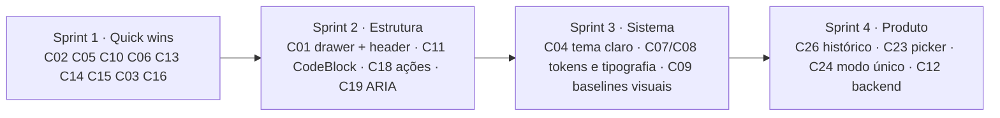

---

## Apêndice A — Medições de contraste (sobre `#0b0a14`)

| Elemento | Cor | Tamanho | Razão | WCAG AA |
|---|---|---|---|---|
| Inline code `.markdown-message p code` | `rgba(166,108,255,.44)` | 13,2 px | **2,00:1** | ❌ |
| Eyebrow `.project-navigation__eyebrow` | `rgba(166,108,255,.44)` | 9 px | **2,00:1** | ❌ |
| Modelo no header `.chat__model` | `rgba(245,241,255,.34)` | 10 px | **2,84:1** | ❌ |
| Indicador de contexto | `rgba(245,241,255,.34)` | 10 px | **2,84:1** | ❌ |
| Títulos de seção da sidebar | `rgba(245,241,255,.34)` | 9 px | **2,84:1** | ❌ |
| Placeholder do composer | `rgba(245,241,255,.34)` | 15 px | **2,84:1** | ❌ |
| Chips (provider/modelo) | `rgba(245,241,255,.58)` | 11 px | 6,28:1 | ✅ |
| Itens da sidebar | `rgba(245,241,255,.58)` | 13,1 px | 6,28:1 | ✅ |
| Texto do composer | `rgb(245,241,255)` | 15 px | 17,71:1 | ✅ |

## Apêndice B — Sequência de foco (Tab a partir da sidebar, conversa concluída)

`Novo chat → Novo Code → Chats → Projetos → 5 conversas → Nova conversa → Ações agendadas → Reverter alterações → Sim, aprovar e aceitar… → Sim, aprovar e revisar… → Pedir ajustes… → Write(calculadora.py) → calculadora.py → Write(test_…) → … → "Resposta concluída" (outline: none) → … → composer (último)`

Observações: não há "pular para o composer"; ações velhas e destrutivas (Reverter, aprovar plano) vêm antes do conteúdo; o foco em "Resposta concluída" não tem outline.

## Apêndice C — Pontos fortes a preservar

- Stop no lugar do Send, sem trocar o alvo do clique ([Composer.tsx#L385-L417](file:///c:/Users/User/Documents/GitHub/Carlos/orin/frontend/src/features/conversations/Composer.tsx#L385-L417)).
- Pinagem de scroll antes do paint, sem salto, e "Ir para o fim" com scroll suave respeitando reduced-motion.
- Reconexão SSE com backoff e ressincronização por snapshot; o cancelamento otimista evita o "Pensando" infinito.
- Diálogo de input muito longo com a alternativa "enviar como .txt".
- AgentPulse com movimento distinto por tipo de trabalho e versão estática em reduced-motion.
- Botões só com ícone têm `aria-label`; o picker de modelo explica "sem ferramentas" e oferece "Configurar provider".
