# 04 — Auditoria heurística do Orin Code

> **Escopo:** modo Code do Orin (Home em modo Code, sessão de código em `/chats/:id` com `mode = "code"`, composer, timeline de ferramentas, aprovações, plano, tarefas, arquivos, diffs, rewind, preferências do Modo Code).
> **Referência principal de UX:** Claude Code (CLI e app desktop). Referências secundárias: Cursor, Zed, Codex.
> **Data:** 2026-10-15 · **Estado auditado:** working tree atual (inclui arquivos **não commitados** `CodeToolCallBlock.tsx`, `PlanApprovalCard.tsx`, `TodoBar.tsx` e alterações em `ChatPage.tsx`, `Composer.tsx`, `TurnTimeline.tsx`, `Home.tsx`, etc.).
> **Não modifiquei código-fonte.** Este documento só registra achados e recomendações.

---

## 0. Método e ambiente

| Item | Como foi feito |
|---|---|
| Leitura de código | `Home.tsx`, `ChatPage.tsx`, `Composer.tsx`, `TurnTimeline.tsx`, `CodeToolCallBlock.tsx`, `PlanApprovalCard.tsx`, `ToolPermissionCard.tsx`, `TodoBar.tsx`, `CodeModeCard.tsx`, `ActivityStream.tsx`, `activityReducer.ts`, `WorkspaceNavigation.tsx`, `WorkspaceFileCard.tsx`, `api/codeMode.ts`, `api/conversations.ts`, `api/client.ts`, `styles/*`, `tailwind.config.ts`, `DESIGN.md`, `UX-CONTRACT.md`, spec `docs/superpowers/specs/2026-10-15-orin-code-claude-parity-design.md`. |
| Execução | Vite em `127.0.0.1:4190` (`VITE_AUTH_MODE=loopback`), **sem backend**. A API `/v1/**` foi simulada com rotas do Playwright em um contexto de navegador isolado. Duas sessões fictícias: `conv-code-1` (turno concluído com plano, edições, testes com falha e correção + turno aguardando permissão de Bash) e `conv-code-2` (turno em execução). |
| Capturas | 1440×900 e 1024×768. Tema escuro. Também testei `prefers-color-scheme: light`. |
| Verificações automáticas | axe-core (injetado na página), `elementFromPoint` para sobreposição de botões, estilos computados, ciclo de `Shift+Tab`, `Esc` durante execução. |
| Limitações | Dados são fictícios; prévia de arquivo e "Visão geral" não foram simuladas (aparecem em estado de erro). O bug de Stop relatado pelo usuário **não se reproduz com mocks** (ver OC-01); a causa-raiz está sendo investigada em `05-diagnostico-…md`. **Não existe tema claro** no produto (ver OC-24). |

---

## 1. Resumo executivo

O Orin Code **não tem layout de workspace de código**: é o Orin Chat com cards de ferramenta. Não há painel de alterações, árvore de arquivos usável, terminal, nem uma linha de status de execução. Ele imita parte do vocabulário do Claude Code (`Read(...)`, pílula `shift+tab to cycle`, `TodoWrite`), mas não reproduz o **fluxo de controle** que torna o Claude Code confiável. Esse fluxo tem quatro partes: interromper com `Esc`, prompts de permissão no lugar do input com opções numeradas, ciclo seguro de modos e checkpoints com confirmação.

Os problemas mais graves afetam **controle e segurança**:

1. **Perda de controle da execução**: o Stop some ou não responde (relato do usuário). Também não há `Esc`, fila de mensagens nem Stop enquanto a Visão geral está aberta.
2. **Aprovações inalcançáveis ou enganosas**: o botão **Permitir** fica coberto pela barra de tarefas. Cards de permissão e de plano antigos continuam clicáveis para sempre.
3. **Escalonamento acidental de privilégio**: um `Shift+Tab` vai de *ask permissions* para *bypass permissions* e grava isso como **preferência global**.
4. **Contexto de arquivos quebrado**: a gaveta "Arquivos" e a menção `@arquivo` nunca chamam a API, porque o cliente lança erro e o erro é engolido. A gaveta também não tem CSS.
5. **Design system quebrado nos componentes novos**: 42 usos de tokens CSS que **não existem** geram bordas brancas brilhantes e fundos transparentes.

**Nota heurística geral: 3/10.** Há boa intenção e peças úteis (diff com número de linha, pílula de modo, plano em Markdown, tarefas). Falta arquitetura de layout, e há bugs de segurança e de usabilidade bloqueantes.

---

## 2. Onde o Orin Code vive no código

| Camada | Arquivos | Papel |
|---|---|---|
| Entrada / Home | [Home.tsx](../../frontend/src/app/Home.tsx) | Seletor grande Chat / Orin Code, barra de workspace âmbar, composer com toggle Code, pílula de permissão, Worktree. Rota `/?mode=code`. |
| Navegação | [WorkspaceNavigation.tsx](../../frontend/src/features/projects/WorkspaceNavigation.tsx) | Botões "Novo chat" / "Novo Code", badge `>_` nas conversas Code. |
| Sessão | [ChatPage.tsx](../../frontend/src/features/conversations/ChatPage.tsx) (1.367 linhas) | Mesma página do Chat. `conversationMode === 'code'` liga o badge, o chip de pasta, a gaveta "Arquivos", o `Shift+Tab` global, a worktree e o `TurnTimeline` de código. Rota `/chats/:id` e `/projects/:p/chats/:id`. |
| Composer | [Composer.tsx](../../frontend/src/features/conversations/Composer.tsx) | Pílula de permissão, select oculto, Worktree, `@` menção, `/` comandos, TodoBar, Send/Stop. |
| Timeline | [TurnTimeline.tsx](../../frontend/src/features/conversations/TurnTimeline.tsx), [turnTimelineFold.ts](../../frontend/src/features/conversations/turnTimelineFold.ts), [activitySummary.ts](../../frontend/src/features/conversations/activitySummary.ts) | Dobra eventos por turno, renderiza `CodeToolCallBlock`, `PlanApprovalCard`, permissões e o botão "Reverter alterações". |
| Blocos de ferramenta | [CodeToolCallBlock.tsx](../../frontend/src/features/conversations/CodeToolCallBlock.tsx) *(não commitado)* | `Read/Update/Write/Bash/Grep/Glob/TodoWrite(...)`, diff inline, saída de terminal. |
| Aprovações | [ToolPermissionCard.tsx](../../frontend/src/features/conversations/ToolPermissionCard.tsx), [PlanApprovalCard.tsx](../../frontend/src/features/conversations/PlanApprovalCard.tsx) *(não commitado)*, [UserQuestionCard.tsx](../../frontend/src/features/conversations/UserQuestionCard.tsx) | Permissão por ferramenta, aprovação de plano (`exit_plan_mode`), perguntas. |
| Progresso | [TodoBar.tsx](../../frontend/src/features/conversations/TodoBar.tsx) *(não commitado)*, [AgentPulse.tsx](../../frontend/src/features/conversations/AgentPulse.tsx), [CodeModeCard.tsx](../../frontend/src/features/conversations/CodeModeCard.tsx) (aposentado no modo Code, ainda usado no Chat) | Tarefas, indicador "Executando comandos", stepper de 5 etapas. |
| Arquivos / diff | [WorkspaceFileCard.tsx](../../frontend/src/features/conversations/WorkspaceFileCard.tsx) (`WorkspaceFilePreview`, `StructuredDiffView`), [WorkspaceFolderButton.tsx](../../frontend/src/features/conversations/WorkspaceFolderButton.tsx) | Prévia em modal, diff unificado/lado a lado, vínculo de pasta. |
| API | [api/codeMode.ts](../../frontend/src/api/codeMode.ts), [api/conversations.ts](../../frontend/src/api/conversations.ts) | Preferências (`/v1/code-mode/settings`), modos de permissão, worktree, `workspace-files`, `permission-mode`, `rewind`, `tool-permission`. |
| Preferências | [RuntimeSettingsPage.tsx](../../frontend/src/features/settings/RuntimeSettingsPage.tsx) | "MODO CODE · Autonomia e acompanhamento". |
| Desktop | [desktop/electron/main.cjs](../../desktop/electron/main.cjs) `desktop:notify-code-mode` | Notificações do sistema (conclusão / bloqueio / decisão). |
| Backend | `src/agentos/code_mode/*` (`permissions.py`, `checkpoints.py`, `worktree.py`, `prompt.py`), `src/agentos/agentic/*` | Runtime, fases, permissões, checkpoints. |
| Legado | `frontend/src/features/executions/*` (rotas `/execution/*`) | Superfície antiga de execução. **Não faz parte** do Orin Code atual. |

---

## 3. Referência: fluxo do Claude Code × Orin Code

| Momento | Claude Code (comportamento público) | Orin Code hoje | Gap |
|---|---|---|---|
| Início | Mostra o diretório de trabalho. O modo padrão pede permissão para edições e comandos não seguros. | A Home força **accept edits** ao escolher Code, mesmo com preferência global `approval_required` | Default inseguro e contrário ao `UX-CONTRACT.md` |
| Ciclo de modos | `Shift+Tab` alterna *normal → accept edits → plan mode*. *Bypass* só aparece com flag explícita na inicialização | `Shift+Tab` cicla *accept → plan → ask → **bypass*** | Bypass a um toque de distância |
| Em execução | Linha de status viva: verbo, tempo decorrido, tokens e "esc to interrupt". `Esc` interrompe. Dá para digitar a próxima instrução | Ponto pulsante "Executando comandos", sem tempo nem tokens. `Esc` não faz nada. Composer bloqueado | Sem controle por teclado; sem *steering* |
| Ferramentas | Linhas compactas `⏺ Read(path)` com resultado resumido `⎿ Read 120 lines`. Detalhe sob demanda. Diffs só em edições | Cada chamada vira caixa com borda. Diffs **abertos por padrão**. Leituras e buscas não são agrupadas | Ruído visual; scroll longo |
| Permissão | O prompt **ocupa o lugar do input**, com opções numeradas: 1 Sim · 2 Sim, não perguntar de novo para *X* · 3 Não, e dizer o que fazer (`Esc`) | Card no meio do histórico. Pode ficar coberto pela barra de tarefas. Sem atalhos | Aprovação perdida no scroll |
| Plano | Plano em Markdown e opções: 1 Sim, aceitar edições · 2 Sim, aprovar manualmente · 3 Não, continuar planejando | Card com 2 botões e campo de 1 linha. Continua ativo depois de decidido | Estado resolvido inexistente |
| Tarefas | Checklist atualizado no fluxo. Itens só marcados quando de fato concluídos | Barra acima do composer. **Marca tudo como concluído** quando o turno termina | Progresso falso |
| Checkpoints | `Esc Esc` / `/rewind` abre a lista de pontos e pergunta o que restaurar (código, conversa ou ambos) | Botão "Reverter alterações" no topo do turno, **sem confirmação** e sem tratamento de erro | Ação destrutiva sem salvaguarda |
| Contexto | `@arquivo` com autocomplete e uso de contexto visível | `@` e gaveta de arquivos **quebrados** (OC-05). Contexto só no hover do header | Sem anexar arquivos do repo |
| Revisão de mudanças | No app desktop e em IDEs: painel de diff por arquivo, aceitar ou rejeitar | Inexistente. A prévia mostra só o último patch do arquivo | Sem visão consolidada |

---

## 4. Galeria de evidências

> Os títulos e dados das sessões são fictícios (mocks). As capturas estão em `docs/ux-redesign/images/code/`.

| # | Captura | O que mostra |
|---|---|---|
| 01 |  | Home em modo Code: dois controles "Code", pílula truncada, hero de marketing, âmbar fora do DS, estados crus (`waiting_user`) |
| 02 | 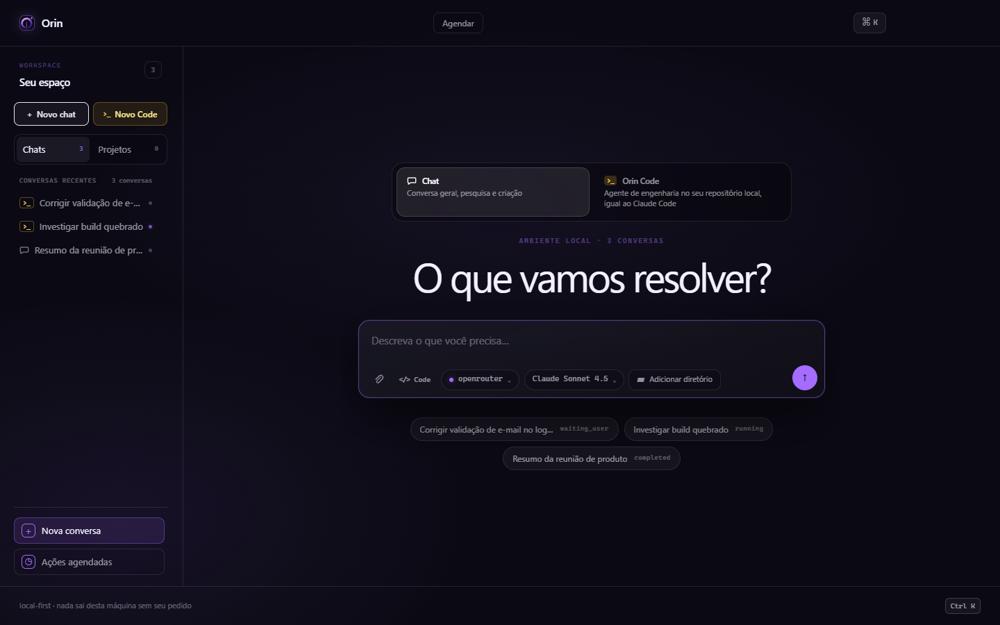 | Home em modo Chat (comparação de consistência) |
| 03 | 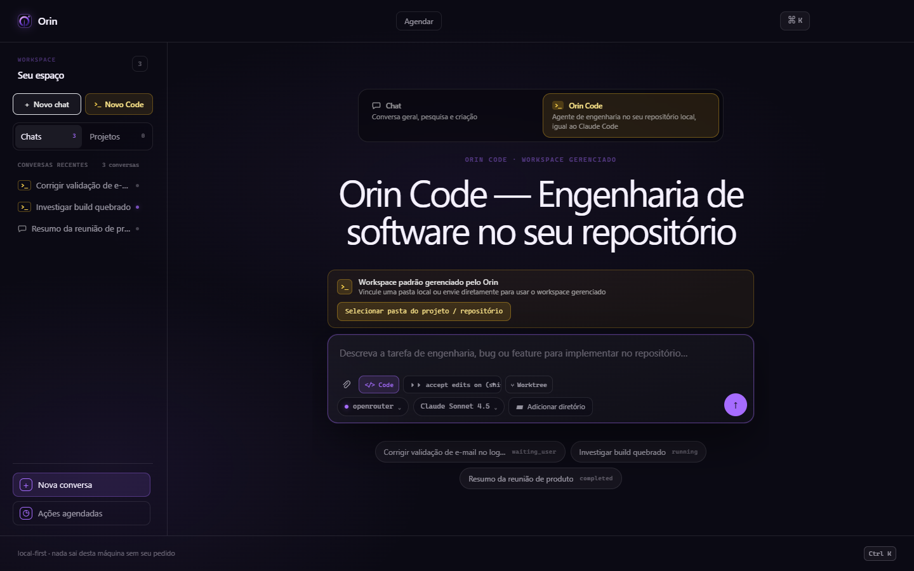 | `prefers-color-scheme: light`: idêntica à 01 (não existe tema claro) |
| 10 | 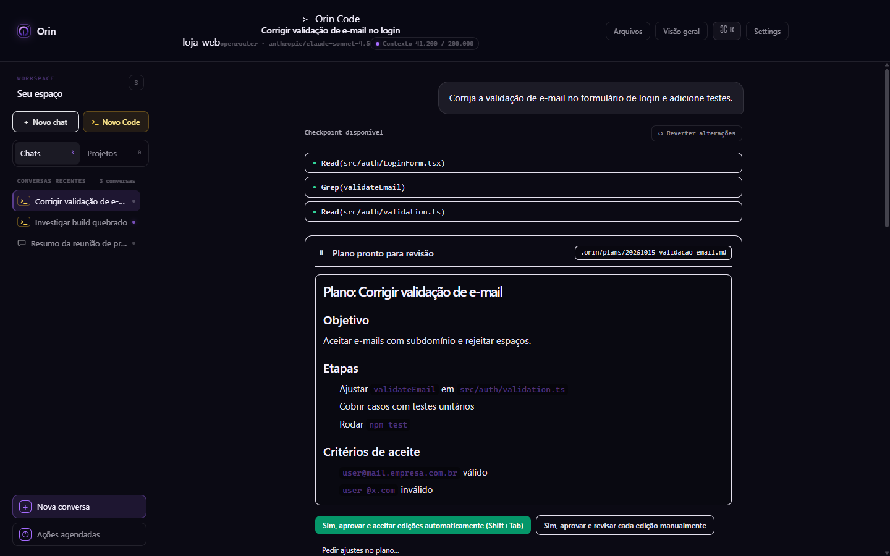 | Header desalinhado, "Reverter alterações" no topo do turno, blocos com borda branca, plano de turno concluído ainda com botões ativos |
| 11 | 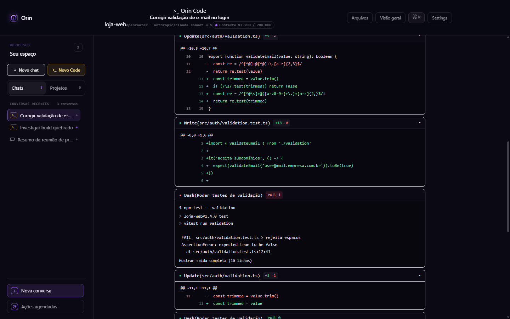 | Diffs abertos por padrão, linhas +/− sem fundo, Bash com falha |
| 12 / 13 | 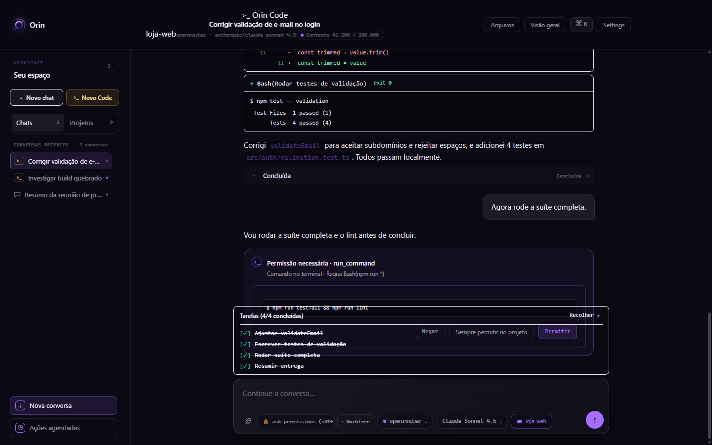 | Permissão pendente coberta pela TodoBar transparente ("4/4 concluídas" falso) |
| 14 | 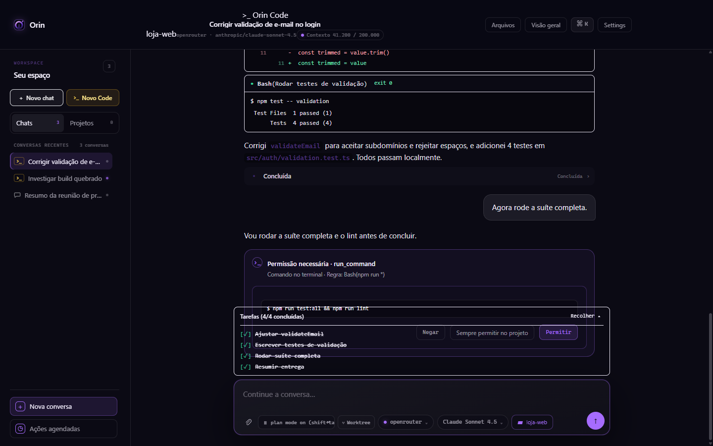 | Pílula de modo truncada após ciclos de `Shift+Tab` |
| 15 | 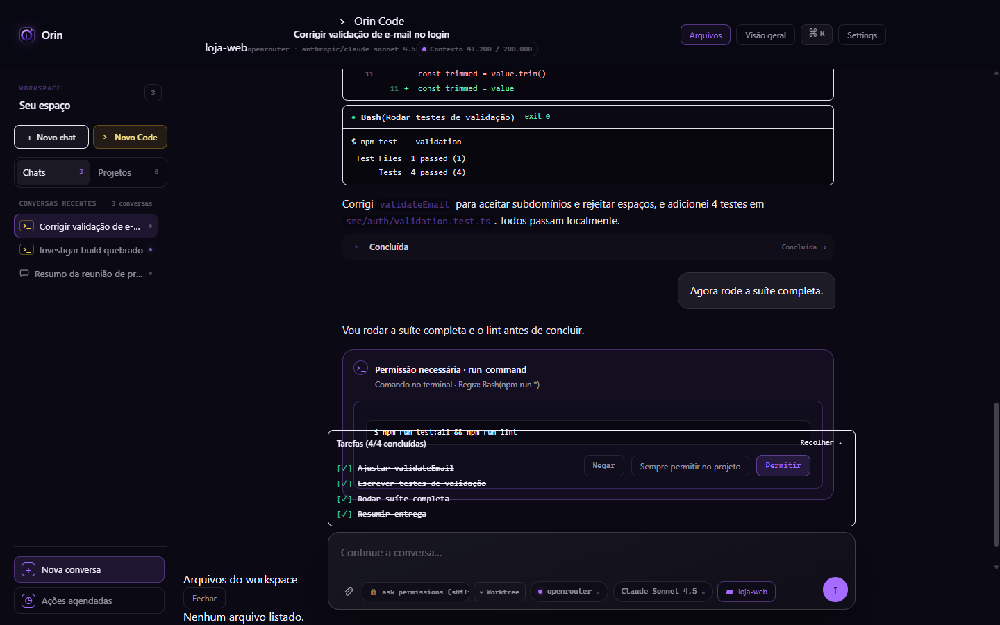 | Gaveta "Arquivos do workspace" sem estilo, renderizada no rodapé da sidebar, com "Nenhum arquivo listado" |
| 16 | 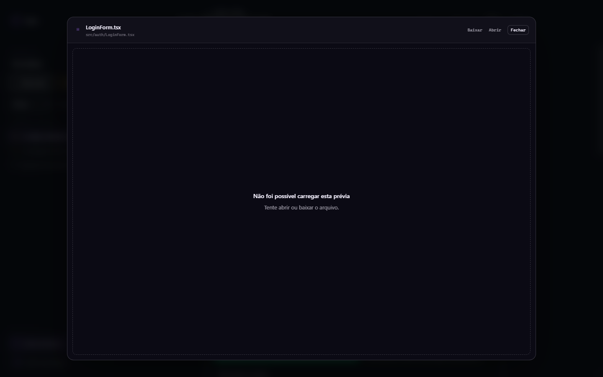 | Prévia de arquivo em modal de tela cheia (bloqueia a conversa) |
| 17 | 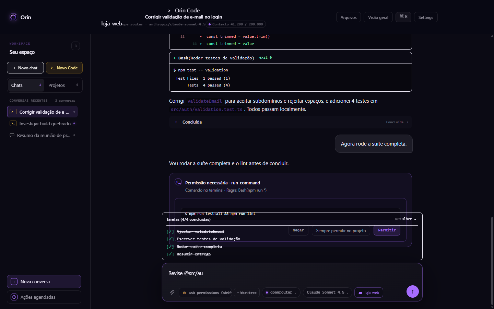 | `@src/au` não abre sugestões |
| 18 | 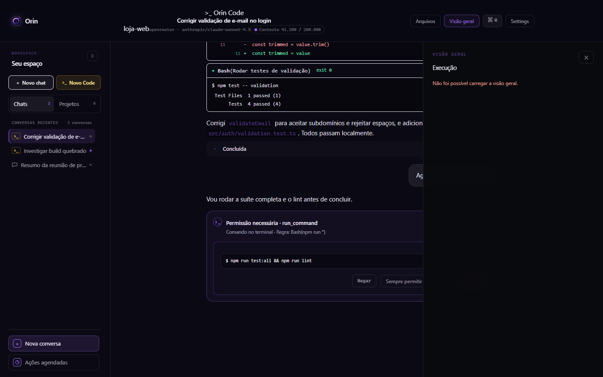 | Visão geral cobre o histórico e **remove o composer e o Stop** |
| 19 | 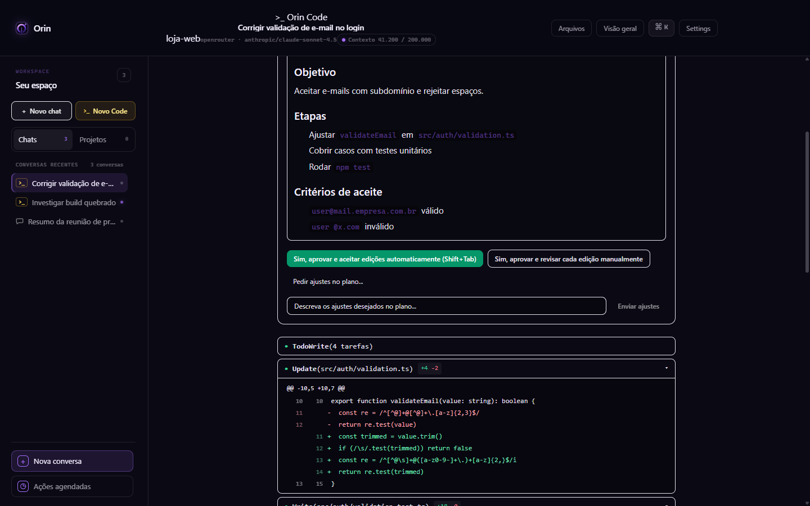 | "Pedir ajustes no plano" com campo de uma linha |
| 20 | 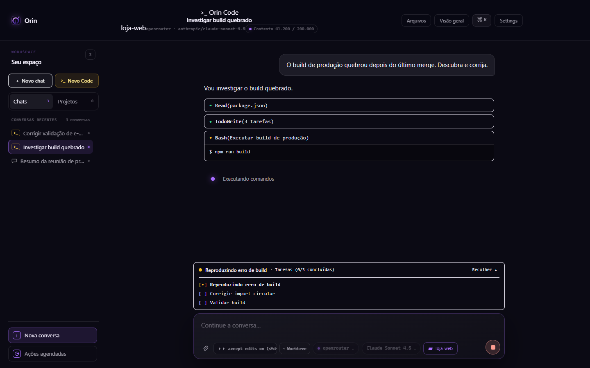 | Execução: sem tempo, tokens ou cauda de saída; Stop pequeno; sem dica de `Esc` |
| 30 / 31 | 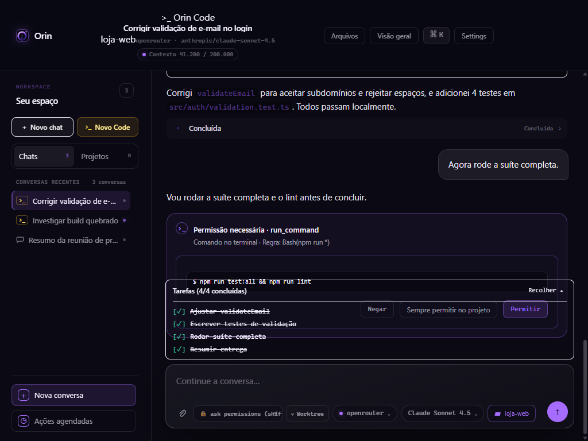 | 1024 px: header em 3 linhas, mesma sobreposição |
| 32 | 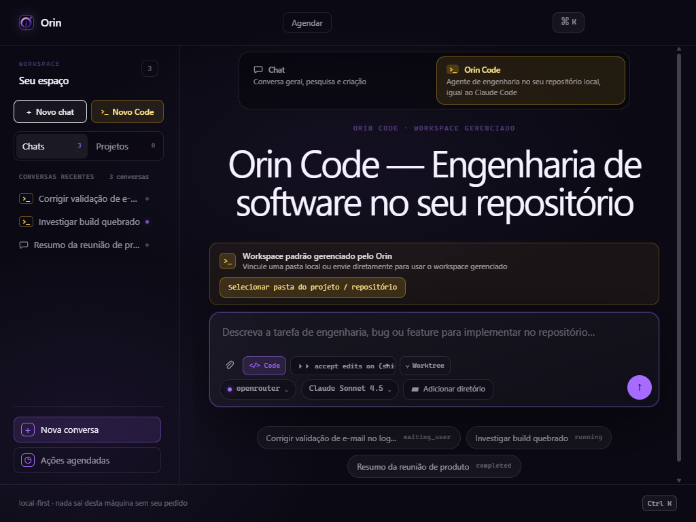 | Home 1024 px |

---

## 5. Tabela-mestre de achados

Severidade: **P0** bloqueia o fluxo ou cria risco · **P1** prejudica muito a tarefa ou viola um contrato · **P2** atrito relevante · **P3** polimento.

| ID | Sev. | Área | Achado |
|---|---|---|---|
| OC-01 | **P0** | Execução | Stop indisponível ou inoperante durante a execução (relato do usuário) |
| OC-02 | **P0** | Aprovação | Botões de permissão cobertos pela TodoBar e pelo composer |
| OC-03 | **P0** | Aprovação | Cards de permissão e de plano continuam acionáveis depois de decididos ou recarregados |
| OC-04 | **P0** | Permissões | `Shift+Tab` vai de *ask* direto para *bypass*, sem confirmação, e grava como preferência global |
| OC-05 | **P0** | Contexto | Gaveta de arquivos e `@menção` quebradas (API nunca chamada) e gaveta sem CSS |
| OC-06 | P1 | Design system | 42 usos de tokens CSS inexistentes nos componentes do Code |
| OC-07 | P1 | Permissões | Default *accept edits* contradiz o `UX-CONTRACT.md` e a preferência do servidor |
| OC-08 | P1 | A11y / teclado | `Shift+Tab` global sequestra a navegação reversa de foco |
| OC-09 | P1 | Diff / rewind | Sem revisão consolidada de mudanças; rewind tudo-ou-nada, sem confirmação |
| OC-10 | P1 | Densidade | Cada chamada de ferramenta vira um card; viola o contrato de "Activity in chat" |
| OC-11 | P1 | Progresso | Estágio e estado do Code invisíveis; TodoBar marca tarefas não feitas como concluídas |
| OC-12 | P1 | Composer | Composer ocupa 34% da altura, com controles truncados, duplicados e falsos |
| OC-13 | P1 | Erros | Falhas silenciosas em ações críticas (modo, worktree, plano, plugin) |
| OC-14 | P1 | Layout | "Visão geral" esconde o composer e o Stop |
| OC-15 | P1 | Header | Header de sessão desorganizado, sem branch nem estado, com modelo duplicado |
| OC-17 | P1 | A11y | Contraste insuficiente, controles interativos aninhados e estado só por cor |
| OC-16 | P2 | Consistência | Âmbar como identidade do Code contra o DS violeta; Tailwind solto contra tokens |
| OC-18 | P2 | Atalhos | Faltam `Esc`, `Esc Esc`, 1/2/3, painel e ajuda; `⌘K` e `Ctrl K` inconsistentes |
| OC-19 | P2 | Execução | Não é possível enviar nem enfileirar mensagem durante a execução |
| OC-20 | P2 | Microcopy | Mistura de inglês e pt-BR, estados crus, "igual ao Claude Code" na UI |
| OC-21 | P2 | Plano | Feedback em 1 linha, sem "continuar planejando", CTA primário é o menos supervisionado |
| OC-22 | P2 | Home | Hero de marketing e ações duplicadas na sidebar e no header |
| OC-23 | P2 | Terminal | Sem streaming visível, tempo, stderr distinto nem cópia |
| OC-24 | P2 | Tema | Não existe tema claro; classes fixas `white/xx` e `black/xx` impedem criar um |
| OC-25 | P2 | Tipografia / diff | Linhas de diff sem fundo (classe Tailwind inexistente); código inline com pouco contraste |
| OC-26 | P2 | Estados | Erro mostrado como vazio; erros sem "tentar novamente"; loading só em texto |
| OC-29 | P2 | Navegação | Sidebar mistura Chat e Code; "aguardando você" só como ponto colorido |
| OC-30 | P2 | Responsivo | Em 1024 px o header quebra em 3 linhas e a sidebar não colapsa |
| OC-27 | P3 | Contexto | Sem visão de "arquivos no contexto"; uso de contexto só no hover |
| OC-28 | P3 | Arquitetura | `ChatPage.tsx` com 1.367 linhas e dezenas de estados dificulta evoluir a UX |

---

## 6. Achados detalhados

### OC-01 · P0 · Stop indisponível ou inoperante durante a execução
- **Evidência:** relato do usuário: no modo Code o botão de parar não pode ser clicado enquanto o agente roda, a não ser que outra mensagem seja enviada.
  - Em [ChatPage.tsx:668-675](../../frontend/src/features/conversations/ChatPage.tsx#L668-L675), `running` é a conjunção de **7 condições**: `!stopping`, `conversation.state` em `RUNNING_STATES`, `activeTurn.state` em `running|queued`, `openQuestionTurnIds.size === 0`, `!hasTerminalEventForActiveTurn` e `!isActivityTerminal` (que lê o `activity.status` **global**).
  - O [Composer.tsx:388-416](../../frontend/src/features/conversations/Composer.tsx#L388-L416) troca **Send por Stop no mesmo lugar**. Se qualquer condição falhar, o usuário vê Send em vez de Stop.
  - [ChatPage.tsx:880](../../frontend/src/features/conversations/ChatPage.tsx#L880) bloqueia o envio quando `running` é verdadeiro. Isso é coerente com o sintoma "só volta depois de enviar outra mensagem": o envio força `loadSnapshot` e a reconciliação.
  - Com mocks o Stop aparece e é clicável (captura 20; `elementFromPoint` atinge `.composer__stop-glyph`). O defeito depende de sequência real de eventos. A causa-raiz fica em `05-diagnostico-…`.
- **Impacto:** o usuário perde o controle de um agente que **edita o repositório e executa comandos**. É o pior cenário de confiança em uma ferramenta de agente.
- **Recomendação (paridade Claude Code):**
  1. Derivar "pode parar" de **um único fato do servidor**: existe turno não terminal. Não usar heurística de 7 fatores.
  2. Stop **separado** do Send e sempre visível enquanto houver turno não terminal, inclusive em `waiting_user`. Aí ele vira "Cancelar turno".
  3. `Esc` interrompe, com a dica "esc para interromper" na linha de status.
  4. Feedback imediato ("Parando…") e estado final explícito ("Interrompido por você às 18:12").
  5. Permitir digitar durante a execução (ver OC-19).

### OC-02 · P0 · Aprovações cobertas pela TodoBar e pelo composer
- **Evidência:**
  - Capturas 13, 15 e 30: o botão **Permitir** fica atrás da TodoBar.
  - `document.elementFromPoint(centro de "Permitir")` retorna `[data-testid=todo-bar]`, ou seja, `covered: true`.
  - `.chat__thread` tem `padding-bottom: 168px`, mas a área TodoBar + composer mede **309,5 px**.
  - A TodoBar tem fundo transparente porque usa `bg-[var(--surface-raised)]`, token inexistente ([TodoBar.tsx:27](../../frontend/src/features/conversations/TodoBar.tsx#L27)). O histórico vaza por trás dela.
- **Impacto:** com a lista de tarefas expandida (padrão para até 5 itens), a decisão pendente não pode ser clicada. O agente fica travado em `waiting_user`.
- **Recomendação:**
  - Medir o footer com `ResizeObserver` e aplicar `padding-bottom` dinâmico (e `scroll-padding`) ao histórico. Dar fundo opaco à TodoBar.
  - **Melhor (Claude Code):** quando houver decisão pendente, mostrar o prompt de permissão **ancorado no lugar do composer**, com opções numeradas e foco automático. O card no histórico passa a ser só um registro.

### OC-03 · P0 · Cards de permissão e de plano acionáveis para sempre
- **Evidência:**
  - [ActivityStream.tsx:71-79](../../frontend/src/features/conversations/ActivityStream.tsx#L71-L79) passa `active={true}` fixo ao `ToolPermissionCard`. O estado `resolved` é só local e se perde ao recarregar.
  - Não existe evento de "permissão resolvida" no parser (grep sem ocorrências).
  - O `PlanApprovalCard` não tem estado resolvido, e o `TurnTimeline` nunca passa `disabled` ([TurnTimeline.tsx:249-266](../../frontend/src/features/conversations/TurnTimeline.tsx#L249-L266)).
  - Medido na captura 10: `planButtonsEnabled: 1` em um turno **concluído**.
- **Impacto:** é possível aprovar duas vezes ou aprovar uma requisição expirada. O usuário não sabe o que está realmente pendente, e o histórico deixa de ser confiável como registro.
- **Recomendação:** derivar `active` de `openQuestionTurnIds` e do `requestId` pendente vindo do servidor. Após a decisão, mostrar um carimbo legível ("Permitido uma vez · `npm run test:all` · 18:12" / "Plano aprovado · aceitar edições") e recolher o card.

### OC-04 · P0 · Escalonamento acidental para "bypass permissions"
- **Evidência:**
  - A ordem do ciclo é `['accept_edits','plan_mode','ask_permissions','full_autonomy']` ([codeMode.ts:71-75](../../frontend/src/api/codeMode.ts#L71-L75)).
  - Teste a partir de *ask permissions*: o primeiro `Shift+Tab` leva a `bypass permissions` (medido: `modes[0] = "bypass permissions (shift+tab to cycle)"`).
  - Cada troca chama `setCodeModeSettings`, que **grava como autonomia global** ([ChatPage.tsx:325-337](../../frontend/src/features/conversations/ChatPage.tsx#L325-L337)). Não há confirmação, aviso nem banner.
- **Impacto:** uma tecla, que também é a tecla de navegação reversa (ver OC-08), libera execução sem aprovação. A mudança afeta **todas as sessões futuras**.
- **Recomendação:**
  - Ciclo igual ao do Claude Code: **Perguntar → Aceitar edições → Plano**.
  - *Autonomia total* só por menu explícito, com diálogo de confirmação e um banner vermelho persistente no header ("Autonomia total ativa — comandos executam sem pedir").
  - Separar o "modo desta sessão" da "preferência global": trocar na sessão **não** deve alterar o global.

### OC-05 · P0 · Arquivos do workspace e `@menção` quebrados
- **Evidência:**
  - `listWorkspaceFiles` monta `path` com `?query=…&limit=…` ([codeMode.ts:153-173](../../frontend/src/api/codeMode.ts#L153-L173)).
  - `ApiClient.safeUrl` **lança** `TypeError('API paths must be absolute and must not contain query data')` ([client.ts:162-165](../../frontend/src/api/client.ts#L162-L165)).
  - O erro é engolido na gaveta (`.catch(() => setDrawerFiles([]))`, [ChatPage.tsx:356-358](../../frontend/src/features/conversations/ChatPage.tsx#L356-L358)) e na menção (`items: []`, [Composer.tsx:176-178](../../frontend/src/features/conversations/Composer.tsx#L176-L178)).
  - Medido: **0 requisições** a `workspace-files` ao abrir a gaveta.
  - Não há nenhuma regra `.chat__workspace-drawer*` em `agentos.css`. A gaveta aparece sem estilo, na parte de baixo da sidebar (captura 15).
- **Impacto:** em um agente de código, não dá para navegar no repositório nem anexar arquivos ao contexto. A mensagem "Nenhum arquivo listado" esconde um erro.
- **Recomendação:**
  - Correção imediata: usar a opção `query` de `client.request`.
  - Redesenho: painel direito "Arquivos" com árvore, busca fuzzy, status git (M/A/D), "adicionar ao contexto" e estados de loading, vazio e erro distintos.

### OC-06 · P1 · Tokens CSS inexistentes nos componentes do Code
- **Evidência:**
  - `--border-subtle`, `--surface-raised`, `--surface-hover`, `--text-primary`, `--text-secondary`, `--text-muted` e `--accent-primary` **não estão definidos** em nenhum CSS.
  - Usos: CodeToolCallBlock 17, PlanApprovalCard 11, TodoBar 10, TurnTimeline 2, Composer, ChatPage e WorkspaceFileCard 1 cada.
  - Estilo computado do bloco: `border-color: rgba(245,241,255,.93)` (cai em `currentColor`) e `background: transparent`.
  - Resultado visual: caixas com **contorno branco brilhante** (capturas 10 e 11), TodoBar transparente (OC-02) e o botão "Enviar ajustes" (`bg-[var(--accent-primary)]`) sem fundo.
  - O `tailwind.config.ts` ainda tem uma paleta órfã (`accent: '#c8ff6a'`, `ink: '#f4f0e9'`).
- **Impacto:** contradiz o `DESIGN.md` ("hierarquia por espaçamento e superfícies sutis, não caixas densas"). A sessão de código fica com a aparência mais pesada do produto.
- **Recomendação:**
  - Quick win: definir esses nomes como aliases dos `--orin-*` no `theme.css`.
  - Estrutural: mapear os tokens no `tailwind.config.ts` (`colors.orin.*`) e proibir `var(--…)` não declarados e `white/xx` com uma regra de lint ou stylelint.

### OC-07 · P1 · Default *accept edits* contra o contrato
- **Evidência:**
  - Home: `requestedModeParam === 'code' ? 'accept_edits'`, e o mesmo em `selectMode` e após carregar as preferências ([Home.tsx:52-54, 84-88, 124-129](../../frontend/src/app/Home.tsx#L52-L54)). Teste: com o servidor em `approval_required`, a pílula mostra **"accept edits on"**.
  - `parseModeAndPermission` assume `accept_edits` em conversas Code sem `permission_mode` ([conversations.ts:92-102](../../frontend/src/api/conversations.ts#L92-L102)).
  - O texto fixo "Auto-accept edits ativo" ([Home.tsx:329](../../frontend/src/app/Home.tsx#L329)) aparece mesmo que o modo seja outro.
  - O [UX-CONTRACT.md](../../UX-CONTRACT.md) diz "`approval_required` is the default"; a spec de paridade escolheu o contrário.
- **Impacto:** o produto contradiz a si mesmo e edita o repositório sem a supervisão que o usuário configurou.
- **Recomendação:** decidir e registrar um único default (sugestão: **Perguntar**, como o Claude Code). Sempre respeitar a preferência do servidor e sempre exibir o modo **efetivo**, nunca um texto fixo.

### OC-08 · P1 · `Shift+Tab` global sequestra o foco
- **Evidência:**
  - Listener em `window` com `preventDefault` em toda a página da sessão Code ([ChatPage.tsx:339-350](../../frontend/src/features/conversations/ChatPage.tsx#L339-L350)).
  - Teste: foco em "Arquivos" + `Shift+Tab` deixa o foco **no mesmo botão** e troca o modo de permissão.
- **Impacto:** quebra os critérios WCAG 2.1.1 (Teclado) e 2.4.3 (Ordem de foco). Usuários de teclado e de leitor de tela não conseguem voltar o foco e, sem saber, trocam a permissão (combina com OC-04).
- **Recomendação:** tratar o atalho **só no textarea do composer**, como no input do Claude Code, ou usar um atalho com modificador. Anunciar a troca em `aria-live`.

### OC-09 · P1 · Sem revisão consolidada; rewind sem salvaguarda
- **Evidência:**
  - "Reverter alterações" aparece **no topo** do turno, antes do conteúdo, com rótulo "Checkpoint disponível" ([TurnTimeline.tsx:400-417](../../frontend/src/features/conversations/TurnTimeline.tsx#L400-L417)).
  - Executa sem confirmação, e `handleRewind` usa `try/finally` **sem `catch`** ([TurnTimeline.tsx:213-226](../../frontend/src/features/conversations/TurnTimeline.tsx#L213-L226)): rejeição não tratada e nenhuma mensagem de erro.
  - A prévia de arquivo mostra só o **último** patch daquele caminho ([ChatPage.tsx:1220-1233](../../frontend/src/features/conversations/ChatPage.tsx#L1220-L1233)) e abre em modal de tela cheia (captura 16).
  - Há dois renderizadores de diff diferentes: o inline do `CodeToolCallBlock` e o `StructuredDiffView`.
- **Impacto:** não há como responder "o que esta sessão mudou no meu repo?" antes de commitar. Reverter é tudo-ou-nada e pode destruir trabalho sem aviso.
- **Recomendação:**
  - Painel **Alterações**: lista de arquivos com +/−, diff unificado ou lado a lado, "reverter arquivo/hunk", "abrir no editor" e "copiar patch".
  - **Menu de checkpoints** (Claude Code `Esc Esc` / `/rewind`) com escolha entre restaurar código, conversa ou ambos, e diálogo de confirmação que lista os arquivos afetados.
  - Um único componente de diff.

### OC-10 · P1 · Atividade não agrupada: parede de cards
- **Evidência:**
  - Cada evento de ferramenta vira um `CodeToolCallBlock` ([TurnTimeline.tsx:331-338, 354-361](../../frontend/src/features/conversations/TurnTimeline.tsx#L331-L338)). Foram **9 blocos** em um turno simples, e o histórico tem 2.429 px para 2 turnos.
  - Diffs começam abertos (`useState(true)`, [CodeToolCallBlock.tsx:54](../../frontend/src/features/conversations/CodeToolCallBlock.tsx#L54)).
  - O [UX-CONTRACT.md §Activity in chat](../../UX-CONTRACT.md) exige que uma sequência contínua seja **uma linha expansível**, em texto discreto com chevron.
- **Impacto:** fica difícil ver o que importa (edições, falhas, decisões), e o scroll esconde o estado atual.
- **Recomendação:**
  - Agrupar leituras e buscas consecutivas ("Explorou 3 arquivos · buscou `validateEmail`", expansível).
  - Edições com cabeçalho `Update(src/auth/validation.ts) +4 −2` e diff **recolhido** acima de ~12 linhas.
  - Bash com uma linha de resultado (`exit 1 · 1 falhou, 3 passaram`) e cauda sob demanda.
  - Falhas sempre visíveis.

### OC-11 · P1 · Estado e estágio invisíveis; progresso falso
- **Evidência:**
  - O `DESIGN.md` define o card de 5 etapas como "representação canônica" que deve dizer se o trabalho está rodando, aguardando, bloqueado ou concluído. O `TurnTimeline` o **aposentou** no modo Code ([TurnTimeline.tsx:302-342](../../frontend/src/features/conversations/TurnTimeline.tsx#L302-L342)) sem colocar nada no lugar.
  - `settleTodos` marca **todos** os itens como `completed` quando o turno termina ([activityReducer.ts:92-107](../../frontend/src/features/conversations/activityReducer.ts#L92-L107)). Captura 15: "Tarefas (4/4 concluídas)" quando "Rodar suíte completa" e "Resumir entrega" nunca terminaram.
- **Impacto:** viola o `DESIGN.md` ("must not imply validation that did not happen") e induz o usuário a confiar em entregas não validadas.
- **Recomendação:**
  - **Linha de status persistente** acima do composer: estado (Executando / Aguardando você / Bloqueado / Concluído com ressalvas), etapa, tempo decorrido, tokens e "esc para interromper".
  - Não autocompletar tarefas. Ao encerrar, mostrar "2 de 4 concluídas · 2 não executadas".

### OC-12 · P1 · Composer sobrecarregado, com controles truncados, duplicados e falsos
- **Evidência:**
  - O footer mede 309,5 px de 900 px (34%).
  - A pílula aparece truncada: "accept edits on (shi" e "ask permissions (shif" (capturas 01, 13 e 14).
  - O texto da pílula é inglês com emoji (`formatPermissionModePill`, [Composer.tsx:65-76](../../frontend/src/features/conversations/Composer.tsx#L65-L76)), enquanto o select oculto está em pt-BR.
  - Na Home, o **Worktree é um toggle falso**: a Home não passa `onWorktreeIsolatedChange` e, mesmo assim, o botão fica `aria-pressed=true` (medido).
  - Na Home, o toggle "Code" do composer duplica o seletor grande ([Home.tsx:237-286](../../frontend/src/app/Home.tsx#L237-L286) + [Composer.tsx:331-338](../../frontend/src/features/conversations/Composer.tsx#L331-L338)).
  - "Selecionar pasta do projeto" aciona por `document.querySelector('.workspace-folder__button').click()` ([Home.tsx:343-353](../../frontend/src/app/Home.tsx#L343-L353)), o que duplica "Adicionar diretório".
- **Impacto:** a área de leitura encolhe, o usuário não vê o modo real e há controles que mentem sobre o próprio efeito.
- **Recomendação:**
  - Composer em 2 linhas: input, e uma barra com anexar, `@`, modo (menu com rótulo curto em pt-BR: *Perguntar · Aceitar edições · Plano · Autonomia total*), modelo e enviar/parar.
  - Mover pasta, worktree e branch para o header da sessão.
  - Esconder ou desabilitar o Worktree antes de existir uma sessão.

### OC-13 · P1 · Falhas silenciosas em ações críticas
- **Evidência:**
  - `updateConversationPermissionMode(...).catch(() => undefined)` e `setCodeModeSettings(...).catch(() => undefined)` em [ChatPage.tsx:330, 336](../../frontend/src/features/conversations/ChatPage.tsx#L330); o mesmo em [Home.tsx:143, 173](../../frontend/src/app/Home.tsx#L143).
  - A worktree reverte em silêncio ([ChatPage.tsx:380-382](../../frontend/src/features/conversations/ChatPage.tsx#L380-L382)).
  - As aprovações de plano usam `void handler(event)`, sem estado ocupado nem erro ([TurnTimeline.tsx:253-264](../../frontend/src/features/conversations/TurnTimeline.tsx#L253-L264)).
  - `submitPluginApproval` não tem `try` ([ChatPage.tsx:803-810](../../frontend/src/features/conversations/ChatPage.tsx#L803-L810)).
- **Impacto:** a UI diz "Perguntar" enquanto o servidor continua em outro modo. Isso é perigoso.
- **Recomendação:** atualização otimista com **rollback visível** e mensagem inline junto ao controle (regra já presente no `DESIGN.md`: "clear saved/error state beside the action").

### OC-14 · P1 · "Visão geral" remove o composer e o Stop
- **Evidência:** `{!loadFailure && !showOverview && <footer …>}` ([ChatPage.tsx:1236](../../frontend/src/features/conversations/ChatPage.tsx#L1236)). Na captura 18 o painel cobre o histórico, corta o card de permissão e o composer desaparece.
- **Impacto:** ao abrir a Visão geral durante a execução, não dá para parar nem responder.
- **Recomendação:** Visão geral como painel lateral redimensionável que **coexiste** com o histórico e o composer, ou como aba do painel direito.

### OC-15 · P1 · Header de sessão desorganizado
- **Evidência:**
  - Capturas 10 e 30: o badge `>_ Orin Code` fica empilhado acima do título; `loja-web` (16 px) aparece colado em `openrouter · anthropic/claude-sonnet-4.5` (mono 10 px, baixo contraste segundo o axe); em 1024 px o header tem 3 linhas.
  - Não mostra branch git, estado da execução nem modo de permissão.
  - O modelo aparece duas vezes: no texto cru do header ([ChatPage.tsx:990](../../frontend/src/features/conversations/ChatPage.tsx#L990)) e no `ModelPicker` do composer.
  - "Settings" está em inglês ([ChatPage.tsx:1014](../../frontend/src/features/conversations/ChatPage.tsx#L1014)).
- **Recomendação:** header de uma linha: `[CODE] Título · loja-web ⎇ main · ● Executando 1m12s · Perguntar` à esquerda e `Alterações · Arquivos · Terminal · ⋯` à direita. O modelo fica num único lugar.

### OC-17 · P1 · Acessibilidade
- **Evidência (axe, sessão Code):**
  - `color-contrast` (serious, 10 nós: `.chat__model`, `.context-indicator`, …).
  - `nested-interactive` (serious, 3 nós): o cabeçalho do bloco tem `role="button"` e contém um `<button>` com o nome do arquivo ([CodeToolCallBlock.tsx:118-160](../../frontend/src/features/conversations/CodeToolCallBlock.tsx#L118-L160)).
  - O status dos blocos é um `●` colorido com `aria-hidden` ([CodeToolCallBlock.tsx:138-140](../../frontend/src/features/conversations/CodeToolCallBlock.tsx#L138-L140)), e "executando" ou "falhou" não é anunciado.
  - O `ModeBadge` e o ponto de estado na sidebar têm `aria-hidden` ([WorkspaceNavigation.tsx:20-47, 215](../../frontend/src/features/projects/WorkspaceNavigation.tsx#L20-L47)): o leitor de tela não sabe se a conversa é Code nem se está aguardando.
  - O `aria-label` da pílula ("Modo de permissão do Code") não inclui o valor atual.
- **Recomendação:** disclosure com `<button aria-expanded>` separado do link do arquivo; status com texto visualmente oculto ("concluído", "falhou, exit 1"); rótulos com o valor ("Modo de permissão: Perguntar"); contraste ≥ 4,5:1 nos metadados.

### OC-16 · P2 · Identidade visual inconsistente com o DS e com o Chat
- **Evidência:**
  - Âmbar como cor do Code em [Home.tsx:272, 316-353](../../frontend/src/app/Home.tsx#L272) e [WorkspaceNavigation.tsx:24, 158](../../frontend/src/features/projects/WorkspaceNavigation.tsx#L24), contra o `DESIGN.md` ("violeta é a cor de affordance").
  - Home com 15 e navegação com 5 ocorrências de `amber-|emerald-|rose-|white/`.
  - Verde (`bg-emerald-600`) como CTA primário do plano.
- **Recomendação:** o Code se diferencia por **ícone e rótulo** (`CODE`), não por paleta. Usar tokens semânticos (`--orin-warn`, `--orin-success`) só para estados.

### OC-18 · P2 · Atalhos de teclado
- **Inventário atual:** `Ctrl/⌘ K` (paleta), `Enter` / `Shift+Enter`, `/` comandos, `@` menção, `Shift+Tab` (modo, global, ver OC-08).
- **Faltam:** `Esc` para interromper (testado: 0 chamadas a `/cancel`), `Esc Esc` para checkpoints, `1/2/3` nas aprovações, atalho para alternar o painel direito, `?` para a lista de atalhos.
- O header mostra `⌘ K` no Windows e o rodapé mostra `Ctrl K` (captura 01).
- **Recomendação:** adotar o mapa do Claude Code e exibir dicas contextuais na linha de status.

### OC-19 · P2 · Não é possível falar com o agente enquanto ele roda
- **Evidência:** `if (… || running) return` em [ChatPage.tsx:880](../../frontend/src/features/conversations/ChatPage.tsx#L880) e [Composer.tsx:219, 234](../../frontend/src/features/conversations/Composer.tsx#L219).
- **Recomendação:** permitir escrever durante a execução e **enfileirar** a mensagem (com chip "na fila", editável ou removível), como o Claude Code permite *steering*.

### OC-20 · P2 · Microcopy
- Mistura de idiomas: pílula `accept edits on (shift+tab to cycle)`, verbos `Read/Update/Write/Bash/Grep/Glob/TodoWrite` ([CodeToolCallBlock.tsx:305-349](../../frontend/src/features/conversations/CodeToolCallBlock.tsx#L305-L349)), "Settings", "Checkpoint", `exit 1`.
- Estados crus `waiting_user`, `running`, `completed` nas pílulas da Home ([Home.tsx:427](../../frontend/src/app/Home.tsx#L427)).
- "igual ao Claude Code" como texto de produto ([Home.tsx:283](../../frontend/src/app/Home.tsx#L283)).
- Botão do plano com "(Shift+Tab)" ([PlanApprovalCard.tsx:82](../../frontend/src/features/conversations/PlanApprovalCard.tsx#L82)), mas `Shift+Tab` troca o modo, não aprova.
- **Recomendação:** glossário pt-BR (Ler, Editar, Criar, Executar, Buscar), mantendo o nome técnico da ferramenta em tooltip. Estados humanos ("Aguardando você"). Remover a comparação com concorrente.

### OC-21 · P2 · Fluxo de plano
- **Evidência:**
  - O feedback usa um `<input type="text">` de uma linha ([PlanApprovalCard.tsx:108-135](../../frontend/src/features/conversations/PlanApprovalCard.tsx#L108-L135)).
  - Não existe "Cancelar" nem "Continuar planejando", embora o `docs/plans/2026-08-30-modo-code.md` preveja Aprovar / Pedir ajustes / Cancelar.
  - O CTA primário (verde, maior) é a opção **menos supervisionada**.
  - As listas numeradas do Markdown aparecem sem número (captura 10).
  - As aprovações enviam texto sintético ao histórico ("Plano aprovado. Pode prosseguir com accept edits.", [ChatPage.tsx:838-855](../../frontend/src/features/conversations/ChatPage.tsx#L838-L855)).
- **Recomendação:** opções 1/2/3 iguais às do Claude Code, textarea para ajustes, decisão registrada como evento (não como mensagem do usuário) e numeração visível.

### OC-22 · P2 · Home do Code
- **Evidência (capturas 01 e 32):**
  - O hero "Orin Code — Engenharia de software no seu repositório" ocupa cerca de 35% da altura.
  - A barra de workspace e o composer duplicam a escolha de pasta.
  - Ações duplicadas: "Novo chat" e "Nova conversa", "Agendar" (header) e "Ações agendadas" (sidebar) ([WorkspaceNavigation.tsx:144-163, 291-307](../../frontend/src/features/projects/WorkspaceNavigation.tsx#L144-L163)).
- **Recomendação:** Home do Code orientada a tarefa: seletor de repositório (recentes, com branch), composer e sessões recentes do repositório com estado. Sem hero.

### OC-23 · P2 · Saída de terminal
- **Evidência:**
  - O bloco em execução mostra só `$ npm run build`, sem tempo decorrido nem cauda ao vivo (captura 20).
  - `stdout` e `stderr` são concatenados sem distinção ([CodeToolCallBlock.tsx:89-97](../../frontend/src/features/conversations/CodeToolCallBlock.tsx#L89-L97)).
  - Prévia de 6 linhas, sem "copiar comando/saída" e sem link para um terminal persistente.
- **Recomendação:** cauda ao vivo de 5 linhas com cronômetro, `stderr` com rótulo, botões copiar e "abrir no Terminal" (aba do painel direito com processos em background e portas detectadas).

### OC-24 · P2 · Tema claro inexistente
- **Evidência:** `color-scheme: dark` fixo ([index.css:6](../../frontend/src/styles/index.css#L6)). A captura com `prefers-color-scheme: light` é byte-idêntica à escura (03 = 01). Há classes fixas `text-white/55`, `bg-black/25` e `bg-white/[0.05]` em Home, navegação e blocos de código.
- **Recomendação:** se o tema claro estiver no roadmap da spec 02, migrar primeiro para tokens semânticos (pré-requisito de OC-06).

### OC-25 · P2 · Diff e tipografia
- **Evidência:**
  - `bg-emerald-500/12` e `bg-rose-500/12` ([CodeToolCallBlock.tsx:237-241](../../frontend/src/features/conversations/CodeToolCallBlock.tsx#L237-L241)) usam opacidade **fora da escala padrão do Tailwind 3** e não geram CSS. Fundo computado `rgba(0,0,0,0)`: linhas +/− distinguidas só pela cor do texto e pelo glifo (captura 11).
  - O código inline em violeta sobre fundo escuro tem pouco contraste (capturas 10 e 13).
- **Recomendação:** classes CSS do DS para diff (fundo + barra lateral + glifo), syntax highlighting leve e coluna de números com contraste ≥ 3:1.

### OC-26 · P2 · Estados vazios, de loading e de erro
- "Nenhum arquivo listado" para um erro (OC-05).
- Visão geral com erro e sem "tentar novamente" (captura 18).
- Prévia com erro genérico (captura 16).
- "Carregando conversa…" só em texto, sem skeleton.
- O vazio de sessão Code nova não orienta (sugestões como "explicar este repo", "corrigir testes falhando").
- **Recomendação:** matriz de estados por superfície (vazio / carregando / erro com ação / parcial / desconectado).

### OC-29 · P2 · Navegação de sessões
- A lista mistura Chat e Code, sem filtro e sem agrupamento por repositório.
- "Aguardando você" só aparece como ponto colorido com `aria-hidden`.
- **Recomendação:** agrupar por repositório, filtrar por modo e mostrar o badge textual "Aguardando você" (que leva direto à decisão pendente).

### OC-30 · P2 · Responsividade
- Em 1024 px o header quebra em 3 linhas, a sidebar continua fixa em ~264 px e o conteúdo fica com ~730 px (capturas 30, 31 e 32). Não há overflow horizontal (medido `0`).
- **Recomendação:** sidebar recolhível (atalho), header de uma linha com truncamento e painel direito em sobreposição abaixo de 1280 px.

### OC-27 · P3 · Contexto da sessão
- Não existe uma lista de "arquivos no contexto" (menções resolvidas, arquivos lidos). O uso de contexto só aparece em hover/foco no header.
- **Recomendação:** chip "Contexto 21%" clicável que abre o detalhe e a lista de arquivos, com ação "compactar".

### OC-28 · P3 · Dívida que trava a UX
- `ChatPage.tsx` tem 1.367 linhas, cerca de 40 `useState` e lógica de Chat e Code misturada. Decisões de estado como `running` e `openQuestionTurnIds` ficam espalhadas, o que explica a fragilidade de OC-01 e OC-03.
- **Recomendação:** extrair `CodeSessionPage` com uma máquina de estados de sessão (fonte única: estado do turno vindo do servidor).

---

## 7. Avaliação por dimensão pedida

| Dimensão | Nota | Comentário |
|---|---|---|
| Layout de workspace (árvore, chat, editor/diff, terminal) | 1/5 | Só existe a coluna do chat. Gaveta quebrada; sem editor, painel de diff ou terminal |
| Diffs e aprovação/rejeição | 2/5 | O diff inline com números é bom. Faltam visão consolidada, ação por arquivo/hunk e confirmação no rewind |
| Permissões de ferramentas | 1/5 | Bypass a um toque, default inconsistente, cards eternos, botões cobertos |
| Progresso / plano | 2/5 | O plano em Markdown é bom. Estado invisível e tarefas falsamente concluídas |
| Status de execução | 1/5 | Stop frágil, sem tempo, tokens ou `Esc` |
| Contexto (arquivos, projeto) | 1/5 | `@` e arquivos quebrados; pasta e worktree confusos |
| Seleção de modelo | 3/5 | O picker funciona; está duplicado no header em formato cru |
| Atalhos | 1/5 | Só `Ctrl K` e `Shift+Tab`, este último prejudicial |
| Estados (vazio, carregando, erro, longo, cancelamento) | 2/5 | Existem textos; faltam ações de recuperação e estados de execução longa |
| Densidade de informação | 2/5 | Excesso de caixas e diffs abertos; composer alto demais |
| Tipografia monospace | 3/5 | Mono adequada nos blocos; metadados mono de 10–11 px com pouco contraste |
| Acessibilidade | 2/5 | Base razoável (labels, `aria-live` no pulse), mas há contraste, aninhamento e sequestro de teclado |
| Consistência com Chat e DS | 1/5 | Tokens inexistentes, âmbar, dois sistemas de diff, inglês/pt |

---

## 8. Quick wins (≤ 1 dia cada, alto impacto)

1. **Corrigir `listWorkspaceFiles`** para usar `query` no `client.request` (1 linha) e destrava gaveta e `@`. Dar estilo mínimo à gaveta como painel lateral. *(OC-05)*
2. **Definir aliases dos tokens ausentes** no `theme.css` (`--border-subtle: var(--orin-line)`, `--surface-raised: var(--orin-surface-raised)`, `--text-primary: var(--orin-text)`, `--accent-primary: var(--orin-accent)`, …). Corrige bordas brancas, TodoBar transparente e o botão sem fundo. *(OC-06, OC-02)*
3. **TodoBar opaca + `padding-bottom` dinâmico** no histórico (`ResizeObserver` no footer). *(OC-02)*
4. **Tirar `full_autonomy` do ciclo `Shift+Tab`** e exigir confirmação no menu. Não gravar a troca da sessão como preferência global. *(OC-04)*
5. **Escutar `Shift+Tab` só no textarea** e remover o listener de `window`. *(OC-08)*
6. **`Esc` para interromper** e Stop visível enquanto houver turno não terminal (a correção da causa-raiz vem do doc 05). *(OC-01, OC-18)*
7. **Cards decididos ficam inativos**: `active` vindo de `openQuestionTurnIds` e do `requestId` pendente; `PlanApprovalCard` com `disabled` e carimbo de decisão. *(OC-03)*
8. **Não autocompletar tarefas** em `settleTodos` quando o turno termina. *(OC-11)*
9. **Confirmação + `catch` no "Reverter alterações"**, movendo o botão para o rodapé do turno. *(OC-09)*
10. **Diffs recolhidos acima de 12 linhas** e agrupamento de leituras/buscas consecutivas numa linha. *(OC-10)*
11. **Home respeita a autonomia do servidor**; remover o toggle "Code" duplicado e o Worktree falso da Home; trocar o texto fixo "Auto-accept edits ativo" pelo modo efetivo. *(OC-07, OC-12)*
12. **Microcopy pt-BR da pílula** (*Perguntar · Aceitar edições · Plano · Autonomia total*), `aria-label` com o valor, remover "igual ao Claude Code" e "(Shift+Tab)" do botão do plano. *(OC-20, OC-17)*
13. **Diff com classes válidas** (`/10` ou CSS do DS) para recuperar o fundo das linhas +/−. *(OC-25)*
14. **Mostrar erros de troca de modo e de worktree** com rollback visível. *(OC-13)*

---

## 9. Direção estrutural recomendada (resumo para a spec 02)

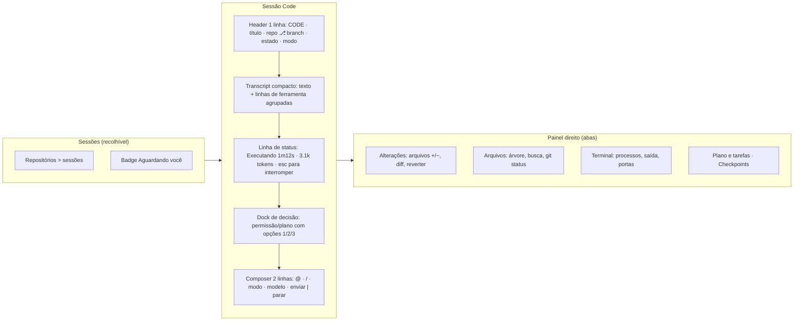

Princípios:
- **Uma fonte de verdade** para o estado do turno.
- **Decisões pendentes ancoradas** no composer.
- **Detalhe sob demanda.**
- **Mudanças revisáveis antes do commit.**
- **Nada perigoso a uma tecla de distância.**
- **Tokens do DS em tudo.**
- **Paridade de fluxo com o Claude Code** (modos, `Esc`, prompts numerados, `/rewind`), mantendo os extras do Orin (worktree, notificações, plano versionado em `.orin/plans/`, agendamento).

---

## 10. Conflitos de contrato a decidir

| Tema | `UX-CONTRACT.md` / `DESIGN.md` | Spec de paridade / código atual | Sugestão |
|---|---|---|---|
| Permissão padrão no Code | `approval_required` | `accept_edits` | **Perguntar** (igual ao Claude Code) e respeitar a preferência global |
| Card de 5 etapas | Representação canônica | Aposentado no Code | Substituir por linha de status + plano/tarefas; atualizar o `DESIGN.md` |
| Agrupamento de atividade | Uma linha expansível por sequência | Um card por chamada | Seguir o contrato |
| Bypass no ciclo | — | Incluído | Remover do ciclo |
| Cor do Code | Violeta = affordance | Âmbar | Ícone + rótulo; sem paleta própria |

---

## Apêndice A — Resultados automáticos

```text
axe (Home Code): 0 violações
axe (sessão Code): color-contrast (serious) ×10 · nested-interactive (serious) ×3
Permitir coberto: elementFromPoint → [data-testid=todo-bar]
padding-bottom do histórico: 168px · altura do footer: 309.5px
Requisições a workspace-files ao abrir a gaveta: 0
Shift+Tab a partir de "ask permissions": → "bypass permissions"
Shift+Tab com foco em "Arquivos": foco permanece em "Arquivos"
Esc durante execução: 0 chamadas a /cancel
Stop (mock): visível, 36×36 px, clicável
Home Code (servidor = approval_required): pílula = "accept edits on"
Worktree na Home: aria-pressed=true sem efeito no backend
Borda dos blocos (computada): rgba(245,241,255,.93) · fundo: transparente
Fundo das linhas de diff +/−: rgba(0,0,0,0)
Overflow horizontal em 1024px: 0
```

## Apêndice B — Como reproduzir as capturas
1. `cd frontend && $env:VITE_AUTH_MODE='loopback'; npx vite --host 127.0.0.1 --port 4190 --strictPort`
2. Com o MCP Playwright, abrir um contexto novo e interceptar `**/v1/**` com respostas fictícias (conversa `mode: "code"` com eventos `tool.finished`, `tool.permission_required` e `assistant.completed`). O script usado foi salvo fora do repositório, em `C:\Users\User\AppData\Local\Programs\Antigravity\.playwright-mcp\capture-all.js` e `capture2.js`.
