# 05 — Diagnóstico Forense da Conversa `chat_e65477e1432842f8b517e9fe61e7dee8` e Análise de Gap do Harness (Orin Code × Claude Code)

> **Alvo diagnosticado:** `http://127.0.0.1:49200/chats/chat_e65477e1432842f8b517e9fe61e7dee8` (`chat_e65477e1432842f8b517e9fe61e7dee8`)
> **Banco e logs inspecionados:** `data/orin.db` (somente leitura), `.logs/worker.log`, `.logs/backend.log`, workspace `data/users/local-user/workspaces/chat_e65477e1432842f8b517e9fe61e7dee8/`.
> **Capturas de tela da sessão real:** `docs/ux-redesign/images/diagnostico/05-01-*.png` a `05-13-*.png` (1440×900 e 1024×768).
> **Referência cruzada:** complementa a [04 — Auditoria heurística do Orin Code](./04-auditoria-orin-code.md) (onde o bug `OC-01` do botão Stop não pôde ser reproduzido com mocks estáticos).
> **Restrições respeitadas:** nenhum código-fonte do repositório foi modificado e nenhuma mensagem foi enviada na conversa.

---

## Sumário Executivo

A conversa `chat_e65477e1432842f8b517e9fe61e7dee8` foi iniciada em **15/10/2026 às 16:29:12 BRT (19:29:12 UTC)** no **Modo Code** (`mode = "code"`, `permission_mode = "accept_edits"`) usando o modelo **`ollama / gemma4:31b`** (via `https://ollama.com/api/chat`). O usuário pediu:

> *"Quero que vc crie uma landing page para um produto digital que vc acredita que possa vender muito bem nos dias de hoje, divida responsabilidades com subagentes"*

Durante **5 minutos e 20 segundos** (319,9 s), o sistema gerou **2 turnos**, **1 subagente (`general`)**, **52 passos persistidos no turno principal** (26 chamadas de ferramenta do agente principal + 17 chamadas de ferramenta do subagente não persistidas em `conversation_turn_steps`), **281 eventos de atividade** e consumiu **651.454 tokens totais** (248.558 no agente principal + 402.896 no subagente), **sem emitir um único caractere de texto de resposta ao usuário** (`content = ""` nas duas mensagens do assistente).

A sessão expôs uma tempestade perfeita de falhas combinadas entre **frontend**, **harness agentic** e **backend**:

1. **Bug P0 do Botão Stop ("Não consigo clicar no botão de parar quando está no modo code a não ser que eu envie outra mensagem"):**
   - O backend (`src/agentos/conversations/chat.py:1119`) coloca o turno reclamado pelo worker em `state = "starting"` e **nunca** o transiciona para `"running"` em nenhum ponto do ciclo de vida.
   - Uma alteração na working tree de `frontend/src/features/conversations/ChatPage.tsx:672` trocou `RUNNING_STATES.has(turn.state)` por `(activeTurn.state === 'running' || activeTurn.state === 'queued')`, esquecendo `'starting'` e `'streaming'`.
   - Assim, 375 ms após o envio da mensagem, `running` virou `false` no frontend durante todos os 5 minutos do Turno 1: o botão **Stop (`■`)** nunca apareceu e o indicador `AgentPulse` sumiu.
   - Ao mesmo tempo, o botão **Send (`↑`)** permaneceu no lugar com `disabled={true}`, mas com **`opacity: 1` forçada inline pelo Framer Motion** (`Composer.tsx:410`), parecendo visualmente um botão roxo ativo (`rgb(166, 108, 255)`) que não reagia ao clique. E, quando o usuário rolava a página (8.166 px de altura) para inspecionar os erros, a regra `.chat__foot > *` (`agentos.css:741-745`) aplicava `opacity: 0; pointer-events: none` ao composer inteiro por `data-at-bottom="false"`.
   - **Por que enviar outra mensagem destravou o Stop:** como `running` era `false`, `submit()` (`ChatPage.tsx:880`) não bloqueou o envio da 2ª mensagem (`"que erro ta dando no writefile?"` às 19:34:07 UTC). Essa 2ª mensagem criou o **Turno 2** (`turn_989fcb...`), que ficou na fila com **`state = "queued"`** porque o worker ainda estava preso no Turno 1. Como `activeTurn` pega o último turno não cancelado, `activeTurn.state === 'queued'` tornou `running === true` imediatamente, fazendo o botão **Stop** aparecer (e ao ser clicado 18 s depois, cancelou ambos os turnos de uma vez).
2. **Loop fatal do subagente em `write_file` (11 tentativas falhas em 2min15s, 402k tokens):**
   - O subagente `general` tentou criar o componente completo da Landing Page em uma única chamada `write_file`, mas os subagentes têm teto fixo `SUBAGENT_MAX_OUTPUT_TOKENS = 4096` (`src/agentos/agentic/session.py:51,1116`).
   - Como o modelo gerou `content` antes de `path` no JSON de argumentos e atingiu o limite de `num_predict = 4096` tokens (~12 s por geração), o JSON foi truncado antes da chave `path`.
   - O stream do Ollama (`src/agentos/agentic/provider_stream.py:355`) mascarou `done_reason == "length"` como `FinishReason.TOOL_CALLS`, e o dispatcher devolveu apenas `Invalid arguments for write_file: AgentToolset.write_file() missing 1 required positional argument: 'path'`, sem informar que houve truncamento por limite de tokens. O subagente repetiu a geração de 4.096 tokens **11 vezes seguidas** (8 `INVALID_ARGUMENTS` + 3 `DUPLICATE_TOOL_CALL`).
   - Além disso, falhas de argumento e chamadas duplicadas **não incrementavam `action_count`** antes de estourar o limite, permitindo 17 iterações mesmo com `SUBAGENT_MAX_ACTIONS = 12`.
3. **5 falhas consecutivas de scaffolding Vite (`Operation cancelled` com `exit 0`) e armadilha de `cwd` invisível (`contentflow-lp/contentflow-lp`):**
   - `verify_project(scaffold="vite-react-ts")` e 4 chamadas `run_command("npm create vite@latest . ...")` falharam porque o workspace já continha `produto_digital.md` (criado pelo primeiro subagente), fazendo o `create-vite` abortar interativamente com `Operation cancelled` e código de saída `0`.
   - Depois que o agente criou `contentflow-lp/` e rodou `cd contentflow-lp && npm install ...` com `exit=0`, `self._current_cwd` persistiu silenciosamente para dentro de `contentflow-lp/` (`agent_tools.py:3545`), mas `list_files` continuou listando a raiz do workspace (`agent_tools.py:2796`). Sem saber que o `cwd` do shell já era `contentflow-lp/`, o modelo tentou `cd contentflow-lp` novamente (recusado com `'contentflow-lp' is not a directory in this workspace`) e depois rodou `npm install ... --prefix contentflow-lp`, criando a pasta duplicada aninhada `contentflow-lp/contentflow-lp/`.
4. **Degradação severa de UI no modo Code:**
   - `CodeToolCallBlock.tsx` usa 7 variáveis CSS inexistentes (`--border-subtle`, `--surface-raised`, `--text-primary`, `--text-secondary`, `--text-muted`, `--accent-primary`, `--surface-hover`), resultando em **59 blocos com bordas brancas acesas** (`rgba(245, 241, 255, 0.93)`) e fundo transparente.
   - `stdout` e `stderr` estão incluídos em `_SENSITIVE_KEY_PARTS` (`src/agentos/agentic/models.py:50-51`), fazendo todo payload persistido de `run_command` gravar `"stdout": "[REDACTED]"` e `"stderr": "[REDACTED]"`. Como `CodeToolCallBlock.tsx:92-94` prioriza `bashOutput.stdout` sobre `outputTail`, todos os blocos Bash exibem literalmente `[REDACTED]` `[REDACTED]` no lugar da saída do terminal.
   - Todos os diffs abrem expandidos por padrão (`useState(true)` em `CodeToolCallBlock.tsx:54`), despejando 74 linhas (`produto_digital.md`) e 121 linhas (`index.css`) sem limite de altura, somando **8.166 px de página** (~11 telas).

---

## 1. Timeline Completa Reconstruída (`chat_e65477e1432842f8b517e9fe61e7dee8`)

### 1.1 Metadados da Conversa, Turnos e Agentes no Banco (`data/orin.db`)

| Entidade | Identificador / Campo | Valor registrado em `data/orin.db` |
|---|---|---|
| **Conversa** (`conversations`) | `conversation_id` | `chat_e65477e1432842f8b517e9fe61e7dee8` (id interno `5`) |
| | `title` | `"Quero que vc crie uma landing page para um produto digital que vc acredita que p"` |
| | `provider` / `model_id` | `ollama` / `gemma4:31b` (executado via `https://ollama.com/api/chat`) |
| | `mode` / `permission_mode` | `code` / `accept_edits` |
| | `state` | `cancelled` (`created_at`: `19:29:12.228 UTC` · `updated_at`: `19:34:25.926 UTC`) |
| | Workspace no disco | `data/users/local-user/workspaces/chat_e65477e1432842f8b517e9fe61e7dee8/` |
| **Turno 1** (`conversation_turns`) | `turn_id` | `turn_d6ee8f42edc242c98d9ecd5bda45dbcf` (id `10`) |
| | `execution_id` | `exe_50c68e7372195df3c1f15b7537c5144baec6c441351816cc85f9d7baf1135477` |
| | `user_message_id` → `assistant_message_id` | `msg_58d8f7d5c4384768b59fc5df020e0aa9` → `msg_6d8e32f93c244480af53932fe7ac9734` |
| | `state` / `code_mode` | `cancelled` / `code` |
| | Timestamps (UTC) | `created_at`: `19:29:12.228` · `started_at`: `19:29:12.603` · `finished_at`: `19:34:25.923` |
| | `code_mode_runs` | `work_kind="implementation"`, `stage="blocked"`, `autonomy="code_autonomy"`, `caveats="TURN_CANCELLED"`, `updated_at="19:34:32.602"` |
| | `turn_quality_metrics` | `iterations=27`, `tool_calls=26`, `input_tokens=246814`, `output_tokens=1744`, `duration_ms=319917`, `outcome="cancelled"` |
| **Turno 2** (`conversation_turns`) | `turn_id` | `turn_989fcb262bf444ffaf3e3c9ee1e633d0` (id `12`) |
| | `execution_id` | `exe_b6303ea5f8bfe76c6a470287f9381140fc148e81adc662ed3af126a1fd5aae04` |
| | `user_message_id` → `assistant_message_id` | `msg_1e82755551c44495aa731229d8f9c342` → `msg_3e11b70eb9fe48e6a8340ce98dd925db` |
| | `state` / `code_mode` | `cancelled` / `code` |
| | Timestamps (UTC) | `created_at`: `19:34:07.612` · `started_at`: **`None`** (nunca iniciou) · `finished_at`: `19:34:25.926` |
| | `code_mode_runs` | `work_kind="bugfix"`, **`stage="implementing"`** (órfão — nunca liquidado!), `caveats=None` |
| **Agente Principal** (`conversation_agent_usage`) | `agent_id` | `agent:chat_e65477e1432842f8b517e9fe61e7dee8:main` |
| | Uso de tokens | `input_tokens=246.814` · `output_tokens=1.744` · `total_tokens=248.558` |
| **Subagente** (`conversation_agents` + `usage`) | `agent_id` / `name` | `agent:chat_e65477e1432842f8b517e9fe61e7dee8:98e8aa12c21e4948fc4ce363` / `general` |
| | `state` final | **`failed`** (deveria ser `cancelled`) |
| | Uso de tokens | `input_tokens=356.110` · `output_tokens=46.786` · `total_tokens=402.896` |

### 1.2 As 4 Mensagens em `conversation_messages` e os 5 Eventos em `conversation_events`

| Seq | `message_id` | Turno | Role | Status | Horário UTC (BRT) | Conteúdo |
|---:|---|---|---|---|---|---|
| 1 | `msg_58d8f7d5...` | `turn_d6ee8f...` (T1) | `user` | `completed` | `19:29:12.228` (`16:29:12`) | `"Quero que vc crie uma landing page para um produto digital que vc acredita que possa vender muito bem nos dias de hoje, divida responsabilidades com subagentes"` |
| 2 | `msg_6d8e32f9...` | `turn_d6ee8f...` (T1) | `assistant` | `cancelled` | `19:29:12.228` → `19:34:25.923` | `""` *(vazio — zero deltas de texto em 5min13s)* |
| 3 | `msg_1e827555...` | `turn_989fcb...` (T2) | `user` | `completed` | `19:34:07.612` (`16:34:07`) | `"que erro ta dando no writefile?"` |
| 4 | `msg_3e11b70e...` | `turn_989fcb...` (T2) | `assistant` | `cancelled` | `19:34:07.612` → `19:34:25.926` | `""` *(vazio — turno nunca foi adquirido pelo worker)* |

E na tabela `conversation_events` (stream de eventos de estado da conversa/mensagens):

1. `id=90191` (`19:29:12.228 UTC`): `turn.queued` (`msg_6d8e32f9...`, `{"state": "queued"}`)
2. `id=90270` (`19:29:12.603 UTC`): `turn.starting` (`msg_6d8e32f9...`, `{"state": "starting"}`) — **Nota crítica:** não existe nenhum `turn.running` nem `message.delta` em toda a conversa!
3. `id=90272` (`19:34:07.612 UTC`): `turn.queued` (`msg_3e11b70e...`, `{"state": "queued"}`)
4. `id=90273` (`19:34:25.923 UTC`): `turn.cancelled` (`msg_6d8e32f9...`, `{"state": "cancelled", "retryable": false}`)
5. `id=90274` (`19:34:25.926 UTC`): `turn.cancelled` (`msg_3e11b70e...`, `{"state": "cancelled", "retryable": false}`)

---

### 1.3 Cronologia Completa Fase a Fase (52 `turn_steps` + 281 `activity_events` + `.logs/worker.log`)

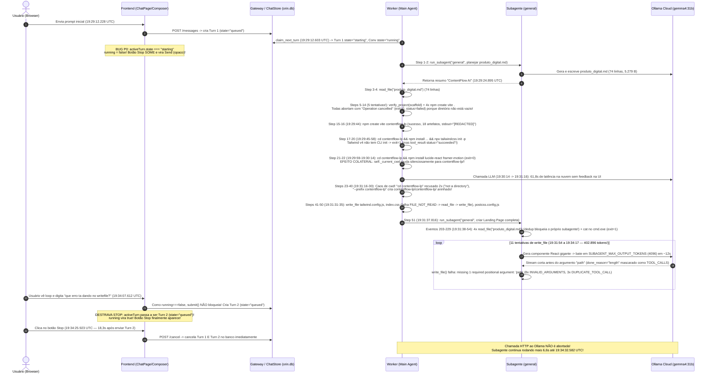

#### Fase 1 — Delegação Inicial de Planejamento (`19:29:12.228` – `19:29:24.900 UTC`)
- **`19:29:12.228`** (`Turn 1 seq 1` / `conv_event 90191`): Conversa e Turno 1 (`turn_d6ee8f...`) criados com `state = "queued"`.
- **`19:29:12.603`** (`Turn 1 seq 2` / `conv_event 90270`): Worker reclama o Turno 1 em `claim_next_turn` (`chat.py:1119`), gravando `conversation_turns.state = "starting"` e `conversations.state = "running"`. **Neste exato milissegundo, `running` no frontend cai para `false`.**
- **`19:29:12.685`** (`Turn 1 seq 3`): `context.updated` (`used_tokens: 8673`, `limit_tokens: 60000`, `14%`, `tools_tokens: 6079`, `system_prompt_tokens: 2389`).
- **`19:29:14.416` – `19:29:24.895`** (`Steps 1–2` / `Turn 1 seq 4–15`):
  - O agente principal invoca `run_subagent(subagent_type="general", task="Identifique um produto digital com alto potencial de vendas... Entregue isso em um documento estruturado no workspace como 'produto_digital.md'.")`.
  - O subagente `general` (`agent:...fc4ce363`) chama `write_file("produto_digital.md")` (`seq 9–11`), gravando **5.279 bytes (74 linhas)** com o plano do SaaS **ContentFlow AI**, e retorna o resumo ao agente principal (`seq 13–14`).
- **`19:29:25.953` – `19:29:25.973`** (`Steps 3–4` / `Turn 1 seq 16–19`): O agente principal executa `read_file("produto_digital.md")` e lê as 74 linhas (`used_tokens` sobe para `10.518`).

#### Fase 2 — Loop de 5 Falhas Consecutivas no Scaffolding Vite (`19:29:26.992` – `19:29:41.760 UTC`)
Como `produto_digital.md` já existia na raiz do workspace (`data/users/local-user/workspaces/chat_e65477e1432842f8b517e9fe61e7dee8/produto_digital.md`), o diretório raiz **não estava vazio**. Quando `create-vite` é executado em um diretório não vazio com `stdin=subprocess.DEVNULL` (`agent_tools.py:3520`), ele exibe `└ Operation cancelled` e encerra com **`exit_code = 0`**, mas o Orin detecta a string `"Operation cancelled"` sem artefatos gerados (`agent_tools.py:3548`) e lança `AgentToolError(..., error_code="COMMAND_CANCELLED_INTERACTIVE")` com a instrução explícita:
> `[Command cancelled interactively ('Operation cancelled') because stdin is closed or the target directory is not empty. Do not repeat the same command; pass non-interactive overwrite flags or create the files directly with write_file.]`

Apesar do aviso explícito `"Do not repeat the same command"`, o modelo `gemma4:31b` tentou **5 vezes seguidas** criar o projeto na raiz `.`:

| Iteração / Step | Horário UTC | Ferramenta | Comando executado | Resultado / Erro |
|---|---:|---|---|---|
| Iter 3 (`Steps 5–6`, `seq 20–27`) | `19:29:26.99` | `verify_project` | `scaffold="vite-react-ts"` → dispara internamente `npm create vite@latest . -- --template react-ts` | `status="failed"`, `error_code="COMMAND_CANCELLED_INTERACTIVE"`, texto começa com `exit=0\n> npx\n> create-vite . --template react-ts\n\n└ Operation cancelled` |
| Iter 4 (`Steps 7–8`, `seq 28–35`) | `19:29:31.81` | `run_command` | `npm create vite@latest . -- --template react-ts` | Idem (`COMMAND_CANCELLED_INTERACTIVE`) |
| Iter 5 (`Steps 9–10`, `seq 36–43`) | `19:29:34.83` | `run_command` | `npm create vite@latest . -- --template react-ts --yes` (`--yes` é consumido pelo `npm` ou repassado ao `create-vite`, que não aceita `--yes` para sobrescrever diretório não vazio) | Idem (`COMMAND_CANCELLED_INTERACTIVE`) |
| Iter 6 (`Steps 11–12`, `seq 44–51`) | `19:29:37.67` | `run_command` | `npm create vite@latest . -- --template react-ts` (repetição idêntica à Iter 4!) | Idem (`COMMAND_CANCELLED_INTERACTIVE`) |
| Iter 7 (`Steps 13–14`, `seq 52–59`) | `19:29:39.78` | `run_command` | `npm init vite . -- --template react-ts` | Idem (`COMMAND_CANCELLED_INTERACTIVE`) |

#### Fase 3 — Scaffolding em Subpasta, Bug do Tailwind v4, Latência de 62s e Caos de `cwd` (`19:29:42.821` – `19:31:35.433 UTC`)
- **Iter 8 (`Steps 15–16`, `seq 60–85`, `19:29:42.82` – `19:29:44.69`):**
  - O agente finalmente cria em subdiretório: `run_command("npm create vite@latest contentflow-lp -- --template react-ts")`.
  - Sucesso (`exit_code: 0`), gerando 18 eventos `artifact.created` (`seq 66–83`: `contentflow-lp/package.json`, `src/App.tsx`, `src/index.css`, etc.).
  - **Bug de Redaction:** No evento `tool.finished` (`seq 65`), o payload persistido grava `"stdout": "[REDACTED]", "stderr": "[REDACTED]"`.
  - **Nota sobre `cwd`:** Como o comando não tinha `cd`, `self._current_cwd` permaneceu na raiz do workspace (`.`).
- **Iter 9 (`Steps 17–18`, `seq 86–96`, `19:29:45.65` – `19:29:56.67`):**
  - Comando: `cd contentflow-lp && npm install && npm install -D tailwindcss postcss autoprefixer && npx tailwindcss init -p`.
  - O `npm install` instalou `tailwindcss` v4 (onde o binário `tailwindcss` CLI foi removido e separado em `@tailwindcss/cli`), fazendo `npx tailwindcss init -p` falhar com `exit=1` (`npm error could not determine executable to run`).
  - **Inconsistência de status:** Em `conversation_turn_steps` (`Step 18`), o resultado foi gravado com **`"status": "succeeded"`** mesmo tendo `exit=1` (porque `run_command` retornou um dict normal sem lançar `AgentToolError`, e `runtime.py` marca qualquer retorno sem exceção como `"succeeded"` no step do modelo!).
  - **Nota sobre `cwd`:** Como `process.returncode == 1` (`succeeded = False` em `agent_tools.py:3541-3542`), `self._current_cwd` **não** foi atualizado e continuou na raiz `.`.
- **Iter 10 (`Steps 19–20`, `seq 97–103`, `19:29:57.55` – `19:29:58.36`):**
  - Comando: `cd contentflow-lp && npx tailwindcss init -p` → falha novamente com `exit=1` (`self._current_cwd` continua na raiz `.`).
- **Iter 11 (`Steps 21–22`, `seq 104–112`, `19:29:59.26` – `19:30:14.68`):**
  - Comando: `cd contentflow-lp && npm install lucide-react framer-motion`.
  - Termina com **`exit=0`** (`added 5 packages in 15s`).
  - **Armadilha de `cwd` (`agent_tools.py:3542-3545`):** Como `succeeded` foi `True`, `self._resolve_cwd_after_command` analisou o segmento `cd contentflow-lp` e **alterou silenciosamente `self._current_cwd` para `<workspace>/contentflow-lp`**. Porém, o `content` retornado ao modelo (`Step 22`) foi apenas `"exit=0\nadded 5 packages in 15s"` — o modelo **não é informado** de que o `cwd` persistente mudou!
- **Gap de 61,8 segundos na chamada ao Ollama (`19:30:14.684` – `19:31:16.497`):**
  - Em `.logs/worker.log`, a requisição `POST https://ollama.com/api/chat` enviada após a Iter 11 levou **61,8 segundos** para responder (`16:31:16,411 INFO httpx HTTP Request: POST https://ollama.com/api/chat "HTTP/1.1 200 OK"`). Durante esse 1 minuto inteiro, como `showAgentPulse` era `false`, a tela ficou 100% estática parecendo congelada.
- **Iter 12 a 20 (`Steps 23–40`, `seq 113–174`, `19:31:16.49` – `19:31:30.19`) — O Caos do `cwd` e a Pasta Duplicada `contentflow-lp/contentflow-lp`:**
  - **Iter 12 (`Steps 23–24`, `seq 114–118`):** O modelo roda `cd contentflow-lp && npm install -D tailwindcss postcss autoprefixer`. Como `self._current_cwd` já era `<workspace>/contentflow-lp`, o precheck (`agent_tools.py:3154-3156`) procurou `<workspace>/contentflow-lp/contentflow-lp`, que não existia, e recusou com `AgentToolError: 'contentflow-lp' is not a directory in this workspace` (`TOOL_REFUSED`)!
  - **Iter 13 (`Steps 25–26`, `seq 119–122`):** Confuso, o modelo chama `list_files(depth=1)`. Mas `list_files` (`agent_tools.py:2796`) resolve caminhos sempre a partir da **raiz do workspace** (`self.workspace.root`), ignorando `self._current_cwd`! Ele retorna `d contentflow-lp\nf produto_digital.md`, convencendo o modelo de que ele está na raiz e que `contentflow-lp` existe!
  - **Iter 14 (`Steps 27–28`, `seq 123–128`):** O modelo repete `cd contentflow-lp && npm install ...` e recebe pela 2ª vez `'contentflow-lp' is not a directory in this workspace`!
  - **Iter 15 (`Steps 29–30`, `seq 129–137`):** Para contornar o `cd`, o modelo executa `npm install -D tailwindcss postcss autoprefixer --prefix contentflow-lp`. Como o comando **já rodou dentro de `contentflow-lp/`**, o `--prefix contentflow-lp` criou a pasta aninhada **`contentflow-lp/contentflow-lp/package.json`** e **`contentflow-lp/contentflow-lp/package-lock.json`** (`seq 134–135`)!
  - **Iter 16 a 20 (`Steps 31–40`, `seq 138–174`):** Agora que `contentflow-lp/contentflow-lp` passou a existir por acidente, os 5 comandos seguintes do modelo usando `cmd /c "cd contentflow-lp && ..."` entraram na pasta fantasma `contentflow-lp/contentflow-lp/` e falharam tentando rodar `npx tailwindcss init -p` e `node_modules\.bin\tailwindcss init -p`!
- **Iter 21 a 25 (`Steps 41–50`, `seq 175–198`, `19:31:31.29` – `19:31:35.43`):**
  - O modelo desiste do CLI `tailwindcss init` e usa `write_file` (que, diferentemente de `run_command`, resolve paths relativos à raiz `self.workspace.root`!):
  - **Iter 21 (`Steps 41–42`):** `write_file("contentflow-lp/tailwind.config.js")` → sucesso (356 B).
  - **Iter 22 (`Steps 43–44`, `seq 181–184`):** `write_file("contentflow-lp/src/index.css")` → falha com **`FILE_NOT_READ`** (`File has not been read yet. Read it first with read_file before writing or editing it.`), porque `index.css` havia sido criado pelo `create-vite` via `run_command` e não estava em `self._read_files`.
  - **Iter 23–24 (`Steps 45–48`, `seq 185–193`):** `read_file("contentflow-lp/src/index.css")` (111 linhas) seguido de `write_file("contentflow-lp/src/index.css")` (163 B, gerando diff de `-111 +10` linhas).
  - **Iter 25 (`Steps 49–50`, `seq 194–198`):** `write_file("contentflow-lp/postcss.config.js")` (82 B).

#### Fase 4 — Segunda Delegação ao Subagente `general` e Loop Fatal de `write_file` (`19:31:37.815` – `19:34:17.177 UTC`)
- Em **`19:31:37.815`** (`Step 51`, `seq 199–202`), o agente principal delega a criação da Landing Page inteira ao subagente `general` (`run_subagent`), que **reutiliza o mesmo `agent_id`** (`agent:...fc4ce363`) da Fase 1.
- **5 tentativas de ler `produto_digital.md` (`seq 203–229`, `19:31:38.79` – `19:31:54.46`):**
  1. `sub-iter 1` (`seq 204–205`): `read_file("produto_digital.md")` → como o `TurnSession` compartilha `self._read_file_state` entre o agente principal e os subagentes (ou da 1ª execução do subagente), a ferramenta respondeu `unchanged: true` (`"Arquivo inalterado: produto_digital.md"`) **sem devolver o conteúdo completo**!
  2. `sub-iter 2` (`seq 208–209`) e `sub-iter 3` (`seq 212–213`): O subagente tenta `read_file("produto_digital.md")` mais duas vezes e o runtime bloqueia ambas com `"read_file reaproveitado da chamada anterior"`, negando o conteúdo ao subagente que acabara de iniciar com histórico limpo (`inherit_context = False` para `general`!)!
  3. `sub-iter 4` (`seq 216–219`): Sem conseguir ler com `read_file`, o subagente apela para `run_command("cat produto_digital.md")`, que falha no `cmd.exe` do Windows (`'cat' não é reconhecido como um comando interno ou externo`, `exit=1`).
  4. `sub-iter 5` (`seq 223–224`) e `sub-iter 6` (`seq 227–228`): Finalmente na `sub-iter 6` consigue ler as 74 linhas de `produto_digital.md`.
- **11 falhas consecutivas de `write_file` (`sub-iter 7` a `sub-iter 17`, `seq 230–274`, `19:31:54.46` – `19:34:17.17`):**
  - Em cada uma das 11 iterações (~11 a 15 segundos cada), o subagente tentou escrever o arquivo completo da Landing Page com `write_file`.
  - Como `SUBAGENT_MAX_OUTPUT_TOKENS = 4096` (`session.py:51,1116`) passa `options.num_predict = 4096` ao Ollama (`provider_stream.py:554`), o JSON de argumentos da tool call (onde o modelo colocou `"content"` antes de `"path"`) foi cortado exatamente aos 4.096 tokens.
  - O parser do stream reparou/fechou o JSON parcial contendo apenas `{"content": "..."}` (sem `"path"`), e `provider_stream.py:355` reportou `FinishReason.TOOL_CALLS` em vez de `FinishReason.LENGTH`.
  - O `AgentToolset.invoke` chamou `self.write_file(**arguments)` e levantou `TypeError: AgentToolset.write_file() missing 1 required positional argument: 'path'`, convertido em `INVALID_ARGUMENTS` (`seq 233, 237, 241, 245, 249, 253, 257, 265`) ou `DUPLICATE_TOOL_CALL` quando os 4.096 tokens gerados foram idênticos (`seq 261, 269, 273`).
  - Só nessa segunda execução do subagente foram consumidos **356.110 tokens de entrada e 46.786 tokens de saída**!

#### Fase 5 — Envio da 2ª Mensagem pelo Usuário e Cancelamento (`19:34:07.612` – `19:34:32.602 UTC`)
- **`19:34:07.612 UTC`** (`Turn 2 seq 1` / `conv_event 90272`): Vendo dezenas de blocos `Write(Invalid arguments for write_file: ...)` empilhados e sem botão Stop, o usuário envia `"que erro ta dando no writefile?"`.
  - O backend cria o **Turno 2** (`turn_989fcb262bf444ffaf3e3c9ee1e633d0`) com `state = "queued"`, e cria um `code_mode_runs` (`code_turn_989fcb...`) classificado erroneamente como `work_kind = "bugfix"`, `stage = "implementing"`.
  - No frontend, `loadSnapshot(false)` vê `activeTurn = turn_989fcb...` com `state === 'queued'`, **ativando `running = true` e exibindo o botão Stop**.
- **`19:34:25.923 UTC`** (`Turn 1 seq 275`, `Turn 2 seq 2`, `conv_events 90273–90274`): O usuário clica no botão Stop.
  - `request_cancel` (`src/agentos/conversations/chat.py:1402-1430`) marca os dois turnos (`turn_d6ee8f...` e `turn_989fcb...`) como `cancelling` e chama `self.finish(..., failed=True, code="TURN_CANCELLED")` para ambos, emitindo `turn.failed` ("Execução cancelada") nos dois turnos.
- **`19:34:25.925` → `19:34:32.595 UTC` (6,67 segundos de atraso pós-cancelamento):**
  - A chamada HTTP em voo do subagente para `https://ollama.com/api/chat` (iniciada às `19:34:17.177`) **não foi abortada**. Ela só retornou às `19:34:32.58` (`16:34:32` no `worker.log`).
  - Ao destravar, o subagente emitiu `turn.failed` (`seq 276`), `delegation.failed` (`seq 277`), marcou seu próprio estado em `conversation_agents` como **`failed`** (em vez de `cancelled`), retornou `Subagent 'general' did not finish (TURN_CANCELLED)` (`Step 52`, `seq 278`), e o `AgenticTurnRuntime` do agente principal emitiu um **segundo evento `turn.failed` duplicado** (`seq 279`, `"Cancelado"`).

---

## 2. Causa-Raiz Exata do Bug do Botão Stop no Modo Code + Diff de Correção

> **Relato do usuário:** *"Não consigo clicar no botão de parar quando está no modo code a não ser que eu envie outra mensagem"*

### 2.1 As 5 Causas Combinadas (Código + Banco + DOM)

#### Causa 1 (Primária — Estado `starting` órfão entre Backend e Frontend)
1. **No Backend (`src/agentos/conversations/chat.py:1113-1125`):**
   Quando o worker adquire um turno da fila em `claim_next_turn`, ele executa:
   ```python
   c.execute(update(conversation_turns).where(conversation_turns.c.turn_id == turn_id).values(state="starting", started_at=now, updated_at=now))
   c.execute(update(conversation_messages).where(conversation_messages.c.message_id == turn["assistant_message_id"]).values(status="streaming", updated_at=now))
   c.execute(update(conversations).where(conversations.c.conversation_id == turn["conversation_id"]).values(state="running", updated_at=now))
   c.execute(insert(conversation_events).values(conversation_id=turn["conversation_id"], user_id=turn["user_id"], event_type="turn.starting", message_id=turn["assistant_message_id"], payload={"state": "starting"}, created_at=now))
   ```
   **Nenhuma função em todo o backend (`src/agentos/`) jamais executa `update(conversation_turns).values(state="running")`!** Durante toda a execução do turno (seja 5 segundos ou 5 minutos), a coluna `conversation_turns.state` permanece em **`"starting"`** até `finish()` mudá-la para `"completed"`, `"failed"`, `"waiting_user"` ou `"cancelled"`.
2. **No Frontend (`frontend/src/features/conversations/ChatPage.tsx:73, 668-675`):**
   Embora a constante na linha 73 declare corretamente todos os estados vivos:
   ```ts
   const RUNNING_STATES = new Set(['queued', 'starting', 'running', 'streaming', 'cancelling'])
   ```
   A derivação de `running` nas linhas `668-675` (modificada na working tree atual em relação ao commit `HEAD`) restringiu `activeTurn.state` apenas a `'running'` ou `'queued'`:
   ```ts
   const running =
     !stopping
     && RUNNING_STATES.has(conversation?.state ?? '')
     && activeTurn !== null
     && (activeTurn.state === 'running' || activeTurn.state === 'queued') // <-- BUG: exclui 'starting' e 'streaming'!
     && openQuestionTurnIds.size === 0
     && !hasTerminalEventForActiveTurn
     && !isActivityTerminal
   ```
   Resultado: **375 ms** depois de o usuário enviar a 1ª mensagem (`19:29:12.228` → `19:29:12.603`), `activeTurn.state` mudou de `'queued'` para `'starting'`, fazendo `running` (e `showAgentPulse` na linha 679) virar **`false`** durante todos os 5 minutos seguintes!

#### Causa 2 (Visual/Interação — Botão `Send` desabilitado mas com `opacity: 1` inline no lugar do `Stop`)
Em `frontend/src/features/conversations/Composer.tsx:388-416`, os botões **Stop** e **Send** dividem o mesmo slot condicional (`{running ? <motion.button key="stop" .../> : <motion.button key="send" .../>}`).
Como `running` era `false`, o `Composer` renderizou o botão **Send (`↑`)** com `disabled={true}` (já que o input estava vazio).
Porém, a regra CSS `.composer__action--send:disabled { cursor: not-allowed; opacity: 0.3; }` (`agentos.css:538`) foi **sobrescrita pela animação inline do Framer Motion** (`Composer.tsx:410`):
```tsx
animate={{ scale: 1, opacity: 1, rotate: 0 }}
```
Medido no DOM via Playwright (`Step 108` e `Step 156`):
- `element.getAttribute('style')` → `"opacity: 1; transform: none;"`
- `getComputedStyle(btn).opacity` → `"1"`
- `getComputedStyle(btn).backgroundColor` → `"rgb(166, 108, 255)"` (roxo aceso)
- `btn.disabled` → `true`

Ou seja: no canto inferior direito do composer, o usuário via um botão roxo 100% opaco (parecendo ativo), clicava nele repetidamente tentando parar/interagir, e o clique era bloqueado por `disabled`!

#### Causa 3 (CSS de Scroll — `.chat__foot > *` aplica `pointer-events: none; opacity: 0` quando `atBottom === false`)
Em `frontend/src/styles/agentos.css:741-748`:
```css
.chat__foot > * {
  width: min(100%, 760px); margin-left: auto; margin-right: auto;
  opacity: 0; transform: translateY(18px); pointer-events: none;
  transition: opacity 0.45s var(--ease), transform 0.45s var(--ease);
}
.chat__foot:hover > *, .chat__foot:focus-within > *, .chat__foot[data-at-bottom="true"] > * {
  opacity: 1; transform: translateY(0); pointer-events: auto;
}
```
No modo Code, como os diffs de 74 e 111 linhas abrem expandidos e dezenas de cards `CodeToolCallBlock` são empilhados (8.166 px de altura), qualquer rolagem para cima para ler um erro define `atBottom = false` (`data-at-bottom="false"`). Nesse estado, **todo o Composer (e o botão Stop dentro dele) recebe `opacity: 0` e `pointer-events: none`**, sumindo da tela até que o usuário passe o mouse sobre a faixa vazia inferior ou role até o fim!

#### Causa 4 (Ausência de atalho `Esc` e Sobreposição da `TodoBar`)
- Não existe listener de `Escape` em `ChatPage.tsx` nem em `Composer.tsx` para acionar `stop()` quando um turno está em execução.
- Quando a `TodoBar` está presente (`TodoBar.tsx:27`), ela usa `bg-[var(--surface-raised)]` (variável CSS inexistente → fundo `rgba(0,0,0,0)` transparente) e expande o rodapé para ~310 px sobre `.chat__thread` (`padding-bottom: 168px`), cobrindo cards de permissão/ação no final da thread.

#### Causa 5 (Por que enviar uma segunda mensagem destravou o botão Stop!)
1. Em `ChatPage.tsx:880`, o guarda de envio é:
   ```ts
   if ((!text && readyUploads.length === 0) || running) return
   ```
   Como `running` estava erroneamente em `false` durante todo o Turno 1 (`state = "starting"`), **`submit()` permitiu o envio de uma nova mensagem no meio da execução**!
2. Quando o usuário digitou `"que erro ta dando no writefile?"` e enviou às `19:34:07.612 UTC`, o backend criou o **Turno 2** (`turn_989fcb262bf444ffaf3e3c9ee1e633d0`).
3. Como o worker estava ocupado executando o Turno 1, o Turno 2 permaneceu na tabela `conversation_turns` com **`state = "queued"`**.
4. Ao terminar o `POST`, `submit()` chamou `await loadSnapshot(false)` (`ChatPage.tsx:891`) e rolou para o fundo (`atBottom = true`).
5. O seletor `activeTurn` (`ChatPage.tsx:641-646`) pegou o último turno da lista (`turn_989fcb...`), cujo `state` era **`'queued'`**.
6. Instantaneamente, `(activeTurn.state === 'running' || activeTurn.state === 'queued')` avaliou como **`true`**, fazendo `running` virar **`true`** e trocando o botão Send pelo botão **Stop (`■`)**!
7. Quando o usuário clicou no Stop 18,3 segundos depois (`19:34:25.923 UTC`), `request_cancel` (`src/agentos/conversations/chat.py:1423`) cancelou todos os turnos em `("queued", "starting", "running", "cancelling")`, matando tanto o Turno 1 quanto o Turno 2 enfileirado.

---

### 2.2 Diff Concreto Sugerido (Frontend + CSS + Backend)

#### A. Frontend — `frontend/src/features/conversations/ChatPage.tsx`
Incluir `'starting'` e `'streaming'` nos estados ativos do turno, manter o composer visível quando `running` for `true`, e adicionar atalho `Escape` para interromper a execução:

```diff
--- a/frontend/src/features/conversations/ChatPage.tsx
+++ b/frontend/src/features/conversations/ChatPage.tsx
@@ -71,6 +71,7 @@ const PROVIDER_NAMES = ['openai', 'anthropic', 'openrouter', 'omniroute', 'ollam
 const MAX_MESSAGE_CHARACTERS = 16_000
 const RUNNING_STATES = new Set(['queued', 'starting', 'running', 'streaming', 'cancelling'])
+const ACTIVE_TURN_STATES = new Set(['queued', 'starting', 'running', 'streaming'])
 const TERMINAL_TURN_STATES = new Set(['completed', 'failed', 'cancelled'])
 
@@ -650,7 +651,8 @@ export function ChatPage() {
     if (!activeTurn) return false
     return activity.events.some(
       (event) =>
-        (!event.turnId || event.turnId === activeTurn.turn_id)
+        (!event.turnId || event.turnId === activeTurn.turn_id)
+        && !event.parentAgentId
         && terminalConversationState(event) !== null,
     )
   }, [activeTurn, activity.events])
@@ -669,14 +671,24 @@ export function ChatPage() {
   const running =
     !stopping
     && RUNNING_STATES.has(conversation?.state ?? '')
     && activeTurn !== null
-    && (activeTurn.state === 'running' || activeTurn.state === 'queued')
+    && ACTIVE_TURN_STATES.has(activeTurn.state)
     && openQuestionTurnIds.size === 0
     && !hasTerminalEventForActiveTurn
     && !isActivityTerminal
 
   const showAgentPulse =
     running
-    && (activeTurn?.state === 'running' || activeTurn?.state === 'queued')
+    && activeTurn !== null
+    && ACTIVE_TURN_STATES.has(activeTurn.state)
     && activity.status !== 'completed'
     && activity.status !== 'failed'
     && activity.status !== 'cancelled'
+
+  useEffect(() => {
+    if (!running) return
+    const onKeyDown = (event: KeyboardEvent) => {
+      if (event.key === 'Escape' && !event.defaultPrevented) {
+        event.preventDefault()
+        void stop()
+      }
+    }
+    window.addEventListener('keydown', onKeyDown)
+    return () => window.removeEventListener('keydown', onKeyDown)
+  }, [running])
```

E no `footer.chat__foot` (`ChatPage.tsx:1236`), garantir que `data-at-bottom` seja sempre `"true"` enquanto `running` ou `stopping` estiverem ativos (para que o botão Stop nunca desapareça ao rolar a timeline):

```diff
--- a/frontend/src/features/conversations/ChatPage.tsx
+++ b/frontend/src/features/conversations/ChatPage.tsx
@@ -1236,7 +1236,7 @@ export function ChatPage() {
-      {!loadFailure && !showOverview && <footer className="chat__foot" data-testid="chat-composer" data-at-bottom={atBottom}>
+      {!loadFailure && !showOverview && <footer className="chat__foot" data-testid="chat-composer" data-at-bottom={atBottom || running || stopping}>
```

#### B. Frontend — `frontend/src/features/conversations/Composer.tsx`
Corrigir a opacidade inline do Framer Motion que sobrescreve `:disabled` no botão Send, deixando claro quando o botão está desabilitado:

```diff
--- a/frontend/src/features/conversations/Composer.tsx
+++ b/frontend/src/features/conversations/Composer.tsx
@@ -403,14 +403,16 @@ export function Composer({
+              ) : (() => {
+                const sendDisabled = disabled || !canSend || (!value.trim() && attachments.length === 0)
+                return (
                 <motion.button
                   key="send"
                   type="submit"
                   className="composer__action composer__action--send"
                   aria-label="Enviar mensagem"
-                  disabled={disabled || !canSend || (!value.trim() && attachments.length === 0)}
+                  disabled={sendDisabled}
                   initial={reduced ? false : { scale: 0.7, opacity: 0, rotate: 25 }}
-                  animate={{ scale: 1, opacity: 1, rotate: 0 }}
+                  animate={{ scale: 1, opacity: sendDisabled ? 0.3 : 1, rotate: 0 }}
                   exit={reduced ? { opacity: 0 } : { scale: 0.7, opacity: 0, rotate: -25 }}
                   transition={{ duration: 0.18, ease: 'easeOut' }}
                 >
                   <span aria-hidden="true">↑</span>
                 </motion.button>
-              )}
+                )
+              })()}
```

#### C. Backend — `src/agentos/conversations/chat.py` e `src/agentos/agentic/runtime.py`
Transicionar explicitamente `conversation_turns.state` de `"starting"` para `"running"` assim que o turno entra em execução no worker (ou diretamente ao iniciar o `AgenticTurnRuntime`):

```diff
--- a/src/agentos/conversations/chat.py
+++ b/src/agentos/conversations/chat.py
@@ -1116,10 +1116,10 @@ class ChatStore:
             if turn is None:
                 return None
             now = datetime.now(UTC)
-            c.execute(update(conversation_turns).where(conversation_turns.c.turn_id == turn_id).values(state="starting", started_at=now, updated_at=now))
+            c.execute(update(conversation_turns).where(conversation_turns.c.turn_id == turn_id).values(state="running", started_at=now, updated_at=now))
             c.execute(update(conversation_messages).where(conversation_messages.c.message_id == turn["assistant_message_id"]).values(status="streaming", updated_at=now))
             c.execute(update(conversations).where(conversations.c.conversation_id == turn["conversation_id"]).values(state="running", updated_at=now))
-            c.execute(insert(conversation_events).values(conversation_id=turn["conversation_id"], user_id=turn["user_id"], event_type="turn.starting", message_id=turn["assistant_message_id"], payload={"state": "starting"}, created_at=now))
+            c.execute(insert(conversation_events).values(conversation_id=turn["conversation_id"], user_id=turn["user_id"], event_type="turn.running", message_id=turn["assistant_message_id"], payload={"state": "running"}, created_at=now))
             return dict(turn) | {"state": "running", "started_at": now}
```

---

## 3. Lista Priorizada (P0–P3) de Todos os Problemas Técnicos e de Fluxo na Conversa

Classificação por camada:
- **[UX/FE]** Frontend / UI / Estado no cliente
- **[HARNESS]** Fluxo do loop agentic / Ferramentas / Subagentes / Prompt
- **[BACKEND]** Persistência / Cancelamento / Eventos / Redaction
- **[MODELO]** Comportamento do modelo / Configuração de provider

### Resumo Rápido (Matriz P0–P3)

| ID | Sev. | Camada | Título curto | Arquivo:Linha principal |
|---|---|---|---|---|
| **T-01** | **P0** | [UX/FE] + [BACKEND] | Botão Stop invisível durante toda a execução (`starting` vs `running`) e Send bloqueado com `opacity: 1` | `ChatPage.tsx:672`, `Composer.tsx:410`, `chat.py:1119` |
| **T-02** | **P0** | [HARNESS] | Subagente preso em loop de 11 falhas `write_file` por truncamento em `SUBAGENT_MAX_OUTPUT_TOKENS = 4096` mascarado como `TOOL_CALLS` | `session.py:51,1116`, `provider_stream.py:355`, `agent_tools.py:2398` |
| **T-03** | **P0** | [BACKEND] + [UX/FE] | Redaction global de `stdout` e `stderr` faz todos os blocos Bash exibirem `[REDACTED]` na UI | `models.py:50-51`, `conversations.ts:655-660`, `CodeToolCallBlock.tsx:92-94` |
| **T-04** | **P0** | [HARNESS] | Persistência silenciosa de `self._current_cwd` no `run_command` dessincroniza o modelo de `list_files` e cria `contentflow-lp/contentflow-lp` | `agent_tools.py:3137-3158, 3542-3545, 2796` |
| **T-05** | **P0** | [HARNESS] | Limite `SUBAGENT_MAX_ACTIONS = 12` burlado porque tool calls com erro de argumento ou duplicadas não incrementam `action_count` | `runtime.py:515-560, 1345-1360`, `session.py:52` |
| **T-06** | **P1** | [BACKEND] | Cancelamento não aborta stream HTTP em voo do provider (6,7s de atraso), emite `turn.failed` duplicado e deixa `code_mode_runs` e subagente inconsistentes | `chat.py:1402-1430`, `runtime.py:1793`, `session.py:899, 1140` |
| **T-07** | **P1** | [HARNESS] | Deduplicação de `read_file` compartilhada bloqueia o próprio subagente de ler `produto_digital.md` (4 tentativas negadas) | `session.py:1080-1105`, `agent_tools.py:2162-2260`, `runtime.py:1345` |
| **T-08** | **P1** | [HARNESS] | `verify_project(scaffold="vite-react-ts")` e `create-vite .` falham 5x com `exit=0` em workspace que só tinha `produto_digital.md` | `agent_tools.py:3548-3555, 3818-3846` |
| **T-09** | **P1** | [BACKEND] | Passos de subagentes (`_SubagentStore`) não são persistidos em `conversation_turn_steps`, perdendo auditoria dos 402k tokens | `session.py:1088-1095` |
| **T-10** | **P1** | [UX/FE] | 7 tokens CSS indefinidos em `CodeToolCallBlock.tsx` e `TodoBar.tsx` criam 59 caixas com borda branca acesa e fundos transparentes | `CodeToolCallBlock.tsx:65,113,120,142-159,217`, `TodoBar.tsx:27` |
| **T-11** | **P1** | [HARNESS] + [UX/FE] | Segunda mensagem enviada durante execução vira um Turno 2 `bugfix` separado e é destruída ao clicar em Stop | `ChatPage.tsx:880, 935-940`, `chat.py:1423`, `phases.py` |
| **T-12** | **P2** | [HARNESS] | `run_command` com `exit_code != 0` é gravado como `status="succeeded"` em `conversation_turn_steps` e dispara eventos falsos de `code_mode.validation_started` | `agent_tools.py:3556-3584`, `runtime.py`, `session.py` |
| **T-13** | **P2** | [HARNESS] | Regra `FILE_NOT_READ` bloqueia `write_file` em arquivos recém-criados por comando de scaffolding (`create-vite`) no mesmo turno | `agent_tools.py:2398-2445, 3546` |
| **T-14** | **P2** | [HARNESS] + [MODELO] | Zero texto narrativo do assistente em 27 iterações (5min20s em silêncio absoluto) e subagente executando `cat` no `cmd.exe` Windows | `session.py:280-360, 1105` |
| **T-15** | **P2** | [BACKEND] | `worker.log` não registra `conversation_id`, `turn_id` nem `agent_id`, exibindo apenas linhas genéricas do `httpx` | `workers/chat.py`, `provider_stream.py` |
| **T-16** | **P3** | [UX/FE] | Rajada de 19 requisições HTTP no carregamento da página, com chamadas duplicadas a `/v1/conversations` (3×) e `/v1/providers/ollama/models` (3×) | `ChatPage.tsx:235-315` |

---

### Detalhamento Técnico de Cada Problema (T-01 a T-16)

#### T-01 · P0 · [UX/FE] + [BACKEND] Botão Stop invisível durante toda a execução (`starting` vs `running`) e Send bloqueado com `opacity: 1`
- **Arquivos e linhas:** `src/agentos/conversations/chat.py:1119-1122`, `frontend/src/features/conversations/ChatPage.tsx:668-683`, `frontend/src/features/conversations/Composer.tsx:388-416`, `frontend/src/styles/agentos.css:538, 741-748`.
- **Evidência:** Em `conversation_events`, o Turno 1 emite `turn.queued` (`19:29:12.228`) e `turn.starting` (`19:29:12.603`), mas nunca `turn.running`. `ChatPage.tsx:672` exige `activeTurn.state === 'running' || activeTurn.state === 'queued'`.
- **Correção:** Ver Seção 2.2 (incluir `'starting'` e `'streaming'` em `ACTIVE_TURN_STATES`, atualizar `chat.py:1119` para `"running"`, corrigir `opacity` inline em `Composer.tsx:410` e manter `data-at-bottom={atBottom || running || stopping}`).

#### T-02 · P0 · [HARNESS] Subagente preso em loop de 11 falhas `write_file` por truncamento em `SUBAGENT_MAX_OUTPUT_TOKENS = 4096` mascarado como `TOOL_CALLS`
- **Arquivos e linhas:**
  - `src/agentos/agentic/session.py:51, 1116` (`SUBAGENT_MAX_OUTPUT_TOKENS = 4096`)
  - `src/agentos/agentic/provider_stream.py:354-355` (`finish_reason=FinishReason.TOOL_CALLS if saw_tool_call else _finish(payload.get("done_reason"))`)
  - `src/agentos/agentic/agent_tools.py:1568, 2398` (`def write_file(self, path: str, content: str = "")`)
- **Evidência nos logs e DB:**
  - Eventos `230` a `274` em `conversation_activity_events`: 11 chamadas seguidas de `write_file` pelo subagente `general` entre `19:31:54` e `19:34:17`, todas falhando com `Invalid arguments for write_file: AgentToolset.write_file() missing 1 required positional argument: 'path'` (8×) ou `Chamada repetida ignorada` / `DUPLICATE_TOOL_CALL` (3×).
  - `conversation_agent_usage` registra `output_tokens = 46786` para o subagente (~4.096 tokens × 11 chamadas longas + 6 chamadas curtas).
- **Causa-raiz:**
  1. `SUBAGENT_MAX_OUTPUT_TOKENS = 4096` é pequeno demais para um subagente de implementação escrever um arquivo React completo (~250–350 linhas).
  2. Quando o modelo gera `{"content": "<4096 tokens de JSX...", "path": "..."}`, o `num_predict: 4096` do Ollama corta a resposta no meio de `"content"`, antes de chegar na chave `"path"`.
  3. O parser de tool call recupera o JSON parcial `{"content": "..."}` e `provider_stream.py:355` ignora `done_reason == "length"` porque `saw_tool_call` é `True`.
  4. A mensagem de erro diz apenas `missing 1 required positional argument: 'path'`, sem avisar ao modelo que sua saída foi **truncada por atingir o limite de 4.096 tokens de saída**. O modelo acha que esqueceu o argumento e tenta gerar o mesmo arquivo gigante de novo!
- **Correção proposta:**
  1. Elevar `SUBAGENT_MAX_OUTPUT_TOKENS` de `4096` para `16384` (ou herdar `self.limits.max_output_tokens` para subagentes que não sejam `read_only`).
  2. No schema JSON de `write_file` e `edit_file`, instruir explicitamente na descrição: `" Put 'path' as the VERY FIRST key in the JSON arguments before 'content'."`
  3. Em `provider_stream.py:355`, se `payload.get("done_reason") == "length"` e `saw_tool_call` for `True`, marcar a tool call como truncada (`truncated_by_length=True`) e retornar ao modelo um erro explícito: `"Tool call write_file was truncated because output exceeded max_output_tokens (4096). Write a smaller file or split into modular components."`

#### T-03 · P0 · [BACKEND] + [UX/FE] Redaction global de `stdout` e `stderr` faz todos os blocos Bash exibirem `[REDACTED]`
- **Arquivos e linhas:**
  - `src/agentos/agentic/models.py:33-52` (`_SENSITIVE_KEY_PARTS` inclui `"stdout"` e `"stderr"` nas linhas 50–51)
  - `frontend/src/api/conversations.ts:655-660` (`const stdout = typeof bashSource.stdout === 'string' ? bashSource.stdout.slice(0, 16_000) : ...`)
  - `frontend/src/features/conversations/CodeToolCallBlock.tsx:89-97` (`if (event.bashOutput?.stdout) parts.push(event.bashOutput.stdout)`)
- **Evidência no DB e nas capturas:**
  - Em `conversation_activity_events` (`seq 65, 92, 101, 108, 133, 142, 149, 157, 164, 172, 219`), todos os eventos `tool.finished` de `run_command` têm `"stdout": "[REDACTED]", "stderr": "[REDACTED]"`, enquanto `"output_tail"` contém a saída real (ex.: `"added 27 packages in 7s..."`).
  - Como `conversations.ts:655` vê que `bashSource.stdout` é uma string não vazia (`"[REDACTED]"`), ele **não cai no fallback de `payload.output_tail`**! E `CodeToolCallBlock.tsx:92-94` concatena `stdout` + `stderr`, renderizando duas linhas `[REDACTED]` em todos os blocos Bash (ver capturas `05-05` e `05-06`).
- **Correção proposta:**
  1. Em `src/agentos/agentic/models.py:50-51`, remover `"stdout"` e `"stderr"` de `_SENSITIVE_KEY_PARTS` (aplicando `sanitize_summary` no conteúdo textual para mascarar tokens/chaves reais, exatamente como já é feito para `output_tail`).
  2. Em `frontend/src/api/conversations.ts:655-660` e `CodeToolCallBlock.tsx:92-94`, ignorar valores iguais a `"[REDACTED]"` e usar `output_tail` como fallback imediato.

#### T-04 · P0 · [HARNESS] Persistência silenciosa de `self._current_cwd` no `run_command` dessincroniza o modelo de `list_files`/`write_file` e cria pastas aninhadas duplicadas
- **Arquivos e linhas:** `src/agentos/agentic/agent_tools.py:3137-3158` (`_resolve_cwd_after_command`), `3178` (`working_directory = self._current_cwd`), `3542-3545` (`self._current_cwd = next_cwd`), `2796` (`list_files`), `2398` (`write_file`).
- **Evidência:**
  - Na Iter 11 (`seq 108`), `cd contentflow-lp && npm install lucide-react framer-motion` teve `exit=0` e mudou `self._current_cwd` para `<workspace>/contentflow-lp`.
  - Na Iter 12 (`seq 116`) e Iter 14 (`seq 126`), `cd contentflow-lp && ...` falhou com `'contentflow-lp' is not a directory in this workspace`, enquanto na Iter 13 (`seq 121`) `list_files(depth=1)` listou a raiz do workspace (`d contentflow-lp`).
  - Na Iter 15 (`seq 133-135`), `npm install ... --prefix contentflow-lp` criou `contentflow-lp/contentflow-lp/package.json`!
- **Correção proposta (paridade com Claude Code):**
  1. **Não persistir `cd` silenciosamente** entre chamadas se as demais ferramentas (`list_files`, `read_file`, `write_file`, `edit_file`, `glob_files`) continuam ancoradas em `self.workspace.root`, **ou** informar explicitamente no `content` retornado ao modelo em toda chamada `run_command`: `[cwd: contentflow-lp]` (e quando `cwd` for resetado/alterado, avisar `[working directory is now: contentflow-lp; note that read_file/write_file/list_files still use workspace-root relative paths]`).
  2. Na mensagem de erro da linha 3156, incluir o `cwd` atual: `f"'{raw_target}' is not a directory inside current working directory '{current.relative_to(root_resolved).as_posix()}' (workspace root already contains '{raw_target}'; you are already inside '{current.name}')"`.

#### T-05 · P0 · [HARNESS] Limite `SUBAGENT_MAX_ACTIONS = 12` burlado porque falhas de argumento e chamadas duplicadas não contam no limite de ações
- **Arquivos e linhas:** `src/agentos/agentic/session.py:52` (`SUBAGENT_MAX_ACTIONS = 12`), `src/agentos/agentic/runtime.py:515-560, 1345-1360`.
- **Evidência:** O subagente `general` executou **17 iterações** de ferramentas (`iter1` a `iter17`, eventos `204` a `273`) na segunda delegação, ultrapassando `SUBAGENT_MAX_ACTIONS = 12` sem ser interrompido, e sem circuit-breaker após 3 falhas idênticas consecutivas de `write_file`.
- **Correção proposta:** Incrementar `action_count` em toda tentativa de invocação (incluindo `INVALID_ARGUMENTS` e `DUPLICATE_TOOL_CALL`) e adicionar um disjuntor de falhas consecutivas da mesma ferramenta (`MAX_CONSECUTIVE_TOOL_FAILURES = 3`) que aborte ou injete orientação corretiva.

#### T-06 · P1 · [BACKEND] Cancelamento não aborta stream HTTP do provider (6,7s de atraso), emite `turn.failed` duplicado e deixa `code_mode_runs` e subagente inconsistentes
- **Arquivos e linhas:** `src/agentos/conversations/chat.py:1402-1430`, `src/agentos/agentic/runtime.py:1793-1796`, `src/agentos/agentic/session.py:899, 1135-1155`, `src/agentos/agentic/provider_stream.py`.
- **Evidência no DB:**
  1. `request_cancel` cancelou o Turno 1 às `19:34:25.923 UTC` e emitiu `turn.failed` (`seq 275`, `"Execução cancelada"`).
  2. O subagente continuou aguardando o stream HTTP do Ollama até `19:34:32.582 UTC` (+6,66 s) e emitiu mais dois eventos `turn.failed` (`seq 276` para o subagente e `seq 279` para o agente principal, `"Cancelado"`).
  3. Em `conversation_agents`, o subagente ficou com `state = "failed"` em vez de `"cancelled"`.
  4. Em `code_mode_runs`, o Turno 1 ficou com `stage = "blocked"` (em vez de `"cancelled"`) e o Turno 2 (`code_turn_989fcb...`) ficou congelado para sempre em **`stage = "implementing"`**!
- **Correção proposta:**
  1. Passar um `cancel_event` / ` httpx.Client` cancelável para `provider_stream` para fechar o socket HTTP imediatamente quando `cancel_requested(turn_id)` for verdadeiro.
  2. Em `runtime.py:1793-1794`, não emitir `self._life(turn, "cancelled")` nem chamar `self.store.finish` uma segunda vez se `request_cancel` já finalizou o turno.
  3. Em `request_cancel`, atualizar também `code_mode_runs` dos turnos cancelados para `stage = "cancelled", caveats = "TURN_CANCELLED"`, e em `session.py` gravar `agents_store.set_state(agent_id, "cancelled")` quando `result.error_code == "TURN_CANCELLED"`.

#### T-07 · P1 · [HARNESS] Deduplicação de `read_file` compartilhada bloqueia o subagente de ler `produto_digital.md`
- **Arquivos e linhas:** `src/agentos/agentic/session.py:1080-1105`, `src/agentos/agentic/agent_tools.py:2162-2260`, `src/agentos/agentic/runtime.py:1345-1360`.
- **Evidência:** Na 2ª delegação ao subagente `general` (`seq 204–228`), o subagente começa com histórico vazio (`inherit_context = False`), mas como o `agent_id` (`agent:...fc4ce363`) e o cache de SHA-256 de leitura foram reutilizados da 1ª delegação, a 1ª chamada `read_file("produto_digital.md")` respondeu `"Arquivo inalterado: produto_digital.md"` (`unchanged: true`, sem o conteúdo!) e as 2 chamadas seguintes (`seq 209, 213`) foram barradas com `"read_file reaproveitado da chamada anterior"`, forçando o subagente a tentar `cat produto_digital.md` no terminal e gastar 6 iterações só para ler um arquivo de 74 linhas!
- **Correção proposta:** Isolar o estado de `read_file` (`_read_file_state`) e de deduplicação por instância de execução de subagente (`sub_store`), nunca reaproveitando leituras de uma invocação anterior de `run_subagent` quando `inherit_context=False`.

#### T-08 · P1 · [HARNESS] `verify_project(scaffold="vite-react-ts")` falha em workspace com arquivos de documentação (`produto_digital.md`)
- **Arquivos e linhas:** `src/agentos/agentic/agent_tools.py:3818-3846`, `src/agentos/code_mode/recipes.py`.
- **Evidência:** O agente seguiu um fluxo natural (planejou em `produto_digital.md` e depois chamou `verify_project(scaffold="vite-react-ts")`), mas a receita executa `npm create vite@latest . -- --template react-ts`, que falha se houver qualquer arquivo no diretório `.`. Além disso, depois que o projeto foi criado em `contentflow-lp/`, `detect_recipe(self.workspace.root)` (`agent_tools.py:3846`) só procura `package.json` na raiz do workspace, tornando `verify_project` incapaz de verificar projetos em subpastas.
- **Correção proposta:** No scaffolding `vite-*`, se o diretório conter apenas arquivos `.md` / `.orin`, movê-los temporariamente durante o `create-vite` (assim como já é feito com `_stash_orin` em `agent_tools.py:3535`!) e restaurá-los em seguida; e fazer `detect_recipe` inspecionar `self._current_cwd` ou subdiretórios de 1º nível caso a raiz não tenha manifesto.

#### T-09 · P1 · [BACKEND] Passos de subagentes (`_SubagentStore`) não são persistidos em `conversation_turn_steps`
- **Arquivos e linhas:** `src/agentos/agentic/session.py:1088-1095` (`_SubagentStore`).
- **Evidência:** A tabela `conversation_turn_steps` tem 52 linhas — todas com `agent_id = "main"`. As 19 chamadas de modelo e 18 chamadas de ferramenta do subagente `general` (que consumiram 402.896 tokens, 62% do total da conversa) não foram salvas em `conversation_turn_steps`, impossibilitando inspecionar os prompts/argumentos brutos do subagente ou retomar sua execução.
- **Correção proposta:** Fazer `_SubagentStore.append_step` delegar para `self.parent.store.append_step` passando o `agent_id` do subagente.

#### T-10 · P1 · [UX/FE] 7 tokens CSS indefinidos em `CodeToolCallBlock.tsx` e `TodoBar.tsx`
- **Arquivos e linhas:** `frontend/src/features/conversations/CodeToolCallBlock.tsx:65, 113, 120, 142-159, 209, 217, 229, 241, 266, 270, 273, 281`, `frontend/src/features/conversations/TodoBar.tsx:27`.
- **Evidência medida no DOM (`Step 156`):**
  - `getComputedStyle(document.documentElement).getPropertyValue('--border-subtle')` → `""` (indefinido)
  - Idem para `--surface-raised`, `--surface-hover`, `--text-primary`, `--text-secondary`, `--text-muted`, `--accent-primary`.
  - Como `--border-subtle` não existe, `border-[var(--border-subtle)]` cai no fallback `currentColor` do CSS, pintando todas as 59 caixas `CodeToolCallBlock` com **borda branca brilhante `rgba(245, 241, 255, 0.93)`** e fundo transparente `rgba(0, 0, 0, 0)`.
- **Correção proposta:** Mapear para os tokens reais definidos em `frontend/src/styles/agentos.css`: `--line` (no lugar de `--border-subtle`), `--raised` (no lugar de `--surface-raised`), `--raised-strong` (no lugar de `--surface-hover`), `--text` (no lugar de `--text-primary`), `--muted` (no lugar de `--text-secondary`), `--faint` (no lugar de `--text-muted`) e `--signal` (no lugar de `--accent-primary`).

#### T-11 · P1 · [HARNESS] + [UX/FE] Segunda mensagem enviada durante execução vira um Turno 2 `bugfix` separado e é perdida no Stop
- **Arquivos e linhas:** `frontend/src/features/conversations/ChatPage.tsx:880, 935-940`, `src/agentos/conversations/chat.py:1423`, `src/agentos/agentic/phases.py`.
- **Evidência:** A pergunta `"que erro ta dando no writefile?"` criou o Turno 2 (`turn_989fcb...`) com `work_kind = "bugfix"` em `code_mode_runs` (porque continha a palavra `"erro"`!), não foi injetada como *steering message* no Turno 1 em andamento, e foi cancelada junto com o Turno 1 quando o usuário clicou em Stop.
- **Correção proposta:** Quando um turno estiver em execução, mensagens enviadas pelo usuário devem entrar em uma **fila de injeção intra-turno** (entregue ao agente principal na próxima fronteira de ferramenta, exatamente como no Claude Code) ou, se o usuário clicar em Stop, cancelar apenas o turno em execução e manter/restaurar a mensagem enfileirada no composer.

#### T-12 · P2 · [HARNESS] `run_command` com `exit_code != 0` é gravado como `status="succeeded"` em `conversation_turn_steps` e dispara `code_mode.validation_started` em qualquer comando
- **Arquivos e linhas:** `src/agentos/agentic/agent_tools.py:3556-3584`, `src/agentos/agentic/session.py`.
- **Evidência:** Em `conversation_turn_steps`, os passos 18, 20, 32, 36 e 40 têm `"status": "succeeded"` embora seus conteúdos comecem com `"exit=1\n[stderr]\nnpm error..."`. Além disso, **toda** chamada `run_command` (até mesmo `cat produto_digital.md` na `seq 217` e `npm install` na `seq 88`) emite `code_mode.validation_started` ("Executando validação") e `code_mode.stage_changed` ("Corrigindo falha de validação"), poluindo a timeline com mudanças falsas de estágio.
- **Correção proposta:** Gravar `status = "failed"` em `conversation_turn_steps` quando `payload.get("ok") is False` ou `exit_code != 0`; e só emitir `code_mode.validation_started` quando o comando for de fato um comando de verificação (`verify_project`, `verify_frontend`, `npm test`, `npm run build`, `pytest`, etc.).

#### T-13 · P2 · [HARNESS] Regra `FILE_NOT_READ` bloqueia `write_file` em arquivos criados por scaffolding no mesmo turno
- **Arquivos e linhas:** `src/agentos/agentic/agent_tools.py:2398-2445, 3546`.
- **Evidência:** Na Iter 8 (`seq 79`), `run_command("npm create vite...")` rastreou e registrou `artifact.created` para `contentflow-lp/src/index.css`. Mesmo assim, na Iter 22 (`seq 183`), `write_file("contentflow-lp/src/index.css")` falhou com `FILE_NOT_READ` (`File has not been read yet`), obrigando um `read_file` extra do template padrão do Vite antes de sobrescrevê-lo.
- **Correção proposta:** Quando `self.workspace.end_change_tracking` detectar arquivos recém-criados por `run_command` dentro do próprio turno, registrá-los ou permitir `write_file` (sobrescrita total) sem exigir leitura prévia (mantendo a exigência estrita para `edit_file` e para arquivos preexistentes antes do turno).

#### T-14 · P2 · [HARNESS] + [MODELO] Ausência total de narração do assistente em 27 iterações e subagente usando `cat` no `cmd.exe`
- **Arquivos e linhas:** `src/agentos/agentic/session.py:99-115, 280-360, 1105`.
- **Evidência:** Em todos os 26 passos `assistant_tool_call` do agente principal (`steps.txt`), `"text": ""` é vazio. E o subagente tentou rodar `cat produto_digital.md` (`seq 216`) no `cmd.exe` do Windows.
- **Correção proposta:** Incluir nos `environment_facts` do prompt de subagentes (`_subagent_prompt` em `session.py:1105`) o sistema operacional e shell exatos (`Windows / cmd.exe — do not use Unix commands like cat/ls/grep; use read_file, list_files, search_files`), e orientar o agente principal no modo Code a emitir uma frase curta de progresso ao trocar de fase (planejamento → scaffolding → implementação).

#### T-15 · P2 · [BACKEND] `worker.log` sem `conversation_id`, `turn_id` ou `agent_id`
- **Arquivos e linhas:** `src/agentos/workers/chat.py`, `src/agentos/agentic/provider_stream.py`.
- **Evidência:** Durante os 5 minutos da sessão (`16:29:12` – `16:34:32` local), `.logs/worker.log` contém apenas dezenas de linhas idênticas `INFO httpx HTTP Request: POST https://ollama.com/api/chat "HTTP/1.1 200 OK"`, sem nenhum ID de conversa, turno, iteração, ferramenta ou latência.
- **Correção proposta:** Adicionar `logging.LoggerAdapter` ou `contextvars` no worker com `conversation_id`, `turn_id`, `agent_id`, `iteration` e `duration_ms` em cada chamada de provider e de ferramenta.

#### T-16 · P3 · [UX/FE] Chamadas de API duplicadas e carregamento de todos os 5 providers ao abrir a conversa
- **Arquivos e linhas:** `frontend/src/features/conversations/ChatPage.tsx:235-315`.
- **Evidência medida na rede (`Step 118`):** Ao abrir `/chats/chat_e65477...`, o frontend dispara 19 requisições XHR, incluindo `GET /v1/conversations` **3 vezes** (req 16, 18, 23), `GET /v1/providers/ollama/models` **3 vezes** (req 12, 20, 21), `GET /v1/conversations/chat_e65477...` **2 vezes** (req 6, 22) e busca catálogos de `openai`, `anthropic`, `openrouter` e `omniroute` mesmo com a conversa fixada em `ollama`.
- **Correção proposta:** Deduplicar fetches no mount de `ChatPage.tsx` e carregar catálogos de outros providers sob demanda apenas quando o usuário abrir o `ModelPicker`.

---

## 4. Auditoria Visual Completa da Conversa (`chat_e65477e1432842f8b517e9fe61e7dee8`)

### 4.1 Índice das 13 Capturas de Tela Realizadas

Todas as capturas foram tiradas diretamente da sessão real `http://127.0.0.1:49200/chats/chat_e65477e1432842f8b517e9fe61e7dee8` em `1440×900` e `1024×768`:

| # | Arquivo | Viewport / Scroll | O que documenta |
|---|---|---|---|
| 01 | 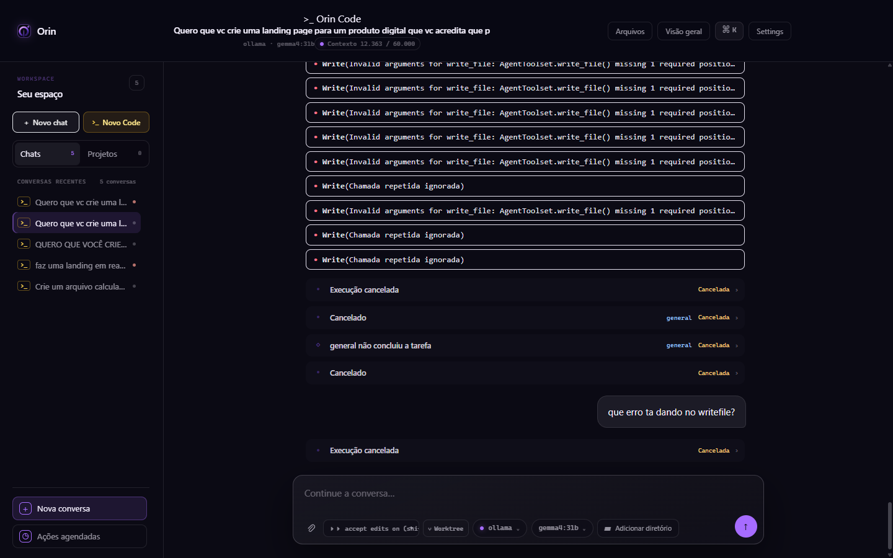 | `1440×900` (`scrollTop=7349`) | Estado inicial ao abrir a conversa (ancorado no fim): repetição de cards `Write(Invalid arguments...)`, 2ª mensagem do usuário, blocos `Execução cancelada` sem explicação, botão Send roxo aceso (`opacity: 1`) mesmo desabilitado. |
| 02 | 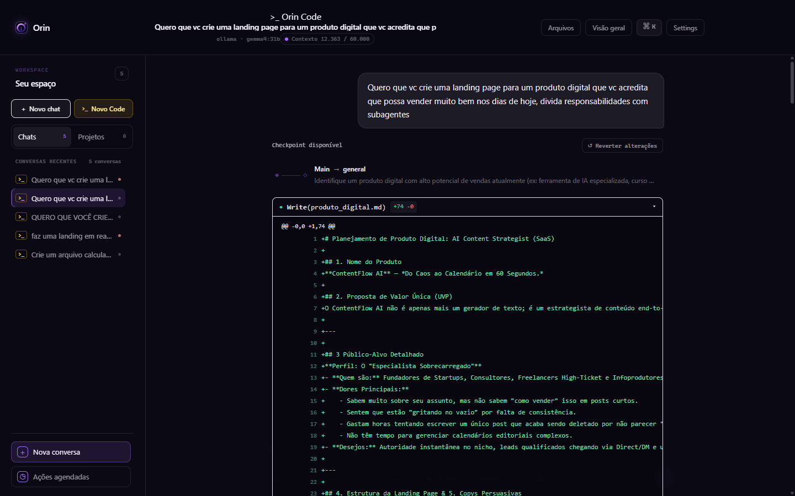 | `1440×900` (`scrollTop=0`) | Topo da conversa: 1ª mensagem do usuário, botão `↺ Reverter alterações`, `Write(produto_digital.md) +74 -0` aberto por padrão ocupando a tela inteira; **composer no rodapé desapareceu** (`opacity: 0; pointer-events: none` por `data-at-bottom="false"`). |
| 03 | 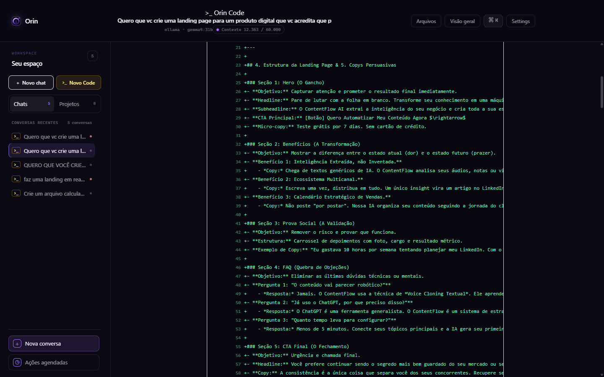 | `1440×900` (`scrollTop=740`) | Continuação do diff de 74 linhas de `produto_digital.md`: linhas longas de Markdown cortadas horizontalmente (`whitespace-pre` + `overflow-x-auto`), obrigando scroll horizontal dentro do card. |
| 04 | 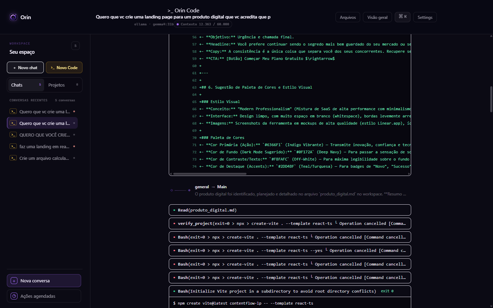 | `1440×900` (`scrollTop=1480`) | Fim do diff de 74 linhas, card `run_subagent(Recebeu a resposta de general)` com nome técnico cru, `Read(produto_digital.md)`, `verify_project(exit=0 > npx > create-vite...)` e 4 blocos `Bash(Initialize Vite...)` com **ponto vermelho de erro mas badge verde `exit 0`** contraditório! |
| 05 | 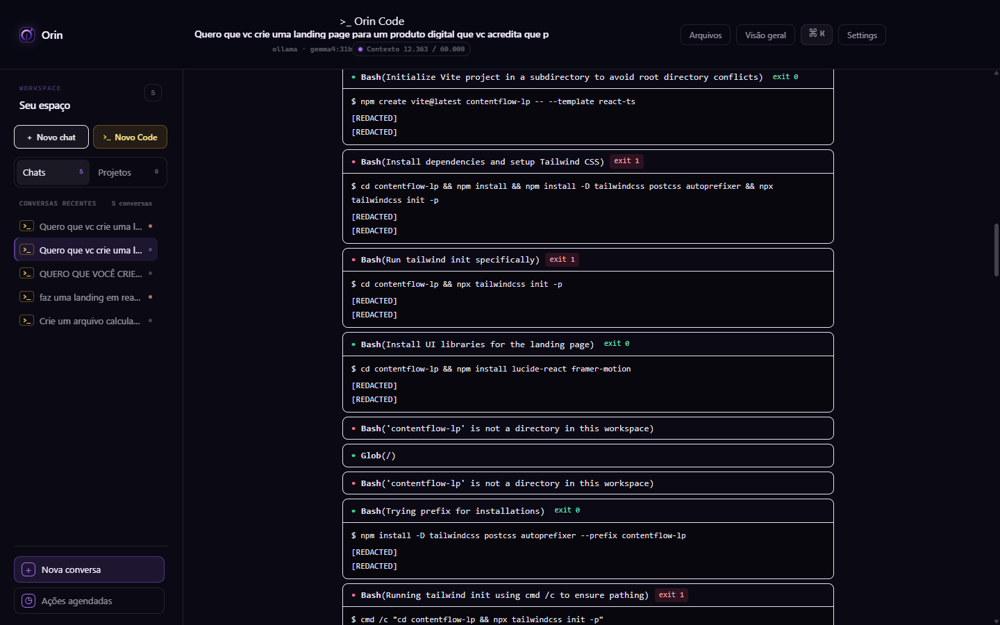 | `1440×900` (`scrollTop=2220`) | 4 blocos `Bash` consecutivos mostrando literalmente **`[REDACTED]` / `[REDACTED]`** no lugar da saída do terminal; abaixo, `Bash('contentflow-lp' is not a directory in this workspace)` usando a mensagem de erro no lugar do comando, e `Glob(/)` com path cru. |
| 06 | 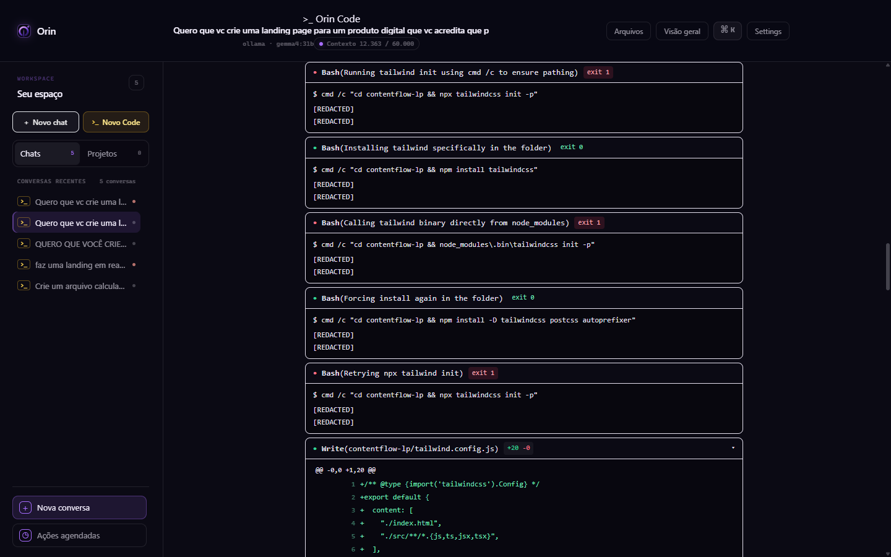 | `1440×900` (`scrollTop=2960`) | Mais 5 blocos `Bash` (`Trying prefix...`, `Running tailwind init...`, `Calling tailwind binary...`, `Forcing install...`) todos exibindo `[REDACTED]` `[REDACTED]`, com bordas brancas acesas. |
| 07 | 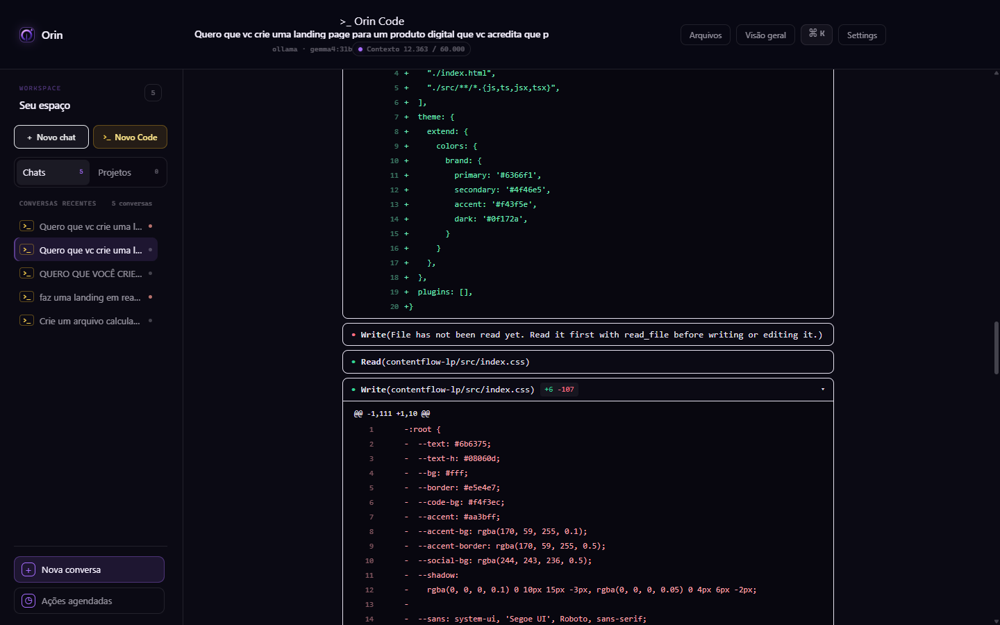 | `1440×900` (`scrollTop=3700`) | Diff aberto de `tailwind.config.js` (`+20 -0`), card `Write(File has not been read yet...)` sem indicar qual arquivo falhou (`index.css`), `Read(contentflow-lp/src/index.css)` e início do diff gigante `+10 -111` aberto por padrão. |
| 08 | 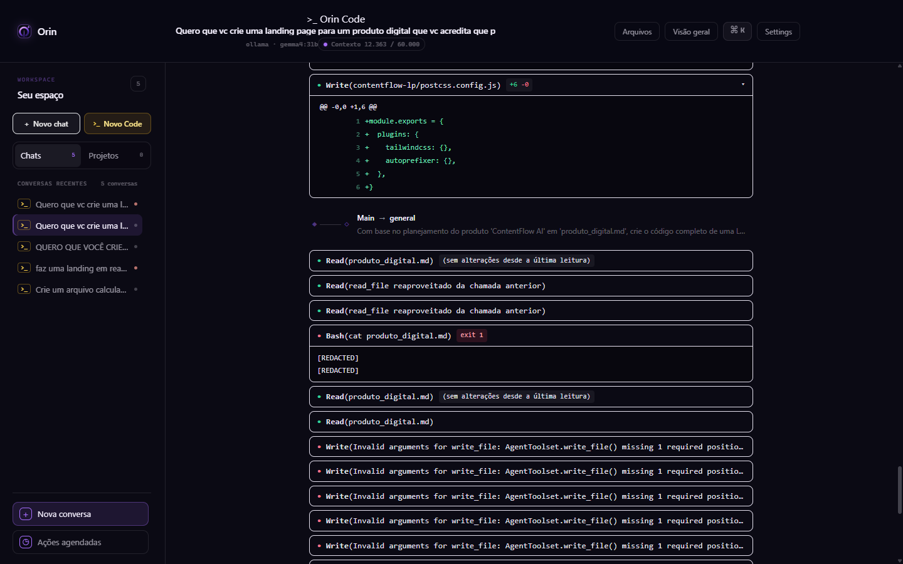 | `1440×900` (`scrollTop=6660`) | Sequência do 2º subagente despejada no nível principal (sem agrupamento sob `Task`): `Read(produto_digital.md)` com badge `(sem alterações desde a última leitura)`, `Read(read_file reaproveitado...)` 2×, `Bash(cat produto_digital.md)` falho (`exit 1` + `[REDACTED]`), seguido de 8 blocos `Write(Invalid arguments for write_file: AgentToolset.write_file() missing 1 required positional)` com a palavra final `'path'` cortada! |
| 09 | 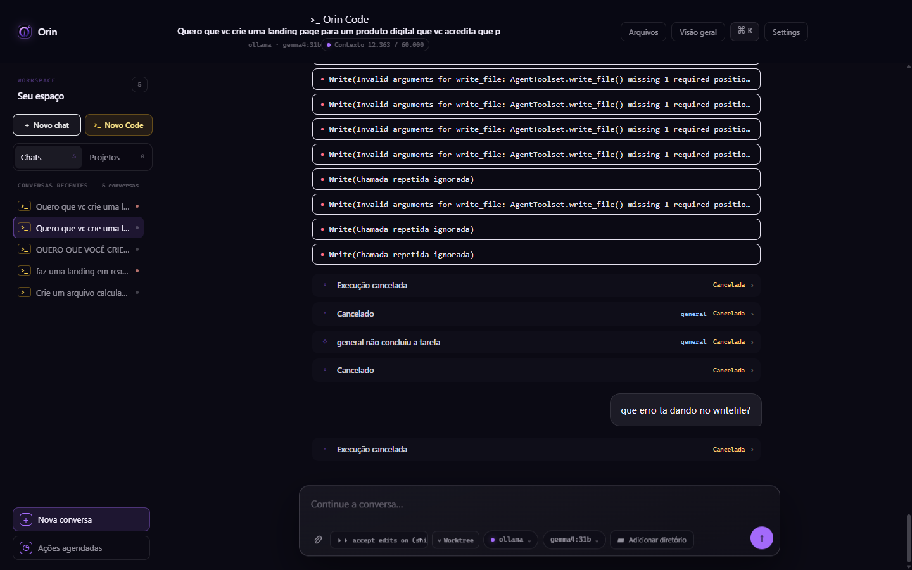 | `1440×900` (`scrollTop=7400`) | Final do loop de `Write` (`Invalid arguments...` e `Chamada repetida ignorada`), banner duplicado `Execução cancelada` + `run_subagent(general não concluiu)` + `Cancelado`. |
| 10 | 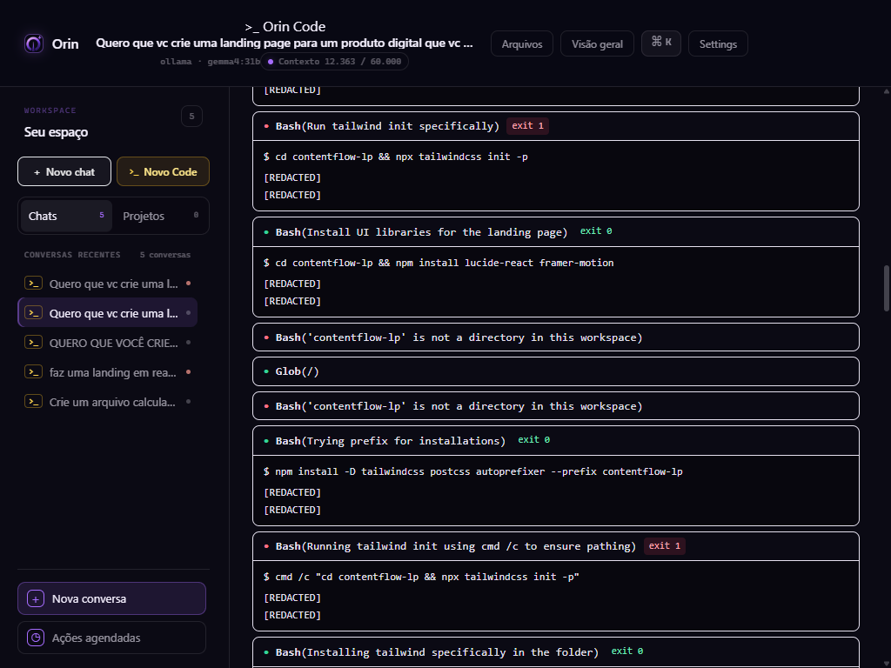 | `1024×768` (`scrollTop=2449`) | Mesma seção de blocos Bash `[REDACTED]` em 1024 px: sidebar fixa de 272 px espreme a área de conversa e o header quebra. |
| 11 | 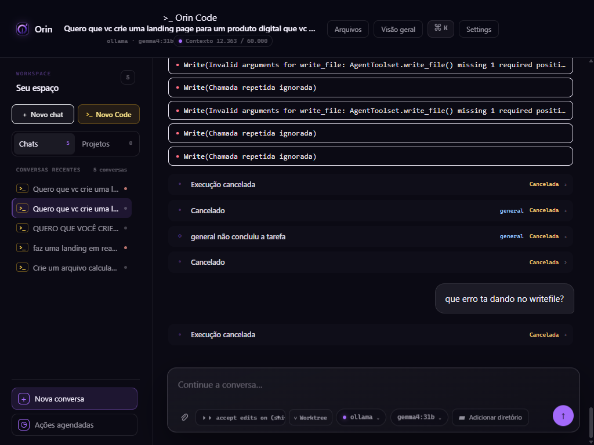 | `1024×768` (`scrollTop=8166`) | Fim da conversa em 1024 px: pílula de permissão truncada no composer, múltiplos status de cancelamento empilhados. |
| 12 |  | Recorte `form.composer` (`1440`) | Detalhe do Composer: pílula `⏵⏵ accept edits on (shift+tab...` cortada (`scrollWidth: 268px` em `clientWidth: 153px`), seletor duplicado de provider/modelo/pasta, e botão `↑` Send com `disabled=true` mas `opacity: 1` (`rgb(166, 108, 255)`). |
| 13 |  | Recorte `.chat__topbar` (`1440`) | Detalhe do Header: título truncado no meio da palavra (`...acredita que p`), chip de modelo `ollama · gemma4:31b` duplicando o rodapé, `Contexto 21%` sem mostrar tokens absolutos exceto no hover. |

---

### 4.2 Medições Objetivas no DOM (Playwright)

| Elemento / Propriedade | Valor medido no DOM (`1440×900`) | Esperado pelo Design System (`DESIGN.md` / `agentos.css`) | Diagnóstico |
|---|---|---|---|
| `.chat__scroll` (`scrollHeight` / `clientHeight`) | **`8.166 px`** / `800 px` (10,2× a altura da viewport) | <= 2–3× a viewport com diffs e leituras colapsados | Diffs de 74 e 121 linhas abertos por padrão + 59 cards individuais sem agrupamento |
| Quantidade de cards/blocos na timeline | **59 blocos** `[data-testid="code-tool-call-block"]` | ~8–12 grupos semânticos (Subagente 1, Scaffolding, Configuração Tailwind, Subagente 2) | Cada tool call (e cada falha repetida) renderiza uma caixa isolada |
| `[data-testid="code-tool-call-block"]` `borderTopColor` | **`rgba(245, 241, 255, 0.93)`** (branco quase puro!) | `var(--line)` = `#f5f1ff1a` (`rgba(245, 241, 255, 0.10)`) | `--border-subtle` não existe → CSS `border-color` cai para `currentColor` (`--text`) |
| `[data-testid="code-tool-call-block"]` `backgroundColor` | **`rgba(0, 0, 0, 0)`** (100% transparente) | `var(--raised)` (`rgba(245, 241, 255, 0.03)`) | `--surface-raised` não existe → `bg-[var(--surface-raised)]/70` é inválido |
| `.composer__action--send` (`disabled`, `opacity`, `bg`) | `disabled: true`, **`opacity: "1"`**, `bg: "rgb(166, 108, 255)"` | `opacity: "0.3"` quando `:disabled` (`agentos.css:538`) | `motion.button` injeta `style="opacity: 1; transform: none;"` inline |
| `[data-testid="code-permission-mode-pill"]` | `scrollWidth: 268 px` dentro de `clientWidth: 153 px` (`overflow: hidden`) | Texto legível sem truncar a dica `(shift+tab to cycle)` | `max-width: 170px` / layout apertado na `.composer__bar` |
| `.chat__foot > *` quando `scrollTop < 7300` (`atBottom=false`) | `opacity: 0`, `pointer-events: none`, `transform: translateY(18px)` | Composer sempre visível e clicável em sessões Code | Regra `.chat__foot > *` (`agentos.css:741-745`) esconde o composer fora do fim da página |

---

### 4.3 Achados Visuais Detalhados (V-01 a V-12)

#### V-01 · P0 · Botão Send desabilitado renderiza 100% opaco e substitui o botão Stop durante a execução
- **Screenshot:** [05-01-fim-conversa-1440.png](images/diagnostico/05-01-fim-conversa-1440.png), [05-12-composer-send-desabilitado-parece-ativo.png](images/diagnostico/05-12-composer-send-desabilitado-parece-ativo.png)
- **Arquivo:Linha:** `frontend/src/features/conversations/Composer.tsx:403-415`, `frontend/src/styles/agentos.css:536-538`.
- **Problema:** Mesmo com o campo de texto vazio (`disabled={true}`), o botão de envio `↑` aparece com fundo roxo vibrante (`rgb(166, 108, 255)`) e `opacity: 1`. Durante a execução (quando `running` ficou em `false` pelo bug `T-01`), o usuário olha para o canto inferior direito, vê um botão de ação aceso e clica nele sem obter resposta.
- **Recomendação:** Animar `opacity: sendDisabled ? 0.3 : 1` no `motion.button` e manter um botão **Stop** dedicado sempre que houver turno ativo (`queued | starting | running | streaming`).

#### V-02 · P0 · Composer desaparece (`opacity: 0; pointer-events: none`) ao rolar a conversa para inspecionar diffs ou erros
- **Screenshot:** [05-02-inicio-write-diff-expandido-1440.png](images/diagnostico/05-02-inicio-write-diff-expandido-1440.png) a [05-08-subagente-write-loop-1440.png](images/diagnostico/05-08-subagente-write-loop-1440.png)
- **Arquivo:Linha:** `frontend/src/styles/agentos.css:741-748`, `frontend/src/features/conversations/ChatPage.tsx:1236`.
- **Problema:** Nas capturas `05-02` a `05-08`, a parte inferior da janela mostra um vazio de ~170 px porque `.chat__foot > *` oculta o Composer sempre que `data-at-bottom="false"`. Em uma sessão de código de 8.166 px de altura, o usuário precisa rolar constantemente para ver diffs e saídas de terminal — e ao fazer isso perde acesso visual ao Composer, ao modo de permissão e ao botão Stop.
- **Recomendação:** Remover a ocultação automática do `.chat__foot > *` (ou desativá-la completamente quando `conversationMode === 'code'` ou `running === true`).

#### V-03 · P0 · Saída de todos os blocos `Bash` exibe literalmente `[REDACTED]`
- **Screenshot:** [05-05-bash-redacted-e-cwd-1440.png](images/diagnostico/05-05-bash-redacted-e-cwd-1440.png), [05-06-bash-redacted-cmd-1440.png](images/diagnostico/05-06-bash-redacted-cmd-1440.png), [05-10-bash-1024.png](images/diagnostico/05-10-bash-1024.png)
- **Arquivo:Linha:** `src/agentos/agentic/models.py:50-51`, `frontend/src/api/conversations.ts:655-660`, `frontend/src/features/conversations/CodeToolCallBlock.tsx:89-97`.
- **Problema:** Todos os 9 comandos `run_command` que finalizaram normalmente mostram:
  ```text
  $ cd contentflow-lp && npm install && npm install -D tailwindcss postcss autoprefixer && npx tailwindcss init -p
  [REDACTED]
  [REDACTED]
  ```
  O usuário fica completamente cego quanto ao motivo de os comandos `npm` / `npx` terem falhado (`exit 1`) ou sucedido (`exit 0`), embora o banco tenha a saída real em `payload.output_tail`.
- **Recomendação:** Ignorar strings `"[REDACTED]"` em `conversations.ts` e `CodeToolCallBlock.tsx`, priorizando `outputTail`, e remover `stdout`/`stderr` da lista `_SENSITIVE_KEY_PARTS` (usando sanitização por regex de segredos reais).

#### V-04 · P1 · 59 blocos `CodeToolCallBlock` com borda branca acesa (`rgba(245, 241, 255, 0.93)`) por variáveis CSS inexistentes
- **Screenshot:** Todas as capturas ([05-01](images/diagnostico/05-01-fim-conversa-1440.png) a [05-11](images/diagnostico/05-11-fim-conversa-1024.png))
- **Arquivo:Linha:** `frontend/src/features/conversations/CodeToolCallBlock.tsx:113, 217, 266`.
- **Problema:** A classe `border border-[var(--border-subtle)]` usa um token que não existe em `agentos.css`. No CSS, `border-color: var(--inexistente)` resolve para `initial` = `currentColor`, que herda `--text` (`#f5f1ff`, branco-lavanda 93%). Isso cria 59 retângulos de alto contraste que dominam a hierarquia visual e destroem a estética *Atmospheric Minimalism & High-Craft Dark UI* definida no `DESIGN.md`.
- **Recomendação:** Substituir `var(--border-subtle)` por `var(--line)` (`rgba(245, 241, 255, 0.10)`) e `var(--surface-raised)` por `var(--raised)`.

#### V-05 · P1 · Diffs de 74 linhas (`produto_digital.md`) e 121 linhas (`index.css`) abertos por padrão e com overflow horizontal
- **Screenshot:** [05-02-inicio-write-diff-expandido-1440.png](images/diagnostico/05-02-inicio-write-diff-expandido-1440.png), [05-03-diff-74-linhas-overflow-1440.png](images/diagnostico/05-03-diff-74-linhas-overflow-1440.png), [05-07-file-not-read-e-diff-111-1440.png](images/diagnostico/05-07-file-not-read-e-diff-111-1440.png)
- **Arquivo:Linha:** `frontend/src/features/conversations/CodeToolCallBlock.tsx:54, 215-262`.
- **Problema:** `const [diffOpen, setDiffOpen] = useState(true)` abre todos os diffs sem limite de linhas (enquanto o terminal tem `TERMINAL_PREVIEW_LINE_LIMIT = 6` na linha 40!). Só os 2 diffs grandes ocupam mais de 4.200 px verticais (> 5 telas), e as linhas de prosa Markdown em `produto_digital.md` usam `whitespace-pre` sem quebra, cortando o texto na direita.
- **Recomendação:** Limitar a prévia aberta de diffs a `DIFF_PREVIEW_LINE_LIMIT = 10` linhas (com botão `"Mostrar todas as 74 linhas"`), ou iniciar diffs > 20 linhas recolhidos (`useState(totalLines <= 20)`), e habilitar `whitespace-pre-wrap break-words` para arquivos `.md`.

#### V-06 · P1 · Contradição visual nos cards de comando cancelado/recusado: Ponto Vermelho de falha + Badge Verde `exit 0` + comando engolido pelo título
- **Screenshot:** [05-04-subagente-e-bash-exit0-falho-1440.png](images/diagnostico/05-04-subagente-e-bash-exit0-falho-1440.png), [05-05-bash-redacted-e-cwd-1440.png](images/diagnostico/05-05-bash-redacted-e-cwd-1440.png)
- **Arquivo:Linha:** `frontend/src/features/conversations/CodeToolCallBlock.tsx:195-205, 314-318`, `frontend/src/api/conversations.ts:625-645`.
- **Problema:**
  1. Nos 4 blocos `Bash(Initialize Vite project...)` (`05-04`), o card mostra um **ponto vermelho (`text-rose-400`)** indicando falha, mas ao lado exibe um **badge verde `exit 0` (`bg-emerald-500/12 text-emerald-300`)** porque `conversations.ts` extraiu `exit=0` do texto do erro `COMMAND_CANCELLED_INTERACTIVE`, e `CodeToolCallBlock.tsx:198` pinta qualquer `exitCode === 0` de verde independentemente de `visualStatus === 'failed'`!
  2. Quando `run_command` falha no precheck de diretório (`TOOL_REFUSED`, `05-05`), o backend não envia `command` no payload de erro; o card renderiza `Bash('contentflow-lp' is not a directory in this workspace)`, escondendo qual comando foi tentado!
- **Recomendação:** Se `visualStatus === 'failed'`, nunca pintar o badge de exit code de verde (exibir badge vermelho `cancelado` / `recusado`), e incluir sempre `command` e `target_path` nos payloads de erro de `tool.finished` no backend (`session.py` / `runtime.py`).

#### V-07 · P1 · Títulos de `Write` falhos truncam exatamente a causa do erro e omiten o nome do arquivo
- **Screenshot:** [05-07-file-not-read-e-diff-111-1440.png](images/diagnostico/05-07-file-not-read-e-diff-111-1440.png), [05-08-subagente-write-loop-1440.png](images/diagnostico/05-08-subagente-write-loop-1440.png), [05-09-write-loop-cancelamentos-1440.png](images/diagnostico/05-09-write-loop-cancelamentos-1440.png)
- **Arquivo:Linha:** `frontend/src/features/conversations/CodeToolCallBlock.tsx:141, 310-311`, `src/agentos/agentic/models.py:95-120`.
- **Problema:**
  1. Na captura `05-07`, o erro `FILE_NOT_READ` aparece como `● Write(File has not been read yet. Read it first with read_file before writing or editing it.)` — sem mostrar que o arquivo era `contentflow-lp/src/index.css` (que estava no evento `tool.started`, mas não foi copiado no merge ou no `tool.finished`).
  2. Na captura `05-08`, os 8 erros de `write_file` do subagente aparecem como `● Write(Invalid arguments for write_file: AgentToolset.write_file() missing 1 required positional)` — o truncamento em 90 caracteres corta justamente `argument: 'path'`! E como o card não tem corpo expansível para erros sem diff, o usuário não consegue ler o resto da mensagem (foi exatamente por isso que o usuário precisou perguntar no chat: *"que erro ta dando no writefile?"*!).
- **Recomendação:** Exibir no cabeçalho apenas `Write( filePath || 'argumentos inválidos' )` e renderizar a mensagem de erro completa em um bloco de detalhe abaixo do cabeçalho quando `visualStatus === 'failed'`.

#### V-08 · P1 · Atividade do subagente despejada no nível principal sem agrupamento hierárquico (`Task`) e sem recolhimento de loops
- **Screenshot:** [05-04-subagente-e-bash-exit0-falho-1440.png](images/diagnostico/05-04-subagente-e-bash-exit0-falho-1440.png), [05-08-subagente-write-loop-1440.png](images/diagnostico/05-08-subagente-write-loop-1440.png), [05-09-write-loop-cancelamentos-1440.png](images/diagnostico/05-09-write-loop-cancelamentos-1440.png)
- **Arquivo:Linha:** `frontend/src/features/conversations/TurnTimeline.tsx:160-245`, `frontend/src/features/conversations/turnTimelineFold.ts`, `frontend/src/features/conversations/CodeToolCallBlock.tsx:345-350`.
- **Problema:**
  - Todas as 18 chamadas internas do subagente `general` aparecem soltas na mesma coluna das ferramentas do agente principal, sem indentação, sem badge `@general` e sem ficarem aninhadas dentro de um bloco `Task(general: Criar Landing Page)` colapsável.
  - Quando a delegação termina, aparece um card avulso `● run_subagent(Recebeu a resposta de general)` (`05-04`) ou `● run_subagent(general não concluiu)` (`05-09`) com o nome interno da função Python (`run_subagent`) porque `formatToolSignature` (`CodeToolCallBlock.tsx:305-350`) não tem `case 'run_subagent':`!
  - As 11 falhas seguidas de `Write` do subagente renderizam 11 caixas idênticas empilhadas (`05-08` e `05-09`) em vez de agrupar tentativas repetidas (`Write ×11 falhou`).
- **Recomendação:** Adicionar `case 'run_subagent': return { verb: 'Task', arg: event.agentName || event.label || 'subagent' }` em `CodeToolCallBlock.tsx` e agrupar em `turnTimelineFold.ts` todos os eventos com `parentAgentId` (ou `agentId !== main`) dentro de um container expansível do `Task` correspondente.

#### V-09 · P2 · Nomes de ferramentas e paths crus expostos (`verify_project(...)`, `Glob(/)`, `Read(read_file reaproveitado da chamada anterior)`)
- **Screenshot:** [05-04-subagente-e-bash-exit0-falho-1440.png](images/diagnostico/05-04-subagente-e-bash-exit0-falho-1440.png), [05-05-bash-redacted-e-cwd-1440.png](images/diagnostico/05-05-bash-redacted-e-cwd-1440.png), [05-08-subagente-write-loop-1440.png](images/diagnostico/05-08-subagente-write-loop-1440.png)
- **Arquivo:Linha:** `frontend/src/features/conversations/CodeToolCallBlock.tsx:305-350`.
- **Problema:**
  - `verify_project` cai no `default:` de `formatToolSignature`, exibindo `verify_project(exit=0 > npx > create-vite . --template react-ts └ Operation cancelled [Command cancell)` tudo espremido em uma linha no cabeçalho (`05-04`).
  - `list_files` na raiz renderiza `Glob(/)` (`05-05`), sugerindo ao usuário a raiz do sistema operacional Unix `/` em vez da raiz do workspace (`.`).
  - As leituras deduplicadas renderizam `Read(read_file reaproveitado da chamada anterior)` (`05-08`), perdendo o nome do arquivo (`produto_digital.md`).

#### V-10 · P2 · Tripla mensagem de cancelamento redundante e Turno 2 sem explicação
- **Screenshot:** [05-01-fim-conversa-1440.png](images/diagnostico/05-01-fim-conversa-1440.png), [05-09-write-loop-cancelamentos-1440.png](images/diagnostico/05-09-write-loop-cancelamentos-1440.png), [05-11-fim-conversa-1024.png](images/diagnostico/05-11-fim-conversa-1024.png)
- **Arquivo:Linha:** `frontend/src/features/conversations/TurnTimeline.tsx`, `frontend/src/features/conversations/ChatPage.tsx:1308-1317`.
- **Problema:** No fim do Turno 1 (`05-09`), o usuário vê **3 indicadores de cancelamento seguidos**:
  1. Banner âmbar `Execução cancelada` (`seq 275`)
  2. Card `● run_subagent(general não concluiu)` (`seq 278`)
  3. Texto `Execução cancelada por você.` (`placeholderFor(message)` na linha 1314)
  E logo abaixo, após a bolha `"que erro ta dando no writefile?"` (`05-01`), aparece novamente `Execução cancelada` + `Execução cancelada por você.`, sem explicar que aquela pergunta estava na fila e foi descartada junto com o cancelamento do Turno 1.

#### V-11 · P2 · Pílula de modo de permissão truncada e controles duplicados no Composer
- **Screenshot:** [05-12-composer-send-desabilitado-parece-ativo.png](images/diagnostico/05-12-composer-send-desabilitado-parece-ativo.png), [05-11-fim-conversa-1024.png](images/diagnostico/05-11-fim-conversa-1024.png)
- **Arquivo:Linha:** `frontend/src/features/conversations/Composer.tsx:335-384`, `frontend/src/styles/agentos.css:433-446`.
- **Problema:** A pílula `⏵⏵ accept edits on (shift+tab to cycle)` tem `scrollWidth = 268 px` espremida em `clientWidth = 153 px`, cortando o texto em `⏵⏵ accept edits on (shift+t...`. Ao lado dela, o rodapé do composer repete `Ollama`, `gemma4:31b` e `Pasta gerenciada pelo Orin`, que já estão no Header da página (`05-13`).

#### V-12 · P2 · Header com título truncado sem `title` tooltip e conversas duplicadas indistinguíveis na Sidebar
- **Screenshot:** [05-01-fim-conversa-1440.png](images/diagnostico/05-01-fim-conversa-1440.png), [05-13-header.png](images/diagnostico/05-13-header.png)
- **Arquivo:Linha:** `frontend/src/features/conversations/ChatPage.tsx:1080-1155`, `frontend/src/features/projects/WorkspaceNavigation.tsx`, `src/agentos/conversations/chat.py`.
- **Problema:**
  - O backend truncou o `title` da conversa em 80 caracteres no banco (`"Quero que vc crie uma landing page para um produto digital que vc acredita que p"`), cortando a palavra `"possa"` ao meio (`"que p"`).
  - Na sidebar esquerda (`05-01`), existem duas conversas seguidas com o mesmo título truncado `>_ Quero que vc crie uma...` sem horário relativo nem diferenciação.

---

## 5. Análise de Gap Completa: Orin Code Harness × Claude Code

Esta seção compara a arquitetura real do harness do **Orin Code** (`src/agentos/agentic/*`, `src/agentos/code_mode/*`, `frontend/src/features/conversations/*`) com o harness de referência do **Claude Code** (CLI / Desktop / IDE integrations).

### 5.1 Matriz Comparativa Completa (15 Dimensões do Harness)

| Dimensão | Claude Code (Referência) | Orin Code Harness (Estado Atual) | Gap Técnico & de UX | Prioridade |
|---|---|---|---|---|
| **1. Loop Agentic & Narração** | Loop single-thread com streaming de pensamento/texto intercalado às chamadas de ferramenta; o modelo narra brevemente o que vai fazer antes de bater em ferramentas pesadas; contadores em tempo real de tempo decorrido (`12s`) e tokens (`↓ 4.2k tokens`). | `AgenticTurnRuntime` (`runtime.py`) suporta deltas de texto + tool calls, mas o modelo rodou 27 iterações em 5min20s com `text=""` em 100% dos passos; UI não mostra cronômetro nem contador de tokens ao vivo durante o turno. | Falta telemetria viva no `AgentPulse` (tempo decorrido, tokens consumidos, iteração atual, tail de streaming) e instrução de narração concisa entre fases. | **P0** |
| **2. Interrupção (`Esc`) & Fila de Mensagens (Steering)** | `Esc` interrompe instantaneamente (aborta HTTP stream e mata subprocesso atual), preservando o contexto. Digitar e enviar durante a execução **enfileira a mensagem intra-turno** e a injeta na próxima fronteira de tool result para redirecionar o agente sem perder o turno. | Sem atalho `Esc`. Bug `T-01` esconde o botão Stop quando `turn.state === "starting"`. Enviar mensagem durante a execução cria um **Turno 2 separado** no banco; clicar em Stop cancela o Turno 1 e destrói o Turno 2 enfileirado; stream HTTP do provider não é abortado no cancelamento (+6,7s). | Implementar `Esc` global para interromper, abortar `httpx` stream no cancelamento, e transformar mensagens enviadas durante execução em fila de *steering* injetada no turno ativo. | **P0** |
| **3. Modos de Permissão (`Shift+Tab`)** | Ciclo seguro por sessão: `Normal (Ask)` → `Accept Edits (⏵⏵)` → `Plan Mode (⏸)`. O modo `Bypass Permissions` (`--dangerously-skip-permissions`) **nunca** entra no ciclo normal de `Shift+Tab`. Prompts de permissão aparecem no lugar do composer com atalhos `1` (Sim), `2` (Sim, lembrar regra para `npm run *`), `3` / `Esc` (Não + instrução). | `Shift+Tab` global (`ChatPage.tsx:320-340`) captura o foco reverso da página, cicla `accept_edits → plan_mode → ask_permissions → full_autonomy` (incluindo **bypass**!) e chama `setCodeModeSettings`, sobrescrevendo a preferência **global** do usuário. Card de aprovação fica solto no histórico (coberto pela `TodoBar`) e sem opção "Permitir sempre para este padrão". | Remover `full_autonomy` do ciclo `Shift+Tab`, não gravar preferência global ao trocar modo da sessão, ancorar prompt de aprovação no composer com teclas `1/2/3/Esc` e regras por prefixo de comando. | **P0** |
| **4. `TodoWrite` & Progresso de Tarefas** | Ferramenta `TodoWrite` atualiza checklist estruturado (`pending`, `in_progress`, `completed`). Apenas 1 item fica `in_progress` por vez; se o turno for interrompido ou falhar, os itens não concluídos permanecem `in_progress`/`pending`. | Tem `todo_write`, `task_create`, `task_update`, `task_list` (`agent_tools.py:4526-4789`) e componente `TodoBar.tsx`. Porém: (1) o agente não usou `todo_write` em uma tarefa de 27 passos; (2) ao finalizar o turno, `complete_remaining_todos` (`agent_tools.py:4589`) marca automaticamente tarefas pendentes como concluídas; (3) `TodoBar` tem fundo transparente e cobre a thread. | Não autocompletar tarefas não feitas ao encerrar turno; corrigir CSS/layout da `TodoBar`; incentivar `todo_write` em tarefas multi-etapa no prompt do modo Code. | **P1** |
| **5. Ferramentas de Arquivo (`Read`, `Edit`, `Write`, `NotebookEdit`)** | `Read` (com `offset`/`limit`), `Edit` (`old_string`/`new_string` + `replace_all`), `Write` (sobrescrita completa). Exige leitura prévia apenas para arquivos existentes antes da primeira edição; se o próprio turno criou o arquivo, permite editar/sobrescrever. Argumento `file_path` vem primeiro no schema. | Tem `read_file`, `edit_file`, `write_file`, `notebook_edit` (`agent_tools.py:2162-2725`). Problemas reais observados: (1) `FILE_NOT_READ` bloqueou `write_file` em arquivo criado pelo `create-vite` no mesmo turno; (2) deduplicação de `read_file` bloqueou o subagente de ler `produto_digital.md`; (3) truncamento de `write_file` aos 4.096 tokens omitiu `path`. | Isolar cache de leitura por subagente, liberar `write_file` para artefatos criados no próprio turno, e detectar truncamento de tool call (`done_reason="length"`). | **P0** |
| **6. Ferramentas de Busca (`Glob`, `Grep`)** | `Glob` (padrões rápidos ordenados por mtime) e `Grep` (ripgrep com regex, `glob`, `type`, modos `content`/`files_with_matches`/`count`, contexto `-A/-B/-C`). | Tem `glob_files`, `list_files`, `search_files`, `search_code`, `project_map` (`agent_tools.py:2726-3119`). Porém `list_files`/`glob_files` usam sempre `self.workspace.root` enquanto `run_command` muda `self._current_cwd`, confundindo o modelo sobre a estrutura de pastas. | Alinhar resolução de diretório ou explicitar sempre caminhos relativos à raiz do workspace em ambas as ferramentas. | **P1** |
| **7. Execução `Bash` (`run_command`), `cwd` e Plataforma** | Sessão bash persistente onde o ambiente é mantido, mas o harness informa ao modelo quando o `cwd` muda (ou reseta `cwd` com aviso explícito). Prompt de sistema injeta claramente OS, shell (`bash`/`zsh`/`powershell`/`cmd`) e ferramentas disponíveis. Saída nunca é marcada como `[REDACTED]` sem motivo. | `run_command` usa `subprocess.Popen(..., shell=True)` (`cmd.exe` no Windows), rastreia `cd` via regex (`_resolve_cwd_after_command`) e persiste `self._current_cwd` silenciosamente sem informar o modelo. Subagente não recebe `environment_facts` completos e tentou `cat` no `cmd.exe`. `stdout`/`stderr` são substituídos por `[REDACTED]` em `models.py:50-51`. | Informar `cwd` atual no retorno de `run_command`, injetar `environment_facts` (OS + shell) no prompt de todos os subagentes, e corrigir a redaction de `stdout`/`stderr`. | **P0** |
| **8. Subagentes (`Task` / `run_subagent`)** | Ferramenta `Task` lança subagentes especializados (`general-purpose`, `Explore`, `Plan`, ou customizados em `.claude/agents/*.md`) com janela de contexto isolada, limite de saída adequado ao modelo (8k–32k tokens), passos persistidos para auditoria e UI aninhada sob o card `Task(...)` com resumo de ferramentas usadas. | `run_subagent` (`session.py:1020-1160`) tem tipos `general`, `explore`, `plan`, `verifier`, mas: (1) trava `SUBAGENT_MAX_OUTPUT_TOKENS = 4096` (causando o loop fatal de `write_file`); (2) compartilha `agent_id` e cache de leitura entre delegações; (3) não persiste passos em `conversation_turn_steps`; (4) despeja os eventos do subagente soltos na timeline principal. | Elevar `SUBAGENT_MAX_OUTPUT_TOKENS` (>= 16.384), isolar estado por invocação de `Task`, persistir steps do subagente no DB e aninhar seus eventos dentro de um card `Task` colapsável na UI. | **P0** |
| **9. Visualização de Diffs & Revisão** | No CLI/IDE: mostra resumo compacto (`Wrote 74 lines to produto_digital.md` ou diff curto de ~10 linhas com opção `Ctrl+O` para expandir) e painel consolidado de alterações da sessão. | `CodeToolCallBlock.tsx:54` abre **todos** os diffs com `useState(true)` sem limite de linhas (74 e 121 linhas inteiras na thread), sem wrap em Markdown e sem painel consolidado de arquivos alterados no turno/conversa. | Colapsar ou truncar diffs > 12 linhas por padrão na timeline e oferecer aba/gaveta consolidada "Alterações do turno (N arquivos)". | **P1** |
| **10. Processos em Background (`Ctrl+B` / `BashOutput` / `KillShell`)** | Comandos longos podem ser enviados para background com `run_in_background=true` ou pelo usuário em tempo real com `Ctrl+B`; monitorados via `BashOutput` e encerrados via `KillShell`. | Possui `run_command(background=True)`, auto-backgrounding para dev servers, detecção de URL (`detectedUrl`), `read_process_output` e `stop_process` (`agent_tools.py:3649-3815`). Falta apenas o botão/atalho na UI (`Ctrl+B`) para o usuário enviar um comando em andamento para background. | Expor ação "Enviar para background" na UI enquanto um `run_command` está em `tool.progressed`. | **P2** |
| **11. Compactação de Contexto (`/compact` & Auto-Compact)** | Auto-compacta aos ~92–95% da janela de contexto preservando resumo estruturado + arquivos recém-lidos; comando `/compact [instrução]` manual; `/context` detalha uso por categoria. | Possui compactação reativa e proativa (`runtime.py:375, 444`, `post_compact_enrichment` em `agent_tools.py:4790`) e telemetria rica em `context.updated` (`system_prompt_tokens`, `history_tokens`, `tools_tokens`, `skills_tokens`, `mcps_tokens`). Porém o `limit_tokens` para `gemma4:31b` veio fixo em `60.000` e não há comando `/compact` nem `/context` na UI. | Expor `/compact` e `/context` no picker de slash commands e abrir popover clicável no indicador `Contexto XX%` do header. | **P2** |
| **12. Checkpoints & Rewind (`Esc Esc` / `/rewind`)** | Cria checkpoint antes de cada prompt do usuário; `Esc Esc` ou `/rewind` abre seletor de ponto no tempo perguntando se deseja restaurar: (1) código e conversa, (2) apenas conversa, ou (3) apenas código. | Possui snapshots e endpoint `rewindTurn` (`src/agentos/code_mode/checkpoints.py`, `ChatPage.tsx:872`), mas o botão `↺ Reverter alterações` dispara imediatamente **sem diálogo de confirmação**, sem escolha entre código/conversa e sem recarregar o snapshot da conversa após o rewind! | Adicionar modal de confirmação com opções (Restaurar código + conversa / Apenas código) e chamar `loadSnapshot(true)` após `rewindTurn`. | **P1** |
| **13. Hooks de Ciclo de Vida** | Hooks configuráveis em `settings.json` para `PreToolUse` (pode bloquear/modificar input com exit code 2), `PostToolUse` (ex.: rodar `prettier`/linter após `Edit`/`Write`), `UserPromptSubmit`, `Notification`, `Stop`, `SubagentStop`, `PreCompact`, `SessionStart`. | Possui apenas hooks de plugins no início da sessão (`conversation_hook_context` / `SessionStart`), sem hooks `PreToolUse`, `PostToolUse` ou `Stop` configuráveis por projeto. | Implementar hooks leves `PreToolUse` / `PostToolUse` / `Stop` por workspace (ou integrados ao pipeline `verify_project`). | **P2** |
| **14. Slash Commands Built-in** | Comandos nativos: `/clear`, `/compact`, `/config`, `/context`, `/cost`, `/doctor`, `/help`, `/init`, `/mcp`, `/memory`, `/model`, `/permissions`, `/plan`, `/resume`, `/rewind`, `/review`, `/status`, `/todos`, `/vim` + comandos customizados em `.claude/commands/*.md`. | O picker `/` (`Composer.tsx:180-225`) lista apenas comandos de **plugins instalados e skills** (`/v1/plugins/commands` e `/v1/skills`). Se o usuário digitar `/clear`, `/compact`, `/plan`, `/rewind` ou `/init`, nada aparece. | Registrar comandos built-in nativos do Orin Code no `Composer` (`/plan`, `/rewind`, `/compact`, `/clear`, `/init`, `/verify`, `/worktree`, `/model`). | **P1** |
| **15. Memória (`CLAUDE.md` / `AGENTS.md`)** | Carrega hierarquicamente `CLAUDE.md` (global `~/.claude/CLAUDE.md`, raiz do repo, subpastas e `CLAUDE.local.md`), suporta `@path/to/import` e atalho `#` para adicionar memória rapidamente, além do comando `/init` para gerar o arquivo. | Carrega automaticamente `AGENTS.md`, `CLAUDE.md` e `CONVENTIONS.md` (`session.py:58`: `WORKSPACE_INSTRUCTION_FILES`) e possui ferramentas explícitas `remember` e `recall` (`agent_tools.py:4258-4295`) com banco SQLite (`agent_memories`). Falta o comando `/init` e o atalho `#`. | Adicionar comando `/init` para gerar `AGENTS.md`/`CLAUDE.md` no workspace e suportar escopo de projeto na `MemoryPage.tsx` (hoje o botão `Project` está `disabled` na linha 15!). | **P2** |

---

### 5.2 O Que o Orin Tem **A Mais** que o Claude Code CLI e Deve Ser Preservado

Ao corrigir os gaps acima para atingir paridade de controle e confiabilidade com o Claude Code, a arquitetura do Orin possui diferenciais próprios valiosos que **não devem ser removidos**:

| Capacidade Exclusiva do Orin | Onde vive no código | Por que preservar e como valorizar no redesign |
|---|---|---|
| **1. Suporte Multi-Provider & Modelos Locais/Cloud unificados** (`OpenAI`, `Anthropic`, `OpenRouter`, `OmniRoute`, `Ollama`) | `src/agentos/providers/*`, `src/agentos/agentic/provider_stream.py`, `ModelPicker` | Permite rodar tanto modelos proprietários de ponta quanto modelos abertos (`gemma4:31b`, `qwen`, `deepseek`) localmente ou em nuvem, trocando de provider/modelo dentro da mesma interface. |
| **2. Receitas de Verificação Automatizada & Gate de Conclusão (`verify_project`, `verify_frontend`, `code_completion_gate`)** | `src/agentos/agentic/agent_tools.py:1753, 3818, 4176`, `src/agentos/code_mode/*` | Enquanto o Claude Code depende de o modelo lembrar de rodar testes ou de hooks externos, o Orin tem detecção nativa de receitas (`pytest`, `npm test/build/lint`, `cargo`, `go`) e verificação visual de frontend via Playwright (`verify_frontend`). Basta corrigir o gatilho em subpastas (`T-08`) e os eventos de estágio (`T-12`). |
| **3. Automação de Browser Integrada & Preview Server Gerenciado** (`browse_page`, `browser_click/fill/screenshot`, `preview_start/stop/logs`) | `src/agentos/agentic/browser_tools.py`, `agent_tools.py:4003-4248, 4961-5015` | O agente pode subir o servidor de desenvolvimento (`preview_start`), abrir o navegador headless, inspecionar console/DOM, tirar screenshot e validar a UI renderizada sem precisar configurar MCP externo. |
| **4. Visualização Orbital Multi-Agente ("Visão Geral" / `OverviewPanel`)** | `frontend/src/features/overview/OverviewPanel.tsx`, `components/three/useCanvasScene.ts` | Oferece uma visão espacial em tempo real da topologia de agentes (`Main` ↔ subagentes), uso de tokens por agente e estado de delegação. (Deve ser mantida como aba/drawer sem destruir o Composer/Stop, conforme `OC-14`). |
| **5. Telemetria Granular da Janela de Contexto (`context.updated`)** | `src/agentos/agentic/models.py:58-71`, `session.py` | Emite a cada iteração a quebra exata de `system_prompt_tokens`, `history_tokens`, `input_tokens`, `tools_tokens`, `skills_tokens`, `mcps_tokens`, `omitted_messages` e `compaction_count` — base pronta para um inspetor visual de contexto superior ao `/context` em texto. |
| **6. Isolamento em Git Worktree com 1 Clique na UI** | `src/agentos/code_mode/worktree.py`, `agent_tools.py:4878-4955`, `Composer.tsx` | Permite alternar isolamento em worktree git tanto por ferramenta (`enter_worktree`/`exit_worktree`) quanto por botão direto no Composer. |
| **7. Agentes Nomeados Persistentes (`create_agent`, `ask_agent`, `ask_agents`) e Memória Estruturada (`remember`/`recall`)** | `src/agentos/agentic/agent_tools.py:4258-4295, 4838-4852`, `frontend/src/features/memory/MemoryPage.tsx` | Além de subagentes efêmeros (`run_subagent`), suporta criação de especialistas persistentes na conversa e banco de memórias pesquisável por tags na interface web/desktop. |
| **8. Catálogo Integrado de Skills, Plugins, MCP OAuth e Agendamentos (`Schedules`)** | `frontend/src/features/skills/*`, `mcp/*`, `schedules/*`, `agent_tools.py:4296-4525` | Permite ao próprio agente buscar, inspecionar e instalar skills/plugins/MCPs (com fluxo OAuth nativo em card) e agendar execuções recorrentes. |
| **9. Leitura Multimodal Nativa & Transcrição de PDF (`view_file`, `transcribe_pdf`)** | `src/agentos/reading/vision.py`, `agent_tools.py:2268-2395` | Roteia automaticamente imagens e PDFs para o modelo de visão configurado mesmo quando o modelo principal da conversa é somente texto. |
| **10. Guardas de Eficiência de Contexto (Deduplicação de `read_file` por SHA-256 e Guarda de Tool Call Duplicada)** | `src/agentos/agentic/agent_tools.py:2190-2235`, `runtime.py:1345-1360` | Economiza milhares de tokens evitando reenviar arquivos inalterados na mesma janela de contexto (desde que o cache seja isolado por agente/subagente, corrigindo `T-07`). |

---

## 6. Plano de Ação Recomendado (Ordem de Execução)

1. **Hotfix Imediato de Controle de Execução (`T-01`, `V-01`, `V-02`, `T-06`):**
   - Aplicar o diff da Seção 2.2 em `ChatPage.tsx`, `Composer.tsx` e `chat.py` para que `starting`/`streaming` ativem `running = true`, o botão Stop fique sempre visível e clicável, `Esc` interrompa o turno e o botão Send desabilitado tenha `opacity: 0.3`.
   - Abortar o stream HTTP do provider imediatamente em `request_cancel` e liquidar `code_mode_runs` e `conversation_agents` como `cancelled`.
2. **Hotfix de Visibilidade de Erros e Terminal (`T-03`, `V-03`, `V-04`, `V-06`, `V-07`):**
   - Remover `stdout`/`stderr` de `_SENSITIVE_KEY_PARTS` (e fazer fallback para `output_tail` quando `stdout === "[REDACTED]"`).
   - Substituir os 7 tokens CSS indefinidos em `CodeToolCallBlock.tsx` e `TodoBar.tsx` pelos tokens reais de `agentos.css` (`--line`, `--raised`, `--text`, `--muted`, `--faint`, `--signal`).
   - Exibir o erro completo no corpo do `CodeToolCallBlock` quando `visualStatus === 'failed'` e corrigir o badge verde `exit 0` em comandos cancelados.
3. **Hotfix de Confiabilidade do Harness e Subagentes (`T-02`, `T-04`, `T-05`, `T-07`, `T-08`):**
   - Aumentar `SUBAGENT_MAX_OUTPUT_TOKENS` de `4096` para `16384`, detectar `done_reason == "length"` em tool calls e ordenar `path` antes de `content` nos schemas de `write_file`/`edit_file`.
   - Isolar o cache `_read_file_state` por subagente e contabilizar falhas no limite `SUBAGENT_MAX_ACTIONS` com disjuntor de 3 falhas consecutivas.
   - Retornar `[cwd: ...]` explícito em `run_command` e injetar `environment_facts` (Windows / `cmd.exe`) no prompt dos subagentes.
